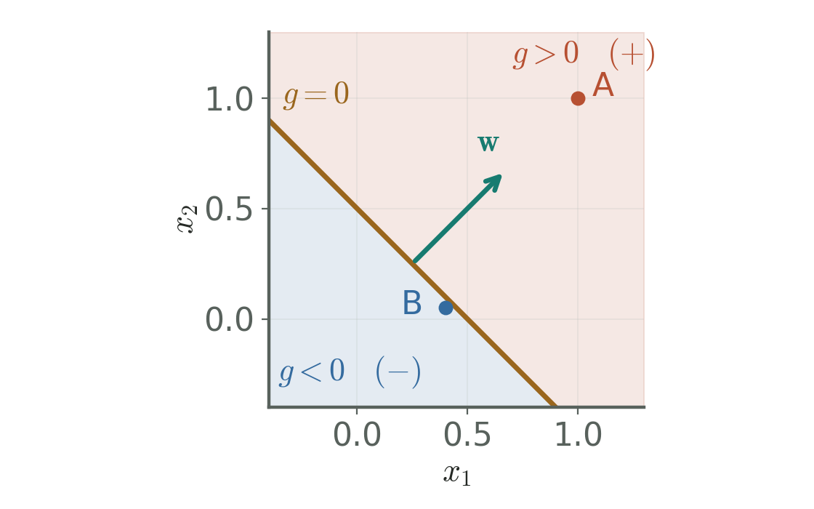
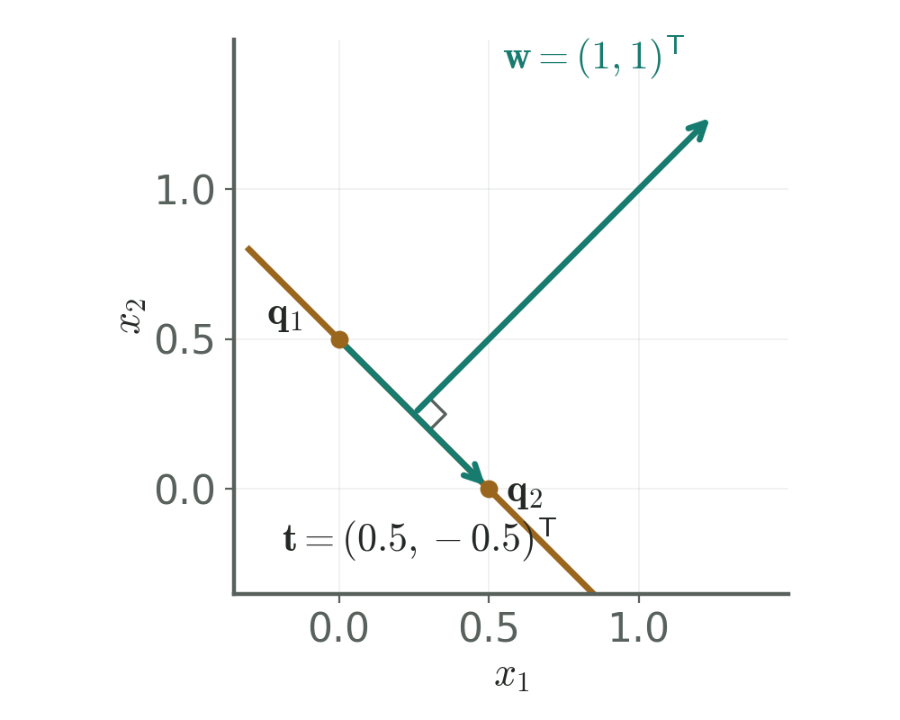
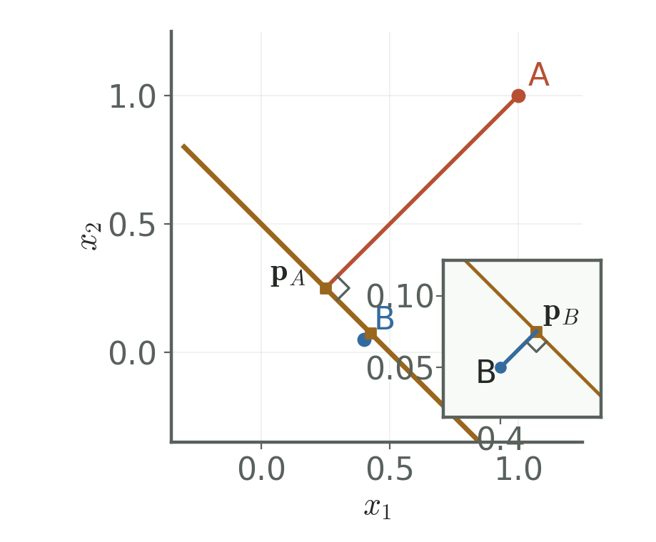
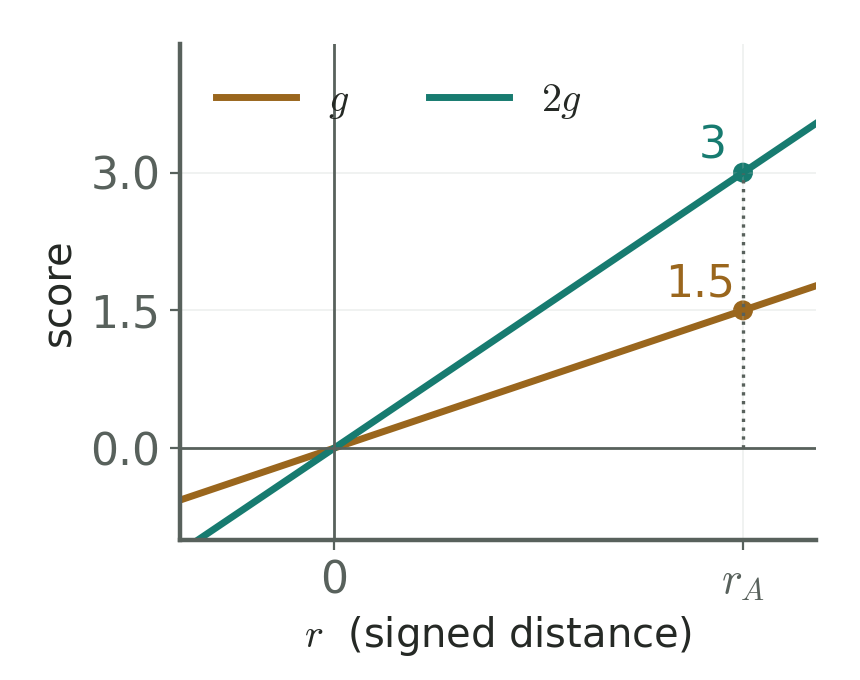

# Lecture 03 試做：分數、法向量與距離（Pilot: Scores, normals, and distances）

> 程度：研究生（grad）／Level: Graduate (grad)
>
> 對應第3週（2026-09-21）：線性分類器；本檔只涵蓋 KP01。
>
> Week 3 (2026-09-21): Linear classifiers. This file covers KP01 only.

**來源**：[第3章「線性分類器」](https://ndhuccc.github.io/CCC-LNS/PR_115/Ch03-linear-classifiers/index.html)，§3.2、知識點1及其「教授祕笈」。讀取日期：2026-10-16。本文重新組織講解，沿用來源的數值例。

**Source**: Chapter 3, §3.2, knowledge point 1, including its instructor notes. Accessed October 16, 2026. This handout reorganizes the explanation and retains the source examples.

**教材下載**：[JianBauDau投影片](../slides/lec03-kp01-pilot-with-comics.jbd.json)。本批僅含KP01，4個內容頁；實際播放器待驗收。

**Downloads**: PDF handout and JianBauDau slides are linked above. This pilot covers KP01 with four content pages. Player and slide PDF export checks remain pending.

## 學習目標（Learning objectives）

- 由分數的正負指出預測的類別，並交代零分的處理。（Use the score sign to predict a class and specify a rule for zero scores.）
- 用邊界上的2點證明權重垂直於邊界。（Prove that the weights are perpendicular to the boundary using two boundary points.）
- 推導垂足與距離公式，完成來源的2個樣本計算。（Derive the projection and distance formulas, then calculate both source examples.）
- 分辨係數縮放對分數、邊界與距離的影響。（Distinguish how coefficient scaling affects scores, boundaries, and distances.）

## KP01：分數定側，正規化後得到距離（The score selects a side; normalization gives distance）

**一句話重點**：先用分數判斷位於哪一側。要量出垂直距離，再除以權重的長度。

**One-sentence summary**: The score identifies the side. Divide its magnitude by the weight length to obtain perpendicular distance.

### 1. 先把分類問題寫成分數（Express classification through a score）

**白話說明**：上一章用機率比較不同類別。現在先選一個簡單模型，直接計算分數。分數大於零時預測第一類，小於零時預測第二類。我們先研究這個規則的形狀，尚未決定如何從資料學出它。

**Plain explanation**: The previous chapter compared classes through probabilities. We now choose a simple model and calculate a score directly. Positive scores predict the first class, and negative scores predict the second. We first study its geometry, before learning its parameters from data.

沿用來源的「雷達防禦牆」比喻：特徵點代表目標，分隔牆代表分類邊界。這個比喻只描述空間的切分。它不能保證牆兩側的目標都符合真實標籤，也不能把分數直接解讀為機率。

The source uses a radar defense wall as an analogy. Feature points represent targets, and the wall represents a boundary. This analogy describes a partition of space. It guarantees neither correct labels on each side nor a probability interpretation of the score.

**正式定義**：令特徵維度為整數 $l\geq1$。每個輸入有 $l$ 個實數特徵。權重與輸入做內積，再加上偏置，得到純量分數。

**Formal definition**: Let the feature dimension be an integer $l\geq1$. Each input contains $l$ real features. The inner product with the weights, plus a bias, gives a scalar score.

$$
g(\mathbf{x})=\mathbf{w}^{\mathsf T}\mathbf{x}+b,
\qquad \mathbf{x},\mathbf{w}\in\mathbb{R}^{l},\quad b\in\mathbb{R}.
$$

| 符號 | 中文意義與維度 | English meaning and dimension |
|---|---|---|
| $\mathbf{x}$ | 特徵向量，$l\times1$ | Feature vector, $l\times1$ |
| $\mathbf{w}$ | 權重向量，$l\times1$；幾何推導要求它不為零 | Weight vector, $l\times1$; geometry requires a nonzero vector |
| $b=w_0$ | 偏置，純量；沿用來源時也記為 $w_0$ | Bias, a scalar; the source also writes $w_0$ |
| $g(\mathbf{x})$ | 判別分數，純量 | Discriminant score, a scalar |
| $\omega_1,\omega_2$ | 2個類別名稱 | Names of the two classes |
| $\mathcal H$ | 零分邊界，特徵空間的子集合 | Zero-score boundary, a subset of feature space |
| $\|\mathbf{w}\|$ | 歐氏範數，即權重長度，純量 | Euclidean norm, the scalar weight length |
| $\mathbf{n},\mathbf{t}$ | 單位法向量、切向量，各為 $l\times1$ | Unit normal and tangent vectors, each $l\times1$ |
| $\mathbf{p},\mathbf{q}_1,\mathbf{q}_2$ | 邊界上的點，各為 $l\times1$ | Boundary points, each $l\times1$ |
| $r(\mathbf{x}),z(\mathbf{x}),d$ | 有號距離、幾何距離、原點距離，皆為純量 | Signed distance, geometric distance, and origin distance, all scalars |

此處以所選特徵座標的歐氏尺度量距離。分數沒有預設的公尺或毫米單位。若特徵尺度不同，必須先說明如何縮放，再解釋距離。

Distances use the Euclidean metric of the chosen feature coordinates. Scores have no default unit of meters or millimeters. When feature scales differ, specify their scaling before interpreting distance.

### 2. 零分集合把空間分成兩側（The zero set divides space into two sides）

分數已定義，現在找出預測改變的位置。令分數等於零，便得到決策邊界。權重非零時，它是 $l-1$ 維的仿射超平面。二維中是一條直線，三維中是一個平面。

With the score defined, we can locate where predictions change. Setting the score to zero gives the decision boundary. Nonzero weights define an affine hyperplane of dimension $l-1$. It is a line in two dimensions and a plane in three.

$$
\mathcal H=\{\mathbf{x}:\mathbf{w}^{\mathsf T}\mathbf{x}+b=0\},
\qquad
\widehat\omega(\mathbf{x})=
\begin{cases}
\omega_1,&g(\mathbf{x})>0,\\
\omega_2,&g(\mathbf{x})<0.
\end{cases}
$$

[補充] 零分時落在邊界上。實作必須另訂平手規則，例如固定選一類或暫不分類。來源未指定唯一規則，因此這裡不替所有演算法選定它。

[Added] A zero score places the point on the boundary. Implementation needs a tie rule, such as choosing one class or abstaining. The source specifies no universal rule, so we leave that choice to each algorithm.

**例子**：全單元固定使用來源的權重與偏置。以下將來源的2個樣本命名為 A 與 B。這些名稱只用來識別座標。

**Example**: We use the source weights and bias throughout this unit. We name its two samples A and B. These names identify coordinates only.

$$
\begin{aligned}
\mathbf{w}&=\begin{bmatrix}1\\1\end{bmatrix},\quad b=-0.5,\\
g(\mathbf{x})&=x_1+x_2-0.5,\\
\mathbf{x}_A&=\begin{bmatrix}1\\1\end{bmatrix},\quad
\mathbf{x}_B=\begin{bmatrix}0.4\\0.05\end{bmatrix}.
\end{aligned}
$$

**圖說 `lec03-kp01-halfspaces`**：先看零分直線，再看標有正負號的兩側。A與B位於不同側。箭頭標示分數增加的方向；座標與來源相同。〔功能：1、2、3〕

**Caption `lec03-kp01-halfspaces`**: First locate the zero-score line, then inspect the two labeled sides. A and B lie on opposite sides. The arrow marks increasing scores. Coordinates match the source.

### 3. 邊界上移動時，權重與位移垂直（Weights are perpendicular to movement along the boundary）

知道邊界的位置後，還要知道權重指向哪裡。取邊界上2個不同的點。兩點的分數都為零，因此兩式相減後偏置消失。

After locating the boundary, we need the direction of the weights. Choose two distinct boundary points. Both scores vanish, so subtracting their equations eliminates the bias.

[補充] 以下兩點的位移證明針對 $l\geq2$。一維時，邊界只有1個點。非零純量權重決定其法向方向。

[Added] The two-point displacement proof below assumes $l\geq2$. In one dimension, the boundary is a single point. The nonzero scalar weight determines its normal direction.

$$
\begin{aligned}
\mathbf{w}^{\mathsf T}\mathbf{q}_1+b&=0,\\
\mathbf{w}^{\mathsf T}\mathbf{q}_2+b&=0,\\
\mathbf{w}^{\mathsf T}(\mathbf{q}_2-\mathbf{q}_1)&=0.
\end{aligned}
$$

差向量代表沿邊界的位移。它與權重的內積等於零，所以兩者垂直。邊界上任何位移都如此，權重因此是法向量。注意：位移向量平行於仿射邊界，向量的終點未必在邊界上。

The difference vector describes movement along the boundary. Its zero inner product with the weights implies perpendicularity. This holds for every boundary displacement, making the weights a normal vector. A displacement is parallel to the affine boundary. Its endpoint need not itself lie on that boundary.

在主例子中，選2個截距點即可直接驗算。此處 $\mathbf{t}$ 是沿邊界的位移向量。

For the running example, choose the two intercepts for a direct check. Here, $\mathbf{t}$ denotes a displacement along the boundary.

$$
\begin{aligned}
\mathbf{q}_1&=(0,0.5)^{\mathsf T},\quad \mathbf{q}_2=(0.5,0)^{\mathsf T},\\
\mathbf{t}&=\mathbf{q}_2-\mathbf{q}_1=(0.5,-0.5)^{\mathsf T},\\
\mathbf{w}^{\mathsf T}\mathbf{t}&=1(0.5)+1(-0.5)=0.
\end{aligned}
$$

**圖說 `lec03-kp01-normal`**：先看連接2個截距點的位移，再看與它成直角的權重箭頭。小方角檢查垂直關係，箭頭指向正側。〔功能：1、2、3〕

**Caption `lec03-kp01-normal`**: First follow the displacement between the intercepts, then inspect the perpendicular weight arrow. The square marks the right angle. The arrow points toward positive scores.

權重也指向分數增加的一側。從任何點沿權重方向前進，分數增加量等於前進係數乘上權重長度平方。當前進係數為正時，增加量為正。

The weights point toward increasing scores. Moving along them increases the score by the movement coefficient times their squared length. A positive movement coefficient gives a positive increase.

$$
g(\mathbf{x}+s\mathbf{w})
=g(\mathbf{x})+s\|\mathbf{w}\|^2,
\qquad s>0.
$$

### 4. 投影把分數轉成垂直距離（Projection converts a score into perpendicular distance）

既然法向量提供垂直方向，便能沿它尋找最近的邊界點。先除以長度，得到長度為1的單位法向量。令 $r$ 代表沿此方向量到的有號距離，令 $\mathbf{p}$ 為垂足。

The normal provides the direction toward the nearest boundary point. Normalize it to obtain a unit normal. Let $r$ denote signed distance along this direction, and let $\mathbf{p}$ be the perpendicular foot.

$$
\mathbf{n}=\frac{\mathbf{w}}{\|\mathbf{w}\|},
\qquad \mathbf{x}=\mathbf{p}+r\mathbf{n},
\qquad \mathbf{p}\in\mathcal H.
$$

將這個分解代入分數。垂足在邊界上，所以它的分數為零。剩下的項就是有號距離乘上權重長度。

Substitute this decomposition into the score. The foot lies on the boundary, so its score vanishes. The remaining term is signed distance times the weight length.

$$
\begin{aligned}
g(\mathbf{x})
&=\mathbf{w}^{\mathsf T}(\mathbf{p}+r\mathbf{n})+b\\
&=\underbrace{\mathbf{w}^{\mathsf T}\mathbf{p}+b}_{0}
  +r\frac{\mathbf{w}^{\mathsf T}\mathbf{w}}{\|\mathbf{w}\|}\\
&=r\|\mathbf{w}\|.
\end{aligned}
$$

因此，有號距離保留正負側資訊。幾何距離取絕對值，永遠非負。原點的距離是同一公式的特例。

Signed distance therefore retains the side information. Geometric distance takes its absolute value and is always nonnegative. The origin distance is a special case.

$$
r(\mathbf{x})=\frac{g(\mathbf{x})}{\|\mathbf{w}\|},\qquad
z(\mathbf{x})=\frac{|g(\mathbf{x})|}{\|\mathbf{w}\|},\qquad
d=z(\mathbf{0})=\frac{|b|}{\|\mathbf{w}\|}.
$$

[補充] 由點的位置扣掉有號垂直位移，可算出垂足。這也給了實作中可以檢查的等式：垂足分數應接近零。

[Added] Subtracting the signed normal displacement gives the foot. This yields a practical check: its score should be approximately zero.

$$
\mathbf{p}=\mathbf{x}-r\mathbf{n}
=\mathbf{x}-\frac{g(\mathbf{x})}{\|\mathbf{w}\|^2}\mathbf{w}.
$$

[補充] 為何它是最近點？對任何邊界點 $\mathbf{q}$，向量 $\mathbf{p}-\mathbf{q}$ 沿著邊界。它垂直於 $\mathbf{x}-\mathbf{p}$，因此平方距離可用畢氏定理相加。第二項非負，故垂足達到最短距離。

[Added] Why is it nearest? For any boundary point $\mathbf{q}$, the vector $\mathbf{p}-\mathbf{q}$ runs along the boundary. It is perpendicular to $\mathbf{x}-\mathbf{p}$. The Pythagorean theorem splits the squared distance. The nonnegative second term proves that the foot is nearest.

$$
\|\mathbf{x}-\mathbf{q}\|^2
=\|\mathbf{x}-\mathbf{p}\|^2+\|\mathbf{p}-\mathbf{q}\|^2
\geq\|\mathbf{x}-\mathbf{p}\|^2.
$$

### 5. 用來源的2個樣本完整計算（Calculate both source samples step by step）

距離公式已得到，現在用同一條直線檢查。先算權重長度，再代入原點與2個樣本。下列小數只在最後一步四捨五入。

We can now check the distance formula on the same line. First compute the weight length, then evaluate the origin and both samples. We round only the final decimal results.

$$
\|\mathbf{w}\|=\sqrt{1^2+1^2}=\sqrt2\approx1.414214,
\qquad d=\frac{|-0.5|}{\sqrt2}=\frac{0.5}{\sqrt2}\approx0.353553.
$$

A的內積先得到2，再加上偏置。分數為正，因此預測第一類。除以權重長度後，才得到垂直距離。

For A, the inner product gives 2, followed by the bias. The positive score predicts the first class. Dividing by the weight length gives perpendicular distance.

$$
\begin{aligned}
g(\mathbf{x}_A)&=1(1)+1(1)-0.5=2-0.5=1.5>0,\\
r(\mathbf{x}_A)&=\frac{1.5}{\sqrt2}\approx1.060660,\\
z(\mathbf{x}_A)&=\frac{|1.5|}{\sqrt2}\approx1.060660.
\end{aligned}
$$

B的內積是0.45，加上偏置後變成負數。它很靠近邊界，仍位於負側。這是模型的預測，尚未檢查真實標籤。

For B, the inner product is 0.45, and adding the bias makes the score negative. B remains on the negative side despite being nearby. This is a prediction, without checking its true label.

$$
\begin{aligned}
g(\mathbf{x}_B)&=1(0.4)+1(0.05)-0.5=0.45-0.5=-0.05<0,\\
r(\mathbf{x}_B)&=\frac{-0.05}{\sqrt2}\approx-0.035355,\\
z(\mathbf{x}_B)&=\frac{|-0.05|}{\sqrt2}\approx0.035355.
\end{aligned}
$$

[補充] 權重長度平方等於2。將2個分數代入垂足公式，A往負法向方向移動，B往正法向方向移動。2個垂足的分數都為零。

[Added] The squared weight length equals 2. Substituting the scores moves A against the normal and B along it. Both feet have zero scores.

$$
\begin{aligned}
\mathbf{p}_A&=(1,1)^{\mathsf T}-\frac{1.5}{2}(1,1)^{\mathsf T}=(0.25,0.25)^{\mathsf T},\\
\mathbf{p}_B&=(0.4,0.05)^{\mathsf T}-\frac{-0.05}{2}(1,1)^{\mathsf T}=(0.425,0.075)^{\mathsf T},\\
g(\mathbf{p}_A)&=0.25+0.25-0.5=0,\\
g(\mathbf{p}_B)&=0.425+0.075-0.5=0.
\end{aligned}
$$

**圖說 `lec03-kp01-distances`**：先沿A到垂足的線段讀距離，再看B附近的放大框。兩個小方角都標示垂直。放大框使用自己的座標刻度；2個樣本的距離約為1.060660與0.035355。〔功能：2、3〕

**Caption `lec03-kp01-distances`**: First follow A's perpendicular segment, then inspect the magnified view around B. Both squares mark right angles. The inset has its own coordinate scale. The distances are approximately 1.060660 and 0.035355.

### 6. 同比縮放保留邊界，也保留距離（Proportional scaling preserves the boundary and distance）

A的分數是1.5，但同一條直線也能給它3分。原因是權重與偏置可以同乘2。零分集合不變，分數與權重長度一起加倍，所以它們的比值不變。

A scores 1.5, but the same line can give it a score of 3. Multiply both the weights and bias by 2. The zero set remains unchanged. The score and weight length double together, leaving their ratio unchanged.

$$
\begin{aligned}
g'(\mathbf{x})&=2x_1+2x_2-1=2g(\mathbf{x}),\\
\|\mathbf{w}'\|&=\sqrt{2^2+2^2}=\sqrt8=2\sqrt2,\\
g'(\mathbf{x}_A)&=2(1)+2(1)-1=3,\\
z'(\mathbf{x}_A)&=\frac{|3|}{2\sqrt2}
=\frac{1.5}{\sqrt2}\approx1.060660.
\end{aligned}
$$

**圖說 `lec03-kp01-scaling`**：先找兩條分數線共用的零點，再沿A的位置讀到1.5與3。橫軸是有號距離，A的位置不動。此圖呈現分數函數，不以兩線夾角表示幾何垂直。〔功能：1、2〕

**Caption `lec03-kp01-scaling`**: First locate the shared zero, then read 1.5 and 3 at A's position. The horizontal axis is signed distance, so A stays fixed. This plot compares score functions. Its angles do not represent geometric perpendicularity.

**常見迷思**：分數大一倍，不代表到邊界的距離大一倍。比較不同係數設定時，還要檢查權重長度。只有權重長度固定時，分數絕對值才與距離共用同一比例。

**Common misconception**: Doubling the score does not necessarily double boundary distance. Compare weight lengths across parameter settings. Score magnitude uses a common distance scale only when the weight length stays fixed.

[補充] 若同乘任何正數 $c$，預測、邊界與有號距離都不變。若 $c<0$，邊界與幾何距離仍不變，但正負側與有號距離反轉。若 $c=0$，每點分數都是零，不能沿用非零法向量的距離公式。

[Added] Scaling by any positive $c$ preserves predictions, the boundary, and signed distance. Negative $c$ preserves the boundary and geometric distance but reverses sides and signed distance. At $c=0$, every score vanishes. The nonzero-normal distance formula no longer applies.

$$
\frac{|c\,g(\mathbf{x})|}{\|c\mathbf{w}\|}
=\frac{|c|\,|g(\mathbf{x})|}{|c|\,\|\mathbf{w}\|}
=z(\mathbf{x}),\qquad c\ne0.
$$

[補充] 只放大權重，卻保留偏置，通常會移動邊界。本例只將權重乘2，邊界便成為 $x_1+x_2=0.25$，與原來的 $x_1+x_2=0.5$ 不同。另一方面，非零權重且偏置為零時，邊界通過原點。

[Added] Scaling only the weights generally moves the boundary. Doubling only the weights here gives $x_1+x_2=0.25$, whereas the original line has $x_1+x_2=0.5$. With nonzero weights and zero bias, the boundary passes through the origin.

[補充] 若權重為零，非零偏置使所有點得到相同的非零分數，零分集合為空。若偏置也為零，零分集合是整個空間。這兩種情形都不形成通常的分隔超平面。

[Added] With zero weights and nonzero bias, every point has the same nonzero score. The zero set is empty. With zero bias as well, the zero set is all of space. Neither case defines the usual separating hyperplane.

### 7. 完成1題示範，再自行檢查（Study one solution, then check your understanding）

**小練習**：前面的直線已經熟悉。現在沿用來源的公開練習，換一組係數檢查方法是否通用。題目要求原點的距離，以及點 $(1,2)^{\mathsf T}$ 位於哪一側。

**Practice**: We now change coefficients using the source's public exercise to check whether the method transfers. Find the origin distance and the side containing $(1,2)^{\mathsf T}$.

$$
3x_1-4x_2+10=0.
$$

提示：先辨識權重與偏置。計算距離時除以權重長度，判斷哪一側時只看分數正負。

Hint: Identify the weights and bias first. Divide by the weight length for distance. Use the score sign for the side.

**[補充] 示範解題**：依核准的答案規格，示範這1題。先算範數，再用原點距離公式。接著代入樣本，最後檢查結果非負、分數符號正確。

**[Added] Worked solution**: The approved format includes this one demonstration. Compute the norm, then apply the origin-distance formula. Evaluate the sample next. Finally check that distance is nonnegative and the score sign matches the predicted side.

$$
\begin{aligned}
\mathbf{w}&=(3,-4)^{\mathsf T},\quad b=10,\\
\|\mathbf{w}\|&=\sqrt{3^2+(-4)^2}=\sqrt{9+16}=5,\\
d&=\frac{|10|}{5}=2,\\
g((1,2)^{\mathsf T})&=3(1)-4(2)+10=3-8+10=5>0,\\
z((1,2)^{\mathsf T})&=\frac{|5|}{5}=1.
\end{aligned}
$$

所以原點距離為2，樣本位於正側，樣本距離為1。再檢查：樣本垂足為 $(0.4,2.8)^{\mathsf T}$，代入得到 $1.2-11.2+10=0$。所有距離都以本題特徵座標的尺度表示。

The origin distance is 2. The sample lies on the positive side at distance 1. Its foot is $(0.4,2.8)^{\mathsf T}$, giving $1.2-11.2+10=0$. All distances use the coordinate scale of this exercise.

**自行練習A [補充]**：主例子的權重與偏置都乘以 $-2$。A與B的分數、預測側及幾何距離各如何改變？提示：分開處理符號與絕對值。

**Independent practice A [Added]**: Multiply both running-example weights and bias by $-2$. What happens to scores, predicted sides, and geometric distances? Hint: Treat signs and absolute values separately.

**自行練習B [補充]**：只把偏置改成0。原點與B分別位於哪裡？提示：先寫新零分集合，再代入；若分數等於零，說明你的平手規則。

**Independent practice B [Added]**: Change only the bias to zero. Where do the origin and B lie? Hint: Write the new zero set first. State a tie rule whenever the score vanishes.

**與實作的連結 [補充]**：實數運算可能留下微小誤差。檢查垂足時可容許小量誤差，但容許值要配合資料尺度。改動係數尺度後，也要重新檢查零分容許值。

**Implementation connection [Added]**: Floating-point calculations can leave small errors. Allow a scale-appropriate tolerance when checking a projection foot. Revisit the zero-score tolerance whenever you rescale coefficients.

**圖**：本單元4張圖分別呈現半空間、法向方向、垂直距離與縮放。它們共用同一組主例子參數，幾何圖使用等比例座標。

**Figure**: Four figures show half-spaces, the normal direction, perpendicular distances, and scaling. They share the running-example parameters. Geometry plots use equal coordinate scales.

## 小結（Summary）

- 零分集合描述邊界；零分時的預測需要平手規則。（The zero set describes the boundary. Zero scores need a tie rule.）
- 權重垂直於邊界，也指向分數增加的一側。（Weights are perpendicular to the boundary and point toward increasing scores.）
- 將分數除以權重長度，才得到有號距離。（Dividing the score by the weight length gives signed distance.）
- 同乘正數保留預測與距離；負數會反轉正負側。（Positive scaling preserves predictions and distance. Negative scaling reverses the sides.）

**留下的問題**：現在能描述任何一組權重的幾何效果。但訓練資料給的是樣本與標籤，未直接給權重。下一個知識點將問：一次誤判，應如何改動權重與偏置？

**Question for the next unit**: We can describe the geometry of any chosen weights. Training data supply samples and labels, rather than weights. How should a misclassification change the weights and bias?

## 術語表（Glossary）

| 中文 | English | 中文意義 | English meaning |
|---|---|---|---|
| 特徵向量 | Feature vector | 描述輸入的數值座標 | Numerical coordinates describing an input |
| 判別分數 | Discriminant score | 用來比較或決定類別的純量 | A scalar used to compare or select classes |
| 權重 | Weights | 決定特徵如何組合的係數 | Coefficients combining the features |
| 偏置 | Bias | 與輸入無關的加法常數 | An additive constant independent of the input |
| 內積 | Inner product | 對應分量乘積的總和 | The sum of products of corresponding entries |
| 決策邊界 | Decision boundary | 預測側改變的零分集合 | The zero set where the predicted side changes |
| 仿射超平面 | Affine hyperplane | 非零法向量定義的平坦零分集合 | A flat zero set defined by a nonzero normal |
| 半空間 | Half-space | 超平面單側的區域 | The region on one side of a hyperplane |
| 切向量 | Tangent vector | 沿邊界的位移方向 | A displacement direction along the boundary |
| 法向量 | Normal vector | 垂直於邊界的非零向量 | A nonzero vector perpendicular to the boundary |
| 歐氏範數 | Euclidean norm | 分量平方和的平方根 | The square root of the sum of squared entries |
| 單位法向量 | Unit normal | 長度為1的法向量 | A normal vector of length one |
| 垂足 | Perpendicular foot | 最近的邊界點 | The nearest boundary point |
| 有號距離 | Signed distance | 保留邊界側別的垂直距離 | Perpendicular distance retaining side information |
| 幾何距離 | Geometric distance | 非負的最短歐氏距離 | The nonnegative shortest Euclidean distance |
| 平手規則 | Tie rule | 對零分指定的預測處理 | The prediction rule for a zero score |
| 浮點誤差 | Floating-point error | 有限精度計算造成的數值差異 | A numerical difference caused by finite precision |

## 延伸閱讀（Further reading）

沿用本章來源的§3.2，並銜接同頁的感知器單元。此處不新增未核對的書目或頁碼。

Read §3.2 of the linked source, then continue to its perceptron unit. No unverified bibliography or page numbers are added here.
