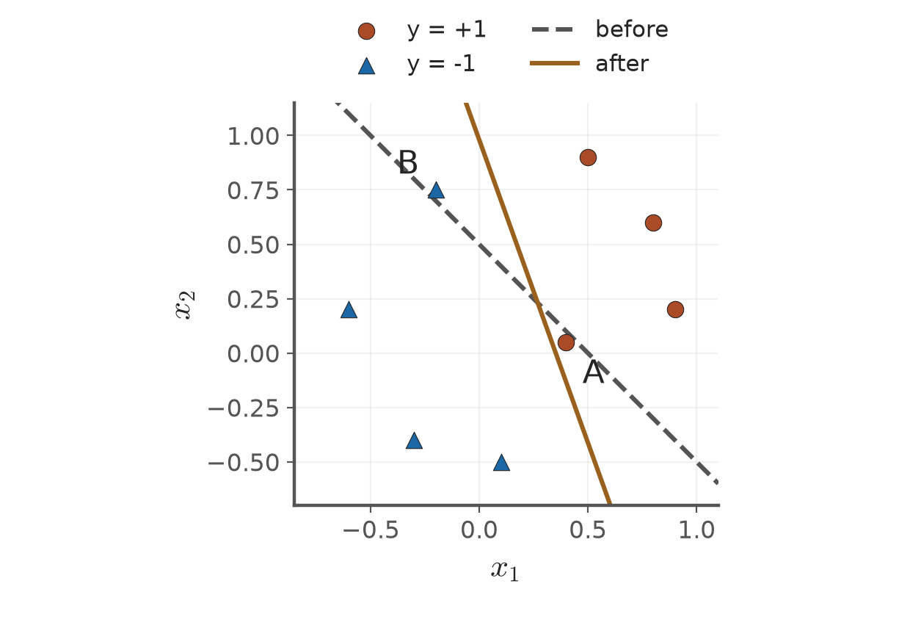

# 第3章 KP02：批次感知器（Batch perceptron）

> 程度：研究生（grad）／Level: Graduate (grad)
>
> [下載本KP簡報（JianBauDau slides）](../slides/lec03-kp02-batch-perceptron.jbd.json)
>
> 圖型識別 AIIA50260，2026秋季；一個KP一個講義檔案。
>
> Pattern Recognition AIIA50260, Fall 2026. This handout contains one knowledge point.
>
> 來源：[線性分類器 §3.3，KP02](https://ndhuccc.github.io/CCC-LNS/PR_115/Ch03-linear-classifiers/index.html#kp2)及對應教授祕笈與互動程式。內容讀取：2026-10-16（Asia/Taipei）；HTML blob：`bd64b78ba21606d078c672b0fa67337b017e4a34`。
>
> Source: §3.3, KP02, including its teaching notes and interactive code. Accessed October 16, 2026, Asia/Taipei.

## 學習目標（Learning objectives）

用誤判集合算出一次批次修正，檢查修正後的分數。

Compute one batch update and check the resulting scores.

## 先備符號（Prerequisite notation）

本檔以 $y_i\in\{-1,+1\}$表示真實類別，$\mathbf{a}_i=(\mathbf{x}_i^T,1)^T$表示增廣樣本，$\mathbf{v}=(\mathbf{w}^T,b)^T$包含截距。分數為 $g_i=\mathbf{v}^T\mathbf{a}_i$，$y_i g_i>0$才嚴格分對。

The true label is positive or negative one. The augmented sample ends in one, and the weight vector includes the intercept. Strict correctness requires a positive label-adjusted score.

## KP02：把誤判樣本合成一次修正（Combining mistakes into one batch update）

### 1.1 為什麼需要誤判集合（Why we collect mistakes）

**一句話重點**：先找出目前不合格的樣本，再把它們要求的修正相加。

**One-sentence summary**: Identify the samples that currently fail, then add their requested corrections.

**白話說明**：KP01只告訴你如何使用一條分類線。若初始分類線放錯位置，就需要資料提供方向。你可以想像拔河：站錯側的人才提出修正。但這個比喻只說明方向相加，不表示分類線真的平移同一段距離。

**Plain explanation**: KP01 told you how to use a classification boundary. A misplaced boundary needs directions from data. Think of a tug-of-war in which only misplaced participants request a correction. This analogy explains summed directions, not a literal translation of the boundary.

先把截距寫進內積。令原特徵為 $\mathbf{x}_i\in\mathbb{R}^d$，增廣後的特徵與權重為

First include the intercept in the inner product. For an original feature vector $\mathbf{x}_i\in\mathbb{R}^d$, define

$$
\mathbf{a}_i=\begin{bmatrix}\mathbf{x}_i\\1\end{bmatrix},\qquad
\mathbf{v}=\begin{bmatrix}\mathbf{w}\\b\end{bmatrix},\qquad
g_i=\mathbf{v}^T\mathbf{a}_i=\mathbf{w}^T\mathbf{x}_i+b.
$$

| 符號 | 中文意義 | English meaning |
|---|---|---|
| $y_i\in\{-1,+1\}$ | 真實類別標籤；正類為 $+1$ | True class label; the positive class uses $+1$ |
| $\mathbf{a}_i\in\mathbb{R}^{d+1}$ | 最後一項為1的增廣樣本 | Augmented sample with a final entry of one |
| $\mathbf{v}\in\mathbb{R}^{d+1}$ | 包含截距的權重 | Weight vector including the intercept |
| $m_i=y_i\mathbf{v}^T\mathbf{a}_i$ | 有標籤分數；大於0才嚴格分對 | Label-adjusted score; strict correctness requires positivity |
| $Y(\mathbf{v})$ | 分數不合格的樣本索引集合 | Indices of samples whose label-adjusted scores are nonpositive |
| $\delta_i=-y_i$ | 來源使用的反向標籤 | Negated label used in the source |
| $\rho_t>0$ | 第 $t$ 次修正的學習率 | Positive learning rate for update $t$ |

**正式定義**：本講義將落在邊界上的點也列入待修正集合。

**Formal definition**: This handout treats boundary points as requiring correction.

$$
Y(\mathbf{v})=\{i:y_i\mathbf{v}^T\mathbf{a}_i\le0\},\qquad
J(\mathbf{v})=\sum_i\max(0,-y_i\mathbf{v}^T\mathbf{a}_i)
=\sum_{i\in Y(\mathbf{v})}\delta_i\mathbf{v}^T\mathbf{a}_i.
$$

若集合暫時不變，微分得到 $\sum_{i\in Y}\delta_i\mathbf{a}_i$。在折角處，此向量是合法的次梯度，也就是可用的廣義下降方向。它不要求函數處處可微。

When the active set stays fixed, differentiation gives $\sum_{i\in Y}\delta_i\mathbf{a}_i$. At a corner, this is a valid subgradient, a generalized derivative. Differentiability everywhere is unnecessary.

$$
\mathbf{v}_{t+1}=\mathbf{v}_t-\rho_t\sum_{i\in Y(\mathbf{v}_t)}\delta_i\mathbf{a}_i
=\mathbf{v}_t+\rho_t\sum_{i\in Y(\mathbf{v}_t)}y_i\mathbf{a}_i.
$$

正類的錯點要求加上樣本，負類的錯點要求扣除樣本。每一輪都用同一個舊權重決定整個集合，最後才更新一次。停止條件是集合為空。

A mistaken positive sample requests addition; a mistaken negative sample requests subtraction. Each round uses one unchanged weight vector to determine the entire set. Only then does one update occur. Stop when the set is empty.

### 1.2 原例3.1：先加總，再修正（Example 3.1: sum first, then update）

**例子**：來源給定 $\mathbf{v}_0=(1,1,-0.5)^T$、$\rho=0.7$。兩個錯點為正類 $A=(0.4,0.05)$ 與負類 $B=(-0.2,0.75)$。

**Example**: The source gives $\mathbf{v}_0=(1,1,-0.5)^T$ and $\rho=0.7$. The mistakes are positive sample $A=(0.4,0.05)$ and negative sample $B=(-0.2,0.75)$.

先確認它們真的分錯，再建立總修正量。

First verify the mistakes, then form their combined correction.

$$
g_A=0.4+0.05-0.5=-0.05,\qquad
g_B=-0.2+0.75-0.5=0.05.
$$

$$
\begin{aligned}
\sum_{i\in Y}\delta_i\mathbf{a}_i
&=-\begin{bmatrix}0.4\\0.05\\1\end{bmatrix}
+\begin{bmatrix}-0.2\\0.75\\1\end{bmatrix}
=\begin{bmatrix}-0.6\\0.7\\0\end{bmatrix},\\
\mathbf{v}_1
&=\begin{bmatrix}1\\1\\-0.5\end{bmatrix}
-0.7\begin{bmatrix}-0.6\\0.7\\0\end{bmatrix}
=\begin{bmatrix}1+0.42\\1-0.49\\-0.5\end{bmatrix}
=\begin{bmatrix}1.42\\0.51\\-0.5\end{bmatrix}.
\end{aligned}
$$

截距沒有改變，因為兩個樣本最後一項的修正相消。這是本例的巧合，不能當成一般規則。

The intercept stays unchanged because the two final-coordinate corrections cancel. This is specific to this example.

$$
\begin{aligned}
g_A^{\mathrm{new}}&=1.42(0.4)+0.51(0.05)-0.5
=0.568+0.0255-0.5=0.0935>0,\\
g_B^{\mathrm{new}}&=1.42(-0.2)+0.51(0.75)-0.5
=-0.284+0.3825-0.5=-0.4015<0.
\end{aligned}
$$

下表也納入來源互動程式的其餘六點。這八點是網頁示範資料，不宣稱是原教科書圖的完整原始資料。

The following table includes six additional points from the source demonstration. These eight points are webpage data, not a claimed reconstruction of the textbook figure.

| 樣本 $\mathbf{x}$ | 標籤 $y$ | 舊分數 | 新分數 |
|---|---:|---:|---:|
| $(0.4,0.05)$ | $+1$ | $-0.05$ | $0.0935$ |
| $(0.8,0.6)$ | $+1$ | $0.90$ | $0.9420$ |
| $(0.5,0.9)$ | $+1$ | $0.90$ | $0.6690$ |
| $(0.9,0.2)$ | $+1$ | $0.60$ | $0.8800$ |
| $(-0.2,0.75)$ | $-1$ | $0.05$ | $-0.4015$ |
| $(-0.6,0.2)$ | $-1$ | $-0.90$ | $-1.2500$ |
| $(-0.3,-0.4)$ | $-1$ | $-1.20$ | $-1.1300$ |
| $(0.1,-0.5)$ | $-1$ | $-0.90$ | $-0.6130$ |

**圖說 `lec03-kp02-boundaries`**：先看虛線兩側的A、B，再看實線如何把它們分對。圓點是正類，三角形是負類；全部8點使用來源互動程式座標。〔功能：精準度、空間幾何〕

**Caption `lec03-kp02-boundaries`**: First inspect A and B beside the dashed boundary. Then inspect their correct sides of the solid boundary. Circles are positive and triangles negative. All eight coordinates come from the source demonstration.

**常見迷思**：每一步修正不保證誤判數下降。$J$也不是幾何距離總和，因為每項沒有除以 $\|\mathbf{w}\|$。對單一錯點而言，其有標籤分數增加 $\rho\|\mathbf{a}_i\|^2$；但批次更新還有其他樣本的交叉影響。

**Common misconception**: One update need not reduce the mistake count. Also, $J$ is not a sum of geometric distances. Its terms omit division by $\|\mathbf{w}\|$. An isolated update increases that sample's label-adjusted score by $\rho\|\mathbf{a}_i\|^2$. Other samples introduce cross-effects in batch updates.

**[更正]** $J=0$不足以停止。若 $\mathbf{v}=\mathbf{0}$，所有分數都是0，損失也為0，卻沒有點嚴格分對。因此應直接檢查 $Y=\emptyset$。

**[Correction]** Zero loss does not establish termination. At $\mathbf{v}=\mathbf{0}$, every score and loss term is zero, but no sample is strictly correct. Check the set directly.

**小練習**：沿用原例，將學習率改為0.5。求新權重與A、B新分數。提示：先保留總修正量，只換前面的倍率。

**Practice**: Change the learning rate to 0.5 in the same example. Find the weights and new scores for A and B. Hint: reuse the combined correction and change only its multiplier.

修正規則已經定義，但一個成功例子還不是一般保證。接下來要問：若資料確實能分開，為什麼不能永遠修正？

We have an update rule, but one successful example is not a general guarantee. Why can updates not continue forever on separable data?

## 術語表（Glossary）

| 中文 | English | 白話解釋 |
|---|---|---|
| 增廣向量 | Augmented vector | 多加常數1，讓截距一起參與內積 |
| 有標籤分數 | Label-adjusted score | 把原分數乘上真實正負標籤 |
| 批次更新 | Batch update | 用同一舊權重找出整批錯點後更新 |
| 次梯度 | Subgradient | 不可微折角處仍可選用的廣義導數 |
| 線性可分 | Linearly separable | 存在一個超平面把兩類嚴格分開 |

## 來源與更正（Sources and corrections）

停止條件為待修正集合為空，不能只查零損失；感知器損失未正規化，不能當成幾何距離總和。

Stop only with an empty failing set. Zero loss is insufficient, and unnormalized loss is not geometric distance.

## 相鄰知識點（Adjacent knowledge points）

- 前一個：KP01（Previous: KP01）
- 下一個：[感知器收斂證明](lec03-kp03-convergence.md)（Next: Perceptron convergence）
