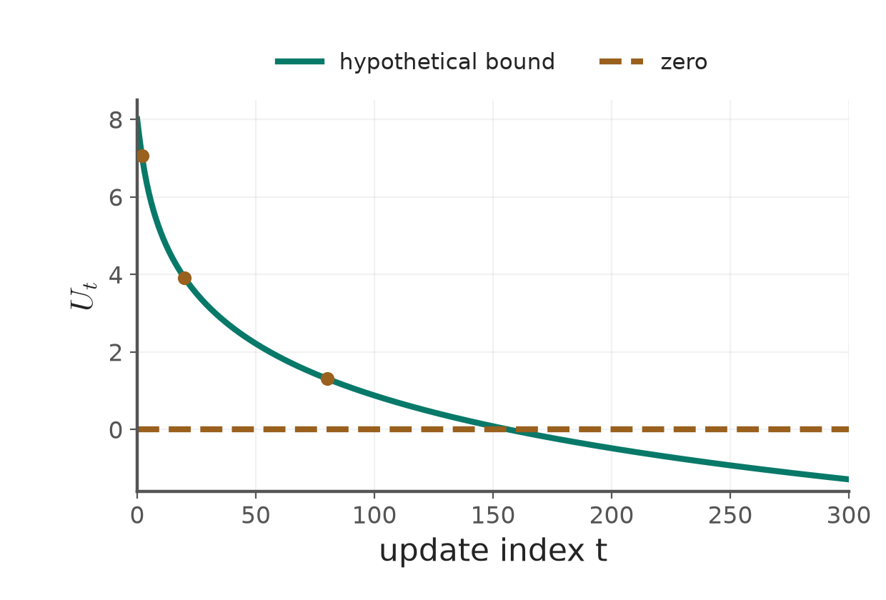

# 第3章 KP03：感知器收斂證明（Perceptron convergence）

> 程度：研究生（grad）／Level: Graduate (grad)
>
> 圖型識別 AIIA50260，2026秋季；一個KP一個講義檔案。
>
> Pattern Recognition AIIA50260, Fall 2026. This handout contains one knowledge point.
>
> 來源：[線性分類器 §3.3，KP03](https://ndhuccc.github.io/CCC-LNS/PR_115/Ch03-linear-classifiers/index.html#kp3)及對應教授祕笈與互動程式。內容讀取：2026-10-16（Asia/Taipei）；HTML blob：`bd64b78ba21606d078c672b0fa67337b017e4a34`。
>
> Source: §3.3, KP03, including its teaching notes and interactive code. Accessed October 16, 2026, Asia/Taipei.

## 學習目標（Learning objectives）

展開距離平方，說明有限步停止的反證條件。

Expand the squared distance and explain the assumptions for finite termination.

## 先備符號（Prerequisite notation）

本檔以 $y_i\in\{-1,+1\}$表示真實類別，$\mathbf{a}_i=(\mathbf{x}_i^T,1)^T$表示增廣樣本，$\mathbf{v}=(\mathbf{w}^T,b)^T$包含截距。分數為 $g_i=\mathbf{v}^T\mathbf{a}_i$，$y_i g_i>0$才嚴格分對。

The true label is positive or negative one. The augmented sample ends in one, and the weight vector includes the intercept. Strict correctness requires a positive label-adjusted score.

本檔的四點界限算例使用正類 $(-1,0),(0,1)$與負類 $(0,-1),(1,0)$，並在每個向量末端加上1。這裡列出資料，讓你不必開啟相鄰講義也能重算。

The four-point bound example uses positives $(-1,0),(0,1)$ and negatives $(0,-1),(1,0)$, each augmented by one. These coordinates make the example independently reproducible.

## KP03：以不可能的上界證明有限步停止（Proving finite termination with an impossible bound）

### 1.1 把「永遠不停」當成假設（Assume updates never stop）

**一句話重點**：若無窮次修正會迫使非負距離小於負數，這個無窮假設就不成立。

**One-sentence summary**: If infinitely many updates force a nonnegative distance below a negative bound, that assumption is false.

**白話說明**：上一節的分類線可能一次就成功，也可能需要多次。證明不必預測每條線的位置。像追蹤信標，你選一個可行目標來量距離。但信標只是證明工具，不是演算法知道的答案。

**Plain explanation**: The previous boundary succeeded quickly, but other problems need more updates. A proof need not predict every boundary. A tracking beacon measures distance to a feasible target. The beacon is a proof device, not an answer available to the algorithm.

**正式定義**：假設訓練集有限且嚴格線性可分。存在 $\mathbf{v}^*$，使每個 $y_i\mathbf{v}^{*T}\mathbf{a}_i>0$。令 $t$ 只計實際修正次數。

**Formal definition**: Assume a finite, strictly linearly separable training set. Some $\mathbf{v}^*$ makes every $y_i\mathbf{v}^{*T}\mathbf{a}_i$ positive. The index $t$ counts actual updates only.

$$
\mathbf{s}_t=\sum_{i\in Y_t}y_i\mathbf{a}_i,\qquad
\gamma=\min_i y_i\mathbf{v}^{*T}\mathbf{a}_i>0,\qquad
B^2=\max_{\emptyset\ne S\subseteq\{1,\ldots,n\}}
\left\|\sum_{i\in S}y_i\mathbf{a}_i\right\|^2<\infty.
$$

| 符號 | 中文意義 | English meaning |
|---|---|---|
| $\mathbf{s}_t$ | 本次總修正方向 | Combined correction at update $t$ |
| $\gamma$ | 可行權重的最小正有標籤分數 | Minimum positive label-adjusted score of a feasible vector |
| $B^2$ | 任意非空子集合總修正量的平方上界 | Upper bound on squared corrections over nonempty subsets |
| $\alpha>0$ | 分析時選用的目標縮放量 | Target scaling chosen for the analysis |
| $D_t$ | 到分析目標的距離平方 | Squared distance to the analytical target |

只要 $Y_t$非空，就有 $\mathbf{v}^{*T}\mathbf{s}_t\ge\gamma$。另一方面，因為 $Y_t$都是不合格樣本，所以 $\mathbf{v}_t^T\mathbf{s}_t\le0$。

Whenever the set is nonempty, $\mathbf{v}^{*T}\mathbf{s}_t\ge\gamma$. Because all selected samples fail, $\mathbf{v}_t^T\mathbf{s}_t\le0$.

### 1.2 展開平方，累加得到矛盾（Expand and accumulate to obtain a contradiction）

將更新式代入距離，逐項展開。

Substitute the update into the distance and expand each term.

$$
\begin{aligned}
D_{t+1}
&=\|\mathbf{v}_{t+1}-\alpha\mathbf{v}^*\|^2\\
&=\|\mathbf{v}_t-\alpha\mathbf{v}^*+\rho_t\mathbf{s}_t\|^2\\
&=D_t+2\rho_t\mathbf{v}_t^T\mathbf{s}_t
-2\rho_t\alpha\mathbf{v}^{*T}\mathbf{s}_t
+\rho_t^2\|\mathbf{s}_t\|^2\\
&\le D_t+\rho_t^2B^2-2\rho_t\alpha\gamma.
\end{aligned}
$$

選 $\alpha=B^2/(2\gamma)$。假設一直有錯點可修正，累加不等式得到

Choose $\alpha=B^2/(2\gamma)$. If an update remains possible forever, summing gives

$$
0\le D_{t+1}\le D_0+B^2\left(\sum_{k=0}^t\rho_k^2-\sum_{k=0}^t\rho_k\right).
$$

若步長為正，且 $\sum\rho_k=\infty$、$\sum\rho_k^2<\infty$，右側最終為負。左側不可能為負。因此，必定先在有限次修正後遇到空集合，停止更新。

If positive steps satisfy $\sum\rho_k=\infty$ and $\sum\rho_k^2<\infty$, the right side eventually becomes negative. The left side cannot. Thus an empty mistake set must occur after finitely many updates.

**[更正]** 結論不是 $D_t$恰好等於0，也不是 $\mathbf{v}_t=\alpha\mathbf{v}^*$。可行分類線通常不唯一。當步長大於1時，這個單步上界也未必下降。

**[Correction]** The conclusion is neither exact zero distance nor equality to the chosen target. Feasible boundaries are usually not unique. The one-step upper bound also need not decrease when a step exceeds one.

**例子**：來源使用 $D_0=8$、$B^2=2$、$\rho_k=1/(k+1)$來示範純量上界。這是級數示意，沒有給出實際資料與權重，不能當成某次真實訓練的距離軌跡。

**Example**: The source illustrates the scalar bound using $D_0=8$, $B^2=2$, and $\rho_k=1/(k+1)$. No corresponding dataset or weights are given. This is a series illustration, not a measured training trajectory.

$$
U_2=8+2\left(1+\tfrac14+\tfrac19-1-\tfrac12-\tfrac13\right)
=8+2(1.361111-1.833333)\approx7.055556.
$$

| $t$ | $\rho_t$ | $\sum\rho_k^2$ | $\sum\rho_k$ | 上界 $U_t$ |
|---:|---:|---:|---:|---:|
| 0 | 1.000000 | 1.000000 | 1.000000 | 8.000000 |
| 2 | 0.333333 | 1.361111 | 1.833333 | 7.055556 |
| 5 | 0.166667 | 1.491389 | 2.450000 | 6.082778 |
| 20 | 0.047619 | 1.598431 | 3.645359 | 3.906144 |
| 80 | 0.012346 | 1.632664 | 4.977825 | 1.309679 |

**圖說 `lec03-kp03-bound`**：先看0的水平線，再看假設持續更新的上界降到線下。線下部分只表示假設矛盾，不是負距離。參數使用來源的8與2，曲線以公式計算。〔功能：精準度〕

**Caption `lec03-kp03-bound`**: First locate the horizontal zero line. Then follow the hypothetical bound below it. Negative values indicate a contradiction, not negative distances. The source constants eight and two are retained.

**[更正]** 來源表格的 $t=5,20,80$部分數字不準確；上表由未四捨五入的級數重新計算，最後才取6位小數。未將錯誤數字當成原始測量保留。

**[Correction]** Several source entries at $t=5,20,80$ are inaccurate. The table recomputes the unrounded series before rounding to six decimals.

### 1.3 固定學習率為什麼也能停止（Why constant steps can also terminate）

前述兩個級數條件是充分條件，並非必要條件。對固定 $\rho>0$，仍使用相同距離展開。選更遠的分析目標，使 $\alpha>\rho B^2/(2\gamma)$。此時

The series conditions are sufficient, not necessary. For a fixed positive step, reuse the same expansion. Choose a farther analytical target with $\alpha>\rho B^2/(2\gamma)$. Then

$$
\epsilon=2\rho\alpha\gamma-\rho^2B^2>0,\qquad
D_{t+1}\le D_t-\epsilon.
$$

無窮次更新仍會導致負上界，因此必須有限步停止。這個證明適用本講義的有限、嚴格可分批次設定，不需要宣稱步長必須趨近0。

Infinitely many updates would again create a negative bound. Finite termination follows for this finite, strictly separable batch setting. Steps need not approach zero.

**想深入**：逐筆版本可得到另一種錯誤次數界。令 $\mathbf{z}_i=y_i\mathbf{a}_i$、$\|\mathbf{u}\|=1$、$\mathbf{u}^T\mathbf{z}_i\ge\gamma_0>0$、$\|\mathbf{z}_i\|\le R$。從零權重開始，用固定步長，累計 $M$次修正後有

**Going deeper**: A sequential version admits another mistake bound. Let $\mathbf{z}_i=y_i\mathbf{a}_i$, $\|\mathbf{u}\|=1$, $\mathbf{u}^T\mathbf{z}_i\ge\gamma_0>0$, and $\|\mathbf{z}_i\|\le R$. From zero initialization with a fixed positive step, after $M$ updates,

$$
\mathbf{u}^T\mathbf{v}_M\ge M\rho\gamma_0,\qquad
\|\mathbf{v}_M\|^2\le M\rho^2R^2,\qquad
M\rho\gamma_0\le\|\mathbf{v}_M\|\le\rho R\sqrt M.
$$

消去 $\rho$得到 $M\le(R/\gamma_0)^2$。這是修正次數界，不是整體掃描次數界，也不是批次公式可直接套用的界。

Canceling the step gives $M\le(R/\gamma_0)^2$. This bounds updates, not full scans. It is not automatically the batch-update bound.

**[補充] 例子**：KP04的四點取 $\mathbf{u}=(-1,1,0)^T/\sqrt2$，可得 $R=\sqrt2$、$\gamma_0=1/\sqrt2$，所以 $M\le4$。實際只修正2次；上界不要求取等號。

**[Added] Example**: For the KP04 points, choose $\mathbf{u}=(-1,1,0)^T/\sqrt2$. Then $R=\sqrt2$ and $\gamma_0=1/\sqrt2$, giving at most four updates. The actual run needs two; a bound need not be tight.

**常見迷思**：不可分資料沒有嚴格可行的 $\mathbf{v}^*$，所以證明前提失效。有限次訓練未成功，不能反推資料必然不可分。實作也需區分數學實數與浮點誤差。

**Common misconception**: Inseparable data lack the required strictly feasible vector. However, a failed finite run does not prove inseparability. Implementations must also distinguish exact real arithmetic from floating-point calculations.

**小練習**：來源要求比較 $1/t$與 $1/t^2$的無窮級數。提示：從 $t=1$開始，分別用積分檢驗；不要在 $t=0$代入 $1/t$。

**Practice**: Compare the infinite series for $1/t$ and $1/t^2$, as requested in the source. Hint: start at one and apply the integral test.

既然停止的邏輯清楚了，是否能不等整批掃完就修正？下一節將把總修正拆成逐筆動作。

With termination understood, can we update before a full scan finishes? The next section processes one sample at a time.

## 術語表（Glossary）

| 中文 | English | 白話解釋 |
|---|---|---|
| 增廣向量 | Augmented vector | 多加常數1，讓截距一起參與內積 |
| 有標籤分數 | Label-adjusted score | 把原分數乘上真實正負標籤 |
| 線性可分 | Linearly separable | 存在一個超平面把兩類嚴格分開 |
| 反證法 | Proof by contradiction | 假設結論不成立，再導出不可能事件 |

## 來源與更正（Sources and corrections）

反證只推出有限步停止，不推出命中指定目標；純量級數示例已重新計算；批次與線上錯誤次數界分開說明。

The contradiction proves finite termination, not an exact target. Series values are recomputed, and batch and sequential bounds are distinguished.

## 相鄰知識點（Adjacent knowledge points）

- 前一個：[批次感知器](lec03-kp02-batch-perceptron.md)（Previous: Batch perceptron）
- 下一個：[線上感知器](lec03-kp04-online-perceptron.md)（Next: Online perceptron）
