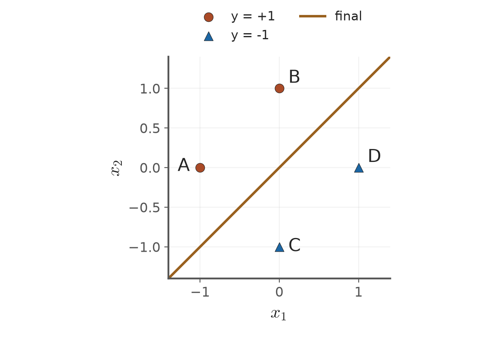

# 第3章 KP04：線上感知器（Online perceptron）

> 程度：研究生（grad）／Level: Graduate (grad)
>
> [下載本KP簡報（JianBauDau slides）](../slides/lec03-kp04-online-perceptron.jbd.json)
>
> 圖型識別 AIIA50260，2026秋季；一個KP一個講義檔案。
>
> Pattern Recognition AIIA50260, Fall 2026. This handout contains one knowledge point.
>
> 來源：[線性分類器 §3.3，KP04](https://ndhuccc.github.io/CCC-LNS/PR_115/Ch03-linear-classifiers/index.html#kp4)及對應教授祕笈與互動程式。內容讀取：2026-10-16（Asia/Taipei）；HTML blob：`bd64b78ba21606d078c672b0fa67337b017e4a34`。
>
> Source: §3.3, KP04, including its teaching notes and interactive code. Accessed October 16, 2026, Asia/Taipei.

## 學習目標（Learning objectives）

逐筆更新原例四點，判斷完整無更新的一輪。

Update the four source samples and identify a full pass without updates.

## 先備符號（Prerequisite notation）

本檔以 $y_i\in\{-1,+1\}$表示真實類別，$\mathbf{a}_i=(\mathbf{x}_i^T,1)^T$表示增廣樣本，$\mathbf{v}=(\mathbf{w}^T,b)^T$包含截距。分數為 $g_i=\mathbf{v}^T\mathbf{a}_i$，$y_i g_i>0$才嚴格分對。

The true label is positive or negative one. The augmented sample ends in one, and the weight vector includes the intercept. Strict correctness requires a positive label-adjusted score.

## KP04：逐筆更新與完整檢查（Sequential updates and complete verification）

### 1.1 一筆資料只決定一次動作（One sample determines one action）

**一句話重點**：當前樣本不合格才更新；完整一輪沒有更新才停止。

**One-sentence summary**: Update only when the current sample fails. Stop after a complete pass without updates.

**白話說明**：前面是收齊錯題再改答案，這裡改成一張卡片一張卡片檢查。答對就保留權重，答錯或剛好落在邊界才修正。這個比喻描述檢查順序，不表示它比批次方法固定快多少倍。

**Plain explanation**: Previously, we collected mistakes before updating. Here we check one card at a time. Keep the weights for a correct answer; update for a mistake or boundary tie. The analogy describes order, not a fixed speed advantage over batch processing.

**正式定義**：本節 $t$計樣本呈現次數，不同於上一節的修正次數。輸入為 $\mathbf{a}_{i_t}$，規則為

**Formal definition**: Here $t$ counts sample presentations, unlike the update counter in the previous proof. For presented sample $\mathbf{a}_{i_t}$,

$$
\mathbf{v}_{t+1}=\begin{cases}
\mathbf{v}_t+\rho y_{i_t}\mathbf{a}_{i_t},&y_{i_t}\mathbf{v}_t^T\mathbf{a}_{i_t}\le0,\\
\mathbf{v}_t,&y_{i_t}\mathbf{v}_t^T\mathbf{a}_{i_t}>0.
\end{cases}
$$

這同時包含「正類加回、負類扣除」。固定資料需反覆呈現，才可使用可分資料的有限錯誤保證。每筆都仍需計算內積；答對並不等於零運算。

This combines addition for positive mistakes and subtraction for negative mistakes. Repeated presentation of a fixed dataset supports the finite-mistake guarantee. Every sample still requires an inner product; correctness does not mean zero computation.

### 1.2 原例3.2：4個點的更新紀錄（Example 3.2: tracing four points）

**例子**：正類為 $A=(-1,0)$、$B=(0,1)$；負類為 $C=(0,-1)$、$D=(1,0)$。初始權重為0，學習率為1，依A、B、C、D順序呈現。

**Example**: Positive samples are $A=(-1,0)$ and $B=(0,1)$. Negative samples are $C=(0,-1)$ and $D=(1,0)$. Start from zero, use step one, and present A, B, C, D.

$$
\begin{aligned}
g_A&=0(-1)+0(0)+0=0,&\mathbf{v}_1&=(0,0,0)^T+(-1,0,1)^T=(-1,0,1)^T,\\
g_B&=(-1)(0)+0(1)+1=1,&\mathbf{v}_2&=\mathbf{v}_1,\\
g_C&=(-1)(0)+0(-1)+1=1,&\mathbf{v}_3&=(-1,0,1)^T-(0,-1,1)^T=(-1,1,0)^T,\\
g_D&=(-1)(1)+1(0)+0=-1,&\mathbf{v}_4&=\mathbf{v}_3.
\end{aligned}
$$

| 呈現次序 | 樣本 | 舊分數 | 動作 | 新權重 |
|---:|---|---:|---|---|
| 1 | A，正類／positive | 0 | 加回／Add | $(-1,0,1)$ |
| 2 | B，正類／positive | 1 | 不動／Keep | $(-1,0,1)$ |
| 3 | C，負類／negative | 1 | 扣除／Subtract | $(-1,1,0)$ |
| 4 | D，負類／negative | -1 | 不動／Keep | $(-1,1,0)$ |
| 5–8 | 再查A、B、C、D／Recheck all | $1,1,-1,-1$ | 全部不動／Keep all | $(-1,1,0)$ |

最終邊界為 $-x_1+x_2=0$。第5–8次呈現提供完整無更新的一輪；來源正文寫成5–7步，與四點完整一輪不一致。本講義採完整檢查法。

The final boundary is $-x_1+x_2=0$. Presentations five through eight form a complete pass without updates. The source's five-through-seven label does not cover all four points. We use the complete-pass method.

**圖說 `lec03-kp04-online`**：先看圓點A、B與三角形C、D，再看穿過原點的 $x_1=x_2$。四個點都與邊界有正距離；使用相同比例的座標軸。〔功能：空間幾何、精準度〕

**Caption `lec03-kp04-online`**: Locate circles A and B and triangles C and D. Then inspect the boundary through the origin. Every point has positive distance from it. Both axes use equal scales.

### 1.3 記憶體節省的實際意義（What memory savings actually mean）

線上方法可逐筆讀入資料，權重與暫存樣本所需空間是 $O(d)$，對樣本數 $n$為常數。但完整重掃仍需可重讀資料。資料持續改變的串流，不自動符合固定訓練集定理。

Sequential processing needs $O(d)$ space for weights and a current sample, constant with respect to sample count. Complete rescans require replayable data. A changing stream does not automatically satisfy the fixed-dataset theorem.

**常見迷思**：一筆答對不能停止；掃過一輪但中間有修正也不能據此停止。批次與線上方法的更新時機不同，通常不會走相同路徑。

**Common misconception**: One correct answer is insufficient for stopping. A pass containing updates is also insufficient. Batch and sequential updates use different timing and generally follow different paths.

**小練習**：來源要求改用B、A、D、C順序，仍從零權重開始。提示：每筆先用最新權重計分，再決定動作；最後完整複查。可行分隔線不唯一，先算再比較。

**Practice**: Repeat with the source's alternative order B, A, D, C from zero. Hint: score each sample using the latest weights, then act. Finish with a full verification pass. Compute before comparing feasible boundaries.

可分時我們可以等到零錯誤；若資料根本不可分，這個停止條件便無法達成。下一節改問：有限時間內應交出哪個權重？

For separable data we can wait for no mistakes. Inseparable data cannot satisfy that condition. Which weights should a finite run return?

## 術語表（Glossary）

| 中文 | English | 白話解釋 |
|---|---|---|
| 增廣向量 | Augmented vector | 多加常數1，讓截距一起參與內積 |
| 有標籤分數 | Label-adjusted score | 把原分數乘上真實正負標籤 |
| 線性可分 | Linearly separable | 存在一個超平面把兩類嚴格分開 |
| 線上學習 | Online learning | 每次用一筆樣本決定是否更新 |

## 來源與更正（Sources and corrections）

四點完整複查標為第5–8次；空間為隨維度變化的O(d)，每筆仍需計分。

The complete recheck uses presentations five through eight. Memory scales with dimension, and every sample still requires scoring.

## 相鄰知識點（Adjacent knowledge points）

- 前一個：[感知器收斂證明](lec03-kp03-convergence.md)（Previous: Perceptron convergence）
- 下一個：[神經元與口袋演算法](lec03-kp05-neuron-pocket.md)（Next: Neuron and pocket algorithm）
