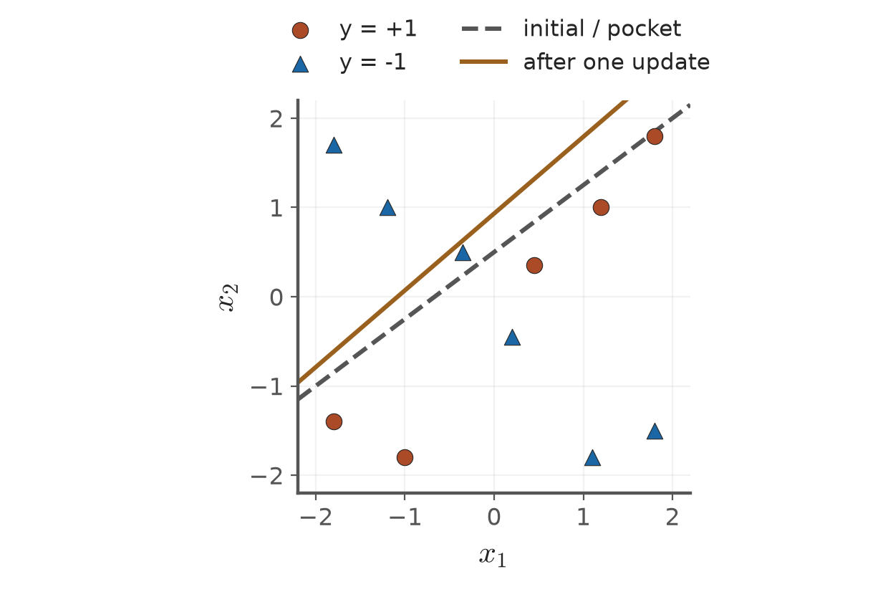
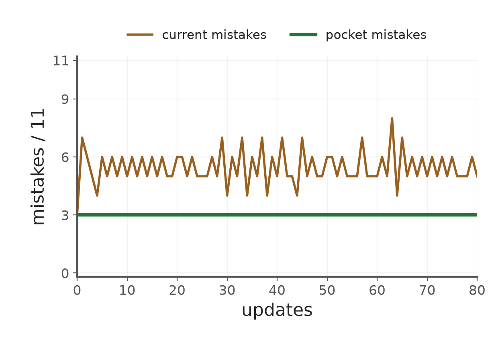

# 第3章 KP05：神經元與口袋演算法（Neuron and pocket algorithm）

> 程度：研究生（grad）／Level: Graduate (grad)
>
> [下載本KP簡報（JianBauDau slides）](../slides/lec03-kp05-neuron-pocket.jbd.json)
>
> 圖型識別 AIIA50260，2026秋季；一個KP一個講義檔案。
>
> Pattern Recognition AIIA50260, Fall 2026. This handout contains one knowledge point.
>
> 來源：[線性分類器 §3.3，KP05](https://ndhuccc.github.io/CCC-LNS/PR_115/Ch03-linear-classifiers/index.html#kp5)及對應教授祕笈與互動程式。內容讀取：2026-10-16（Asia/Taipei）；HTML blob：`bd64b78ba21606d078c672b0fa67337b017e4a34`。
>
> Source: §3.3, KP05, including its teaching notes and interactive code. Accessed October 16, 2026, Asia/Taipei.

## 學習目標（Learning objectives）

區分預測與訓練，保存已觀察到的最佳權重。

Distinguish prediction from training and retain the best observed weights.

## 先備符號（Prerequisite notation）

本檔以 $y_i\in\{-1,+1\}$表示真實類別，$\mathbf{a}_i=(\mathbf{x}_i^T,1)^T$表示增廣樣本，$\mathbf{v}=(\mathbf{w}^T,b)^T$包含截距。分數為 $g_i=\mathbf{v}^T\mathbf{a}_i$，$y_i g_i>0$才嚴格分對。

The true label is positive or negative one. The augmented sample ends in one, and the weight vector includes the intercept. Strict correctness requires a positive label-adjusted score.

## KP05：預測用神經元，訓練保留最佳紀錄（A neuron predicts; a pocket retains the best record）

### 1.1 加權分數與硬式判斷（Weighted scores and hard decisions）

**一句話重點**：神經元描述如何做預測，口袋描述如何保存訓練結果。

**One-sentence summary**: The neuron describes prediction; the pocket describes retaining a training result.

**白話說明**：把模型想成門衛。門衛先替線索加權，再按門檻決定放行。這不提供機率，也不保證新客人都分對。訓練則是在調整這套規則，兩者不可混淆。

**Plain explanation**: Imagine a guard who weights evidence and then applies a threshold. This gives neither probabilities nor guaranteed correctness on new visitors. Training adjusts the rule; prediction uses it.

**正式定義**：感知器的加權合成器先算分數，再將分數交給硬限幅器。為了明確處理平手，本講義預測採正類優先。

**Formal definition**: A perceptron computes a weighted sum and applies a hard limiter. For a concrete prediction tie rule, this handout assigns ties to the positive class.

$$
z=\sum_{j=1}^{d}w_jx_j+b,\qquad
\widehat y=h(z)=\begin{cases}+1,&z\ge0,\\-1,&z<0.\end{cases}
$$

來源的 $b$相當於加上的偏置；若把門檻記為 $\theta$，則 $b=-\theta$。訓練仍把所有零分數列入待修正，較預測平手規則更嚴格。

The added value $b$ is a bias. A threshold written as $\theta$ corresponds to $b=-\theta$. Training still flags every zero score, a stricter criterion than prediction tie handling.

| 階段 | 中文說明 | English explanation |
|---|---|---|
| 輸入／Input | 取特徵與對應權重 | Read features and their corresponding weights |
| 合成／Combination | 相乘、加總並加入偏置 | Multiply, sum, and add the bias |
| 輸出／Output | 硬限幅器決定離散類別 | Apply the hard limiter to choose a discrete class |

圖說：先看加權總和，再看硬限幅器；合併兩個運算後就是單一神經元符號。此為可編輯流程示意，非生物神經元的精確模型。

Caption: Follow the weighted sum and then the hard limiter. Combining these operations gives the single-neuron symbol. This is an editable computational diagram, not an exact biological model.

### 1.2 多記一個歷史最佳權重（Keep one additional best-so-far vector）

上一節的停止條件要求零不合格點。不可分時，普通更新可能持續，甚至循環。口袋法另外保留目前見過正確數最多的權重，不要求當前權重每次都改善。

The previous stopping rule requires no failing samples. With inseparable data, updates can continue or cycle. The pocket separately retains the best observed weights. Current weights need not improve at every step.

令 $C(\mathbf{v})=\sum_i\mathbf{1}\{y_i\mathbf{v}^T\mathbf{a}_i>0\}$為嚴格正確數。先把初始權重存入口袋，並實際計算它的成績。

Let $C(\mathbf{v})$ count strictly correct samples. Initialize the pocket with the initial vector and evaluate its actual score.

$$
\mathbf{v}_{\mathrm{best}}\leftarrow\mathbf{v}_0,\qquad
H\leftarrow C(\mathbf{v}_0).
$$

每次更新後算 $c=C(\mathbf{v}_{t+1})$。只有 $c>H$才同時替換最佳向量與 $H$。相同成績保留舊向量。於是 $H_{t+1}\ge H_t$，最佳嚴格錯誤數不增加。

After each update, evaluate the new vector. Replace both the stored vector and its score only on strict improvement. Keep the old vector on a tie. The best score cannot decrease.

| 符號 | 中文意義 | English meaning |
|---|---|---|
| $\mathbf{v}_t$ | 當前嘗試的權重 | Weights currently being tried |
| $\mathbf{v}_{\mathrm{best}}$ | 歷史最佳權重的獨立副本 | Independent copy of the best observed weights |
| $C(\mathbf{v})$ | 分數嚴格合格的樣本數 | Number of strictly correct samples |
| $H$ | 口袋記錄的最佳正確數 | Best correct count retained in the pocket |
| $c$ | 這次候選權重的正確數 | Correct count of the current candidate |

### 1.3 來源11點：一次修正反而變差（The source's eleven points: an update can hurt）

**例子**：使用來源互動程式全部11點。前5點是正類，後6點是負類。初始權重為 $(0.3,-0.4,0.2)^T$，學習率為0.35。

**Example**: Use all eleven points from the source demonstration. The first five are positive and the final six negative. Initial weights are $(0.3,-0.4,0.2)^T$, with step 0.35.

| 索引 | $\mathbf{x}$ | $y$ |
|---:|---|---:|
| 1 | $(1.8,1.8)$ | $+1$ |
| 2 | $(1.2,1.0)$ | $+1$ |
| 3 | $(-1.8,-1.4)$ | $+1$ |
| 4 | $(-1.0,-1.8)$ | $+1$ |
| 5 | $(0.45,0.35)$ | $+1$ |
| 6 | $(-1.8,1.7)$ | $-1$ |
| 7 | $(-1.2,1.0)$ | $-1$ |
| 8 | $(1.8,-1.5)$ | $-1$ |
| 9 | $(1.1,-1.8)$ | $-1$ |
| 10 | $(0.2,-0.45)$ | $-1$ |
| 11 | $(-0.35,0.5)$ | $-1$ |

初始嚴格正確數為8。錯誤發生於8、9、10號負類點，其 $\delta_i=+1$。

Initially eight samples are strictly correct. Mistakes occur at negative samples eight, nine, and ten, whose negated labels equal one.

$$
\begin{aligned}
\sum_{i\in Y}\delta_i\mathbf{a}_i
&=(1.8,-1.5,1)^T+(1.1,-1.8,1)^T+(0.2,-0.45,1)^T\\
&=(3.1,-3.75,3)^T,\\
\mathbf{v}_1
&=(0.3,-0.4,0.2)^T-0.35(3.1,-3.75,3)^T\\
&=(0.3-1.085,-0.4+1.3125,0.2-1.05)^T\\
&=(-0.785,0.9125,-0.85)^T.
\end{aligned}
$$

用11點重新計分，新權重只分對4點。口袋比較 $4<8$，所以保留初始權重。這個8不是假定的保證值，而是來源資料逐點計算的結果。

Reevaluating all eleven points gives only four correct samples. Since four is below eight, the pocket keeps the initial weights. The count eight is computed from the source data, not an assumed guarantee.



**圖說 `lec03-kp05-boundaries`**：先看初始虛線，再看第一次更新後的實線；圓點5個、三角形6個。雖然錯點驅動更新，正確數仍由8降到4，所以口袋保留虛線。〔功能：空間幾何、反例〕

**Caption `lec03-kp05-boundaries`**: Compare the initial dashed boundary with the solid boundary after one update. There are five circles and six triangles. Correctness falls from eight to four, so the pocket retains the dashed boundary.



**圖說 `lec03-kp05-errors`**：先看當前錯誤數的起伏，再看口袋錯誤數不增加。資料、初值與0.35步長完全相同；80次更新為程式計算，不是實測新實驗。〔功能：精準度、比較〕

**Caption `lec03-kp05-errors`**: Compare fluctuating current mistakes with nonincreasing pocket mistakes. The same data, initialization, and step 0.35 are used for eighty computed updates. This reproduces the source algorithm rather than reporting a new experiment.

### 1.4 哪些保證可以帶到實作（Which guarantees transfer to an implementation）

**常見迷思**：歷史最佳不變差，不代表找到所有可能分類線中最好的線，也不代表測試資料成績最好。你仍需設定更新預算，最後回傳口袋副本。

**Common misconception**: A nondegrading record does not prove global optimality among all boundaries. It also does not guarantee the best test performance. Set an update budget and return an independent pocket copy.

**[查核限制]** Gallant的原論文摘要確認口袋法處理不可分資料。摘要未提供完整最優性定理假設。本講義未將隨機版本的漸近最優性直接套用到網頁的固定批次流程。本批能直接證明的是保存規則的單調性。

**[Verification limit]** Gallant's abstract confirms that pocket learning addresses inseparable data. It does not provide the full assumptions of an optimality theorem. We do not transfer stochastic asymptotic guarantees to the webpage's deterministic batch procedure. Monotonic retention is established directly here.

**[補充] 與實作的連結**：下列程式與來源同採批次修正。它先評估初始解，避免第一次較差的候選解覆蓋紀錄。`copy()`避免兩個變數指向同一個可變陣列。

**[Added] Implementation**: The following code uses batch corrections, as the source does. Evaluating initialization prevents a worse first candidate from replacing the record. An independent copy avoids aliasing a mutable array.

```python
import numpy as np

def pocket_batch(X, y, initial, rho=0.35, steps=80):
    A = np.column_stack((X, np.ones(len(X))))
    v = np.asarray(initial, dtype=float).copy()
    best = v.copy()
    best_count = int(np.sum(y * (A @ best) > 0))
    for _ in range(steps):
        bad = y * (A @ v) <= 0
        if not np.any(bad):
            break
        v += rho * (y[bad, None] * A[bad]).sum(axis=0)
        count = int(np.sum(y * (A @ v) > 0))
        if count > best_count:
            best, best_count = v.copy(), count
    return best, best_count
```

本例使用嚴格分數評估；若要改用預測標籤正確率，必須明列零分數歸類，且保持整段評估一致。全資料評估每次需 $O(nd)$計算，口袋增加一個 $O(d)$權重副本。

This example evaluates strict scores. If using prediction accuracy instead, specify a tie rule and use it consistently. Full evaluation costs $O(nd)$ per candidate. The pocket adds one $O(d)$ weight copy.

**小練習**：來源給 $\sum\delta_i\mathbf{a}_i=(2,-1,4)^T$、當前權重 $(1,0.5,-0.2)^T$、步長0.1。求新權重，並判斷能否只靠這些數字決定替換口袋。提示：更新後還缺候選正確數與歷史最佳正確數。

**Practice**: The source gives combined correction $(2,-1,4)^T$, current weights $(1,0.5,-0.2)^T$, and step 0.1. Find the new weights. Can those values alone determine pocket replacement? Hint: the candidate and historical correct counts are still needed.

感知器目前只有兩個輸出。若要讓多個類別互相比較，如何把它們的分數要求寫成可學的不等式？這是KP06的問題。

The current perceptron has two outputs. How can competing scores for multiple classes become learnable inequalities? KP06 addresses that question.

## 術語表（Glossary）

| 中文 | English | 白話解釋 |
|---|---|---|
| 增廣向量 | Augmented vector | 多加常數1，讓截距一起參與內積 |
| 有標籤分數 | Label-adjusted score | 把原分數乘上真實正負標籤 |
| 批次更新 | Batch update | 用同一舊權重找出整批錯點後更新 |
| 線性可分 | Linearly separable | 存在一個超平面把兩類嚴格分開 |
| 偏置 | Bias | 加在加權總和上的常數 |
| 硬限幅器 | Hard limiter | 依分數正負輸出離散類別 |
| 口袋演算法 | Pocket algorithm | 另外保存訓練中見過的最佳權重 |

## 來源與更正（Sources and corrections）

初始化時實際評估並保存獨立副本；固定批次範例只直接保證歷史最佳不變差，不套用未核實的隨機最優性定理。

Evaluate and copy initialization. This deterministic batch example establishes nondegrading retention, not unverified stochastic optimality guarantees.

補充文獻：S. I. Gallant, “Perceptron-based learning algorithms,” IEEE Transactions on Neural Networks 1(2), 179–191 (1990)，[DOI:10.1109/72.80230](https://doi.org/10.1109/72.80230)。僅讀到[論文摘要](https://pubmed.ncbi.nlm.nih.gov/18282835/)，未讀到全文。

Additional reference: Gallant (1990). Only the indexed abstract was accessible; the full theorem assumptions were not verified.

## 相鄰知識點（Adjacent knowledge points）

- 前一個：[線上感知器](lec03-kp04-online-perceptron.md)（Previous: Online perceptron）
- 下一個：KP06（Next: KP06）
