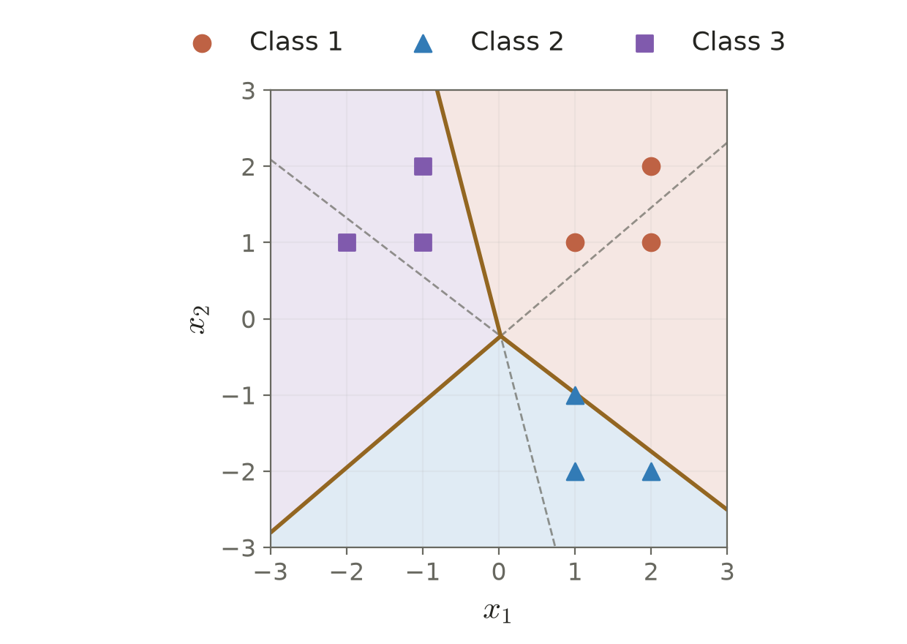

# Lecture 03 · KP06：把多類比較整理成感知器限制（Turning multiclass comparisons into perceptron constraints）

> 程度：研究生（grad）／Level: Graduate (grad)
>
> 週次：第 3 週（2026-09-21）｜進度：Linear Classifiers
>
> Week 3 (2026-09-21) | Topic: Linear Classifiers

[JianBauDau 簡報](../slides/lec03-kp06-kesler-with-comics.jbd.json)

## 學習目標（Learning objectives）

- 把最高分規則寫成全部競爭類別的限制（Express the maximum-score rule as constraints against every competing class）。
- 建立 Kesler 區塊向量並核對維度（Construct Kesler block vectors and verify their dimensions）。
- 用 Example 3.3 檢查分數與限制是否一致（Check scores and constraints using Example 3.3）。

## KP06：同時贏過每個對手才是最高分（Winning every comparison means having the highest score）

**一句話重點**：Kesler 建構法把多類別的勝負條件，翻成同一個高維空間中的正內積限制。

**One-sentence summary**: Kesler's construction expresses multiclass comparisons as positive inner-product constraints in one enlarged space.

### 1. 從兩類門檻走到多類評分（From a binary threshold to multiclass scores）

KP05 解釋如何保留較好的感知器權重。現在假設資料有 3 類，單一正負號便不足以指明類別。我們讓每一類各有一個評分函數，再比較分數。

KP05 explained how to retain better perceptron weights. With three classes, one sign cannot identify the class. We assign each class a score and compare them.

**白話說明**：想像有多位評審，每位代表一類。同一筆資料交給所有評審，最高分決定預測。這個比喻只描述分數比較；分數不是信心機率，也不要求加總為 1。

**Plain explanation**: Imagine one judge for each class. Every judge scores the same sample, and the largest score determines the prediction. This analogy describes comparisons only. Scores are not probabilities and need not sum to one.

| 符號 | 中文意義 | English meaning |
|---|---|---|
| $l,M,N$ | 原始特徵數、類別數、樣本數 | Original dimension, classes, and samples |
| $\mathbf{r}\in\mathbb R^l$ | 原始特徵 | Original feature vector |
| $\mathbf{a}=[\mathbf{r}^T,1]^T$ | 含偏置位置的增廣向量，維度 $l+1$ | Augmented vector including the bias position |
| $\mathbf{w}_i\in\mathbb R^{l+1}$ | 第 $i$ 類權重，最後一項是偏置 | Class weight vector ending with its bias |
| $g_i=\mathbf{w}_i^T\mathbf{a}$ | 第 $i$ 類分數 | Score for class $i$ |
| $\mathbf{v},\mathbf{z}_{ij}$ | 串接權重及比較用區塊向量 | Stacked weights and comparison vector |

**正式定義**：若樣本屬於第 $i$ 類，嚴格分類條件是它勝過所有其他類。

**Formal definition**: A sample from class $i$ must strictly outscore every competing class.

$$
g_i(\mathbf a)>g_j(\mathbf a)\quad\text{for every }j\ne i.
$$

「勝過其中一類」不足以成為最大值。預測時可另定平手規則；訓練的嚴格正限制則將平手列為尚未滿足。

Beating one competitor is insufficient. Prediction may use a tie rule, while strict training constraints treat ties as unsatisfied.

### 2. 用區塊內積表示一場比較（Encoding one comparison with blocks）

既然要比較兩個分數，先把它們相減。把各類權重依順序堆起來，再把同一筆樣本放在正負兩個區塊。

To compare two scores, subtract them. Stack the class weights, and place positive and negative copies of the sample in two blocks.

$$
\mathbf v=\begin{bmatrix}\mathbf w_1\\ \vdots\\\mathbf w_M\end{bmatrix},
\qquad
\mathbf z_{ij}=\begin{bmatrix}\mathbf0\\\vdots\\+\mathbf a\;\text{(block }i\text{)}\\\vdots\\-\mathbf a\;\text{(block }j\text{)}\\\vdots\\\mathbf0\end{bmatrix}.
$$

內積逐區塊相乘。零區塊沒有貢獻，因此只剩兩個分數的差。

The inner product sums block contributions. Zero blocks contribute nothing, leaving the difference between two scores.

$$
\mathbf v^T\mathbf z_{ij}
=\mathbf w_i^T\mathbf a-\mathbf w_j^T\mathbf a
=g_i(\mathbf a)-g_j(\mathbf a)>0.
$$

每筆樣本需要 $M-1$ 個比較。總計有 $N(M-1)$ 個向量，每個維度為 $M(l+1)$。這是整理限制的計算座標，沒有增加新的觀測特徵。

Each sample requires $M-1$ comparisons. There are $N(M-1)$ vectors, each with dimension $M(l+1)$. These coordinates organize constraints without adding observed features.

若某個限制非正，可用感知器修正 $\mathbf v\leftarrow\mathbf v+\rho\mathbf z_{ij}$，其中 $\rho>0$。等價地，正確類權重加上 $\rho\mathbf a$，競爭類權重減去同一向量。

For a nonpositive constraint, use the perceptron update $\mathbf v\leftarrow\mathbf v+\rho\mathbf z_{ij}$ with $\rho>0$. It raises the correct-class weights and lowers the competing-class weights by the same scaled sample.

### 3. Example 3.3：二維樣本形成九維限制（Example 3.3: Two-dimensional samples yield nine-dimensional constraints）

**例子**：保留來源的 9 筆資料及 3 組權重。這裡 $l=2$、$M=3$，所以區塊長度為 3，串接長度為 9。

**Example**: We retain the source's nine samples and three weight vectors. Each block has three entries, giving nine stacked coordinates.

| 類別 | 樣本 | English description |
|---|---|---|
| $\omega_1$ | $(1,1),(2,2),(2,1)$ | Class 1 samples |
| $\omega_2$ | $(1,-1),(1,-2),(2,-2)$ | Class 2 samples |
| $\omega_3$ | $(-1,1),(-1,2),(-2,1)$ | Class 3 samples |

$$
\mathbf w_1=(5.13,3.60,1.00)^T,\quad
\mathbf w_2=(-0.05,-3.16,-0.41)^T,\quad
\mathbf w_3=(-3.84,1.28,0.69)^T.
$$

對第 1 類的 $(1,1)$，增廣後是 $\mathbf a=(1,1,1)^T$。它需要兩個限制。

For the class-1 sample $(1,1)$, augment to $\mathbf a=(1,1,1)^T$. It requires two constraints.

$$
\mathbf z_{12}=(1,1,1,-1,-1,-1,0,0,0)^T,
\quad
\mathbf z_{13}=(1,1,1,0,0,0,-1,-1,-1)^T.
$$

$$
\begin{aligned}
g_1&=5.13+3.60+1.00=9.73,\\
g_2&=-0.05-3.16-0.41=-3.62,\\
g_3&=-3.84+1.28+0.69=-1.87,\\
\mathbf v^T\mathbf z_{12}&=9.73-(-3.62)=13.35>0,\\
\mathbf v^T\mathbf z_{13}&=9.73-(-1.87)=11.60>0.
\end{aligned}
$$

[補充] 全部 $9\times2=18$ 個限制也以 Python 檢查，最小值為 $0.17$。最小限制來自第 2 類樣本 $(1,-1)$ 對第 1 類的比較：$2.70-2.53=0.17$。

[Added] Python verifies all eighteen constraints. The smallest is $0.17$, from class 2's sample $(1,-1)$ against class 1: $2.70-2.53=0.17$.

**圖說 `lec03-kp06-regions`**：先看 9 個樣本的符號，再看背景所代表的最高分類別。細虛線是兩分數相等的位置；其中落在第三類高分區的線段，不是最終決策邊界。圖用原權重計算，沒有重新訓練。〔功能：1、2、3〕

**Caption `lec03-kp06-regions`**: Inspect the nine sample markers, then the maximum-score regions. Thin dashed lines show pairwise equalities. Segments inside a third class's region are not final boundaries. The plot uses the supplied weights without retraining.

來源另報告固定步長 $0.5$、隨機初值下 4 次疊代收斂。未提供亂數種子及完整更新順序，因此本次只能確認給定權重可行，不能聲稱重現該訓練次數。

The source reports convergence after four iterations with step $0.5$ and random initialization. The seed and complete update order are unavailable. We verify feasibility, not the reported training count.

### 4. 可分條件與實作成本仍然存在（Separability and implementation costs still matter）

**常見迷思**：擴增維度不會自動解決任何不可分問題。Kesler 只是等價地重寫線性分數限制。有限步收斂仍需要這些限制存在嚴格可行解。

**Common misconception**: Enlarging the representation does not solve every inseparable problem. Kesler rewrites linear-score constraints equivalently. Finite termination still requires strict feasibility.

它也不同於分開訓練的「一對其餘」。這裡每個比較都共用同一組類別權重。若不想配置完整的高維零向量，實作時只更新兩個非零區塊。

This differs from separately trained one-versus-rest classifiers. All comparisons share the same class weights. Implementation can update only the two nonzero blocks instead of allocating large zero-filled vectors.

**想深入**：對所有類別權重加上同一向量，不會改變任何分數差。因此可行權重通常不唯一。

**Going deeper**: Adding the same vector to every class weight leaves all score differences unchanged. Feasible weights are generally nonunique.

**小練習**：沿用來源練習，令 $M=4$、$l=5$，計算串接維度。再將 $g_1=2.4,g_2=2.1,g_3=2.3$ 寫成第 1 類必須滿足的限制。提示：先加偏置位置，再逐一減去競爭分數。

**Practice**: Using the source exercises, find the stacked dimension for four classes with five original features. Convert the given scores into class-1 constraints. Hint: include the bias position and subtract each competing score.

## 小結與下一步（Summary and next step）

- 每個正確類別都要贏過所有競爭類別（The correct class must beat every competitor）。
- 區塊內積等於兩個分數的差（A block inner product equals a score difference）。
- 若資料無法嚴格分開，可改問「輸出能否盡量接近目標」，這引向 KP07 的 MSE（If strict separation fails, KP07 asks how closely outputs can match targets using MSE）。

## 延伸閱讀與來源（Further reading and sources）

- [第 3 章 §3.3、KP06 與教授祕笈](https://ndhuccc.github.io/CCC-LNS/PR_115/Ch03-linear-classifiers/index.html#kp6)。2026-10-16 讀取；本次由對應 GitHub 原始檔核對，blob `bd64b78ba21606d078c672b0fa67337b017e4a34`（Chapter 3, section 3.3, KP06; accessed 2026-10-16 through its GitHub source）。
- 教科書章節資訊見課程 [references](../references/)；本次未取得原書頁面，不提供未查核頁碼（See course references; original textbook pages were not inspected）。

## 術語表（Glossary）

| 中文 | English |
|---|---|
| 增廣向量 | Augmented vector |
| 判別分數 | Discriminant score |
| 區塊向量 | Block vector |
| 嚴格可行 | Strictly feasible |
| 一對其餘 | One versus rest |
| Kesler 建構法 | Kesler's construction |
