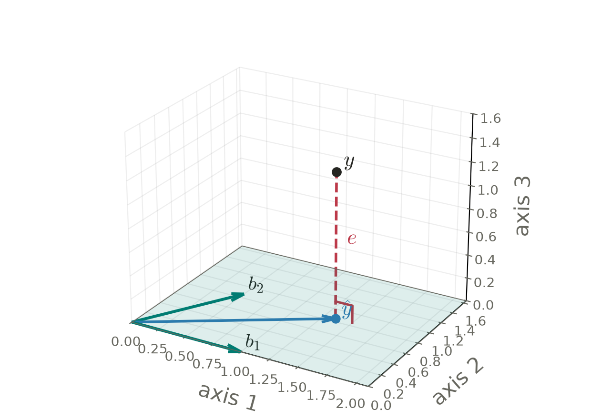

# Lecture 03 · KP07：平方誤差最小就是正交投影（Minimum squared error means orthogonal projection）

> 程度：研究生（grad）／Level: Graduate (grad)
>
> 週次：第 3 週（2026-09-21）｜進度：Linear Classifiers
>
> Week 3 (2026-09-21) | Topic: Linear Classifiers

[JianBauDau 簡報](../slides/lec03-kp07-mse-projection.jbd.json)

## 學習目標（Learning objectives）

- 從平方誤差推導 MSE 正規方程（Derive the MSE normal equations from squared error）。
- 區分特徵向量、權重與投影後輸出（Distinguish features, weights, and projected outputs）。
- 驗證殘差與全部可用方向正交（Verify that the residual is orthogonal to every available direction）。

## KP07：允許有殘差，仍能找到最佳線性輸出（Residuals can remain in the best linear prediction）

**一句話重點**：MSE 找的是最接近目標的線性輸出，不要求每筆樣本都分類正確。

**One-sentence summary**: MSE finds the closest linear prediction without requiring every sample to be classified correctly.

### 1. 將完全分開改成盡量接近（Replacing perfect separation with close prediction）

KP06 的限制需要嚴格可分。若類別重疊，反覆修正感知器可能停不下來。現在為每筆資料指定期望輸出，改量預測值與目標值的差。

KP06 requires strict separability. With overlapping classes, perceptron updates may continue indefinitely. We now assign desired outputs and measure prediction errors.

**白話說明**：像把物體投到一面銀幕，只能在銀幕上移動影子。最好的影子是離物體最近的位置。這個比喻表達投影幾何；MSE 的平均通常在隨機變數空間中計算。

**Plain explanation**: Imagine moving a shadow on a screen. The best shadow is the point closest to the object. The analogy explains projection, while MSE averages usually concern random variables.

| 符號 | 中文意義 | English meaning |
|---|---|---|
| $\mathbf x\in\mathbb R^d$ | 隨機特徵，必要時含常數 1 | Random feature vector, possibly including one |
| $y,\hat y$ | 目標及預測，純量 | Scalar target and prediction |
| $\mathbf w\in\mathbb R^d$ | 待估權重 | Weight vector to estimate |
| $e=y-\mathbf x^T\mathbf w$ | 有正負的殘差 | Signed residual |
| $E[\cdot]$ | 依資料分布取平均 | Expectation over the data distribution |
| $R_x,\mathbf p$ | 二階矩陣及特徵目標互相關，維度 $d\times d$、$d$ | Second-moment matrix and cross-moment vector |

**正式定義**：均方誤差是殘差平方的期望。假設特徵與目標的二階矩有限。

**Formal definition**: Mean squared error is the expected squared residual. Assume finite second moments for the features and target.

$$
\hat y=\mathbf x^T\mathbf w,\qquad
J(\mathbf w)=E[(y-\mathbf x^T\mathbf w)^2].
$$

二元分類可指定 $y=+1$ 或 $-1$。學習時比較連續輸出；最後才以正負號做分類。因此「分對但分數遠離目標」仍可能有平方誤差。

Binary targets can be positive or negative one. Training compares continuous outputs, and classification later uses their signs. A correctly classified sample can still have squared error.

### 2. 展開平方得到正規方程（Expanding the square gives the normal equations）

要找到最小值，先把權重相關的項分開。令 $R_x=E[\mathbf x\mathbf x^T]$、$\mathbf p=E[\mathbf x y]$。

To minimize the cost, collect the terms involving the weights. Define $R_x=E[\mathbf x\mathbf x^T]$ and $\mathbf p=E[\mathbf x y]$.

$$
\begin{aligned}
J(\mathbf w)
&=E[y^2]-2\mathbf w^T\mathbf p+\mathbf w^TR_x\mathbf w,\\
\nabla J(\mathbf w)
&=-2\mathbf p+2R_x\mathbf w
=-2E[\mathbf x(y-\mathbf x^T\mathbf w)].
\end{aligned}
$$

令梯度為零，得到正規方程。若 $R_x$ 正定，也就是所有非零特徵組合都有正的平均平方，解才唯一。

Setting the gradient to zero gives the normal equations. Positive definite $R_x$ makes the minimizing weights unique.

$$
R_x\hat{\mathbf w}=\mathbf p,
\qquad
\hat{\mathbf w}=R_x^{-1}\mathbf p\quad(R_x\text{ invertible}).
$$

**來源更正**：來源把梯度寫成正的 $2E[\mathbf x e]$。因為誤差定義為 $e=y-\mathbf x^T\mathbf w$，對權重微分會帶出負號。設為零時解不變，但梯度下降的方向必須正確。

**Source correction**: The source writes the gradient with a positive sign. Differentiating the stated residual produces a negative sign. The zero-gradient solution is unchanged, but gradient descent needs the correct direction.

$R_x$ 是未中心化的二階矩陣。共變異數另須扣除平均外積：$\operatorname{Cov}(\mathbf x)=R_x-E[\mathbf x]E[\mathbf x]^T$。只有平均為零時兩者相同。

$R_x$ is an uncentered second-moment matrix. Covariance subtracts the outer product of the mean. They coincide only for zero-mean features.

### 3. 梯度為零表示沒有可改善的平面方向（A zero gradient leaves no improving direction in the subspace）

把前式改寫成 $E[x_j e]=0$。最佳殘差與每個特徵方向都正交，亦即與它們的任意線性組合正交。

Rewrite the stationarity condition as $E[x_j e]=0$. The optimal residual is orthogonal to each feature direction and every linear combination of them.

對隨機變數，可用 $\langle u,v\rangle=E[uv]$ 定義內積。這裡將幾乎處處相等的變數視為同一元素。預測落在特徵張成的子空間；殘差則垂直於它。

Random variables use the inner product $\langle u,v\rangle=E[uv]$, identifying variables equal almost surely. Predictions lie in the feature span, and residuals are perpendicular to it.

對任何其他線性預測 $\tilde y$，平方誤差可分成兩項。交叉項因正交而消失，所以第二項只能增加誤差。

For another linear prediction $\tilde y$, the error splits into two terms. Orthogonality removes the cross term, so the second term cannot improve the optimum.

$$
E[(y-\tilde y)^2]
=E[(y-\hat y)^2]+E[(\hat y-\tilde y)^2]
\ge E[(y-\hat y)^2].
$$

### 4. 用三維數字看見投影（Seeing projection with three-dimensional numbers）

**例子**：沿用來源互動程式的初值。此處用有限維幾何示範投影；$X$ 的兩欄是基底，並非單一樣本的兩個特徵座標。

**Example**: Use the source demo's initial values. This finite-dimensional example illustrates projection. The columns of $X$ are basis vectors, not two coordinates of one sample.

$$
\mathbf b_1=(1,0,0)^T,\quad
\mathbf b_2=(0.5,\sqrt3/2,0)^T,\quad
\mathbf y=(1.35,0.85,1.25)^T,\quad X=[\mathbf b_1\ \mathbf b_2].
$$

$$
X^TX=\begin{bmatrix}1&0.5\\0.5&1\end{bmatrix},\quad
X^T\mathbf y=\begin{bmatrix}1.35\\0.675+0.85\sqrt3/2\end{bmatrix}
\approx\begin{bmatrix}1.35\\1.4111216\end{bmatrix}.
$$

行列式為 $1-0.25=0.75$。代入二階矩陣的逆，得到係數。

The determinant is $0.75$. Applying the two-by-two inverse yields the coefficients.

$$
\hat{\mathbf w}=\frac1{0.75}
\begin{bmatrix}1&-0.5\\-0.5&1\end{bmatrix}
\begin{bmatrix}1.35\\1.4111216\end{bmatrix}
\approx\begin{bmatrix}0.8592523\\0.9814955\end{bmatrix}.
$$

$$
\begin{aligned}
\hat{\mathbf y}&=X\hat{\mathbf w}
=0.8592523\mathbf b_1+0.9814955\mathbf b_2
\approx(1.35,0.85,0)^T,\\
\mathbf e&=\mathbf y-\hat{\mathbf y}=(0,0,1.25)^T,\\
\mathbf e^T\mathbf b_1&=0,\quad \mathbf e^T\mathbf b_2=0,\quad
\|\mathbf e\|^2=1.25^2=1.5625.
\end{aligned}
$$

計算保留完整精度，畫面顯示值則四捨五入。程式得到的近零內積約為浮點數誤差量級。

Calculations retain full precision while displayed values are rounded. Computed near-zero inner products have floating-point rounding error.

**圖說 `lec03-kp07-projection`**：先看兩個基底都在 $z=0$ 平面，再看目標垂直落到投影點。直角記號對應殘差與平面內方向正交。投影係數是 2 維，投影點與目標是 3 維，兩者不能混稱。〔功能：1、2、3〕

**Caption `lec03-kp07-projection`**: Locate both basis vectors in the plane, then follow the target to its projection. The right-angle mark indicates orthogonality. Coefficients have two entries; targets and projected points have three.

### 5. 多輸出可拆開，但資料條件不能省略（Multiple outputs separate, but assumptions remain）

若有 $M$ 類，可用目標向量 $\mathbf y$：正確類的位置設 1，其餘設 0。令 $W$ 的每一欄對應一類權重，平方範數展開就是 $M$ 個純量問題。

For multiple classes, use a target vector with one at the correct class and zeros elsewhere. Each column of $W$ holds one class's weights. Expanding the squared norm separates the scalar problems.

$$
E[\|\mathbf y-W^T\mathbf x\|^2]
=\sum_{i=1}^M E[(y_i-\mathbf w_i^T\mathbf x)^2].
$$

**常見迷思**：最佳投影不代表殘差為零，也不代表誤判率最低。平方誤差對極端數值較敏感；資料若不具有限二階矩，本節目標也可能無法定義。

**Common misconception**: Optimal projection does not imply zero residual or minimum classification error. Squared error is sensitive to extreme values. Without finite second moments, the objective may be undefined.

**想深入**：若特徵方向重複，$R_x$ 可能奇異。最佳預測仍可存在，但權重未必唯一。KP09 會用偽逆處理有限資料的同類問題。

**Going deeper**: Repeated feature directions may make $R_x$ singular. The optimal prediction can exist without unique weights. KP09 uses the pseudoinverse for the finite-data counterpart.

**小練習**：來源練習把基底改成 $(1,0,0)^T,(0,1,0)^T$，目標改為 $(2,-1,3)^T$。請求係數、投影、殘差並檢查內積。提示：先寫 $X$ 的兩欄，再解正規方程。

**Practice**: Use coordinate-axis bases and target $(2,-1,3)^T$. Find coefficients, prediction, and residual; check orthogonality. Hint: construct the two columns of $X$ before solving.

## 小結與下一步（Summary and next step）

- 梯度帶負號，最佳解滿足正交條件（The gradient has a negative sign; the optimum satisfies orthogonality）。
- 最佳輸出是投影，權重則是表示投影的係數（The output is a projection; weights are its coefficients）。
- 真實資料的期望值可能未知，KP08 將以逐筆樣本代替期望（KP08 replaces unavailable expectations with individual samples）。

## 延伸閱讀與來源（Further reading and sources）

- [第 3 章 §3.4.1、KP07 與教授祕笈](https://ndhuccc.github.io/CCC-LNS/PR_115/Ch03-linear-classifiers/index.html#kp7)，2026-10-16 由對應 GitHub 原始檔核對，blob `bd64b78ba21606d078c672b0fa67337b017e4a34`（Source checked through GitHub on 2026-10-16）。
- 原書頁面本次未讀取；梯度及投影數值由本次推導與 Python 獨立核算（Original textbook pages were unavailable; derivatives and numerical projection were checked independently）。

## 術語表（Glossary）

| 中文 | English |
|---|---|
| 均方誤差 | Mean squared error, MSE |
| 殘差 | Residual |
| 二階矩陣／自相關矩陣 | Second-moment / autocorrelation matrix |
| 互相關向量 | Cross-correlation vector |
| 正規方程 | Normal equations |
| 正定 | Positive definite |
| 子空間 | Subspace |
| 正交投影 | Orthogonal projection |
