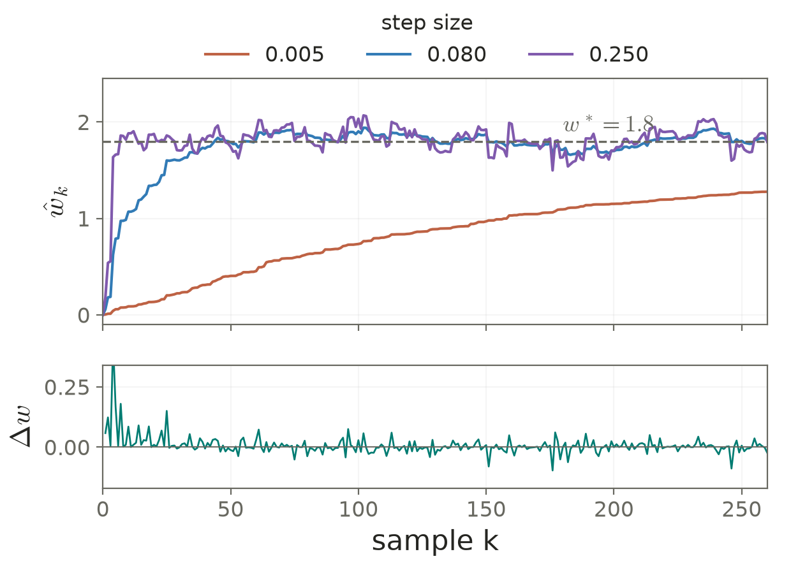

# Lecture 03 · KP08：用當下誤差逐筆修正權重（Updating weights with the current sample error）

> 程度：研究生（grad）／Level: Graduate (grad)
>
> 週次：第 3 週（2026-09-21）｜進度：Linear Classifiers
>
> Week 3 (2026-09-21) | Topic: Linear Classifiers

[JianBauDau 簡報](../slides/lec03-kp08-lms-with-comics.jbd.json)

## 學習目標（Learning objectives）

- 由 MSE 梯度推導 LMS 的逐筆更新（Derive the LMS update from the MSE gradient）。
- 以來源前兩筆樣本重算預測、誤差與修正（Recalculate predictions, errors, and corrections for the first two source samples）。
- 區分固定與遞減步長的效果及保證（Distinguish the effects and guarantees of constant and diminishing step sizes）。

## KP08：不知道分布，也能從樣本估計方向（Samples estimate directions without a known distribution）

**一句話重點**：LMS 用一筆樣本的線性預測誤差，近似 MSE 的平均修正方向。

**One-sentence summary**: LMS uses one sample's linear prediction error to approximate the mean correction direction of MSE.

### 1. 從完整海圖改為逐筆觀測（From a complete chart to sequential observations）

KP07 的閉式解需要二階矩陣與互相關向量。現實中，這些期望往往未知。我們改為持續讀入特徵和目標，讓樣本累積提供資訊。

KP07 needs second moments and cross moments. Their expectations are often unknown. We instead observe feature-target pairs and accumulate information through updates.

**白話說明**：沿用來源的船舵比喻。沒有完整海圖，就依當下的偏差修正航向。單次修正可能受雜訊干擾，因此航線不會每一步都更接近終點。這個比喻只對應逐筆修正，不代表有任意海況下的收斂保證。

**Plain explanation**: Use the source's steering analogy. Without a complete chart, adjust using the current deviation. Noise can make an individual adjustment worse. The analogy describes sequential corrections, not convergence under arbitrary conditions.

| 符號 | 中文意義 | English meaning |
|---|---|---|
| $k$ | 樣本到達次序，從 1 開始 | Sample index starting at one |
| $(\mathbf x_k,y_k)$ | 第 $k$ 筆特徵與目標 | Current feature-target pair |
| $\mathbf w_{k-1},\mathbf w_k$ | 更新前及更新後權重 | Weights before and after the update |
| $\hat y_k,e_k$ | 當下預測與殘差，純量 | Current prediction and residual |
| $\rho_k>0$ | 步長，又稱學習率 | Positive step size, or learning rate |
| $R_x,\mathbf p$ | $E[\mathbf x\mathbf x^T]$、$E[\mathbf x y]$ | Population second moments and cross moments |

### 2. 以單筆量代替期望值（Replacing an expectation with one observation）

上一節的 MSE 梯度包含期望。先用當前樣本估計它，再往負梯度移動。將梯度中的常數 2 吸收進步長，便得到 LMS。

The MSE gradient contains an expectation. Estimate it with the current sample and move in the negative-gradient direction. Absorbing the factor two into the step size gives LMS.

**正式定義**：最小均方演算法以如下順序更新；預測必須使用更新前的權重。

**Formal definition**: The least mean squares algorithm updates in the following order. Predictions use the pre-update weights.

$$
\begin{aligned}
\hat y_k&=\mathbf x_k^T\mathbf w_{k-1},\\
e_k&=y_k-\hat y_k,\\
\mathbf w_k&=\mathbf w_{k-1}+\rho_k\mathbf x_ke_k.
\end{aligned}
$$

修正的正負同時取決於殘差與特徵。不能只說「誤差為正就增加所有權重」。若某個特徵是負數，它的權重修正方向會相反。

Both the residual and feature signs determine each correction. A positive residual does not increase every weight. Negative features reverse the corresponding update direction.

來源也用一般形式 $E[F(\mathbf x,\mathbf w)]=\mathbf0$ 描述隨機逼近。以目前樣本代入 $F$，得到遞迴。

The source also describes stochastic approximation through a general expected root equation. Evaluating $F$ at the current observation gives a recursion.

$$
\mathbf w_k=\mathbf w_{k-1}+\rho_kF(\mathbf x_k,\mathbf w_{k-1}).
$$

這裡的正號不是任意選擇。$F$ 必須指向能穩定逼近根的方向。對 LMS 而言，$F=\mathbf x_k(y_k-\mathbf x_k^T\mathbf w_{k-1})$。

The positive sign does not permit an arbitrary $F$. Its direction must support stable root finding. LMS uses the feature multiplied by the current prediction residual.

### 3. 樣本平均是最簡單的熱身（The sample mean is a simple warm-up）

在一般形式中，若 $F(x_k,w)=x_k-w$，且 $\rho_k=1/k$，每次就把舊平均與新讀數重新加權。

If $F(x_k,w)=x_k-w$ and $\rho_k=1/k$, each update reweights the previous average and the new observation.

$$
w_k=\left(1-\frac1k\right)w_{k-1}+\frac{x_k}{k}
=\frac1k\sum_{r=1}^k x_r.
$$

[補充] 讀數依序為 $2,4,3$ 時，$w_1=2$；$w_2=\frac12(2)+\frac12(4)=3$；$w_3=\frac23(3)+\frac13(3)=3$。這是一般隨機逼近的熱身，並不是把任意 LMS 問題都化成求平均。

[Added] With observations two, four, and three, successive estimates are two, three, and three. This illustrates stochastic approximation; general LMS problems do not reduce to arithmetic averaging.

### 4. 沿用互動程式算出前兩次修正（Recomputing the demo's first two updates）

**例子**：來源程式使用真值 $w^*=1.8$、初值 $w_0=0$、固定步長 $\rho=0.08$。共 260 筆樣本，種子為 `0x3a7f21`，以 Box–Muller 轉換產生高斯特徵及標準差 $0.28$ 的加性雜訊。

**Example**: The source demo uses true weight $1.8$, initial estimate zero, and constant step $0.08$. It generates 260 samples using seed `0x3a7f21`, Box–Muller Gaussian features, and additive noise with standard deviation $0.28$.

產生器是來源的 32 位元整數亂數函數，不是 NumPy 的預設產生器。這份教材依原函數重現同一串樣本。

The source uses its own 32-bit integer generator, not NumPy's default generator. We reproduce the same stream using the source algorithm.

| $k$ | $x_k$ | $y_k$ | $\hat y_k$ | $e_k$ | $\rho x_ke_k$ | $w_k$ |
|---|---|---|---|---|---|---|
| 1 | 0.692368620 | 1.046524886 | 0 | 1.046524886 | 0.057966479 | 0.057966479 |
| 2 | 0.927876948 | 1.711066043 | 0.053785760 | 1.657280283 | 0.123020174 | 0.180986653 |

$$
\begin{aligned}
e_1&=1.046524886-0.692368620(0)=1.046524886,\\
w_1&=0+0.08(0.692368620)(1.046524886)=0.057966479,\\
e_2&=1.711066043-0.927876948(0.057966479)=1.657280283,\\
w_2&=0.057966479+0.08(0.927876948)(1.657280283)=0.180986653.
\end{aligned}
$$

表中是顯示用的近似值。程式先保留完整精度更新，再四捨五入。演算法看不到 $w^*$，圖中的真值線只供讀者比較。

The table displays rounded values. Updates use full precision before rounding. The learner does not receive the true weight; its reference line is for readers.

**圖說 `lec03-kp08-trajectory`**：先看上圖的真值虛線，再比較 3 個步長在同一串 260 筆樣本上的路徑。下圖顯示步長 $0.08$ 的帶正負修正，不能讀成每一步都改善。樣本種子為 `0x3a7f21`。〔功能：1、2〕

**Caption `lec03-kp08-trajectory`**: Locate the true-weight reference, then compare three step sizes on the same 260 samples. The lower panel shows signed corrections for step $0.08$. Individual steps need not improve the estimate.

| 固定步長 | 260 筆後估計 | English description |
|---|---|---|
| 0.005 | 1.276845 | Slow response on this stream |
| 0.080 | 1.806429 | Final value on this stream |
| 0.250 | 1.793099 | Faster initial response, larger fluctuations |

這些是單一樣本路徑的結果，不是不同步長的普遍排名，也不能拿結束時的一個值證明收斂。

These values describe one sample path. They do not rank step sizes universally or prove convergence from a final value.

### 5. 步長條件需要搭配資料假設（Step-size conditions require data assumptions）

**常見迷思**：只要符合兩個步長級數條件就一定收斂。事實上，還要有穩定的目標、足夠的特徵資訊、適當的雜訊矩，以及穩定的更新動態。

**Common misconception**: Two step-size series conditions alone guarantee convergence. Stable targets, informative features, suitable noise moments, and stable update dynamics are also needed.

在適用的隨機逼近條件下，常使用以下步長設計。$1/k$ 滿足它們；但它們不能補救任意錯誤方向或失控資料。

Under suitable stochastic-approximation assumptions, the following design is common. The sequence $1/k$ satisfies it, but cannot repair arbitrary update directions or unstable data.

$$
\rho_k>0,\qquad \sum_{k=1}^{\infty}\rho_k=\infty,
\qquad \sum_{k=1}^{\infty}\rho_k^2<\infty.
$$

對獨立同分布樣本及正定 $R_x$，平均權重誤差滿足線性遞迴。固定步長的平均穩定條件為 $0<\rho<2/\lambda_{\max}(R_x)$。來源的 $2/\operatorname{tr}(R_x)$ 是更保守的平均穩定界。

For independent identically distributed samples and positive definite $R_x$, mean weight error follows a linear recursion. Mean stability requires the stated eigenvalue bound. The source's trace bound is more conservative for mean stability.

$$
E[\mathbf w_k-\mathbf w^*]
=(I-\rho R_x)E[\mathbf w_{k-1}-\mathbf w^*],\qquad
0<\rho<\frac{2}{\lambda_{\max}(R_x)}.
$$

**來源釐清**：平均穩定不等於均方穩定。後者還涉及四階矩；不能僅憑來源的 trace 界就保證變異數有限。[補充] 以獨立標準高斯輸入的無雜訊純量模型為例，均方誤差的乘數為 $1-2\rho+3\rho^2$，需要 $0<\rho<2/3$，比平均條件 $0<\rho<2$ 更嚴格。

**Source clarification**: Mean stability does not imply mean-square stability, which also involves fourth moments. [Added] A noiseless scalar model with independent standard Gaussian inputs has mean-square multiplier $1-2\rho+3\rho^2$, requiring a stricter step bound than mean stability.

固定小步長通常會在解附近波動；保留更新能力也有助於追蹤緩慢變化的目標。遞減步長則讓後期更新逐漸變小，較不適合持續追蹤變動。

Small constant steps typically retain fluctuations near the solution while allowing slow target tracking. Diminishing steps reduce later adjustments and are less suitable for persistent tracking.

### 6. Adaline 的學習誤差來自線性輸出（Adaline learns from its linear output）

有了 LMS 的誤差，便能看懂 adaline。它先用加權總和預測，訓練時計算該連續輸出與目標的差。做二元分類時，可在輸出端加上門檻。

Adaline uses the weighted sum to predict. Training compares this continuous output with the target. Binary classification can apply a threshold afterward.

感知器根據分類是否正確來修正；LMS 根據連續預測誤差來修正。因此一筆已分對的資料，仍可能造成 LMS 更新。

A perceptron updates according to classification failures. LMS uses continuous prediction error, so a correctly classified sample may still trigger an update.

**想深入**：每筆計算與儲存的主要成本都隨特徵數 $d$ 成長。若特徵尺度差很多，更新可能忽快忽慢；實作時要檢查尺度、有限值與誤差軌跡。

**Going deeper**: Per-sample computation and weight storage grow with dimension. Unequal feature scales affect update behavior. Check scales, finite values, and error trajectories in implementation.

**小練習**：來源練習給 $w=0.4,\rho=0.1,x=2,y=1.5$。先求預測和殘差，再求新權重。提示：先使用舊權重預測，不要直接拿 $y$ 當成殘差。

**Practice**: With the given weight, step, feature, and target, compute prediction, residual, and updated weight. Hint: predict using the old weight; the target is not the residual.

## 小結與下一步（Summary and next step）

- LMS 用樣本近似期望方向，每一步仍可能受雜訊影響（LMS approximates the expected direction with noisy samples）。
- 平均穩定與均方穩定需要分開判斷（Mean and mean-square stability require separate analysis）。
- 若整批有限資料已在手上，KP09 可直接解最小平方問題（With a fixed finite dataset, KP09 solves least squares directly）。

## 延伸閱讀與來源（Further reading and sources）

- [第 3 章 §3.4.2、KP08、教授祕笈及互動程式](https://ndhuccc.github.io/CCC-LNS/PR_115/Ch03-linear-classifiers/index.html#kp8)，2026-10-16 由 GitHub 原始檔核對，blob `bd64b78ba21606d078c672b0fa67337b017e4a34`（Source and demo checked through GitHub on 2026-10-16）。
- [補充查核：Error bounds of constant gain least-mean-squares algorithms](https://arxiv.org/abs/2401.11333)，Liu 與 Clark，2024；本次可讀摘要指出四階矩對均方誤差界的重要性，未聲稱讀取全文（The accessible abstract highlights fourth-moment dependence; the full paper was not inspected）。

## 術語表（Glossary）

| 中文 | English |
|---|---|
| 隨機逼近 | Stochastic approximation |
| 最小均方演算法 | Least mean squares, LMS |
| 步長／學習率 | Step size / learning rate |
| 平均穩定 | Mean stability |
| 均方穩定 | Mean-square stability |
| 自適應線性元件 | Adaptive linear element, adaline |
| 特徵尺度 | Feature scale |
