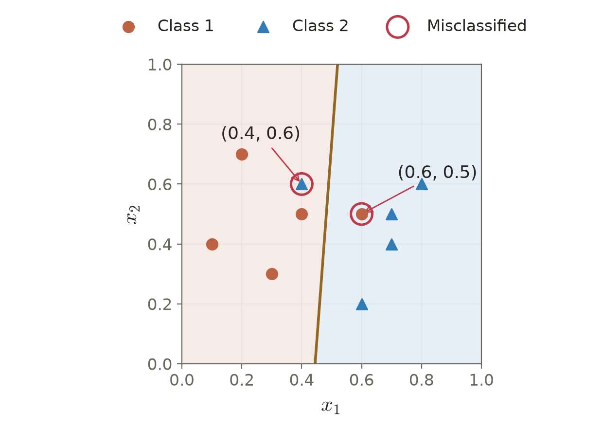

# Lecture 03 · KP09：以有限樣本直接解最小平方（Solving least squares directly from finite samples）

> 程度：研究生（grad）／Level: Graduate (grad)
>
> 週次：第 3 週（2026-09-21）｜進度：Linear Classifiers
>
> Week 3 (2026-09-21) | Topic: Linear Classifiers

[JianBauDau 簡報](../slides/lec03-kp09-least-squares.jbd.json)

## 學習目標（Learning objectives）

- 將有限資料整理為設計矩陣與目標向量（Organize finite data into a design matrix and target vector）。
- 推導正規方程並說明偽逆的適用條件（Derive the normal equations and explain pseudoinverse conditions）。
- 核算 Example 3.4 的權重、殘差與分類錯誤（Verify the weights, residuals, and classification errors in Example 3.4）。

## KP09：最佳平方誤差仍可能分錯類別（Optimal squared error can still misclassify samples）

**一句話重點**：最小平方法對手上的資料最小化誤差平方和；它不直接最小化分類錯誤數。

**One-sentence summary**: Least squares minimizes squared prediction errors on the observed data, not the classification error count.

### 1. 將每筆資料放到矩陣的一列（Putting one sample in each matrix row）

KP08 逐筆修正權重。現在資料已經收齊，可以把全部誤差寫成一個目標，再直接求解。來源稱它為誤差平方和估計，本文簡稱最小平方法，英文為 least squares，縮寫 LS。

KP08 updates one sample at a time. With all samples available, we collect their errors into one objective and solve it directly. We call this least squares, abbreviated LS.

**白話說明**：沿用來源的裁縫比喻。裁縫用一組固定規則兼顧所有尺寸，讓總平方差最小。尺寸誤差較小，不代表每個人的分類標籤都正確；比喻只描述數值折衷。

**Plain explanation**: Use the source's tailoring analogy. One fixed rule compromises across all measurements to minimize total squared discrepancy. Better numerical fit does not imply correct class labels for everyone.

| 符號 | 中文意義 | English meaning |
|---|---|---|
| $N,d$ | 樣本數與含偏置後的特徵數 | Number of samples and augmented features |
| $\mathbf a_i\in\mathbb R^d$ | 第 $i$ 筆增廣特徵 | Augmented feature vector for sample $i$ |
| $X\in\mathbb R^{N\times d}$ | 第 $i$ 列為 $\mathbf a_i^T$ 的設計矩陣 | Design matrix with samples in rows |
| $\mathbf y,\hat{\mathbf y}\in\mathbb R^N$ | 全部目標與線性預測 | Targets and linear predictions |
| $\mathbf w\in\mathbb R^d$ | 權重，最後一項為偏置 | Weights ending with the bias |
| $\mathbf e=\mathbf y-X\mathbf w$ | 殘差向量 | Residual vector |
| $X^+$ | Moore–Penrose 偽逆，維度 $d\times N$ | Moore–Penrose pseudoinverse |

**正式定義**：最小化全部殘差平方之和。若除以固定的 $N$，得到經驗均方誤差；兩者的最小化權重相同。

**Formal definition**: Minimize the sum of squared residuals. Dividing by the fixed sample count gives empirical MSE with the same minimizers.

$$
J(\mathbf w)=\sum_{i=1}^N(y_i-\mathbf a_i^T\mathbf w)^2
=\|\mathbf y-X\mathbf w\|^2.
$$

母體 MSE 是對分布取期望；LS 是對有限資料加總。分布未知時，也能用樣本估計母體矩，因此不宜說「只有知道完整分布才能用 MSE」。

Population MSE averages over a distribution; LS sums finite observations. Samples can estimate population moments, so MSE methods do not inherently require a known distribution formula.

### 2. 零梯度給出正規方程（A zero gradient gives the normal equations）

既然誤差已寫成向量，展開平方並微分即可。梯度中的負號來自 $\mathbf y-X\mathbf w$ 對權重的微分。

With vector residuals, expand the squared norm and differentiate. The negative sign comes from differentiating the residual with respect to the weights.

$$
\begin{aligned}
J(\mathbf w)&=\mathbf y^T\mathbf y-2\mathbf w^TX^T\mathbf y+\mathbf w^TX^TX\mathbf w,\\
\nabla J(\mathbf w)&=-2X^T(\mathbf y-X\mathbf w),\\
\nabla J(\hat{\mathbf w})=\mathbf0
&\Longrightarrow X^TX\hat{\mathbf w}=X^T\mathbf y.
\end{aligned}
$$

這也表示 $X^T\mathbf e=\mathbf0$。殘差垂直於 $X$ 的每一欄，正好接回 KP07 的投影幾何。

This also gives $X^T\mathbf e=\mathbf0$. The residual is perpendicular to every column of $X$, connecting to KP07's projection geometry.

若各欄線性獨立，稱為欄滿秩。此時 $X^TX$ 可逆，權重唯一。

Linearly independent columns give full column rank. Then $X^TX$ is invertible and the minimizing weights are unique.

$$
\hat{\mathbf w}=(X^TX)^{-1}X^T\mathbf y=X^+\mathbf y
\quad\text{if }\operatorname{rank}(X)=d.
$$

### 3. 偽逆不需要假設矩陣一定可逆（A pseudoinverse does not require invertibility）

**來源釐清**：$(X^TX)^{-1}X^T$ 不是任意矩陣偽逆的通用公式。它只適用於欄滿秩情況。一般情況下，Moore–Penrose 偽逆仍有定義。

**Source clarification**: The inverse-Gram formula is not a universal pseudoinverse formula. It requires full column rank. The Moore–Penrose pseudoinverse remains defined more generally.

[補充] 若特徵欄重複，權重可能有很多組。偽逆從所有最小平方解中選擇權重長度最小的一組。投影輸出仍然唯一。

[Added] Repeated columns can produce many minimizing weights. The pseudoinverse selects the one with the smallest Euclidean norm. The projected output remains unique.

例如 $X=\begin{bmatrix}1&1\\2&2\end{bmatrix}$、$\mathbf y=(1,2)^T$。兩欄相同，$X^TX$ 不可逆；只要 $w_1+w_2=1$ 都能精確擬合。偽逆選 $(0.5,0.5)^T$，平方長度為 $0.5$，比 $(1,0)^T$ 的 1 更小。

For the repeated-column example, all weights summing to one fit exactly. The Gram matrix is singular. The pseudoinverse selects equal weights, giving a smaller squared norm than assigning everything to one column.

### 4. Example 3.4：先求權重，再檢查分類（Example 3.4: Solve the weights, then inspect classifications）

**例子**：保留來源兩類各 5 點，增廣成 $(x_1,x_2,1)^T$。前 5 筆的目標為 $+1$，後 5 筆為 $-1$。

**Example**: Retain the source's five samples per class, augmented by one. The first five targets are positive one; the remaining five are negative one.

| 類別 | 資料座標 | English description |
|---|---|---|
| $\omega_1$ | $(0.2,0.7),(0.3,0.3),(0.4,0.5),(0.6,0.5),(0.1,0.4)$ | Positive-target samples |
| $\omega_2$ | $(0.4,0.6),(0.6,0.2),(0.7,0.4),(0.8,0.6),(0.7,0.5)$ | Negative-target samples |

例如左上元素為全部 $x_1^2$ 相加，右下元素為 10 個常數 1 相加。依同樣方式逐項累積，得到來源的矩陣。

The first diagonal entry sums all squared first coordinates. The last sums ten constant ones. Accumulating the other entries gives the source matrices.

$$
X^TX=\begin{bmatrix}2.80&2.24&4.80\\2.24&2.41&4.70\\4.80&4.70&10\end{bmatrix},
\quad X^T\mathbf y=\begin{bmatrix}-1.60\\0.10\\0\end{bmatrix}.
$$

[補充推導] 用整數係數做消去，可核對黑箱解。將 3 條方程乘以 100，第三條先除以 10，再消去偏置。

[Added derivation] Integer coefficients make the solution checkable. Multiply the equations by one hundred, simplify the third, and eliminate the bias.

$$
\begin{aligned}
280w_1+224w_2+480w_0&=-160,\\
224w_1+241w_2+470w_0&=10,\\
48w_1+47w_2+100w_0&=0,\\
248w_1-8w_2&=-800,\\
-16w_1+201w_2&=100.
\end{aligned}
$$

最後兩式的行列式為 $248(201)-(-8)(-16)=49720$。利用二階方程求解，再代回偏置式。

The reduced system has determinant $49720$. Solve the two equations and substitute back for the bias.

$$
\begin{aligned}
w_1&=\frac{-800(201)+800}{49720}=-\frac{4000}{1243},\\
w_2&=\frac{248(100)-12800}{49720}=\frac{300}{1243},\\
w_0&=-\frac{48w_1+47w_2}{100}=\frac{1779}{1243},\\
\hat{\mathbf w}&\approx(-3.218020917,0.241351569,1.431214803)^T.
\end{aligned}
$$

來源顯示到 3 位小數：$(-3.218,0.241,1.431)$。以下計算使用未四捨五入權重，以免把顯示誤差當成公式差異。

The source displays three decimals. The following calculations retain full precision, separating display rounding from mathematical differences.

$$
\begin{aligned}
g(0.6,0.5)&=\frac{-4000(0.6)+300(0.5)+1779}{1243}
=-\frac{471}{1243}\approx-0.378922,\\
g(0.4,0.6)&=\frac{-4000(0.4)+300(0.6)+1779}{1243}
=\frac{359}{1243}\approx0.288817.
\end{aligned}
$$

第一點目標為正，分數卻為負；第二點相反。因此這 2 點分錯。用全部 10 點重算平方和為 $4.827031376$，正規方程殘差 $X^T(\mathbf y-X\hat{\mathbf w})$ 約為零。

The first point has a positive target but negative score; the second has the opposite mismatch. These two are misclassified. All ten residuals give squared-error sum $4.827031376$, with near-zero normal-equation residual.



**圖說 `lec03-kp09-boundary`**：先看兩種樣本符號，再依決策線與背景判斷預測。紅圈標出 $(0.6,0.5)$ 和 $(0.4,0.6)$，它們落在錯誤側。直線由未四捨五入的權重計算，沒有手調位置。〔功能：1、2、3〕

**Caption `lec03-kp09-boundary`**: Inspect class markers and use the boundary and shading to read predictions. Red rings highlight the two samples on the wrong side. The line uses full-precision weights without manual adjustment.

[補充查核] 「這條 LS 線分錯」本身不能證明資料不可分。負類點 $(0.4,0.6)$ 是兩個正類點 $(0.2,0.7)$、$(0.6,0.5)$ 的平均。若線性分數在兩端都嚴格為正，中點分數也必為正。這才是不可分的證據。

[Added verification] Errors from one LS line alone do not prove inseparability. Here, the negative sample is the midpoint of two positive samples. Any affine score strictly positive at both endpoints is also positive at their midpoint, proving inseparability.

### 5. 實作使用線性求解器並檢查殘差（Use a numerical solver and inspect residuals）

**常見迷思**：找到平方誤差最小值，就找到最少錯誤的分類線。LS 看的是輸出與目標的數值差距；分類只看正負號，兩者是不同的目標。

**Common misconception**: Minimizing squared error also minimizes misclassifications. LS measures numerical discrepancies, while sign-based classification uses a different objective.

[補充] 實作宜直接用 `numpy.linalg.lstsq`。它能處理超定、欠定與秩不足的矩陣；多解時回傳最小範數解。不要為了照抄公式，先顯式形成逆矩陣。

[Added] Use `numpy.linalg.lstsq` directly. It handles overdetermined, underdetermined, and rank-deficient systems, returning a minimum-norm solution when needed. Explicit matrix inversion is unnecessary.

```python
import numpy as np

# X: one augmented sample per row; y: one target per sample
w, _, rank, singular_values = np.linalg.lstsq(X, y, rcond=None)
prediction = X @ w
error = y - prediction
squared_error_sum = error @ error
normal_residual = X.T @ error
```

若矩陣秩不足，回傳的 `residuals` 陣列可能是空的，不能據此判斷誤差為零。上面直接從預測重算殘差與平方和，能避免這個誤解。

The solver's returned residual array may be empty for rank-deficient systems. That does not imply zero error. Recomputing residuals from predictions avoids the ambiguity.

**想深入**：若 $X$ 滿欄秩，形成 $X^TX$ 會把二範數條件數平方，放大不穩定性。此處的閉式解用來理解推導，實作則交由數值求解器處理。

**Going deeper**: For full column rank, forming the Gram matrix squares the two-norm condition number. Use the closed form to understand the mathematics and numerical solvers for computation.

**小練習**：來源練習給 1 維資料 $x=(1,2,3)$、$\mathbf y=(1,-1,-1)^T$。請建立含偏置的 $3\times2$ 設計矩陣，求權重並檢查 $X^T\mathbf e$。提示：最後一欄全為 1；先寫方程，再求解。

**Practice**: Construct the augmented design matrix for the given one-dimensional data, solve for the weights, and check residual orthogonality. Hint: the final column contains ones.

## 小結與下一步（Summary and next step）

- LS 與經驗均方誤差只差固定比例，最小化權重相同（LS and empirical MSE have the same minimizers）。
- 逆矩陣公式需要欄滿秩；偽逆的定義更一般（The inverse formula requires full column rank; the pseudoinverse is more general）。
- KP10 將再問：若不限制線性模型，平方誤差下最好的預測函數是什麼（KP10 asks which predictor minimizes squared error without the linear restriction）。

## 延伸閱讀與來源（Further reading and sources）

- [第 3 章 §3.4.3、KP09、教授祕笈及 Example 3.4](https://ndhuccc.github.io/CCC-LNS/PR_115/Ch03-linear-classifiers/index.html#kp9)，2026-10-16 由 GitHub 原始檔核對，blob `bd64b78ba21606d078c672b0fa67337b017e4a34`（Source checked through GitHub on 2026-10-16）。
- [NumPy `lstsq` 官方文件](https://numpy.org/doc/stable/reference/generated/numpy.linalg.lstsq.html)，2026-10-16 查核多解處理及空殘差陣列條件（Official documentation checked for minimum-norm solutions and empty residual arrays）。

## 術語表（Glossary）

| 中文 | English |
|---|---|
| 最小平方法 | Least squares, LS |
| 設計矩陣 | Design matrix |
| 欄滿秩 | Full column rank |
| 正規方程 | Normal equations |
| 偽逆矩陣 | Pseudoinverse |
| 最小範數解 | Minimum-norm solution |
| 條件數 | Condition number |
| 超定／欠定 | Overdetermined / underdetermined |
