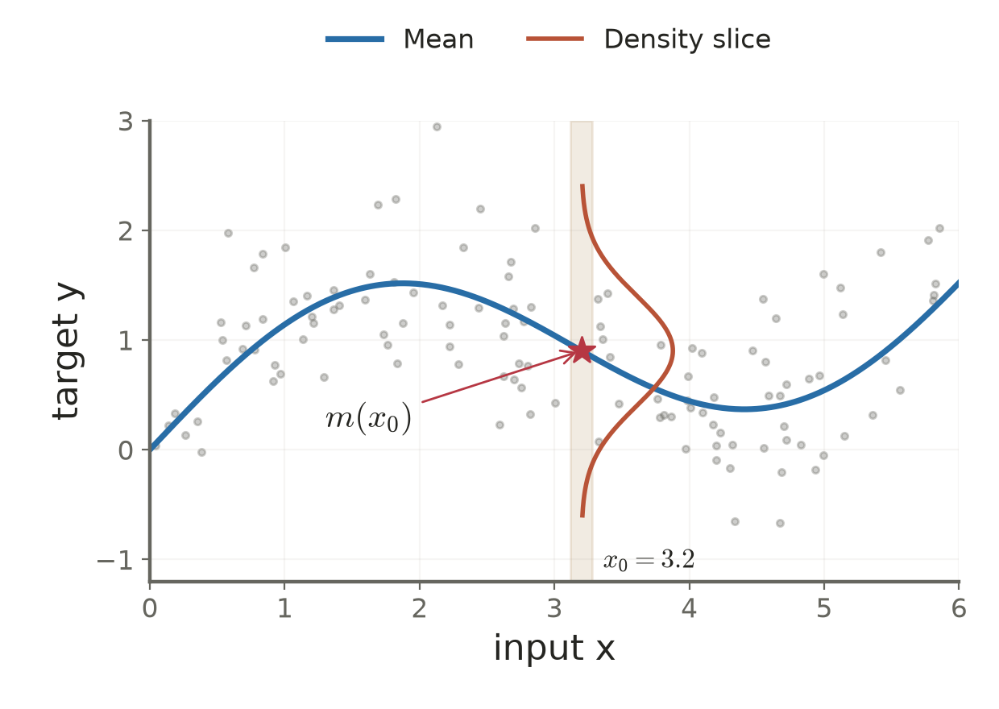

# Lecture 03 · KP10：平方誤差下，條件平均是最佳預測（The conditional mean minimizes squared prediction error）

> 程度：研究生（grad）／Level: Graduate (grad)
>
> 週次：第 3 週（2026-09-21）｜進度：Linear Classifiers
>
> Week 3 (2026-09-21) | Topic: Linear Classifiers

[JianBauDau 簡報](../slides/lec03-kp10-conditional-mean-with-comics.jbd.json)

## 學習目標（Learning objectives）

- 分辨最佳線性擬合與不限制函數形狀的最佳預測（Distinguish optimal linear fitting from unrestricted optimal prediction）。
- 用條件期望讓誤差展開式的交叉項消失（Use conditional expectation to eliminate a cross term）。
- 算出來源三點分布的最佳預測與剩餘誤差（Compute the optimal prediction and residual risk for the source distribution）。

## KP10：觀測到輸入後，預測該條件下的平均（Predict the mean under the observed input）

**一句話重點**：在平方誤差與有限二階矩條件下，最佳預測是 $m(\mathbf x)=E[y\mid\mathbf x]$。

**One-sentence summary**: Under squared error and finite second moments, the optimal prediction is the conditional mean.

### 1. 從一條最佳直線走向最佳函數（From the best line to the best function）

KP09 找到有限資料上的最佳線性權重。現在換一個問題：假設知道整體分布，而且預測函數不必是直線，理論上能做到多好？

KP09 found the best linear weights on finite data. We now ask how well an unrestricted predictor could perform if the population distribution were known.

**白話說明**：沿用來源的氣象預報比喻。先固定今天的氣象條件，再看相同條件下明天的雨量分布。若必須報出一個數字，就選這個分布的加權平均。比喻只對應平方誤差評分，不表示所有預報任務都應報平均。

**Plain explanation**: Use the source's weather analogy. Fix today's conditions and consider tomorrow's rainfall distribution under those conditions. When scored by squared error, report its weighted average. Different scoring rules can favor different summaries.

| 符號 | 中文意義 | English meaning |
|---|---|---|
| $\mathbf x\in\mathbb R^d$ | 可觀測輸入 | Observed input vector |
| $y\in\mathbb R$ | 要預測的隨機目標 | Random scalar target |
| $g(\mathbf x)$ | 只使用輸入的預測函數 | Predictor using only the input |
| $m(\mathbf x)$ | 給定輸入後的目標平均 | Conditional target mean |
| $\operatorname{Var}(y\mid\mathbf x)$ | 同一輸入下的目標變動 | Conditional target variance |
| $R(g)$ | 全體分布上的平均平方損失 | Population squared-error risk |

**正式定義**：假設 $E[y^2]<\infty$，且候選預測函數可由 $\mathbf x$ 決定。比較它們的母體風險。

**Formal definition**: Assume a finite target second moment and predictors determined by the observed input. Compare their population risks.

$$
R(g)=E[(y-g(\mathbf x))^2],\qquad m(\mathbf x)=E[y\mid\mathbf x].
$$

若目標是向量，以歐氏範數平方取代純量平方即可，各分量的條件平均組成最佳預測向量。

For vector targets, use squared Euclidean distance. The componentwise conditional means form the optimal prediction vector.

### 2. 固定輸入後，誤差變成可拆開的兩部分（Conditioning splits the error into two parts）

既然預測只依賴輸入，就先固定 $\mathbf x$。在誤差中加減 $m(\mathbf x)$，再展開平方。

Because predictions depend on the input, condition on that input first. Add and subtract its conditional mean, then expand.

$$
y-g=(y-m)+(m-g).
$$

關鍵是 $E[y-m\mid\mathbf x]=0$。在這個條件期望內，$m-g$ 已經確定，所以可以提出。

The key identity is zero conditional mean residual. Inside this conditional expectation, the difference between the two predictors is fixed.

$$
E[(y-m)(m-g)\mid\mathbf x]
=(m-g)\{E[y\mid\mathbf x]-m\}=0.
$$

因此同一個輸入位置的平方誤差，等於無法靠改預測消除的變動，再加上猜測偏離平均的平方。

At each input, squared error equals residual target variability plus the squared distance from the chosen prediction to the conditional mean.

$$
E[(y-g)^2\mid\mathbf x]
=\operatorname{Var}(y\mid\mathbf x)+(m-g)^2.
$$

再對輸入分布平均，得到完整結論。第二項非負，所以沒有其他函數能降低風險。

Averaging over the input distribution gives the full result. The second term is nonnegative, so another predictor cannot improve the risk.

$$
R(g)=R(m)+E[(m(\mathbf x)-g(\mathbf x))^2]\ge R(m).
$$

**來源釐清**：主文曾把 $m$ 換成 $E[y]$，也把 $m-g$ 直接稱為常數。這些說法只在先固定輸入的條件期望中適用。來源「教授祕笈」的疊代期望版本較完整，本講義依該版本重建證明。

**Source clarification**: The main text mixes conditional and unconditional means and calls the predictor difference constant. It is fixed only after conditioning. The source's teaching guide gives the fuller argument, which we reconstruct here.

最佳函數的唯一性是「在輸入分布下幾乎處處相同」。若某些輸入根本不可能出現，改動那些位置不影響風險，不能要求逐點唯一。

Uniqueness holds almost surely under the input distribution. Changing predictions at impossible inputs does not change the risk, so pointwise uniqueness is unnecessary.

### 3. 來源 3 點分布：預測 21，比預測 20 更好（The source distribution favors twenty-one over twenty）

**例子**：固定 $\mathbf x=\mathbf x_0$，來源給出三個可能的目標值與機率。

**Example**: At the fixed source input, the target has three possible values with the following probabilities.

| $y$ | $P(y\mid\mathbf x_0)$ | English description |
|---|---|---|
| 10 | 0.2 | First possible target |
| 20 | 0.5 | Second possible target |
| 30 | 0.3 | Third possible target |

$$
m(\mathbf x_0)=10(0.2)+20(0.5)+30(0.3)=2+10+9=21.
$$

$$
\begin{aligned}
E[(y-21)^2\mid\mathbf x_0]
&=121(0.2)+1(0.5)+81(0.3)\\
&=24.2+0.5+24.3=49,\\
E[(y-20)^2\mid\mathbf x_0]
&=100(0.2)+0(0.5)+100(0.3)=50.
\end{aligned}
$$

額外的損失正好是 $(21-20)^2=1$。最佳預測不必等於任何可能觀測值；本例的 21 不在三個結果之中。

The excess loss is exactly one. An optimal prediction need not equal an observable outcome; twenty-one is not one of the three possible targets.

### 4. 垂直切片的平均連成回歸曲線（Conditional means form a regression curve）

三點分布解釋了單一位置。對每個輸入都做同一件事，便得到條件平均函數，它可以彎曲。

The discrete example explains one input. Repeat the argument at every input to obtain the conditional mean function, which may be curved.

**圖說 `lec03-kp10-regression-slice`**：[補充視覺模型] 設 $y=\sin x+0.3x+\epsilon$，$\epsilon$ 獨立且服從 $\mathcal N(0,0.5^2)$。先看整條平均曲線，再看 $x_0=3.2$ 的垂直切片與側向條件密度。星號位於該分布平均。散點數 120，NumPy 種子 42。這張連續模型圖不取代前節的離散數字例。〔功能：1、2、3〕

**Caption `lec03-kp10-regression-slice`**: [Added visual model] The independent noise has standard deviation one half. Inspect the mean curve, then the conditional density at the highlighted input. The star marks its mean. The 120 samples use NumPy seed forty-two. This continuous illustration complements the discrete worked example.

### 5. 聯合高斯是線性平均的充分條件（Joint Gaussianity is sufficient for an affine conditional mean）

**常見迷思**：只有聯合高斯資料才有線性條件平均。聯合高斯確實是重要的充分條件，卻不是必要條件。

**Common misconception**: Only jointly Gaussian variables have a linear conditional mean. Joint Gaussianity is an important sufficient condition, not a necessary one.

若 $(y,\mathbf x)$ 聯合高斯，且輸入共變異數 $\Sigma_{xx}$ 可逆，條件平均含一個截距項。一般應稱為仿射函數。

With joint Gaussianity and an invertible input covariance, the conditional mean includes an intercept and is generally affine.

$$
E[y\mid\mathbf x]=\mu_y+\Sigma_{yx}\Sigma_{xx}^{-1}(\mathbf x-\mathbf m_x).
$$

此式的 $\mu_y,\mathbf m_x$ 是目標與輸入平均，$\Sigma_{yx}$ 是兩者的共變異數列向量。若平均為零，就只剩線性項。

The means specify the intercept, and the cross covariance determines the linear part. Zero means remove the intercept.

[補充反例] 若 $x$ 是均勻分布，$y=2x+\epsilon$，且 $E[\epsilon\mid x]=0$，則 $E[y\mid x]=2x$。輸入不必高斯，條件平均仍可線性。

[Added counterexample] A uniform input with a linear target and zero conditional mean noise also has a linear conditional mean. Gaussian inputs are unnecessary in this example.

**想深入**：知道理論目標不等於已經學會它。有限樣本、受限制的模型與估計不確定性，仍會讓學到的函數偏離 $m$。極端值也會強烈影響平方損失。

**Going deeper**: Knowing the ideal target does not mean it has been learned. Finite data, restricted models, and estimation uncertainty can create discrepancies. Extreme values strongly affect squared loss.

**小練習**：沿用來源瑕疵例：$P(y=1\mid x=40)=0.3$，其餘為 $y=0$。求最佳平方誤差預測。若改猜 0，風險增加多少？提示：直接使用兩項分解，不必重新展開所有平方。

**Practice**: In the source defect example, find the optimal prediction when the conditional positive probability is given. Compare its risk with predicting zero. Hint: use the two-term decomposition.

## 小結與下一步（Summary and next step）

- 最佳預測是條件平均，最小風險仍可能大於零（The conditional mean is optimal, but residual risk may remain）。
- 證明要先固定輸入，再消去交叉項（Condition on the input before eliminating the cross term）。
- KP11 將把目標換成 0/1 類別指標，觀察平均如何成為事後機率（KP11 applies the mean identity to binary class indicators）。

## 延伸閱讀與來源（Further reading and sources）

- [第 3 章 §3.5.1、KP10 與教授祕笈](https://ndhuccc.github.io/CCC-LNS/PR_115/Ch03-linear-classifiers/index.html#kp10)，2026-10-16 核對 GitHub 原始檔，blob `bd64b78ba21606d078c672b0fa67337b017e4a34`（Source checked through GitHub on 2026-10-16）。
- 本次未讀取原書頁面；條件期望論證依來源重建，新增數字與圖以 Python 核算（Original textbook pages were unavailable; calculations and visual additions were independently checked）。

## 術語表（Glossary）

| 中文 | English |
|---|---|
| 回歸 | Regression |
| 條件期望／條件平均 | Conditional expectation / conditional mean |
| 母體風險 | Population risk |
| 條件變異數 | Conditional variance |
| 幾乎處處 | Almost surely |
| 聯合高斯 | Jointly Gaussian |
| 仿射函數 | Affine function |
