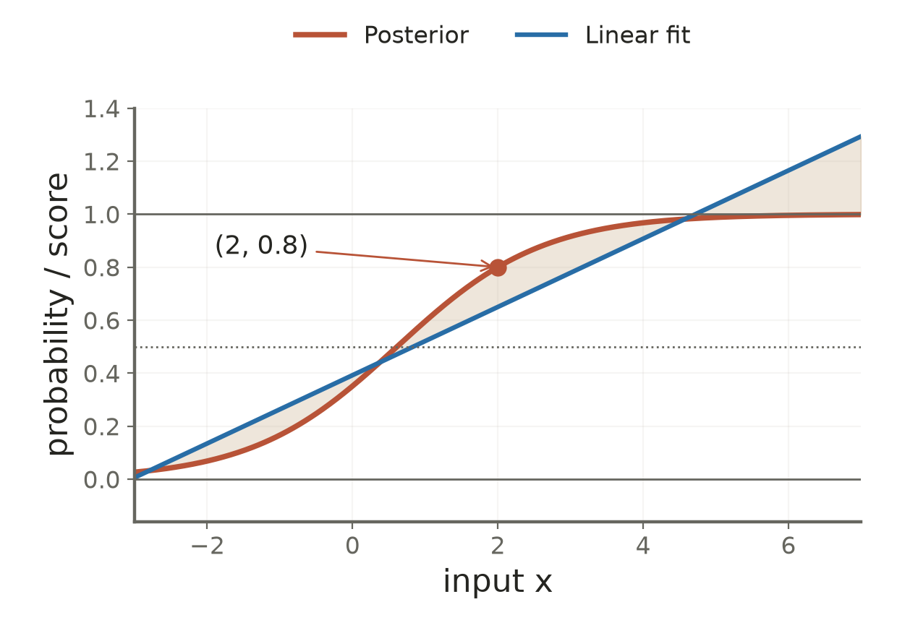

# Lecture 03 · KP11：0/1 標籤的條件平均就是事後機率（The conditional mean of an indicator is a posterior probability）

> 程度：研究生（grad）／Level: Graduate (grad)
>
> 週次：第 3 週（2026-09-21）｜進度：Linear Classifiers
>
> Week 3 (2026-09-21) | Topic: Linear Classifiers

[JianBauDau 簡報](../slides/lec03-kp11-mse-posterior.jbd.json)

## 學習目標（Learning objectives）

- 推出指標標籤的條件平均等於事後機率（Derive the posterior as a conditional indicator mean）。
- 分解多類平方損失的逼近項與固定項（Separate multiclass squared loss into approximation and fixed terms）。
- 解釋線性 MSE 分數為何可能不是有效機率（Explain why linear MSE scores may not be valid probabilities）。

## KP11：學習 0/1 平均，等於以平方誤差逼近事後機率（Learning indicator means approximates posteriors under squared error）

**一句話重點**：平方損失的理論目標是事後機率，但有限資料與受限模型不保證精確恢復它。

**One-sentence summary**: The population squared-loss target is the posterior, but limited data and model restrictions prevent guaranteed recovery.

### 1. 把類別換成一個可以平均的數字（Encoding classes as quantities that can be averaged）

KP10 證明最佳預測是條件平均。若目標只有 0 和 1，平均到底表示什麼？讓 $y_i$ 記錄樣本是否屬於第 $i$ 類，就能把這個問題算清楚。

KP10 established conditional-mean optimality. What does that mean represent for zero-one targets? Let an indicator record membership in each class.

**白話說明**：沿用來源「探員記錄」的比喻。每次只記某類是否出現；在相同條件下平均這些記錄，就在估計該類的比例。比喻不表示隨便畫一條線便能精確還原機率。

**Plain explanation**: Use the source's record-keeping analogy. Record whether a class appears and average records under the same conditions. The proportion estimates its probability, but an arbitrary fitted line need not recover it exactly.

| 符號 | 中文意義 | English meaning |
|---|---|---|
| $\omega_i$ | 第 $i$ 個互斥類別 | Class $i$ |
| $y_i=\mathbf1\{\omega=\omega_i\}$ | 屬於該類為 1，否則為 0 | Class-membership indicator |
| $p_i(\mathbf x)=P(\omega_i\mid\mathbf x)$ | 看見輸入後的類別機率 | Posterior class probability |
| $g_i(\mathbf x)$ | 模型輸出的第 $i$ 類分數 | Model score for class $i$ |
| $M$ | 類別總數 | Number of classes |

**正式定義**：對互斥且涵蓋全部可能的 $M$ 類，用只有一個 1 的目標向量。固定輸入後，指標的條件平均如下。

**Formal definition**: For exhaustive mutually exclusive classes, use a target vector containing one one. The conditional mean of each indicator follows immediately.

$$
E[y_i\mid\mathbf x]=1\,p_i(\mathbf x)+0\,[1-p_i(\mathbf x)]=p_i(\mathbf x).
$$

這是隨機變數的恆等式。它不需要假設特徵密度是高斯，也不需要先估計每一類的密度。

This identity requires neither Gaussian feature densities nor explicit density estimation for every class.

### 2. 平方損失把模型推向事後機率（Squared loss targets the posterior）

既然條件平均是機率，就可直接套用 KP10。先固定輸入，對每一個標籤平方誤差做分解。

Because the conditional mean equals the probability, apply KP10 to each class indicator at a fixed input.

$$
E[(g_i-y_i)^2\mid\mathbf x]
=(g_i-p_i)^2+p_i(1-p_i).
$$

第二項來自 0/1 變數的條件變異數。它與預測函數無關。把所有類別加總，再對輸入取平均。

The second term is the conditional variance of an indicator and does not depend on the predictor. Sum over classes and average over inputs.

$$
J=E\left[\sum_{i=1}^M(g_i-y_i)^2\right]
=E\left[\sum_{i=1}^M(g_i-p_i)^2\right]
+E\left[\sum_{i=1}^Mp_i(1-p_i)\right].
$$

若函數不受限制，第一項可取零。若只允許線性函數，便是尋找該函數族中最接近事後機率的解。

Unrestricted functions can eliminate the first term. Linear functions instead seek the closest approximation within their restricted family.

[補充] 因為各類機率加總為 1，固定項也可寫成 $E[1-\sum_i p_i^2]$。資料的類別不確定性仍會留下平方損失。

[Added] Since probabilities sum to one, the fixed term equals the expected value of one minus their squared sum. Class uncertainty can leave nonzero squared loss.

### 3. 來源 8 比 2 的例子（The source eight-to-two example）

**例子**：來源在 $x_0=2$ 假設 $p_1(x_0)=0.8$。並用 10 筆記錄示範：8 筆標 1，2 筆標 0。

**Example**: The source assumes a posterior of $0.8$ at input two and illustrates ten records: eight positive indicators and two zeros.

$$
\bar y=\frac{8(1)+2(0)}{10}=0.8.
$$

這個樣本比例剛好等於來源假設的母體機率。一般抽到的 $8/10$ 只是估計，不足以證明真實機率一定為 $0.8$。

The sample proportion happens to equal the assumed population probability. In general, an observed proportion is an estimate, not proof of the true probability.

$$
\begin{aligned}
\widehat R(0.8)&=\frac{8(0.8-1)^2+2(0.8-0)^2}{10}\\
&=\frac{8(0.04)+2(0.64)}{10}=0.16,\\
\widehat R(1)&=\frac{8(0)^2+2(1)^2}{10}=0.20.
\end{aligned}
$$

把分數改成 1 看似更有把握，平方損失卻增加 $0.04=(1-0.8)^2$。這裡的目的不是為了讓每筆都輸出正確類別，而是反映相同條件下的類別不確定性。

Predicting one appears more confident but adds squared loss. The goal reflects class uncertainty at the same input, rather than producing a deterministic label for every observation.

### 4. 線性分數的數值範圍沒有自動受限（Linear scores are not automatically bounded）

局部平均解釋了理論目標。現在若要求所有輸入都共用一條直線，就可能無法貼合真正的機率曲線。

The local average identifies the target. Requiring one line across all inputs can prevent it from matching the probability curve.

**圖說 `lec03-kp11-posterior-fit`**：[補充模型] 設 $p_1(x)=1/[1+\exp(-\{\ln4+x-2\})]$，使 $p_1(2)=0.8$。令輸入在整數 $-2,-1,\ldots,6$ 上等機率。以這 9 點求最佳線性近似，得到 $g_1(x)=0.128768669x+0.392144754$。先看機率的 0 與 1 邊界，再看直線及陰影差距。直線在 $x=6$ 約為 $1.164757$，不是有效機率。〔功能：1、2〕

**Caption `lec03-kp11-posterior-fit`**: [Added model] The chosen logistic posterior passes through the source probability at input two. Inputs are uniformly distributed over nine integer locations. Least squares gives the displayed affine approximation. Inspect probability bounds before the shaded discrepancy. The fitted score exceeds one at the right endpoint.

此圖的曲線、輸入分布與擬合程序均有明確定義。不是將任意直線稱為訓練結果，也沒有把新增模型冒稱為來源已提供的資料集。

The curve, input distribution, and fitting procedure are explicit. The line is computed, and the added model is not presented as an original source dataset.

### 5. 理論估計目標不等於已校準機率（An estimation target is not a calibrated probability guarantee）

**常見迷思**：既然在估計機率，所有 MSE 分數都能直接代入機率風險計算。線性分數可能超界，有限樣本也可能失真。需要先檢查範圍及預測機率是否符合實際頻率。

**Common misconception**: Every MSE score can directly support probability-based risk calculations. Linear scores may exceed bounds and finite data may distort them. Check their range and agreement with observed frequencies first.

把分數截到 $[0,1]$ 只修補範圍，不保證它已校準。二元的 $0.5$ 門檻也需要對應類別決策及代價設定，不能當成所有風險問題的固定答案。

Clipping fixes the range without guaranteeing calibration. A one-half classification threshold depends on the decision setting and costs; it is not universal.

**想深入**：本節使用 0/1 編碼。若改成 $-1/+1$，條件平均變成 $2p_1-1$。同一個平方損失目標，在不同編碼下需要不同的機率換算。

**Going deeper**: With negative-one/positive-one coding, the conditional mean becomes twice the positive probability minus one. Label coding changes the conversion from scores to probabilities.

**小練習**：來源給 $p_1(\mathbf x_A)=0.7$。比較預測 $0.7$ 與預測 1 的期望平方損失。提示：使用固定項加偏離平方，不需要假設特徵密度。

**Practice**: Compare predictions at the source's given posterior probability. Hint: add the fixed conditional variance and the squared deviation from the posterior.

## 小結與下一步（Summary and next step）

- 0/1 指標的條件平均精確等於事後機率（An indicator's conditional mean equals its posterior exactly）。
- 線性模型可能只有近似能力，輸出也可能超界（Linear models may approximate poorly and produce invalid ranges）。
- KP12 將區分模型平均偏差與換資料後的波動（KP12 separates systematic bias from variation across training sets）。

## 延伸閱讀與來源（Further reading and sources）

- [第 3 章 §3.5.2、KP11 與教授祕笈](https://ndhuccc.github.io/CCC-LNS/PR_115/Ch03-linear-classifiers/index.html#kp11)，2026-10-16 核對原始檔，blob `bd64b78ba21606d078c672b0fa67337b017e4a34`（Source checked on 2026-10-16）。
- 原書頁面本次未讀取。新增擬合圖以明示的機率模型重算（Textbook pages were unavailable; the added plot uses its explicitly stated probability model）。

## 術語表（Glossary）

| 中文 | English |
|---|---|
| 指標變數 | Indicator variable |
| 單一 1 編碼 | One-hot encoding |
| 事後機率 | Posterior probability |
| 線性近似 | Linear approximation |
| 經驗風險 | Empirical risk |
| 機率校準 | Probability calibration |
