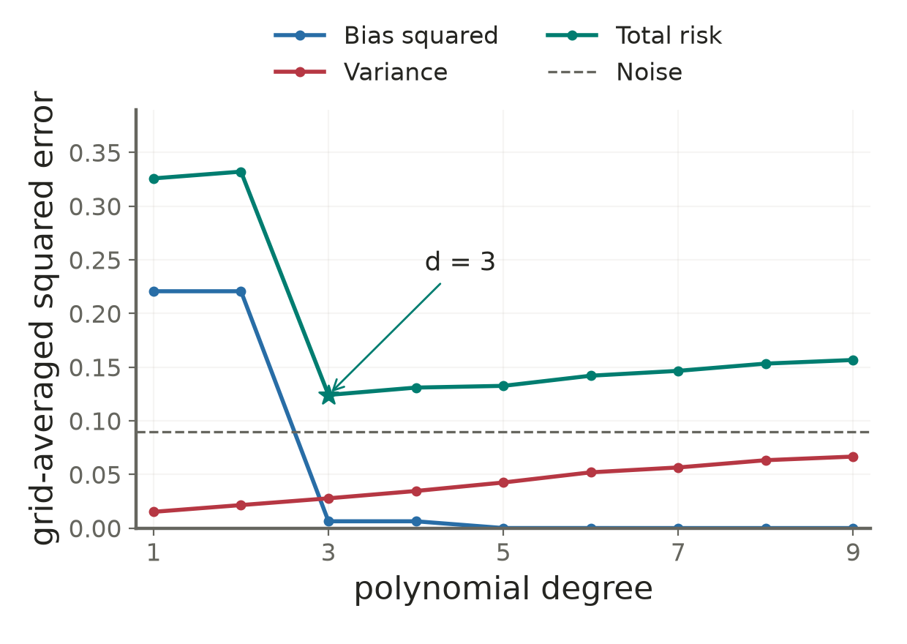
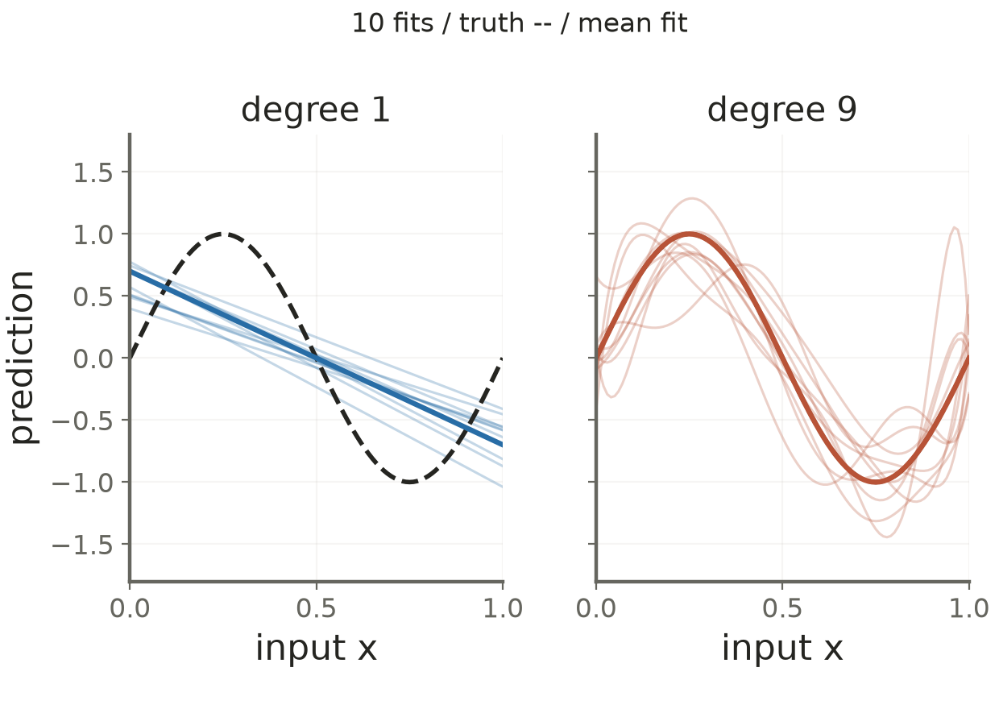

# Lecture 03 · KP12：平均偏離與資料敏感度是兩種誤差（Systematic deviation and data sensitivity are different errors）

> 程度：研究生（grad）／Level: Graduate (grad)
>
> 週次：第 3 週（2026-09-21）｜進度：Linear Classifiers
>
> Week 3 (2026-09-21) | Topic: Linear Classifiers

[JianBauDau 簡報](../slides/lec03-kp12-bias-variance.jbd.json)

## 學習目標（Learning objectives）

- 在固定測試位置分別定義偏誤、變異數與雜訊（Define bias, variance, and noise at a fixed test input）。
- 推導對獨立新目標的平方誤差分解（Derive the squared-error decomposition for an independent new target）。
- 解讀同一組設計下的多項式階數比較（Interpret polynomial-degree comparisons under the same experimental design）。

## KP12：不只看平均有多準，也要看換資料有多穩（Assess average accuracy and stability across datasets）

**一句話重點**：預測誤差可拆成平均預測的偏誤平方、模型對資料的變異數，以及新目標的條件雜訊。

**One-sentence summary**: Prediction error separates into squared bias, variation across datasets, and conditional noise in a new target.

### 1. 固定測試位置，重新抽取訓練資料（Fix the test input and resample training data）

KP11 說明模型有時無法貼合機率曲線。另一個問題是：即使方法不變，換一批訓練資料，預測也會改變。現在把這兩種落差分開。

KP11 showed how restricted models miss a probability curve. Another discrepancy comes from changing training data while keeping the method fixed. We separate these two effects.

**白話說明**：沿用來源的射箭比喻。靶心是真正的條件平均；每一箭是重新訓練後，在同一位置的預測。箭群中心偏移對應偏誤，箭群散開對應變異數。這是在比較多次訓練，不是同一模型對不同輸入的差別。

**Plain explanation**: Use the source's archery analogy. The target is the conditional mean; each arrow is a prediction after retraining. The center's offset represents bias, and the spread represents variance. Inputs remain fixed while training data change.

| 符號 | 中文意義 | English meaning |
|---|---|---|
| $x$ | 固定的測試輸入 | Fixed test input |
| $\mathcal D$ | 隨機取得的訓練資料集 | Random training dataset |
| $g_{\mathcal D}(x)$ | 用該資料集訓練後的預測 | Predictor trained on that dataset |
| $f(x)=E[y\mid x]$ | 真實條件平均 | True conditional mean |
| $\bar g(x)=E_{\mathcal D}[g_{\mathcal D}(x)]$ | 多次訓練預測的平均 | Mean prediction across training datasets |
| $\epsilon$ | 與訓練資料獨立的新目標殘差 | New-target residual independent of training data |

**正式定義**：令 $y=f(x)+\epsilon$，假設 $E[\epsilon\mid x]=0$、$\operatorname{Var}(\epsilon\mid x)=\sigma^2(x)$。固定 $x$ 時，新目標雜訊與訓練資料獨立，並具有有限二階矩。

**Formal definition**: The target equals its conditional mean plus zero-mean residual noise. At the fixed input, the new noise is independent of training data and has a finite variance.

$$
\operatorname{Bias}(x)=\bar g(x)-f(x),\qquad
\operatorname{Var}_{\mathcal D}(g)=E_{\mathcal D}[(g_{\mathcal D}(x)-\bar g(x))^2].
$$

### 2. 先拆模型誤差，再加新目標雜訊（Separate model error before adding new-target noise）

先比較預測與理想平均。加減 $\bar g$，並利用 $E_{\mathcal D}[g_{\mathcal D}-\bar g]=0$ 消去交叉項。

First compare predictions with the ideal mean. Add and subtract the mean prediction, then eliminate the centered cross term.

$$
\begin{aligned}
E_{\mathcal D}[(g_{\mathcal D}-f)^2]
&=E_{\mathcal D}[\{(g_{\mathcal D}-\bar g)+(\bar g-f)\}^2]\\
&=\operatorname{Var}_{\mathcal D}(g)+(\bar g-f)^2.
\end{aligned}
$$

若評分對象是新的隨機 $y$，而非確定的 $f(x)$，還要加入目標本身的變動。獨立性與條件零平均使另一個交叉項為零。

When scoring against a new random target rather than its fixed mean, add target variability. Independence and zero conditional mean remove the remaining cross term.

$$
E_{\mathcal D,\epsilon}[(g_{\mathcal D}(x)-y)^2\mid x]
=\operatorname{Bias}(x)^2+\operatorname{Var}_{\mathcal D}(g)+\sigma^2(x).
$$

這裡的「不可消減」是相對於目前可用輸入與目標定義。若增加有用的觀測特徵，條件雜訊可能下降，不宜把它一律稱為不可改變的物理常數。

Irreducibility is relative to the available inputs and target definition. Additional informative measurements can reduce conditional noise; it is not universally an immutable physical constant.

### 3. 固定常數模型：零變異數仍可能很差（A fixed constant has zero variance but can be inaccurate）

**例子**：來源設定 $f(x)=\sin(2\pi x)$，雜訊變異數為 $0.09$。若完全不看資料，永遠用 $g(x)=0.5$，在 $x=0.75$ 會怎樣？

**Example**: Use the source's sine target, noise variance, and fixed prediction. Evaluate them at the source input three quarters.

$$
\begin{aligned}
f(0.75)&=\sin(1.5\pi)=-1,\\
\bar g-f&=0.5-(-1)=1.5,\\
\operatorname{Bias}^2&=1.5^2=2.25,\\
\operatorname{Var}_{\mathcal D}(g)&=0,\\
\text{test risk}&=2.25+0+0.09=2.34.
\end{aligned}
$$

最後一行是依來源設定補算的風險。變異數為零只表示它不受訓練資料影響，並不表示預測好。

The final risk is an added calculation from the source values. Zero variance means insensitivity to training data, not good prediction.

### 4. 保留原設計，明確重算多項式比較（Recompute polynomial comparisons under the source design）

固定常數揭示偏誤。接著沿用來源互動程式的正弦目標、11 個等距訓練位置與 101 個評估位置，改變多項式階數 1–9。

The constant example reveals bias. We now retain the demo's sine target, eleven equally spaced training inputs, and 101 evaluation inputs, varying polynomial degree from one to nine.

來源程式另在原始冪次係數上加了 $\lambda=10^{-9}$ 的微小平方懲罰。這個細節會影響高階結果，本次保留它，使用奇異值分解做穩定計算。

The source adds a tiny coefficient penalty in the raw-power basis. It affects higher degrees. We retain it and use singular value decomposition for stable computation.

[補充計算] 設 $V_{ij}=x_i^j$，$B_{kj}=t_k^j$，其中 $x_i=i/10$、$t_k=k/100$。$V$ 是訓練位置的冪次矩陣，$B$ 用來計算評估位置的預測。若 $V=USQ^T$，則預測是 $H\mathbf y$。

[Added calculation] The training and evaluation matrices contain powers of their input locations. Using the singular value decomposition of the training matrix, predictions are a linear map of the training targets.

$$
H=BQ\operatorname{diag}\left(\frac{s_j}{s_j^2+\lambda}\right)U^T.
$$

因為本模型對目標值是線性的，可以直接計算雜訊的平均效果。令 $\mathbf f$ 是訓練位置的真值，$\mathbf f_{\rm grid}$ 是評估位置真值，網格大小 $K=101$。

Because predictions are linear in training targets, their noise moments can be computed directly. Let the two truth vectors contain values at training and evaluation locations.

$$
\text{grid bias}^2=\frac{\|H\mathbf f-\mathbf f_{\rm grid}\|^2}{K},\quad
\text{grid variance}=\frac{0.09\|H\|_F^2}{K}.
$$

Frobenius 範數平方 $\|H\|_F^2$ 就是把所有矩陣元素平方後加總。這裡平均的是 101 個位置，不是只挑訓練點。

The squared Frobenius norm sums squared matrix entries. These quantities average all 101 evaluation locations, not just training sites.

| 階數 | 網格偏誤平方 | 網格變異數 | 加上新雜訊後總風險 |
|---|---|---|---|
| 1 | 0.220654 | 0.015136 | 0.325791 |
| 3 | 0.006331 | 0.027724 | 0.124056 |
| 9 | 0.000001 | 0.066618 | 0.156619 |

本次明示設定下，第 3 階的總風險最小。這是對特定訓練位置、懲罰與雜訊計算的結果，不是所有資料都應使用三次多項式。

Degree three minimizes the risk under these stated settings. The result depends on the input design, penalty, and noise; it does not recommend cubics universally.

**圖說 `lec03-kp12-risk-curves`**：先看固定雜訊線，再比較偏誤平方與變異數，最後找總風險最小階數。所有點來自上面的固定設計公式，沒有畫一條人為指定的完美 U 形。偏誤與變異數的交會處，也不必是總風險的最低點。〔功能：1、2〕

**Caption `lec03-kp12-risk-curves`**: Inspect the noise floor, then bias and variance, and finally the minimum total risk. Every point comes from the fixed-design calculation. The crossing of bias and variance need not minimize their sum.

**圖說 `lec03-kp12-retrained-fits`**：[補充固定種子實驗] 用 NumPy 種子 20261016 產生 200 組獨立高斯雜訊，圖中取相同前 10 組比較第 1 與第 9 階。先看真值虛線，再看不同訓練集的曲線散開程度。原網頁用未固定種子的 `Math.random()`，所以本圖不是聲稱重現原頁的同一條隨機路徑。〔功能：1、2〕

**Caption `lec03-kp12-retrained-fits`**: [Added seeded experiment] Generate 200 independent noise sets and display the same first ten fits at two degrees. Compare the truth with their spread. The original webpage is unseeded; these are reproducible new realizations, not the original random paths.

### 5. 取捨是常見現象，分解才是精確恆等式（The tradeoff is common; the decomposition is exact）

**常見迷思**：偏誤必定隨複雜度下降，變異數必定上升，總誤差必定是平滑 U 形。分解式只給出各項加總，不保證這些單調關係。

**Common misconception**: Bias must decrease, variance must increase, and total risk must form a smooth U shape. The decomposition specifies their sum, not these monotonic trends.

另一個誤解是「只要模型是直線，變異數就等於零」。只有係數不隨資料改變的固定直線才如此；重新估計的直線通常也有變異數。

Another mistake assigns zero variance to every line. A line with fixed coefficients has zero training-set variance; a fitted line generally does not.

精確插值只保證在已知訓練位置通過含雜訊的觀測。它不保證在位置之間無偏，也不保證測試變異數剛好等於雜訊變異數。

Exact interpolation fits noisy observations at training sites. It does not guarantee unbiasedness between sites or test variance equal to the noise variance.

來源提及的高階變異數 $2.50$ 沒有對應的可重現亂數紀錄。本次未將它當成實測值，也沒有用它替換上表的計算結果。

The source's illustrative high-degree variance lacks a reproducible realization. We do not treat that value as a verified measurement or substitute it into the calculated table.

**想深入**：增加資料或加入適當限制可能改善總風險，但沒有在所有問題上同時降低偏誤、變異數的保證。限制的選擇應配合獨立驗證資料，而非只追求訓練誤差最低。

**Going deeper**: More data or suitable constraints can improve risk without guaranteeing both components decrease in every problem. Choose constraints using independent validation rather than training error alone.

**小練習**：來源給偏誤 $-0.4$、變異數 $0.25$、雜訊 $0.05$。計算總風險。再比較偏誤平方降至 $0.04$、變異數升至 $0.60$ 的情況。提示：偏誤先平方，雜訊維持相同。

**Practice**: Compute risk from the source bias, variance, and noise. Compare with the changed model. Hint: square the signed bias before adding the other components.

## 小結與下一步（Summary and next step）

- 偏誤與變異數描述多次重新訓練後的預測（Bias and variance describe repeated-training predictions）。
- 分解需區分理想平均、獨立新目標及訓練資料（Distinguish the ideal mean, independent test target, and training data）。
- KP13 將以有結構的機率模型限制輸出，同時保留線性分數（KP13 constrains probabilities through a structured model with linear scores）。

## 延伸閱讀與來源（Further reading and sources）

- [第 3 章 §3.5.3、KP12、教授祕笈與互動程式](https://ndhuccc.github.io/CCC-LNS/PR_115/Ch03-linear-classifiers/index.html#kp12)，2026-10-16 核對原始檔，blob `bd64b78ba21606d078c672b0fa67337b017e4a34`（Source and implementation checked on 2026-10-16）。
- [多倫多大學 CSC311：Bias-Variance Decomposition](https://www.teach.cs.toronto.edu/~csc311notes/bias_variance_decomposition/bv.html)，本次查核偏誤、變異數與資料生成誤差的區別（Checked for the interpretation of decomposition terms）。

## 術語表（Glossary）

| 中文 | English |
|---|---|
| 偏誤 | Bias |
| 變異數 | Variance |
| 欠擬合／過擬合 | Underfitting / overfitting |
| 條件雜訊 | Conditional noise |
| 蒙地卡羅模擬 | Monte Carlo simulation |
| 奇異值分解 | Singular value decomposition |
| Frobenius 範數 | Frobenius norm |
| 平方係數懲罰 | Squared-coefficient penalty |
