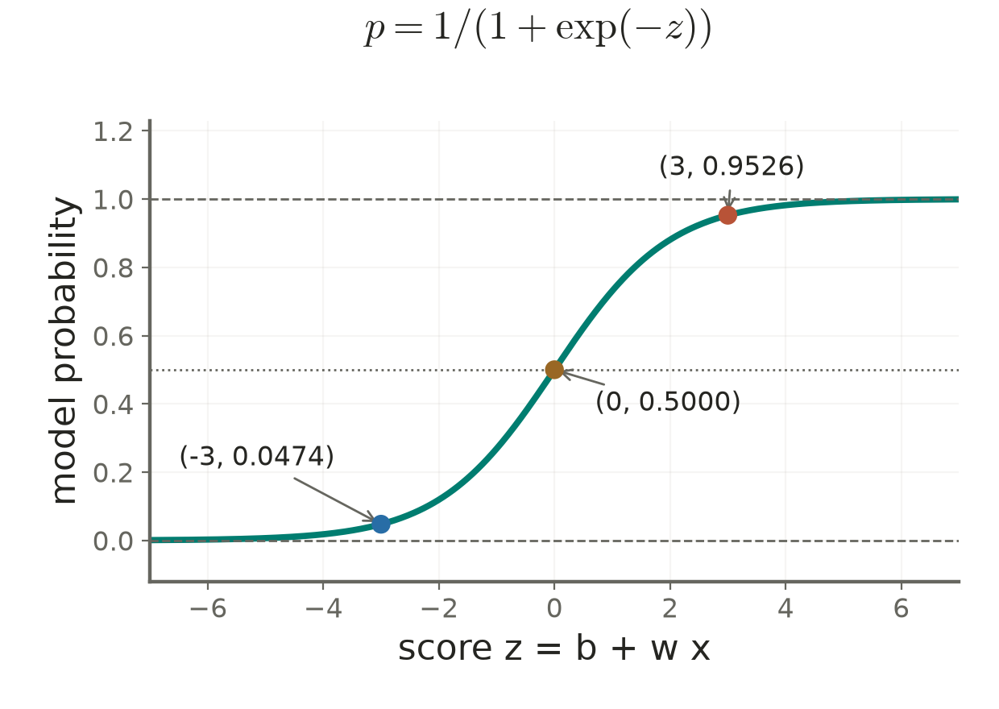

# Lecture 03 · KP13：線性對數比值反解為有效機率（Linear log odds yield valid model probabilities）

> 程度：研究生（grad）／Level: Graduate (grad)
>
> 週次：第 3 週（2026-09-21）｜進度：Linear Classifiers
>
> Week 3 (2026-09-21) | Topic: Linear Classifiers

[JianBauDau 簡報](../slides/lec03-kp13-logistic.jbd.json)

## 學習目標（Learning objectives）

- 從線性對數比值推導 sigmoid 與多類機率（Derive sigmoid and multiclass probabilities from linear log odds）。
- 將分類標籤的條件概似寫成最佳化目標（Write the conditional label likelihood as an optimization objective）。
- 區分邏輯斯迴歸與 LDA 的假設及估計方式（Distinguish logistic regression and LDA assumptions and estimation）。

## KP13：把線性假設放在對數比值上（Place the linear assumption on log odds）

**一句話重點**：邏輯斯迴歸假設對數機率比值為輸入的仿射函數，反解後的模型機率落在有效範圍。

**One-sentence summary**: Logistic regression models log odds as an affine input function, yielding probabilities in the valid range.

### 1. 無界分數需要換一個解讀方式（An unbounded score needs a different interpretation）

KP11 的線性 MSE 分數可能超過 1。KP12 又提醒我們限制模型有時是必要的。現在保留線性分數，但把它解讀成對數比值，而非直接當作機率。

KP11's linear MSE scores can exceed one. KP12 motivated model constraints. We retain a linear score but interpret it as log odds instead of probability itself.

**白話說明**：沿用來源的比值槓桿比喻。先比較某類出現與未出現的機率，再取對數。這個量可正可負，適合用線性分數表示。這是統計建模假設，不保證真實資料一定符合它。

**Plain explanation**: Use the source's odds-lever analogy. Compare the probability of a class with its complement, then take a logarithm. The result can be positive or negative and is modeled linearly. This assumption need not hold exactly in real data.

| 符號 | 中文意義 | English meaning |
|---|---|---|
| $p=P_\theta(\omega_1\mid\mathbf x)$ | 模型給出的正類機率 | Model probability of class one |
| $1-p$ | 另一類的模型機率 | Complementary class probability |
| $z=b+\mathbf w^T\mathbf x$ | 線性分數加截距 | Affine score |
| $p/(1-p)$ | 正反兩類的機率比值 | Odds |
| $\ln[p/(1-p)]$ | 對數機率比值，又稱 logit | Log odds, or logit |
| $\sigma(z)$ | 反解後的 sigmoid 函數 | Sigmoid inverse link |
| $\theta$ | 全部待估參數 | Collection of model parameters |

**正式定義**：二類模型令對數比值等於分數。假設輸入與參數有限。

**Formal definition**: The binary model equates log odds to its score. Assume finite inputs and parameters.

$$
\ln\frac{p}{1-p}=z=b+\mathbf w^T\mathbf x.
$$

### 2. 從對數比值逐步反解機率（Solving log odds for the probability）

既然已選定分數的意義，就能取指數並整理。每一步都是對同一條建模方程做代數運算。

With the score's meaning fixed, exponentiate and rearrange the same model equation.

$$
\begin{aligned}
\frac{p}{1-p}&=e^z,\\
p&=e^z(1-p),\\
p(1+e^z)&=e^z,\\
p&=\frac{e^z}{1+e^z}=\frac1{1+e^{-z}}=\sigma(z),\\
1-p&=\frac1{1+e^z}.
\end{aligned}
$$

有限的實數 $z$ 在數學上給出 $0<p<1$。只有當 $z$ 趨向無窮時，機率才逼近端點。電腦浮點數則可能將極端結果四捨五入為 0 或 1。

Finite real scores mathematically produce probabilities strictly between zero and one. Limits approach the endpoints, while floating-point calculations can round extreme values to them.

當門檻選 $p=0.5$，相當於 $z=0$。在目前輸入特徵空間中，決策邊界仍是超平面。機率曲線的非線性不會自動產生彎曲邊界。

A one-half threshold corresponds to zero score. The decision boundary remains a hyperplane in the current feature space. A nonlinear probability curve does not itself create a curved boundary.

### 3. 沿用來源的三個測試點（The source three-point example）

**例子**：來源互動程式預設 $b=0,w=1.5$，因此 $z=1.5x$。

**Example**: The source demo sets the intercept to zero and slope to one and a half.

| $x$ | $z$ | $e^{-z}$ | $p=1/(1+e^{-z})$ |
|---|---|---|---|
| $-2$ | $-3$ | 20.085537 | 0.047426 |
| 0 | 0 | 1 | 0.500000 |
| 2 | 3 | 0.049787 | 0.952574 |

例如 $x=2$ 時，先得 $z=1.5(2)=3$，再得 $p=1/(1+0.049787068)=0.952574127$。這是模型機率，還不是用實際資料驗證過的正確率。

At input two, compute the score before its exponential and probability. This is a model probability, not a measured accuracy on real data.



**圖說 `lec03-kp13-sigmoid`**：先看分數 $z=0$ 對應機率 $0.5$，再看兩側的漸近線。三個標記對應 $z=-3,0,3$，就是來源 $x=-2,0,2$ 經過分數轉換後的位置。橫軸是 $z$，不能直接讀成原輸入 $x$。〔功能：1、2〕

**Caption `lec03-kp13-sigmoid`**: Inspect the midpoint, then the limiting bounds. Markers are the scores of the three source inputs. The horizontal axis shows scores, not raw inputs.

一維且 $w\ne0$ 時，$x_{\rm threshold}=-b/w$。若 $w=0$，機率在全部輸入上相同：$b=0$ 時處處為平手，$b\ne0$ 時沒有機率為一半的有限門檻點。

For a nonzero scalar slope, the threshold is minus intercept divided by slope. A zero slope produces constant probability: all inputs tie at zero intercept, otherwise no finite midpoint exists.

### 4. 多類情況：挑一類當共同參考（Using one reference class for multiple classes）

二類式可推廣到 $M$ 類。選第 $M$ 類當參考，令 $z_i=b_i+\mathbf w_i^T\mathbf x$，且 $z_M=0$。

For multiple classes, choose the final class as reference and assign it zero score.

$$
\ln\frac{p_i}{p_M}=z_i
\Longrightarrow p_i=e^{z_i}p_M,
\qquad \sum_{i=1}^M p_i=1.
$$

代入加總條件即可求分母。這是參考類別版本的 softmax；換參考類不會改變機率，只會改變參數表示。

Substitute into the normalization condition to obtain the denominator. This is a reference-class softmax representation. Changing the reference changes the parameterization, not the probabilities.

$$
p_M=\frac1{1+\sum_{j=1}^{M-1}e^{z_j}},\qquad
p_i=\frac{e^{z_i}}{1+\sum_{j=1}^{M-1}e^{z_j}}.
$$

[補充算例] 取 $z_1=\ln2,z_2=\ln3,z_3=0$。指數為 $2,3,1$，所以分母為 6，得到 $(p_1,p_2,p_3)=(1/3,1/2,1/6)$。

[Added example] Exponentials of the three scores are two, three, and one. Normalizing their sum gives the displayed probabilities.

### 5. 最大概似使用正確標籤的機率（Maximum likelihood uses each observed label's probability）

有了機率模型，還要從資料估計參數。假設訓練樣本獨立；固定輸入後，選參數讓已觀測標籤的機率乘積最大。

The probability model still needs parameters. For independent training samples, maximize the conditional probability of their observed labels.

$$
\ell(\theta)=\sum_{n=1}^N\ln P_\theta(\omega_{t_n}\mid\mathbf x_n).
$$

$t_n$ 是第 $n$ 筆的正確類別索引。二元標籤 $y_n\in\{0,1\}$ 時，最大化上式等價於最小化二元交叉熵，也就是負對數概似。

The target index identifies the observed class. With binary indicators, maximizing this likelihood is equivalent to minimizing binary cross entropy, the negative log likelihood.

$$
\mathcal L=-\sum_n[y_n\ln p_n+(1-y_n)\ln(1-p_n)]
=\sum_n[\ln(1+e^{z_n})-y_nz_n].
$$

[補充算例] 若正類樣本的 $z=3$，單筆損失為 $\ln(1+e^{-3})\approx0.048587$。若同樣是正類但 $z=-3$，損失為 $\ln(1+e^3)\approx3.048587$。

[Added example] A positive label with a positive score has a small negative log likelihood. Reversing that score while retaining the positive label gives a much larger loss.

**與實作的連結**：可用 `np.logaddexp(0, z)-y*z` 避免直接計算巨大指數。多類時可先從全部分數扣掉最大值，再計算指數比值。

**Implementation connection**: A log-sum-exp calculation avoids forming huge exponentials. Multiclass probabilities can subtract the maximum score before exponentiating.

```python
import numpy as np

# z: scores; y: binary labels
loss = np.logaddexp(0.0, z) - y * z
```

**來源補明**：若資料可被完全分離，未加限制的概似可能只在權重長度趨向無窮時接近上確界。不能保證一定有有限的最大概似權重；實作通常需要適當限制與數值停止判準。

**Source clarification**: With completely separable data, an unconstrained likelihood may approach its supremum only as weights diverge. Finite maximizing weights are not guaranteed. Practical fitting needs suitable constraints and stopping criteria.

### 6. 與 LDA 共用形式，但不共用估計假設（Sharing the LDA form does not mean sharing its assumptions）

LDA 假設各類特徵為高斯分布，且共用可逆共變異數 $\Sigma$。令類別先驗為 $\pi_i$。貝氏公式給出以下對數比值。

LDA assumes Gaussian class-conditional features with a shared invertible covariance. Including the class priors, Bayes' rule gives the following log odds.

$$
\begin{aligned}
\ln\frac{P(\omega_1\mid\mathbf x)}{P(\omega_2\mid\mathbf x)}
&=\ln\frac{\pi_1}{\pi_2}
+\frac12(\mathbf m_2^T\Sigma^{-1}\mathbf m_2-\mathbf m_1^T\Sigma^{-1}\mathbf m_1)\\
&\quad +(\mathbf m_1-\mathbf m_2)^T\Sigma^{-1}\mathbf x.
\end{aligned}
$$

$\mathbf m_1,\mathbf m_2$ 是兩類平均。來源省略先驗比值；只有先驗相等時，該項才為零。形式相同只表示兩者可產生相同類型的決策函數，不表示參數估計或樣本結果相同。

The two mean vectors describe the classes. The source omits the prior ratio, which vanishes only for equal priors. Shared functional form does not imply identical estimation or fitted results.

[補充算例] 一維取 $m_1=1,m_2=-1,\Sigma=1,\pi_1=0.25,\pi_2=0.75$。可得 $z=2x+\ln(1/3)$，門檻 $x=\ln3/2\approx0.549306$。若漏掉先驗，門檻會被誤寫成 0。

[Added example] Unequal priors shift the intercept and move the threshold. Omitting them would incorrectly place the decision boundary at zero in this example.

**常見迷思**：沒有高斯假設就一定比 LDA 好。邏輯斯迴歸仍假設目前特徵下的對數比值為仿射函數。哪個方法較好，需要看假設與資料是否相符，不能只憑模型名稱判定。

**Common misconception**: Avoiding Gaussian assumptions guarantees better performance than LDA. Logistic regression still assumes affine log odds in the current features. Performance depends on how the assumptions match the data.

**想深入**：機率有效只保證落在範圍內並可正規化。它不保證模型正確或已校準。特徵若另做非線性轉換，邊界在原始輸入空間也可能彎曲。

**Going deeper**: Valid ranges and normalization do not guarantee correct or calibrated probabilities. Nonlinear feature transformations can also make boundaries curved in the original input space.

**小練習**：來源貸款範例令 $b=-2,w=0.5$。求 $x=4$ 時的模型機率，以及機率為 $0.5$ 的門檻。提示：先求分數，再代入 sigmoid；數字是抽象收入指標，沒有指定貨幣單位。

**Practice**: Use the source intercept and slope to find the probability and midpoint input. Hint: compute the score first. The income indicator has no stated currency unit.

## 小結與下一步（Summary and next step）

- 線性對數比值對應 sigmoid 或 softmax 機率（Linear log odds yield sigmoid or softmax probabilities）。
- 學習使用條件概似，有限最佳權重仍需檢查（Fitting uses conditional likelihood; finite maximizing weights require care）。
- KP14 將回到決策邊界的幾何，改以最大間隔選擇超平面（KP14 returns to boundary geometry through maximum margins）。

## 延伸閱讀與來源（Further reading and sources）

- [第 3 章 §3.6、KP13、教授祕笈與互動程式](https://ndhuccc.github.io/CCC-LNS/PR_115/Ch03-linear-classifiers/index.html#kp13)，2026-10-16 核對原始檔，blob `bd64b78ba21606d078c672b0fa67337b017e4a34`（Source checked on 2026-10-16）。
- [Stanford CS229：Generative Learning Algorithms](https://cs229.stanford.edu/summer2020/cs229-notes2.pdf)，查核高斯生成模型、類別先驗與邏輯斯條件模型的區別（Checked for the distinction between generative and conditional modeling）。
- [NumPy `logaddexp` 官方文件](https://numpy.org/doc/stable/reference/generated/numpy.logaddexp.html)，查核指數和的對數計算（Checked for stable logarithms of sums of exponentials）。

## 術語表（Glossary）

| 中文 | English |
|---|---|
| 邏輯斯迴歸 | Logistic regression |
| 機率比值 | Odds |
| 對數機率比值 | Log odds / logit |
| 反連結函數 | Inverse link |
| 參考類別 | Reference class |
| 正規化指數函數 | Softmax |
| 條件概似 | Conditional likelihood |
| 負對數概似 | Negative log likelihood |
| 二元交叉熵 | Binary cross entropy |
| 線性判別分析 | Linear discriminant analysis, LDA |
