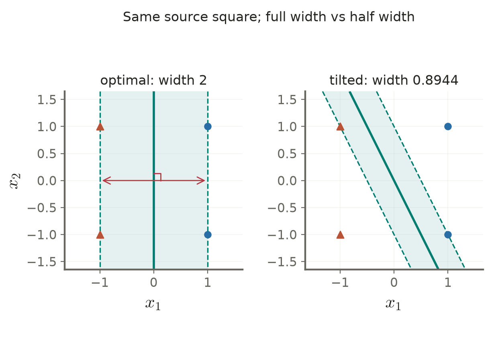

# Lecture 03 · KP14：從分對資料走向最大間隔（From separation to the maximum margin）

> 程度：研究生（grad）／Level: Graduate (grad)
>
> 週次：第3週（2026-09-21）｜進度：Linear Classifiers
>
> Week 3 (2026-09-21) | Topic: Linear Classifiers

[JianBauDau 簡報](../slides/lec03-kp14-hard-margin-with-comics.jbd.json)

## 學習目標（Learning objectives）

- 分清分數、幾何距離、間隔半寬與全寬（Distinguish scores, distances, half margins, and full widths）。
- 從限制式推導主問題與對偶問題（Derive primal and dual formulations from constraints）。
- 用正方形算例說明邊界唯一而乘子可能不唯一（Explain unique boundaries and nonunique multipliers using the square example）。

## KP14：在能分開資料的邊界中選擇最大間隔（Choose the largest margin among separating boundaries）

**一句話重點**：硬間隔支持向量機要求全部訓練點分對，再把最近點到邊界的距離推到最大。

**One-sentence summary**: A hard-margin support vector machine separates all training points and maximizes the nearest distance to the boundary.

### 1. 分數可以縮放，幾何距離不會跟著變（Scores can be rescaled without moving the boundary）

KP13 用機率模型選擇線性邊界。現在換成幾何問題：即使多條線都能分對資料，哪條線留下的緩衝空間最大？這像替兩側房屋畫道路。比喻只說明空間，不表示較寬的間隔必然保證所有新資料正確。

KP13 modeled probabilities with an affine boundary. We now compare separating boundaries by their smallest clearance. Think of placing a road between houses. The analogy explains geometry, not a guarantee of perfect future predictions.

**白話說明**：把所有係數乘以正數，直線不會移動，但分數會變大。因此不能拿原始分數比較安全距離。必須除以法向量長度。

**Plain explanation**: Multiplying every coefficient by a positive number preserves the boundary but changes scores. Normalize by the normal-vector length to compare actual distances.

| 符號 | 中文意義 | English meaning |
|---|---|---|
| $\mathbf x_i\in\mathbb R^d$ | 第$i$筆特徵 | Feature vector of sample i |
| $y_i\in\{-1,+1\}$ | 類別標籤 | Binary class label |
| $g_i=\mathbf w^T\mathbf x_i+b$ | 判別分數 | Affine decision score |
| $y_i g_i$ | 帶標籤的分數 | Functional margin |
| $\gamma=\min_i y_i g_i/\|\mathbf w\|$ | 最小幾何距離 | Minimum geometric margin |
| $\alpha_i\ge0$ | 每個限制的乘子 | Nonnegative constraint multiplier |

**正式定義**：假設有限訓練集包含兩類，且嚴格線性可分。將最小帶標籤分數縮放成1；在最優解中兩側都有貼住的點。

**Formal definition**: Assume finite, strictly separable data containing both classes. Normalize the minimum functional margin to one. At the optimum, both sides have active constraints.

$$
y_i(\mathbf w^T\mathbf x_i+b)\ge1,
\qquad \gamma=\frac1{\|\mathbf w\|},
\qquad W=\frac2{\|\mathbf w\|}.
$$

本文用$\gamma$表示半寬，$W$表示兩條支撐平面之間的全寬。來源算例說margin為1，教授祕笈則算全寬2；兩者須依定義分開。

Here gamma denotes half width and W denotes full width. The source's values one and two refer to different conventions and must be distinguished.

### 2. 最大距離可以改寫成最小權重範數（Maximizing clearance becomes minimizing the weight norm）

距離已定義清楚，現在只要在所有可行邊界中，選擇最短的法向量。

With clearance defined, choose the smallest weight norm among feasible boundaries.

$$
\min_{\mathbf w,b}\frac12\|\mathbf w\|^2
\quad\text{s.t.}\quad y_i(\mathbf w^T\mathbf x_i+b)\ge1.
$$

目標是凸二次函數，限制是線性的，因此局部最小值也是全域最小值。凸性本身不保證所有變數唯一。此處權重的嚴格凸性，以及兩類都存在的可分條件，才進一步確立最優邊界。

The objective is convex quadratic with linear constraints, so a local minimum is global. Convexity alone does not establish uniqueness of every variable. Strict convexity in the weights and the two-class separable setting provide the stronger conclusion here.

**想深入**：對每個限制引入乘子，得到拉格朗日函數；令權重與截距的偏導為0。

**Going deeper**: Introduce a multiplier for each constraint and set the weight and intercept derivatives to zero.

$$
L=\frac12\|\mathbf w\|^2+
\sum_i\alpha_i[1-y_i(\mathbf w^T\mathbf x_i+b)],
$$

$$
\mathbf w=\sum_i\alpha_i y_i\mathbf x_i,
\qquad \sum_i\alpha_i y_i=0.
$$

### 3. 對偶問題解釋哪些點會參與預測（The dual identifies points participating in prediction）

將剛才的最優權重代回，便把問題改寫成只找乘子。

Substitution leaves a problem involving only the multipliers.

$$
\max_{\mathbf a}\left[
\sum_i\alpha_i-\frac12\sum_{i,j}\alpha_i\alpha_jy_iy_j
\mathbf x_i^T\mathbf x_j\right],
\quad \alpha_i\ge0,\quad \sum_i\alpha_i y_i=0.
$$

記$\mathbf a=(\alpha_1,\ldots,\alpha_N)^T$。互補鬆弛條件將乘子與間隔接起來。

The multiplier vector collects all scalar coefficients. Complementary slackness connects these coefficients to the margins.

$$
\alpha_i[y_i g_i-1]=0,
\qquad g(\mathbf x)=\sum_i\alpha_i y_i\mathbf x_i^T\mathbf x+b.
$$

若$\alpha_i>0$，該點必貼在支撐平面上；反方向未必成立。退化資料可能有貼邊點卻在某組最優乘子中得到0。內積形式為核方法留下入口，但計算內積仍與特徵維度相關，並非運算成本完全不受維度影響。

A positive multiplier implies an active margin constraint. The converse can fail in degenerate data. Inner products enable later kernel methods, but computing them still depends on feature dimension.

### 4. 正方形例子的全寬是2，乘子有多種表示（The square has width two and multiple dual representations）

**例子**：沿用Example 3.5的順序，正類為$(1,1),(1,-1)$，負類為$(-1,1),(-1,-1)$。取$\mathbf w=(1,0)^T,b=0$。

**Example**: Retain the source square and its stated point order. The affine score is the first coordinate.

$$
(g_1,g_2,g_3,g_4)=(1,1,-1,-1),\quad
(y_1g_1,\ldots,y_4g_4)=(1,1,1,1),
$$

$$
\|\mathbf w\|=1,\quad \gamma=1,\quad W=2.
$$

**圖說 `lec03-kp14-square-margin`**：先看左側$x_1=0$與兩條支撐線，再看右側傾斜邊界。右側用$\mathbf w=(2,1)^T$，全寬為$2/\sqrt5\approx0.894427$，小於2。兩圖使用同樣四點與等比例座標。〔功能：2、3〕

**Caption `lec03-kp14-square-margin`**: Inspect the optimal separator and support lines, then the tilted feasible separator with normal (2,1). Its full width is approximately 0.894427, compared with two on the left. Both panels use identical data and equal aspect ratios.

依上述點順序，所有下列乘子都產生同一權重；來源部分乘子方程與指定點順序不一致，這裡按定義重算。

For the stated point order, the following family produces the same weights. It corrects inconsistent multiplier equations in the source explanation.

$$
(\alpha_1,\alpha_2,\alpha_3,\alpha_4)
=(t,\tfrac12-t,t,\tfrac12-t),\quad0\le t\le\tfrac12.
$$

$$
\sum_i\alpha_i=1,\quad \mathbf w=(1,0)^T,\quad
\sum_i\alpha_i-\tfrac12\|\mathbf w\|^2=\tfrac12.
$$

$t=0.25$時四個乘子都是0.25；$t=0$時只有第2、4點的乘子為0.5。因此四點都貼邊，但不能宣稱每組解都有四個正乘子。

At t=0.25 all four multipliers are positive. At t=0 only the second and fourth are positive. All points lie on support planes, but not every dual solution uses four positive coefficients.

### 5. 無關點的影響取決於移動後是否仍滿足限制（A point remains irrelevant only while its constraint stays inactive）

**常見迷思**：非支持點可以任意移動而不改變模型。只有當它移動後仍滿足原最優邊界的限制，原解才保持可行與最優。移到間隔內或另一側，便不能套用這個說法。

**Common misconception**: A nonsupport point can be moved anywhere without affecting the model. The claim requires its moved position to preserve the old optimum's constraints. Crossing into the margin changes the problem.

實作上用容差判斷乘子與限制，並檢查可行性、對偶平衡及主對偶差。若兩類不可分，硬限制沒有可行解；下一個KP改用鬆弛變數。

In computation, use tolerances and check feasibility, dual balance, and the primal-dual gap. Nonseparable data make the hard constraints infeasible; the next KP introduces slack.

**小練習**：來源的一維正類為3、4、5，負類為−1、−2。找決策點、間隔全寬及貼邊點。提示：先找兩類最接近的位置，再依標籤決定法向量方向。

**Practice**: For positives 3, 4, 5 and negatives −1, −2, find the boundary, full width, and active margin points. Start from the nearest cross-class pair and preserve the label orientation.

## 小結與下一步（Summary and next step）

間隔須先固定尺度；主問題、對偶與互補鬆弛描述同一個解。接著問：若資料無法全部分對，要放寬哪個條件？

Normalize scores before comparing margins. The primal, dual, and complementary conditions describe one solution. Next ask which constraint can be relaxed when perfect separation fails.

## 延伸閱讀與來源（Further reading and sources）

- [第3章§3.7.1、KP14與教授祕笈](https://ndhuccc.github.io/CCC-LNS/PR_115/Ch03-linear-classifiers/index.html#kp14)，2026-10-16查核（Checked on 2026-10-16）。
- [Cortes與Vapnik：Support-Vector Networks](https://web.engr.oregonstate.edu/~huanlian/teaching/ML/2018spring/extra/svn-1995.pdf)，用於核對支持向量最佳化的定義（For the optimization formulation）。

## 術語表（Glossary）

| 中文 | English |
|---|---|
| 支持向量機 | Support vector machine |
| 硬間隔 | Hard margin |
| 幾何間隔 | Geometric margin |
| 主問題／對偶問題 | Primal / dual problem |
| 拉格朗日乘子 | Lagrange multiplier |
| 互補鬆弛 | Complementary slackness |
| 凸二次規劃 | Convex quadratic programming |
