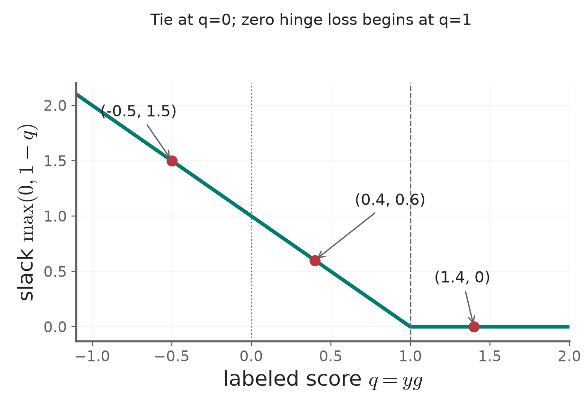
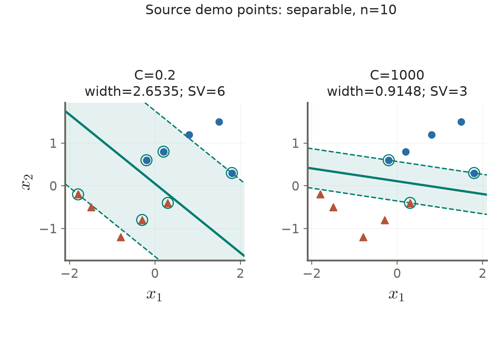

# Lecture 03 · KP15：用鬆弛變數交換間隔與違規代價（Trade margin size against violations with slack variables）

> 程度：研究生（grad）／Level: Graduate (grad)
>
> 週次：第3週（2026-09-21）｜進度：Linear Classifiers
>
> Week 3 (2026-09-21) | Topic: Linear Classifiers

[JianBauDau 簡報](../slides/lec03-kp15-soft-margin-with-comics.jbd.json)

## 學習目標（Learning objectives）

- 以帶標籤分數判讀違規程度（Interpret violations using signed functional margins）。
- 從鬆弛限制得到折線損失與乘子上界（Derive hinge loss and multiplier bounds from slack constraints）。
- 分辨參數C的保證性質與資料依賴的現象（Distinguish proven properties of C from dataset-specific behavior）。

## KP15：容許付出代價的違規，讓不可分資料仍可學習（Allow penalized violations to learn from nonseparable data）

**一句話重點**：軟間隔SVM讓每個點借用鬆弛量，再用C決定這些借用要付多少代價。

**One-sentence summary**: Soft-margin SVM assigns slack to each constraint and uses C to price that slack.

### 1. 分對不代表已經留足間隔（Correct classification does not imply sufficient clearance）

KP14要求每個帶標籤分數至少為1。若有雜訊或互相矛盾的標籤，這項要求可能無法達成。像道路旁房屋不能全部搬走，就得記錄哪些房屋侵入預留空間；比喻只對應違規量，不代表真的刪除資料。

KP14 required each labeled score to reach one. Noise or conflicting labels can make that impossible. Recording encroachment into a planned road illustrates slack; it does not mean deleting observations.

**白話說明**：令$q_i=y_i g_i$。正數表示在正確一側，但介於0與1仍太靠近邊界。負數表示分錯。鬆弛量記錄距離「標準分數1」還缺多少，不直接等於幾何距離。

**Plain explanation**: A positive labeled score indicates the correct side, yet values below one violate the desired clearance. Negative scores indicate mistakes. Slack measures a score deficit, not a geometric distance.

| 符號 | 中文意義 | English meaning |
|---|---|---|
| $q_i=y_i(\mathbf w^T\mathbf x_i+b)$ | 帶標籤分數 | Labeled affine score |
| $\xi_i\ge0$ | 放寬限制的量 | Nonnegative slack |
| $C>0$ | 每單位鬆弛的懲罰權重 | Penalty per unit slack |
| $\alpha_i,\beta_i$ | 兩組非負限制乘子 | Nonnegative constraint multipliers |

**正式定義**：在固定權重與截距下，最小可行鬆弛就是折線損失。

**Formal definition**: For fixed weights and intercept, the smallest feasible slack equals hinge loss.

$$
q_i\ge1-\xi_i,\quad\xi_i\ge0
\quad\Longrightarrow\quad \xi_i^*=\max(0,1-q_i).
$$

| 分數範圍 | 中文判讀 | English interpretation |
|---|---|---|
| $q_i\ge1$ | 不違規，最小鬆弛0 | No margin violation |
| $0<q_i<1$ | 分對但進入間隔 | Correct side, inside margin |
| $q_i=0$ | 位於決策邊界，分類依平手規則 | Boundary tie |
| $q_i<0$ | 分錯，最小鬆弛大於1 | Misclassification |

來源將$\xi=1$算進「仍分對」，此處分出平手情況。且上述對應使用最小或最優鬆弛，不能拿任意放大的可行鬆弛來判斷位置。

The source includes slack one among correct predictions. Here it is treated as a boundary tie. The interpretation also requires minimal or optimal slack, rather than an arbitrarily inflated feasible value.

### 2. 目標懲罰違規大小，不是只數違規點（The objective penalizes violation magnitude, not merely counts）

既然每個點都有缺口，就把所有缺口的代價加到權重範數上。

Add the total cost of these deficits to the weight norm.

$$
\min_{\mathbf w,b,\mathbf s}
\frac12\|\mathbf w\|^2+C\sum_i\xi_i,
\quad q_i\ge1-\xi_i,\quad\xi_i\ge0.
$$

$$
\min_{\mathbf w,b}\frac12\|\mathbf w\|^2+
C\sum_i\max(0,1-y_i g_i).
$$

記$\mathbf s=(\xi_1,\ldots,\xi_N)^T$為所有鬆弛量的集合。最小化的是違規量的總和，並非0/1誤判數。小C或大C都不能單獨保證較好的新資料表現。

The slack vector collects all scalar slacks. The loss sums violation magnitudes rather than zero-one mistakes. Neither a smaller nor a larger C alone guarantees better future performance.

**例子**：[補充] 固定一條線，令$q=1.4,0.4,-0.5$，則最小鬆弛依序為0、0.6、1.5。若C=10，這三點的懲罰依序為0、6、15。

**Example**: [Added] Scores 1.4, 0.4, and −0.5 give slacks zero, 0.6, and 1.5. At C=10, their penalties are zero, six, and fifteen.

$$
\sum_i\xi_i=0+0.6+1.5=2.1,\qquad C\sum_i\xi_i=21.
$$

**圖說 `lec03-kp15-hinge-loss`**：先看橫軸$q$，再從3個標記讀出鬆弛。$q=0$是分類平手，$q=1$才開始零違規。圖形顯示這兩條分界不同。〔功能：1、2〕

**Caption `lec03-kp15-hinge-loss`**: Read the labeled-score axis, then each marker's loss. Zero is the classification tie, while one begins zero hinge loss. These thresholds serve different purposes.

### 3. 乘子上界來自鬆弛方向的平衡（The dual bound comes from stationarity in slack）

要理解誰會支撐模型，替兩組限制各加一個乘子。鬆弛的偏導讓C與兩個乘子平衡。

Introduce multipliers for both sets of constraints. Stationarity with respect to slack balances C against the two multipliers.

$$
L=\frac12\|\mathbf w\|^2+C\sum_i\xi_i+
\sum_i\alpha_i(1-\xi_i-y_i g_i)-\sum_i\beta_i\xi_i,
$$

$$
C-\alpha_i-\beta_i=0\quad\Longrightarrow\quad0\le\alpha_i\le C.
$$

對偶目標與KP14相同，但多出上界C；權重仍是$\sum_i\alpha_i y_i\mathbf x_i$。

The dual objective matches KP14, now with the upper bound C. The weights remain the labeled sum of training vectors.

$$
\max_{\mathbf a}\sum_i\alpha_i-\frac12\sum_{i,j}
\alpha_i\alpha_jy_iy_j\mathbf x_i^T\mathbf x_j,
\quad0\le\alpha_i\le C,\quad\sum_i\alpha_i y_i=0.
$$

互補鬆弛給出：若$\xi_i>0$，則$\beta_i=0$，所以$\alpha_i=C$。若$0<\alpha_i<C$，則$\xi_i=0$且$q_i=1$。反過來，$\alpha_i=C$不保證正鬆弛，貼邊點也可能達上界。

Positive slack forces its multiplier to C. A multiplier strictly between zero and C identifies a zero-slack margin point. A multiplier equal to C need not imply positive slack.

### 4. 原互動資料其實可分，不能冒充不可分實測（The source demo data are separable despite their description）

來源文字比較C=0.2與1000，但未提供原書圖3.13的完整座標。教授祕笈提到約1.42與0.58，無法核實為該原書實測。本講義不把它們當成重現結果。

The source compares C=0.2 and 1000 without providing the original textbook figure's coordinates. The accompanying approximate widths 1.42 and 0.58 cannot be verified as reproduced measurements.

改用網頁互動程式明列的10點重新解精確對偶問題。正類座標為$(0.8,1.2),(1.5,1.5),(0.2,0.8),(1.8,0.3),(-0.2,0.6)$；負類為$(-0.8,-1.2),(-1.5,-0.5),(-0.3,-0.8),(-1.8,-0.2),(0.3,-0.4)$。

We recompute the ten coordinates explicitly provided by the demo, using its two classes in the same order. This is a new optimization run on the source's listed data.

正類第二座標至少0.3，負類至多−0.2，因此$x_2=0.05$已能完全分開。來源稱這組點「不可分」不正確。軟間隔也能用在可分資料，只是不強迫全部零鬆弛。

Every positive second coordinate is at least 0.3, while every negative one is at most −0.2. The horizontal threshold 0.05 separates them. Soft-margin training still applies to separable data.

**圖說 `lec03-kp15-c-comparison`**：先比相同資料，再看兩側的邊界與支撐線。C依原文字取0.2與1000，數字以examples.json的雙精度求解及KKT細化為準。這不是原書圖3.13或網頁近似求解器的原樣重播。〔功能：2、3〕

**Caption `lec03-kp15-c-comparison`**: Compare identical observations before reading the two fitted boundaries and support lines. Penalties follow the source text. Values come from a fresh double-precision dual solve and KKT refinement, not a replay of the original figure or browser solver.

本次重算的係數、全寬W與正乘子數Ns如下，兩組皆沒有訓練誤判。數字四捨五入至6位小數；驗證使用完整精度。

The recomputed coefficients, full width W, and positive-multiplier count Ns are listed below. Both fits have zero training errors. Displayed values use six decimals; verification uses full precision.

| C | w1 | w2 | b | W | Ns |
|---:|---:|---:|---:|---:|---:|
| 0.2 | 0.474186 | 0.585859 | −0.029293 | 2.653529 | 6 |
| 1000 | 0.324324 | 2.162162 | −0.232432 | 0.914766 | 3 |

### 5. C控制權衡，但不控制每個點的命運（C controls a tradeoff rather than each point's outcome）

**常見迷思**：增大C一定減少誤判點與支持向量數。C直接增加的是總鬆弛的代價。對同一組資料、同一損失的全域最優解，總鬆弛不隨C增加；誤判數或正乘子數卻不保證逐步單調。尺度、類別權重與是否取平均損失也會改變C的意義。

**Common misconception**: Increasing C must reduce the number of errors and support vectors. The objective directly controls total slack, whose optimal value is nonincreasing with C under a fixed formulation. Error and support-vector counts need not be monotone. Scaling and loss normalization also matter.

可分資料在足夠大的C下可恢復硬間隔解；不可分資料即使把C拉高，仍不能消除互相矛盾的標籤。實作時先在訓練資料估計特徵尺度，再用驗證資料比較設定。

For separable data, sufficiently large C can recover the hard-margin solution. Contradictory labels remain impossible to separate. Estimate scaling from training data and compare settings on held-out data.

**想深入**：[補充] 設兩個最優解的正則項為$A_1,A_2$，總鬆弛為$L_1,L_2$。對$C_2>C_1$，把兩個最優性不等式相加，可得$(C_2-C_1)(L_2-L_1)\le0$。這是總量的結論，不能改成誤判點數的結論。

**Going deeper**: [Added] Adding the optimality inequalities for two penalty values yields the stated monotonicity of total slack. It does not establish monotonicity of error counts.

**小練習**：固定一條線，正類點得分0.4。求最小鬆弛及C=10的懲罰；再把分數改成−0.5比較。提示：使用折線損失，這不是重新訓練的比較。

**Practice**: For a positive point with score 0.4, find minimal slack and its penalty at C=10. Compare score −0.5. Use hinge loss while keeping the model fixed.

## 小結與下一步（Summary and next step）

鬆弛量、C與乘子上界描述同一個取捨。下一個問題是：只有兩類的機制如何組成多類分類器？

Slack, C, and dual caps express one tradeoff. Next, combine binary machines to handle several classes.

## 延伸閱讀與來源（Further reading and sources）

- [第3章§3.7.2、KP15、教授祕笈與互動程式](https://ndhuccc.github.io/CCC-LNS/PR_115/Ch03-linear-classifiers/index.html#kp15)，2026-10-16查核（Checked on 2026-10-16）。
- [Support-Vector Networks](https://web.engr.oregonstate.edu/~huanlian/teaching/ML/2018spring/extra/svn-1995.pdf)，核對軟間隔與對偶限制（For the soft-margin formulation）。

## 術語表（Glossary）

| 中文 | English |
|---|---|
| 軟間隔 | Soft margin |
| 鬆弛變數 | Slack variable |
| 折線損失 | Hinge loss |
| 超參數 | Hyperparameter |
| 全域最優解 | Global optimum |
| 主對偶差 | Primal-dual gap |
