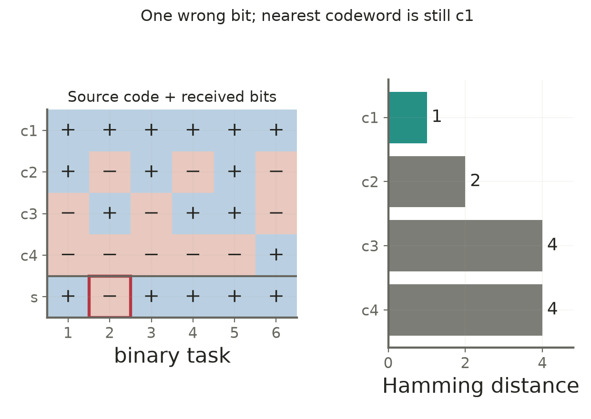

# Lecture 03 · KP16：把多類別決策拆成可組合的二元問題（Compose binary decisions for multiclass prediction）

> 程度：研究生（grad）／Level: Graduate (grad)
>
> 週次：第3週（2026-09-21）｜進度：Linear Classifiers
>
> Week 3 (2026-09-21) | Topic: Linear Classifiers

[JianBauDau 簡報](../slides/lec03-kp16-multiclass-ecoc-with-comics.jbd.json)

## 學習目標（Learning objectives）

- 比較一對多、一對一與糾錯輸出的訓練目標（Compare one-versus-rest, one-versus-one, and error-correcting outputs）。
- 重算碼字距離與可保證的糾錯範圍（Compute code distances and guaranteed correction radius）。
- 區分確定的解碼保證與未保證的分類準確率（Separate decoding guarantees from predictive accuracy）。

## KP16：先定義各二元問題，再定義如何合併（Define binary tasks before choosing an aggregation rule）

**一句話重點**：多類SVM的關鍵不只是訓練更多模型，還包括每個模型回答什麼，以及答案如何組合。

**One-sentence summary**: A multiclass SVM system must specify both its binary tasks and its rule for combining their outputs.

### 1. 一對多是各類與其餘類別比較（One-versus-rest compares each class against the remainder）

KP15解決二元分類的違規權衡。現在若有M個類別，可以讓M位檢查員各自回答「是不是我的類別」。這個團隊比喻只對應問題拆解，並不保證各檢查員的錯誤獨立。

KP15 handled the binary margin tradeoff. For M classes, imagine M inspectors, each recognizing one class against all others. The analogy describes decomposition, not statistical independence.

**白話說明**：第k個分類器把第k類標成+1，其餘標成−1。預測時常選分數最大的類別。多個正分數不是沒有答案；它表示多個二元判斷同時接受，需要合併規則。

**Plain explanation**: Classifier k labels its own class positive and every other class negative. Prediction often selects the largest score. Multiple positive scores require aggregation rather than making the entire system undefined.

**正式定義**：令$g_k(\mathbf x)$為第k個模型的分數，一對多使用M個模型。

**Formal definition**: With one score per class, one-versus-rest uses M binary models.

$$
\widehat k=\arg\max_{k\in\{1,\ldots,M\}}g_k(\mathbf x).
$$

[補充] 若3個分數為$(0.8,0.3,-0.4)$，有2個模型接受，但最大分數仍指定第1類。若同分，須另訂規則。各模型分數不自動具有相同機率意義，也不保證已校準。

[Added] Scores (0.8, 0.3, −0.4) contain two positive decisions, yet argmax selects class one. Ties need a policy, and scores are not automatically calibrated probabilities.

即使原始各類樣本數相同，一對多仍形成1對M−1的群組比例。但「一定極度不平衡」過度概括，實際比例要由資料計算。

Even balanced original classes produce a one-to-(M−1) grouping. Actual imbalance should be measured rather than assumed to be uniformly extreme.

### 2. 一對一以兩類子集訓練，再累積選票（One-versus-one trains class pairs and aggregates votes）

前一種讓每個模型面對全部資料；現在只問任意兩類之間誰勝出。

Instead of comparing one class against every other observation, train on each pair of classes.

$$
K_{\rm pair}=\binom M2=\frac{M(M-1)}2.
$$

**例子**：[補充] M=4時有6個配對。假設六場勝者依序為$1,1,4,2,2,3$，對應配對$(1,2),(1,3),(1,4),(2,3),(2,4),(3,4)$。四類票數為$(2,2,1,1)$，會出現平手。

**Example**: [Added] Four classes require six pairwise models. The stated winners give vote totals (2, 2, 1, 1), demonstrating a tie despite binary decisions in every pair.

模型數較多不代表總訓練時間必然較長，因為每個模型只讀兩類子集；配對也可能有樣本不平衡。實作須記錄配對順序、正負方向、投票及平手規則。

More models do not automatically imply longer total training because each uses a smaller subset. Pairwise imbalance can remain. Record pair order, label orientation, aggregation, and tie handling.

### 3. 糾錯編碼讓類別擁有不同的答案模式（Error-correcting codes assign distinct answer patterns to classes）

若把各模型的答案串起來，就能替每個類別設計一個碼字。這像證件上的冗餘校驗碼：少數位元錯了，整個身份仍可能辨認出來。比喻只對應最近碼字解碼，不保證分類器不會一起出錯。

Concatenate binary outputs into a codeword. Redundant check bits on an identification card illustrate how a few corrupted entries can still permit recovery. They do not ensure that classifiers avoid correlated errors.

| 符號 | 中文意義 | English meaning |
|---|---|---|
| $M,L$ | 類別數、二元模型數 | Number of classes and binary models |
| $A\in\{-1,+1\}^{M\times L}$ | 碼字矩陣 | Code matrix |
| $\mathbf c_k$ | 第k類的矩陣列 | Codeword of class k |
| $\mathbf s$ | L個二元輸出 | Received binary prediction vector |
| $d_H$ | 不同位置的個數 | Hamming distance |
| $d_{\min}$ | 任兩個碼字的最小距離 | Minimum code distance |

第j欄定義第j個二元任務。新輸入的各分數取正負，得到接收碼，再找最近的一列。

Column j defines binary task j. Convert predicted scores to signs and select the nearest codeword.

$$
d_H(\mathbf u,\mathbf v)=\sum_{j=1}^L\mathbf1[u_j\ne v_j],
\quad \widehat k=\arg\min_k d_H(\mathbf s,\mathbf c_k).
$$

### 4. 原碼字保留，但距離須逐對重算（Retain the source codewords and recompute every distance）

沿用教授祕笈的4類、6位元矩陣；+與−分別表示+1、−1。

Retain the source four-class, six-bit code. Plus and minus denote positive and negative labels.

$$
A=\begin{bmatrix}
1&1&1&1&1&1\\
1&-1&1&-1&1&-1\\
-1&1&-1&1&1&-1\\
-1&-1&-1&-1&-1&1
\end{bmatrix}.
$$

六個不同配對的距離為$3,3,5,4,4,4$，所以$d_{\min}=3$。來源把第2與第4類的距離寫成3，正確是4；最小距離與最後解碼不受此修正影響。

The six distinct pairwise distances are 3, 3, 5, 4, 4, and 4. The source's distance between classes two and four should be four rather than three. Minimum distance and the illustrated decision remain unchanged.

$$
\mathbf s=(1,-1,1,1,1,1),\qquad
(d_H(\mathbf s,\mathbf c_1),\ldots,d_H(\mathbf s,\mathbf c_4))=(1,2,4,4).
$$

只有第2個二元答案與真實第1類碼字不同，最近列仍是第1類。

Only the second prediction differs from the true first-class codeword, which remains the unique nearest row.

**圖說 `lec03-kp16-ecoc-distance`**：先看矩陣各列，再看底部接收碼的紅框錯誤位元，最後讀右側1、2、4、4的距離。第1類距離最短，所以單次錯誤沒有改變解碼。〔功能：1、2〕

**Caption `lec03-kp16-ecoc-distance`**: Read the class rows, locate the red-boxed received bit, then compare the distances one, two, four, and four. Class one remains nearest after one bit error.

### 5. 距離保證有明確的條件與上限（Distance-based correction has explicit conditions and limits）

**想深入**：若真實碼字為$\mathbf c_t$，接收碼有e個錯誤，則它距離正確列為e。對任意其他列，用距離的三角不等式可得下界。

**Going deeper**: If the received vector differs from the true codeword in e positions, its distance to that row is e. The triangle inequality bounds its distance to every other row.

$$
d_H(\mathbf s,\mathbf c_k)\ge
d_H(\mathbf c_t,\mathbf c_k)-e\ge d_{\min}-e.
$$
$$
e<d_{\min}-e\quad\Longleftrightarrow\quad
2e<d_{\min},\qquad
e\le\left\lfloor\frac{d_{\min}-1}{2}\right\rfloor.
$$

本例最多保證糾正1位錯誤。超過這個範圍可能仍猜對，但沒有普遍保證；它也不是系統整體準確率100%的承諾。

This code guarantees recovery from one bit error. More errors may still be corrected in particular cases, without a universal guarantee or a claim of perfect classification accuracy.

**常見迷思**：碼字越長一定越好。重複、互補或難以學習的分組，可能讓模型錯誤高度相關。本例第1與第3欄相同，已展示冗餘不必等於新的證據。必須一起考慮列距離、欄差異與各子問題的可學性。

**Common misconception**: Longer codes must improve accuracy. Repeated, complementary, or difficult tasks can create strongly correlated errors. The source code repeats columns one and three. Consider row separation, column diversity, and task learnability together.

**小練習**：M=5時一對多與一對一各需幾個模型？若$d_{\min}=5$，最多保證糾正幾位錯誤？提示：分別使用模型數公式與$2e<d_{\min}$，不要混用。

**Practice**: For five classes, count the one-versus-rest and pairwise models. For minimum code distance five, find the guaranteed correction radius. Use the appropriate formula for each question.

## 小結與下一步（Summary and next step）

拆解決定每個模型學什麼，合併決定如何處理衝突。接著回到單一SVM，研究另一種可解讀的參數ν。

Decomposition defines binary tasks; aggregation resolves their combined decisions. Next return to a single SVM and study its nu parameter.

## 延伸閱讀與來源（Further reading and sources）

- [第3章§3.7.3、KP16與教授祕笈](https://ndhuccc.github.io/CCC-LNS/PR_115/Ch03-linear-classifiers/index.html#kp16)，2026-10-16查核（Checked on 2026-10-16）。
- [Dietterich與Bakiri：Solving Multiclass Learning Problems via Error-Correcting Output Codes](https://arxiv.org/abs/cs/9501101)，用於核對編碼與錯誤相關性的區別（For the distinction between coding and correlated prediction errors）。

## 術語表（Glossary）

| 中文 | English |
|---|---|
| 一對多 | One-versus-rest |
| 一對一 | One-versus-one |
| 糾錯輸出碼 | Error-correcting output codes |
| 碼字／接收碼 | Codeword / received vector |
| 漢明距離 | Hamming distance |
| 糾錯半徑 | Correction radius |
| 類別不平衡 | Class imbalance |
