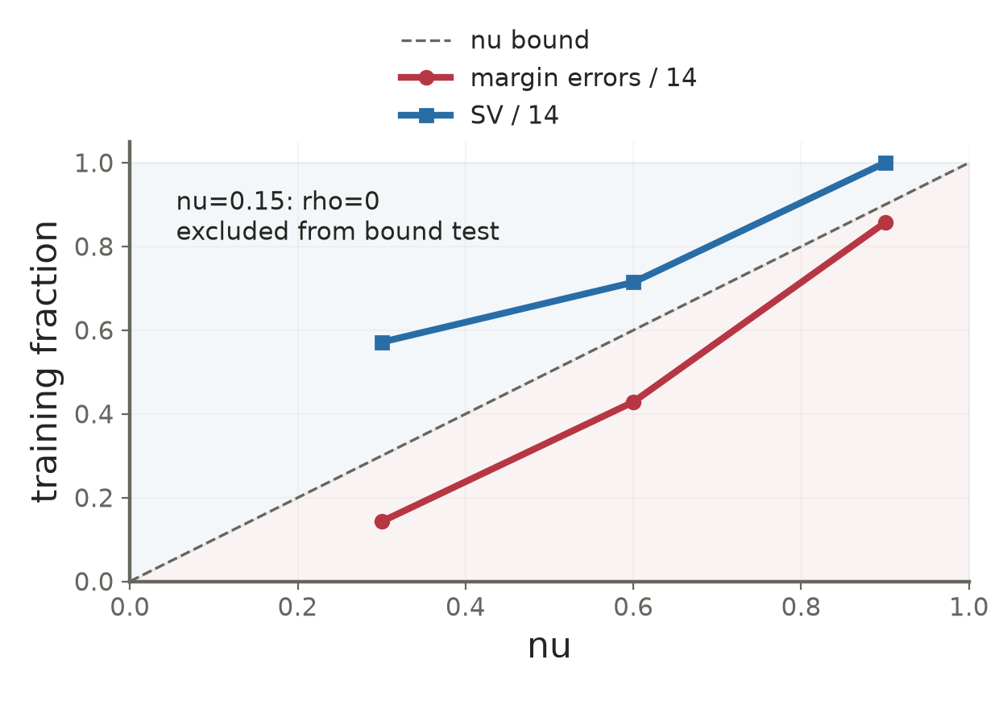

# Lecture 03 · KP17：讓ν連結違規上界與支持向量下界（Link nu to margin-error and support-vector bounds）

> 程度：研究生（grad）／Level: Graduate (grad)
>
> 週次：第3週（2026-09-21）｜進度：Linear Classifiers
>
> Week 3 (2026-09-21) | Topic: Linear Classifiers

[JianBauDau 簡報](../slides/lec03-kp17-nu-svm.jbd.json)

## 學習目標（Learning objectives）

- 區分分數門檻ρ與幾何間隔（Distinguish the score threshold rho from geometric width）。
- 用KKT條件推導ν的兩個數量界（Derive the two nu bounds using KKT conditions）。
- 說明正間隔、類別比例與退化解的重要性（Explain positive margins, class proportions, and degeneracy）。

## KP17：可解讀的比例界仍需要成立條件（Interpretable fraction bounds still require assumptions）

**一句話重點**：ν-SVM在得到正的ρ時，才可把ν解讀成間隔違規比例上界與支持向量比例下界。

**One-sentence summary**: When the optimized rho is positive, nu bounds the margin-error fraction above and the support-vector fraction below.

### 1. 用可學習的分數門檻取代固定的1（Learn a score threshold instead of fixing it to one）

KP15用C替違規量定價，KP16把二元模型組成多類模型。現在回到單一二元分類器，讓支撐分數從固定±1改成可調的±ρ。可想成道路工程同時決定預留寬度與侵入代價；比喻不能把ρ直接當成公尺。

KP15 priced slack with C, and KP16 combined binary machines. Now learn the support-score level rho instead of fixing it to one. A road-planning analogy helps, but rho itself is not a physical distance.

**白話說明**：ρ是分數尺度，真正的幾何全寬仍要除以權重長度。ν是訓練前指定的參數，ρ則是訓練解出的變數。

**Plain explanation**: Rho is a score threshold. Divide by the weight norm to obtain geometric width. Nu is specified before training; rho is optimized.

| 符號 | 中文意義 | English meaning |
|---|---|---|
| $N,N_+,N_-$ | 總樣本數、兩類樣本數 | Total and per-class sample counts |
| $\nu$ | 使用者指定的比例參數 | User-chosen fraction parameter |
| $\rho\ge0$ | 可學習的支撐分數 | Learned support-score threshold |
| $\xi_i$ | 低於ρ的分數缺口 | Score shortfall below rho |
| $E_m=\#\{i:y_i g_i<\rho\}$ | 間隔違規點數 | Margin-error count |
| $N_s=\#\{i:\alpha_i>0\}$ | 正乘子點數 | Support-vector count for the dual solution |

**正式定義**：沿用來源的正規化，鬆弛代價取平均值。

**Formal definition**: Use the source normalization with average slack cost.

$$
\min_{\mathbf w,b,\mathbf s,\rho}\frac12\|\mathbf w\|^2-
\nu\rho+\frac1N\sum_i\xi_i,
\quad y_i g_i\ge\rho-\xi_i,\quad\xi_i\ge0,\quad\rho\ge0.
$$
$$
W_{\rho}=\frac{2\rho}{\|\mathbf w\|}\quad(\|\mathbf w\|>0).
$$

負的νρ項鼓勵提高分數門檻，另外兩項限制權重與違規。不能只看ρ是否增加，就宣稱幾何間隔一定增加。

The negative nu-rho term rewards larger thresholds, while the other terms penalize weights and violations. Rho alone does not determine geometric width.

### 2. 乘子總量與單點上界產生比例限制（Multiplier mass and caps create fraction constraints）

與KP15相同地引入乘子。對ρ≥0再加乘子δ，令偏導為0。

Introduce multipliers as in KP15, with delta for the nonnegative rho constraint.

$$
\mathbf w=\sum_i\alpha_i y_i\mathbf x_i,\quad
\sum_i\alpha_i y_i=0,\quad0\le\alpha_i\le\frac1N,
$$
$$
-\nu+\sum_i\alpha_i-\delta=0,\quad
\delta\ge0,\quad\delta\rho=0.
$$

因此一般對偶要求乘子總和至少為ν；若ρ>0，則δ=0，總和恰為ν。

The dual requires total multiplier mass at least nu. Positive rho forces delta to zero and makes that mass exactly nu.

$$
\max_{\mathbf a}-\frac12\sum_{i,j}\alpha_i\alpha_j y_i y_j
\mathbf x_i^T\mathbf x_j,
\quad0\le\alpha_i\le\frac1N,\quad
\sum_i\alpha_i y_i=0,\quad\sum_i\alpha_i\ge\nu.
$$

### 3. 正間隔條件讓兩個數量界成立（Positive rho enables the counting argument）

在最優解且ρ>0的前提下，每個正鬆弛點都把乘子推到1/N。全部乘子總和只有ν，所以違規點不能太多。反過來，每個正乘子最多1/N，要湊滿ν，就需要足夠多個支持向量。

At an optimum with positive rho, every positive slack has multiplier 1/N. The total mass nu limits the number of such points. Conversely, reaching that mass with capped multipliers requires enough support vectors.

$$
\frac{E_m}{N}\le\sum_i\alpha_i=\nu
\le\frac{N_s}{N}.
$$

若ρ>0，任何$y_i g_i\le0$的分錯或邊界點，皆屬於間隔違規。這是訓練資料上的計數界，不是未見資料的誤差率保證。計算時須設數值容差。

With positive rho, misclassified and boundary-tie observations are among the margin errors. These are training-set counts, not guarantees on unseen data. Numerical implementations require tolerances.

**例子**：沿用教授祕笈N=100、ν=0.15。在正ρ的最優解條件下，$E_m\le15$，且$N_s\ge15$。這不是已經訓練出一個「恰好錯15筆」的模型。

**Example**: With the source values N=100 and nu=0.15, a positive-rho optimum has at most fifteen margin errors and at least fifteen support vectors. The bounds are not measured counts.

$$
E_m\le\lfloor100(0.15)\rfloor=15,
\qquad N_s\ge\lceil100(0.15)\rceil=15.
$$

### 4. 太小的ν可能退化，太大的ν會超過類別容量（Small nu can degenerate; large nu can exceed class capacity）

兩類乘子總量相等，而較小類最多提供$N_{\min}/N$，故對偶可行必須滿足下列上限。

Both classes supply equal multiplier mass, and the smaller class has limited capacity.

$$
\nu\le\nu_{\max}=\frac{2\min(N_+,N_-)}N.
$$

[補充] 若N+=80、N−=20，則νmax=0.4。設ν=0.5會令此對偶不可行。另一端，ν很小並不代表對偶不可行；可能出現ρ=0、權重為0的退化結果。來源將這兩種問題混為「無解」，須加以區分。

[Added] Counts eighty and twenty give maximum nu 0.4. A choice of 0.5 is dual-infeasible. Small nu can instead yield a feasible but degenerate zero-rho result, rather than an empty feasible set.

使用來源KP17的7個正類點及其相反數負類點，共14筆，重新求解。正類為$(1.5,1),(2,0.5),(1,1.5),(-0.5,-0.5),(2,2),(2.5,1.5),(1.8,0.8)$。

Recompute the source fourteen-point dataset: seven listed positives and their negatives. The original data and class counts are preserved.

| ν | 中文結果 | English result |
|---|---|---|
| 0.15 | ρ約0，不能套用正間隔誤差上界 | Degenerate near-zero rho; do not apply the positive-rho error claim |
| 0.30 | ρ=0.3125；違規2筆、支持點8筆 | Rho 0.3125; two margin errors and eight support vectors |
| 0.60 | 違規6筆、支持點10筆 | Six margin errors and ten support vectors |
| 0.90 | 違規12筆、支持點14筆 | Twelve margin errors and fourteen support vectors |

**圖說 `lec03-kp17-nu-bounds`**：先看對角線ν，再比較正ρ設定的違規比例與支持比例。0.15的退化情況另列，不畫成已滿足誤差保證的正常結果。曲線只連接實際算過的設定，並非普遍單調性定理。〔功能：1、2〕

**Caption `lec03-kp17-nu-bounds`**: Compare the diagonal bound with measured fractions at positive-rho solutions. The degenerate 0.15 case is separately identified. Connected observations describe this dataset, not a universal monotonicity law.

### 5. 與C-SVM的連結需要重新縮放（The connection to C-SVM requires rescaling）

**想深入**：[補充] 若ρ>0，以$\widetilde{\mathbf w}=\mathbf w/\rho$、$\widetilde b=b/\rho$將門檻改回1；在此正規化下，取$C=1/(N\rho)$可得到對應的C-SVM決策函數。數值係數不必原封不動相同，但正比例縮放不改變邊界。

**Going deeper**: [Added] Divide the parameters by positive rho to restore unit support scores. Under this normalization, C=1/(N rho) gives a corresponding C-SVM decision function. Coefficients are rescaled while the boundary is preserved.

**常見迷思**：ν越大，支持點數或準確率一定逐次增加。界的方向不等於每次訓練結果的單調性，更不等於泛化保證。來源「不論資料長相都成立」的說法，須補上正ρ等適用條件。

**Common misconception**: Increasing nu must monotonically improve accuracy or increase actual support counts. Bounds do not imply these outcomes. The source's unconditional wording must be qualified by the positive-rho assumption.

**小練習**：N=500、ν=0.08，且已確認ρ>0。寫出間隔違規點數上界與支持點數下界。若正負類為490與10，該ν是否通過對偶容量限制？提示：兩個數量界與可行上限分開檢查。

**Practice**: For N=500, nu=0.08, and positive rho, find the count bounds. If class sizes are 490 and ten, also check dual capacity. These are separate questions.

## 小結與下一步（Summary and next step）

ν把乘子總量轉成可解讀的比例界，但退化解與類別容量不能省略。下一個KP把乘子改寫成凸組合，讓最佳化變成兩個集合的幾何問題。

Nu gives interpretable counting bounds with explicit conditions. Next reinterpret the coefficients as convex combinations of two sets.

## 延伸閱讀與來源（Further reading and sources）

- [第3章§3.7.4、KP17與教授祕笈](https://ndhuccc.github.io/CCC-LNS/PR_115/Ch03-linear-classifiers/index.html#kp17)，2026-10-16查核（Checked on 2026-10-16）。
- [Chen、Lin與Schölkopf：A Tutorial on ν-Support Vector Machines](https://www.csie.ntu.edu.tw/~cjlin/papers/nusvmtutorial.pdf)，核對Propositions 1–3的正ρ、C對應與ν容量限制；不沿用其圖表數據（For the conditional bounds, rescaling, and feasibility distinction）。

## 術語表（Glossary）

| 中文 | English |
|---|---|
| ν支持向量機 | Nu support vector classifier |
| 間隔違規 | Margin error |
| 退化解 | Degenerate solution |
| 對偶可行性 | Dual feasibility |
| 乘子容量 | Multiplier capacity |
| 分數門檻 | Score threshold |
