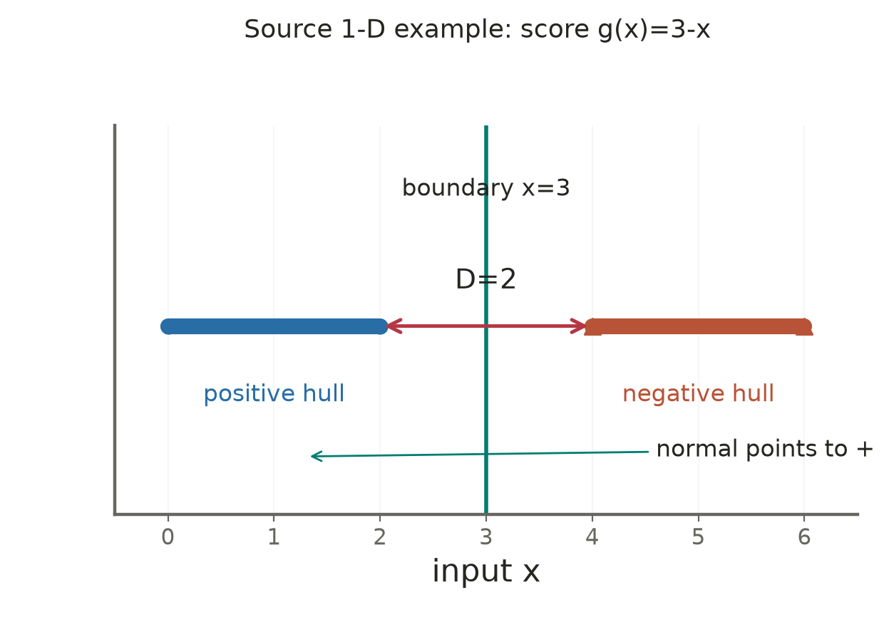
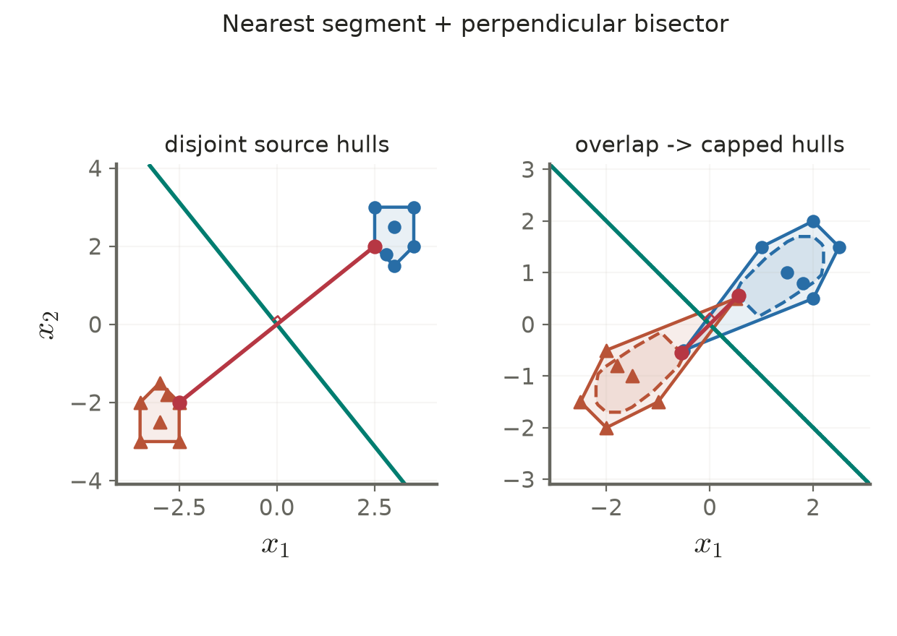

# Lecture 03 · KP18：用凸包最近點看懂SVM幾何（Understand SVM through nearest points of convex hulls）

> 程度：研究生（grad）／Level: Graduate (grad)
>
> 週次：第3週（2026-09-21）｜進度：Linear Classifiers
>
> Week 3 (2026-09-21) | Topic: Linear Classifiers

[JianBauDau 簡報](../slides/lec03-kp18-convex-hulls.jbd.json)

## 學習目標（Learning objectives）

- 以凸組合定義凸包與縮減凸包（Define convex and reduced convex hulls using convex combinations）。
- 從最近點求標籤方向正確的分類邊界（Construct a label-consistent boundary from nearest points）。
- 區分縮減集合的距離、支撐間隔與可行條件（Distinguish reduced-set distance, support margins, and feasibility）。

## KP18：最大間隔與最近凸集合是同一幾何問題的兩面（Maximum margins and nearest convex sets describe related geometry）

**一句話重點**：可分資料的硬間隔邊界，是兩類凸包最近連線的垂直平分面；不可分時，縮減凸包可在特定條件下延續這種解讀。

**One-sentence summary**: The hard-margin boundary bisects a shortest segment between disjoint class hulls; reduced hulls extend the interpretation under explicit conditions.

### 1. 凸包包含所有非負加權平均（A convex hull contains every nonnegative weighted average）

KP17用乘子總量與單點上界解釋ν。現在先把乘子正規化成總和1，看看它們如何形成集合中的點。把橡皮筋套在一組釘子外，可想像凸包的邊緣；比喻限於低維幾何，集合也包含橡皮筋內部。

KP17 interpreted multiplier mass and caps. Normalize coefficients to sum to one and view them as points in a set. A rubber band around nails suggests the hull boundary in low dimensions, while the hull also includes its interior.

**白話說明**：兩點的凸組合就是兩點間的線段。多點的凸組合包括其內部所有加權平均，權重不能是負數，也不能總和超過1。

**Plain explanation**: Convex combinations of two points form their segment. With several points, they include all nonnegative weighted averages whose weights sum exactly to one.

| 符號 | 中文意義 | English meaning |
|---|---|---|
| $X^+,X^-$ | 兩類訓練向量集合 | Positive and negative training sets |
| $n_+,n_-$ | 各類樣本數，總數為N | Per-class counts, summing to N |
| $\lambda_i$ | 總和1的凸組合權重 | Convex-combination weight |
| $\mathbf p,\mathbf q$ | 兩集合中的最近點 | Nearest points in the two sets |
| $D=\|\mathbf p-\mathbf q\|$ | 最近集合距離 | Distance between sets |
| $\mu$ | 凸組合的單點權重上限 | Per-point convex weight cap |

**正式定義**：對含n個點的集合X，凸包為

**Formal definition**: For a set X containing n observations, its convex hull is

$$
\operatorname{conv}(X)=\left\{\sum_{i=1}^n\lambda_i\mathbf x_i:
\lambda_i\ge0,\ \sum_i\lambda_i=1\right\}.
$$

### 2. 可分凸包的最近連線決定法向量（The nearest segment between disjoint hulls determines the normal）

對有限兩類資料，嚴格線性可分等價於兩凸包不相交。選取最近的一對點，就找到兩集合最靠近的方向。

For finite binary data, strict linear separability is equivalent to disjoint convex hulls. A nearest pair identifies their direction of closest approach.

$$
(\mathbf p,\mathbf q)\in\arg\min_{
\mathbf u\in\operatorname{conv}(X^+),\,
\mathbf v\in\operatorname{conv}(X^-)}\frac12\|\mathbf u-\mathbf v\|^2.
$$

若D>0，令$\mathbf d=\mathbf p-\mathbf q$，中點$\mathbf m=(\mathbf p+\mathbf q)/2$。法向量指向正類，因此以下尺度讓最近正負點分數為+1與−1。

For positive distance, orient the normal from the negative nearest point toward the positive one. The following scale gives support scores plus and minus one.

$$
\mathbf w=\frac{2\mathbf d}{D^2},\qquad
b=-\mathbf w^T\mathbf m,\qquad
g(\mathbf x)=\mathbf w^T(\mathbf x-\mathbf m),\qquad W=D.
$$

**想深入**：最近性使$\mathbf d^T(\mathbf u-\mathbf p)\ge0$、$\mathbf d^T(\mathbf v-\mathbf q)\le0$。所以這個中垂面把兩凸包分在兩側。任何分隔面在最近線段上留下的兩側最小距離，不可能同時超過D/2。

**Going deeper**: Nearest-point optimality gives the two directional inequalities. The bisector separates the hulls, and no separator can give both ends of the shortest segment clearance greater than half its length.

### 3. 一維原例必須保留正負方向（The one-dimensional source example requires the correct sign）

**例子**：沿用來源正類0、2，負類4、6。凸包為[0,2]與[4,6]，最近點為p=2、q=4，中點3。

**Example**: The source positives zero and two form interval [0,2]; negatives four and six form [4,6]. Their nearest endpoints are two and four, with midpoint three.

$$
D=|2-4|=2,\quad d=2-4=-2,
\quad w=2(-2)/4=-1,\quad b=3.
$$
$$
g(x)=3-x,\qquad g(2)=1,\quad g(4)=-1,\quad W=2.
$$

來源寫$g=x-3$雖得到相同邊界，卻會把正類放在負分數一側。本講義修正方向，保留邊界3與全寬2。

The source score x−3 has the correct zero set but reverses the declared labels. The corrected score preserves boundary three and width two.

**圖說 `lec03-kp18-interval-hulls`**：先看正類與負類區間，再看2到4的最近線段與中點3。正類在左，因此正向法向量往左，與g=3−x一致。〔功能：2、3〕

**Caption `lec03-kp18-interval-hulls`**: Read the class intervals, then the nearest segment from two to four and midpoint three. The normal points left toward the positive class, consistently with score 3−x.

### 4. 權重上限縮小凸包，但不能低於可行容量（Weight caps shrink a hull but must preserve feasibility）

凸包相交時D=0，硬間隔不存在。縮減凸包限制任何單點能佔的比重，並未刪除原始觀測。

Intersecting hulls have zero distance and no hard margin. Reduced hulls cap each point's contribution rather than deleting observations.

$$
R(X,\mu)=\left\{\sum_{i=1}^n\lambda_i\mathbf x_i:
\sum_i\lambda_i=1,\quad0\le\lambda_i\le\mu\right\}.
$$

必須$n\mu\ge1$，否則全部上限加起來也湊不到1。當$\mu=1/n$，每個權重只能等於1/n，集合只剩該類形心。兩類用共同μ時，須$\mu\ge\max(1/n_+,1/n_-)$。

Feasibility requires n mu at least one. At mu=1/n, all weights are equal and the set collapses to the class centroid. A shared cap must be feasible for both classes.

若兩類樣本數相同且形心不同，縮到共同最小μ時確實分離。形心相同時，形心始終同時屬於兩個非空縮減凸包，不能保證分離。兩類大小不同時，也不能聲稱同一μ讓兩類同時變成形心。

With equal class sizes and distinct centroids, the smallest common cap separates the centroid points. Equal centroids remain in both hulls at every feasible cap. Unequal class sizes do not collapse simultaneously under one shared cap.

[補充反例] 正類−1、1，負類−2、2，兩形心都是0。對任何共同可行μ≥0.5，0仍在兩集合內；不是「縮得夠小就一定成功」。

[Added counterexample] Positives −1 and one and negatives −2 and two share centroid zero. Every common feasible cap at least 0.5 retains zero in both hulls, preventing separation.

### 5. 正規化乘子連結ν與縮減凸包（Normalized multipliers link nu to reduced hulls）

接住KP17的正ρ情況，兩類乘子各合計ν/2。把每類乘子除以這個總量，便得到凸組合。

At positive rho in KP17, each class has multiplier mass nu/2. Dividing by that mass creates convex weights.

$$
\lambda_i=\frac{2\alpha_i}{\nu},\quad
\sum_{i:y_i=+1}\lambda_i=
\sum_{i:y_i=-1}\lambda_i=1,\quad
\lambda_i\le\mu=\frac2{\nu N}.
$$
$$
\mathbf w=\frac\nu2(\mathbf p-\mathbf q).
$$

對固定總乘子量ν，對偶等價於最小化兩縮減凸包距離平方。μ若大於1，上限不比一般凸包更嚴；這個對應本身不保證正距離。

With multiplier mass fixed to nu, the dual minimizes squared distance between the two reduced hulls. A cap above one is no tighter than the ordinary hull, and the correspondence does not itself ensure positive distance.

對來源KP17/18的每類7點資料，N=14。μ=1時原凸包相交；μ=0.4的最近距離約1.555635；μ=0.2約2.669232；μ=1/7時各變成形心，距離約3.526344。來源原圖另提μ=0.1，但對這組7點資料會得到空集合，不能混用。

For the source seven-per-class dataset, the ordinary hulls intersect. Recomputed gaps are approximately 1.555635 at cap 0.4, 2.669232 at cap 0.2, and 3.526344 at cap one-seventh. Cap 0.1 would be infeasible for these seven-point classes, so it cannot be borrowed from another figure.

**圖說 `lec03-kp18-reduced-hulls`**：左圖採來源可分的每類7點資料，畫出凸包、最近線段、中垂面與直角記號。右圖採來源相交資料，實線為原凸包，虛線為μ=0.4縮減集合；先看相交，再看縮減後的正距離。所有縮減頂點由受限凸組合計算，並非任意縮放多邊形。〔功能：1、2、3〕

**Caption `lec03-kp18-reduced-hulls`**: The left uses the source separable data and shows nearest points, the bisector, and a right-angle marker. The right contrasts intersecting original hulls with computed cap-0.4 reduced hulls. Reduced vertices come from capped convex weights rather than an arbitrary polygon scaling.

縮減集合間的D不應直接當成原資料ν-SVM的$2\rho/\|\mathbf w\|$。有鬆弛時，縮減最近點可能位於原資料支撐帶內；中垂面亦須核對截距條件。此對稱資料的正負集合互為相反數，截距0與中垂面一致。

The reduced-set gap is not generally the original data's nu-SVM support width. Slack allows reduced nearest points inside that score band, and the intercept requires KKT checks. For these symmetric data, opposite class sets give a consistent zero-intercept bisector.

### 6. 幾何直覺不能取代適用條件（Geometric intuition does not replace assumptions）

**常見迷思**：只有原凸包的極端頂點才可能是支持向量。硬間隔的正乘子點必位於支撐面，但可能是面上的非頂點。軟間隔時，原凸包內部的違規點也可能有正乘子。不能把硬間隔的圖像規則套到所有SVM。

**Common misconception**: Only extreme hull vertices can be support vectors. Hard-margin support planes can contain nonvertex observations, and soft-margin violations inside an original hull can have positive multipliers.

實作先檢查係數非負、總和與上限，再檢查最近點最優性；D接近0時不做除以$D^2$的動作。有限容差不等於數學上的嚴格分離。

Check weight nonnegativity, sums, caps, and nearest-point optimality. Avoid division by squared distance when it is near zero. Numerical tolerance is distinct from strict mathematical separation.

**小練習**：沿用來源正類1、3，負類7、9。找凸包、最近點、邊界與全寬，再寫出保持標籤方向的分數。若每類2點而μ=0.4，縮減集合是否非空？提示：先檢查容量，再求幾何。

**Practice**: For positives one and three and negatives seven and nine, find the hulls, closest pair, boundary, width, and label-consistent score. Are two-point reduced hulls nonempty at cap 0.4? Check capacity first.

## 小結與全章連結（Summary and chapter connection）

感知器用錯誤修正邊界，最小平方用投影配合標籤，邏輯斯模型用機率概似，SVM用間隔與違規權衡。凸包把最後一種方法的係數約束變成可看見的集合。它們目標不同，不能只憑訓練誤判數宣稱一種方法全面較好。

Perceptrons correct mistakes, least squares project labels, logistic models fit conditional likelihood, and SVMs trade margins against violations. Hull geometry makes SVM coefficient constraints visible. Their different objectives prevent a universal ranking based only on training errors.

## 延伸閱讀與來源（Further reading and sources）

- [第3章§3.7.5–3.7.6、KP18、教授祕笈與程式](https://ndhuccc.github.io/CCC-LNS/PR_115/Ch03-linear-classifiers/index.html#kp18)，2026-10-16查核（Checked on 2026-10-16）。
- [A Tutorial on ν-Support Vector Machines](https://www.csie.ntu.edu.tw/~cjlin/papers/nusvmtutorial.pdf)，核對縮減凸包與ν乘子正規化的連結（For the reduced-hull interpretation）。

## 術語表（Glossary）

| 中文 | English |
|---|---|
| 凸組合／凸包 | Convex combination / convex hull |
| 縮減凸包 | Reduced convex hull |
| 形心 | Centroid |
| 垂直平分面 | Perpendicular bisector hyperplane |
| 最近點對 | Nearest pair |
| 支撐面 | Supporting hyperplane |
