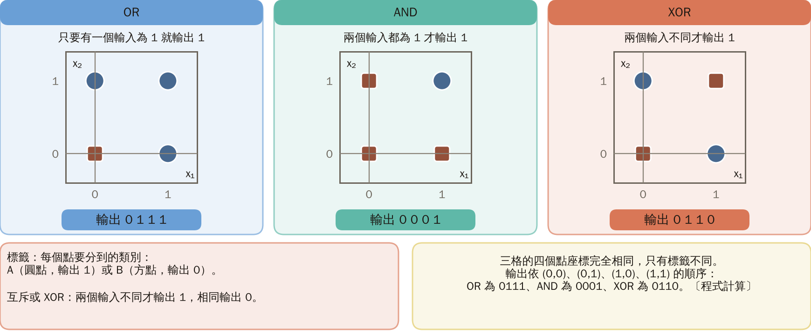
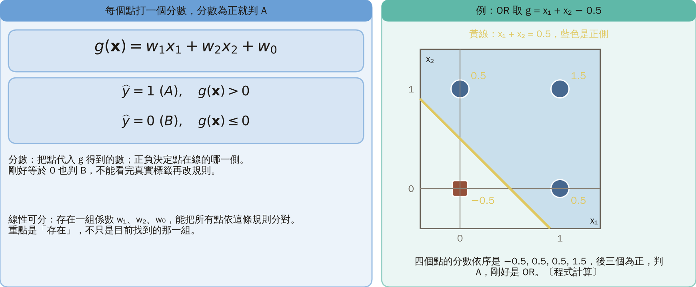
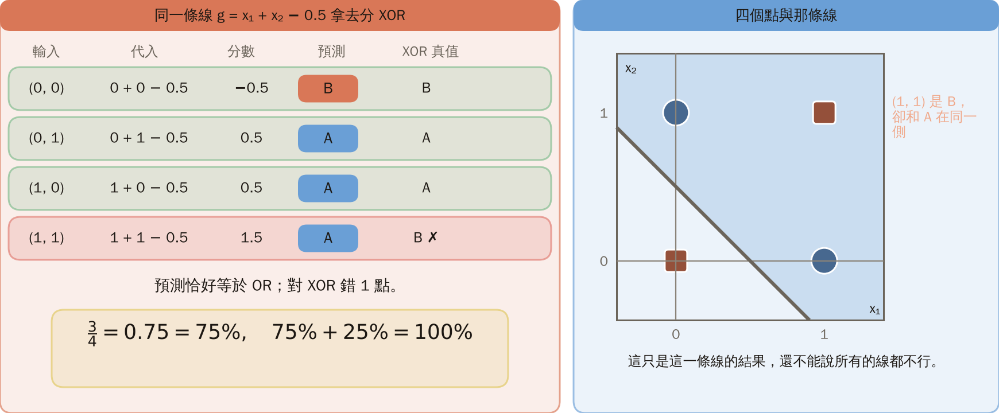
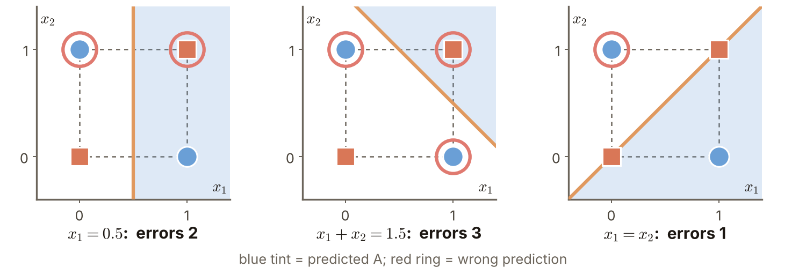
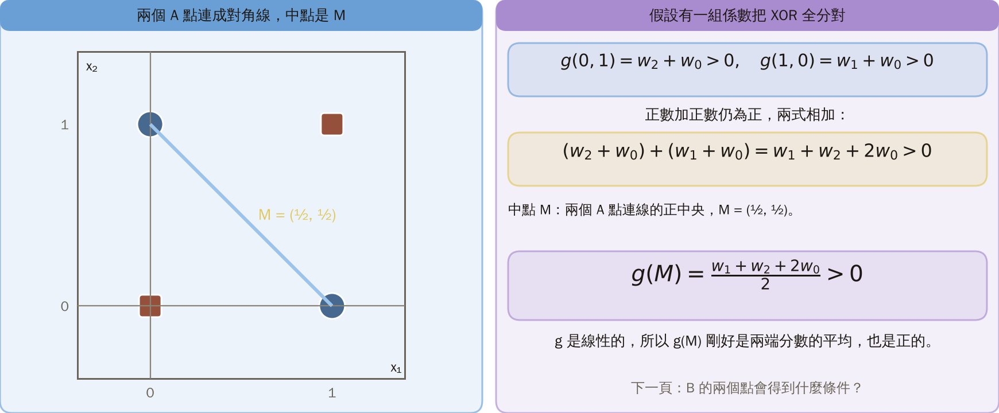
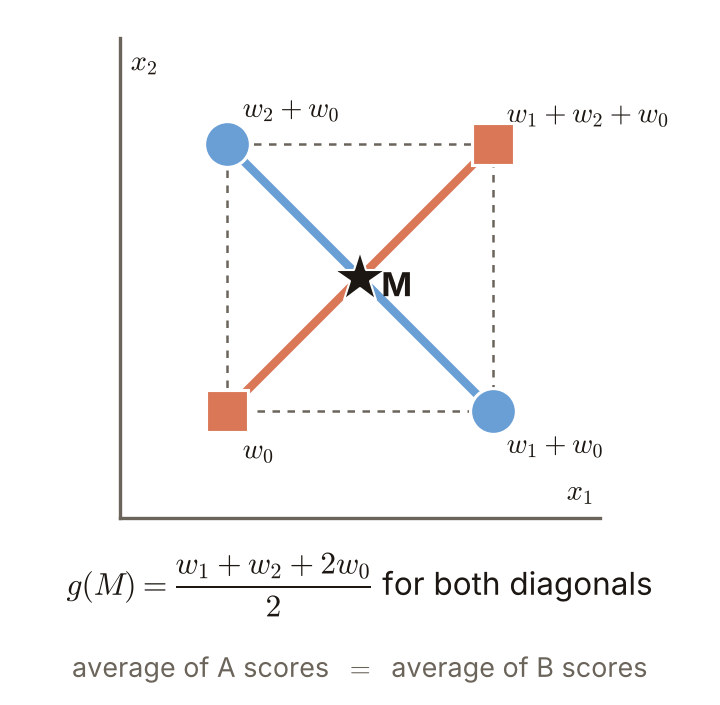
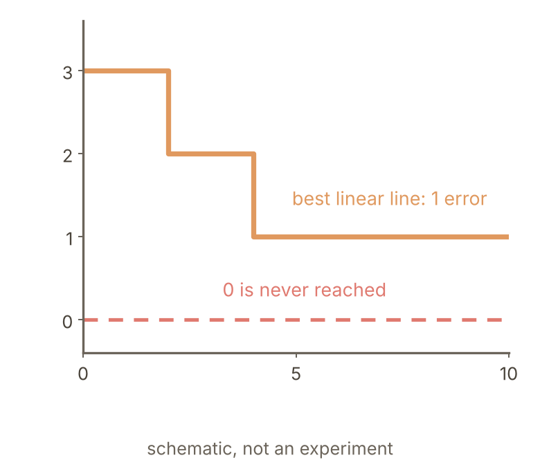
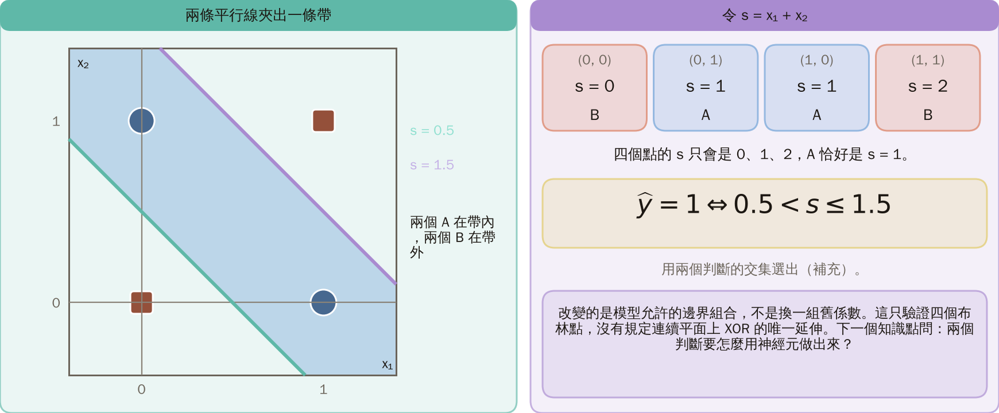
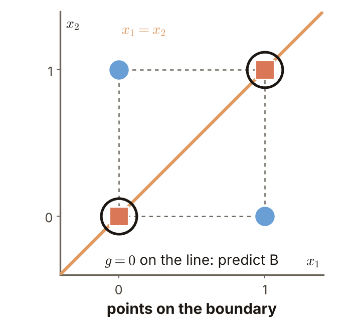
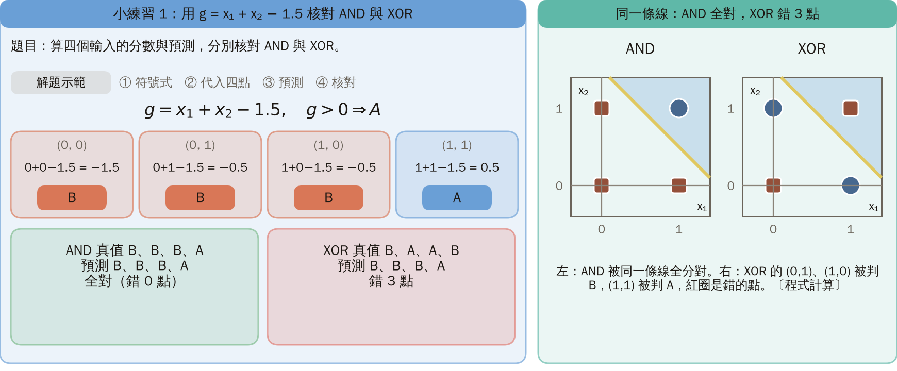

# KP01 XOR 與一條線的極限

> 程度：大學三年級
>
> 圖型識別｜第四章 §§4.1–4.2

[簡報閱讀與下載](../slides/lec05-kp01-xor.jbd.json) | [English version](en/lec05-kp01-xor.md)

## 學習目標

- 能把 OR、AND 與 XOR 的真值表轉成平面上的分類問題。
- 能依分數與固定規則逐點算出預測，並核對對錯。
- 能用兩個 A 點與兩個 B 點的分數相加，證明 XOR 一條線分不開，並區分表達能力與訓練問題。

## KP01 XOR 與一條線的極限

**一句話重點**：同樣四個點，OR、AND 一條線就分得開，XOR 不行：兩個 A 點的分數和必為正，兩個 B 點的分數和必不大於 0，卻是同一個式子；多訓練也補不了，要改的是邊界的組合。

### 先備與符號

**你需要先會的三件事**：

- **線性分類器**（第三章）：用一條直線把兩類分開，直線一側判為一類，另一側判為另一類。
- **分數**：把點代入直線的式子得到的數；正負決定在線的哪一側。
- **真值表**：列出每個輸入組合對應的輸出，本講義只有 $(0,0),(0,1),(1,0),(1,1)$ 四個輸入。

**符號表**（本講義固定使用）：

| 符號 | 意義 | 說明 |
|---|---|---|
| $x_1,x_2$ | 輸入的兩個座標 | 各是 0 或 1 |
| $g(\mathbf x)$ | 分數 | $g=w_1x_1+w_2x_2+w_0$ |
| $w_1,w_2,w_0$ | 係數與常數項 | 常數項把線上下平移 |
| $\widehat y$ | 預測 | 1 表示 A，0 表示 B |
| $s$ | $x_1+x_2$ | 第 8 節用 |
| A、B | 兩個類別 | A 輸出 1（圓點），B 輸出 0（方點） |

### 1. 同樣四個點，只換標籤：一條線還分得開嗎？

**白話說明**：第三章讓模型用一條線決定類別。這一章先不換演算法，只換四個點的標籤，看原來的模型還答不答得了。

- **標籤**：每個點要分到的類別：A（圓點，輸出 1）或 B（方點，輸出 0）。
- **互斥或 XOR**：兩個輸入不同才輸出 1（A），相同輸出 0（B）。OR 是只要有一個輸入為 1 就輸出 1，AND 是兩個輸入都為 1 才輸出 1。

圖說 `lec05-kp01-three-labels`：先看三格的座標，完全相同；再看每格下方的輸出，只有標籤不同。四個輸入是 $(0,0),(0,1),(1,0),(1,1)$，兩個輸入各是 0 或 1。三格是同一組座標，只有標籤不同；每格下方是依序的輸出：OR 為 0111、AND 為 0001、XOR 為 0110。〔功能：1〕

OR 的 A 占三個角，AND 的 A 只占右上角，看起來都能用一條線隔開；XOR 把同類放在對角，不確定。接下來的問題：一條線怎麼打分數、怎麼決定類別？先把規則說清楚。

### 2. 每個點打一個分數，分數為正就判 A

**正式定義**：本單元考慮二元輸入與二類分類。允許常數項的分數與預測規則如下（嚴格說這是仿射函數，分類慣例仍稱為線性分類器）：

$$
g(\mathbf{x})=w_1x_1+w_2x_2+w_0,\qquad
\widehat y(\mathbf{x})=\begin{cases}1\;(A),&g(\mathbf{x})>0,\\0\;(B),&g(\mathbf{x})\le0.\end{cases}
$$

$w_1,w_2$ 是係數，$w_0$ 是常數項（把線上下平移）。分數為正判 A，否則判 B，剛好等於 0 也判 B；不能看完真實標籤再改規則。$g=0$ 就是圖上的線。

**線性可分**：有一組係數，能把所有點依這條規則分對。重點是「存在一組係數」，不只是目前找到的那一組。

**例子**：OR 取 $w_1=w_2=1,\ w_0=-0.5$，即 $g=x_1+x_2-0.5$，四個點的分數是 $-0.5,\ 0.5,\ 0.5,\ 1.5$，後三個為正，判 A，剛好是 OR。

圖說 `lec05-kp01-or-line`：先看邊界 $x_1+x_2=0.5$，再看藍色的正側（箭頭方向）；每個點旁邊標出分數，三個 A 點都在正側。〔功能：1、3〕

接下來的問題：同一條線拿去分 XOR，會怎樣？

### 3. 同一條線，OR 全對，XOR 錯 1 點

把同一條線拿去分 XOR，逐點代入同一個 $g=x_1+x_2-0.5$：

| 輸入 | 代入 | 分數 | 預測 | XOR 真值 |
|---|---|---:|---|---|
| $(0,0)$ | $0+0-0.5$ | $-0.5$ | B | B |
| $(0,1)$ | $0+1-0.5$ | $0.5$ | A | A |
| $(1,0)$ | $1+0-0.5$ | $0.5$ | A | A |
| $(1,1)$ | $1+1-0.5$ | $1.5$ | A | B ✗ |

預測恰好等於 OR；對 XOR 錯 1 點：

$$
\text{正確率}=\frac{3}{4}=0.75=75\%,\qquad 75\%+25\%=100\%\ \text{（驗算）}.
$$

這只是這一條線的結果，還不能說所有線都不行。

圖說 `lec05-kp01-xor-check`：先看四個點的位置與標籤，再看那條灰線：它把 $(0,1),(1,0)$ 與 $(1,1)$ 放在同一側，而 $(1,1)$ 是 B。〔功能：1、3〕

接下來的問題：換一條線會不會好？

### 4. 換三條線看看：分別錯 2、3、1 點

圖說 `lec05-kp01-attempts`：先看三條線各在哪裡，再看每張圖上的紅圈：錯的點分別是 2、3、1 個。〔功能：1〕

| 分數 | 預測（依 $(0,0),(0,1),(1,0),(1,1)$） | 錯誤數 |
|---|---|---:|
| $x_1-0.5$ | $(0,0,1,1)$ | 2 |
| $x_1+x_2-1.5$ | $(0,0,0,1)$ | 3 |
| $x_1-x_2$ | $(0,0,1,0)$ | 1 |

- 第一條線 $x_1=0.5$ 把右邊判 A：$(0,1)$ 是 A 卻判 B，$(1,1)$ 是 B 卻判 A，錯 2 點。
- 第二條線 $x_1+x_2=1.5$ 只切下右上角，但那一側判 A，所以錯的是兩個 A 加一個 B。
- 第三條線 $x_1=x_2$ 上的兩個點分數為 0，依規則判 B。

試了三條都有錯，**不是證明**：沒試到的線太多。接下來的問題：怎樣一次排除所有的線？

### 5. 兩個 A 點的分數相加，一定是正的

要一次排除所有的線，假設有任意一組 $w_1,w_2,w_0$ 能把 XOR 全部分對，列出它必須滿足的條件。先看 A 的兩個點：

$$
g(0,1)=w_2+w_0>0,\qquad g(1,0)=w_1+w_0>0.
$$

正數加正數仍為正，兩式相加：

$$
(w_2+w_0)+(w_1+w_0)=w_1+w_2+2w_0>0.
$$

幾何意思：兩個 A 點連成一條對角線，中點是 $M=(\tfrac12,\tfrac12)$。$g$ 是線性的，所以 $g(M)=\frac{w_1+w_2+2w_0}{2}$ 剛好是兩個分數的平均，也是正的。

圖說 `lec05-kp01-diag-a`：先看兩個 A 點連成的對角線，再看它的中點 $M$；$g(M)$ 是兩端分數的平均，所以為正。〔功能：2、3〕

接下來的問題：B 的兩個點會得到什麼條件？

### 6. 兩個 B 點相加卻不大於 0，同一個式子矛盾

再看 B 的兩個點：分數必須不大於 0（依固定規則）：

$$
g(0,0)=w_0\le0,\qquad g(1,1)=w_1+w_2+w_0\le0.
$$

不大於 0 的數相加，不可能為正：

$$
w_0+(w_1+w_2+w_0)=w_1+w_2+2w_0\le0.
$$

兩邊是**完全相同的式子**，A 要求它大於 0，B 要求它不大於 0，矛盾。所以不存在能全對的係數：這是對所有線的證明，不是只排除圖上幾條候選線。幾何上，兩條對角線共用中點 $M$：$g(M)$ 既是 A 兩端分數的平均，也是 B 兩端分數的平均，不可能一個為正、一個不大於 0。

圖說 `lec05-kp01-diag-both`：先看兩條對角線，再看它們交在同一個中點 $M$；$g(M)$ 不可能同時為正又不大於 0。〔功能：2、3〕

接下來的問題：如果每條線都不行，繼續訓練有用嗎？

### 7. 不管怎麼訓練，一條線都無法把 XOR 全分對

**常見迷思**：多跑幾輪、調小學習率或重新初始化，應該就能全對。這些操作只是在同一類直線裡找錯誤少的參數，可能把錯 3 點降成錯 1 點，但不保證找得到最好的一條；而且這一類直線裡沒有全對的答案，最低錯誤是 1 點，不是 0。

**表達能力**：模型的邊界形狀本身能不能表示出答案。訓練有沒有找到最好的線，和最好的線夠不夠用，是兩個不同的問題。

圖說 `lec05-kp01-best`：這是示意，不是真實實驗。先看錯誤數隨訓練下降，再看虛線 0：永遠達不到。〔功能：1〕

### 8. 要改的是邊界的組合：兩條線夾出一條帶

前面排除的是「一個線性分數加固定門檻」，沒有排除多條邊界的組合。［補充］令 $s=x_1+x_2$。XOR 四個點的 $s$ 只會是 $0,1,2$，A 恰好是 $s=1$，所以用兩個判斷的交集選出：

$$
\widehat y=1\quad\Longleftrightarrow\quad 0.5<s\le1.5.
$$

圖說 `lec05-kp01-strip`：先看兩條平行線夾出的斜帶，再看兩個 A 在帶內、兩個 B 在帶外。這只驗證四個布林點，沒有規定連續平面上 XOR 的唯一延伸。〔功能：1、3〕

改變的是模型允許的邊界組合，不是換一組舊係數。下一個知識點問：兩個判斷要怎麼用神經元做出來？

### 延伸：練習與實作

**實作**：逐點算出分數後，用 「score > 0」 產生預測，再與真值比較。測試必須包含邊界上的點，免得程式用 `>=` 而文字用 `>`。這裡的半整數可精確表示；一般實數資料仍要注意浮點誤差。

圖說 `lec05-kp01-ties`：先看正好落在邊界上的點，再看用 $>$ 與 $\ge$ 兩種寫法預測會不同。〔功能：1、2〕

**小練習**：

1. 用 $g=x_1+x_2-1.5$ 算四個輸入，分別核對 AND 與 XOR。提示：先算分數，再用同一個 $g>0$ 規則，最後才對照兩組真值。
2. XOR 失敗是樣本少、雜訊、學習率，還是邊界形狀受限？提示：矛盾排除了哪一項？
3. OR、XOR、XNOR 哪個能用一條線分開？XNOR：輸入相同輸出 1。提示：先畫標籤。

**題 1 解題示範**：① 符號式 $g=x_1+x_2-1.5$，$g>0$ 判 A。② 代入四點 $(0,0),(0,1),(1,0),(1,1)$：分數依序是 $-1.5,\ -0.5,\ -0.5,\ 0.5$。③ 只有 $(1,1)$ 為正，預測 B、B、B、A。④ 核對：AND 的真值是 B、B、B、A，全對；XOR 的 $(0,1),(1,0)$ 被判 B、$(1,1)$ 被判 A，錯 3 點。

**題 2 解題示範**：先逐一排除。

- 樣本少？四個輸入就是全部資料，沒有缺漏。
- 雜訊？標籤直接取自 XOR 真值，沒有錯的標籤。
- 學習率？第 6 節的矛盾對**任何**係數都成立，與怎麼調整係數無關。
- 剩下的只有「一條線」這個邊界形狀受限，所以答案是邊界形狀受限。

**題 3 解題示範**：

- OR 可以：取 $g=x_1+x_2-0.5$，四點分數依序是 $-0.5,\ 0.5,\ 0.5,\ 1.5$，預測 B、A、A、A，與 OR 真值相同。
- XNOR 不行：$(0,0),(1,1)$ 是 1、$(0,1),(1,0)$ 是 0，同類仍在對角，與 XOR 只差標籤互換，同樣的矛盾還在。
- 結論：三者中只有 OR 能用一條線分開。

圖說 `lec05-kp01-and-xor`：先看左邊 AND 被同一條線全分對，再看右邊 XOR 錯 3 點。〔功能：1、2〕

## 術語與來源

| 中文 | English |
|---|---|
| 標籤 | Label |
| 真值表 | Truth table |
| 互斥或 | Exclusive OR (XOR) |
| 分數、常數項 | Score, constant (bias) |
| 線性可分 | Linearly separable |
| 表達能力 | Representational capacity |

來源：第四章 KP01，§§4.1–4.2（2026-10-24 讀取）。四個點、參數與示範依來源；說明與圖重新撰寫；兩條邊界的帶狀條件與中點證明為［補充］。
