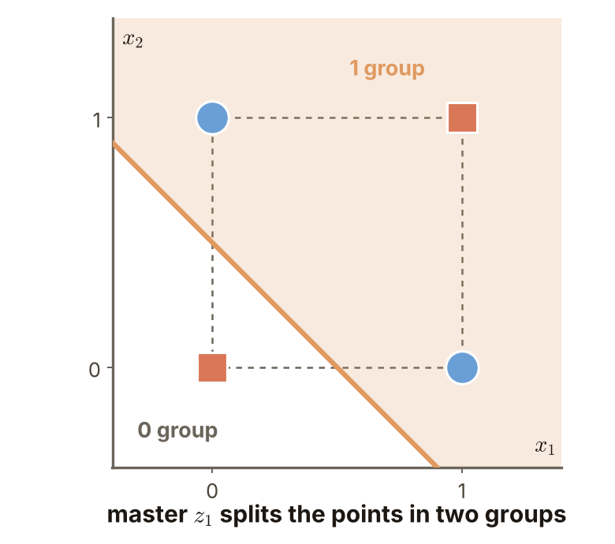
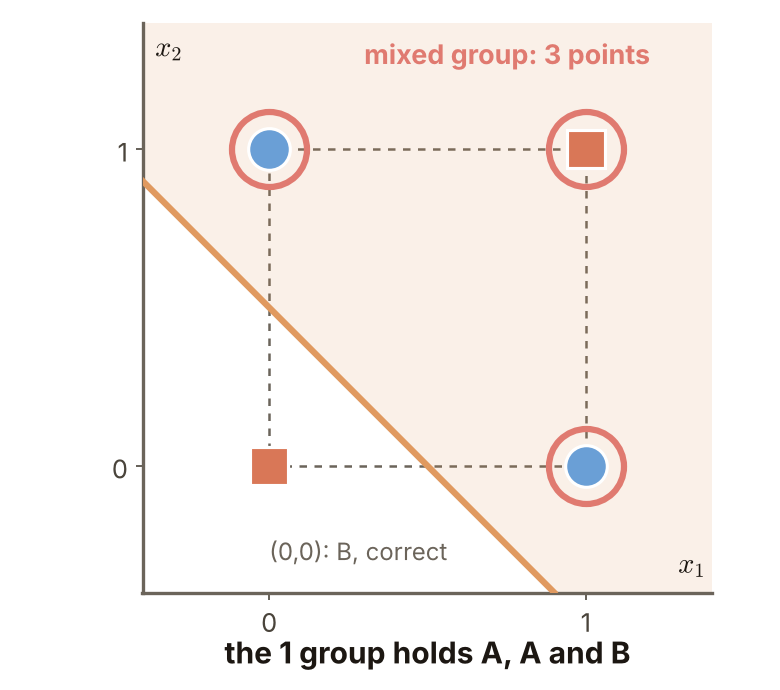
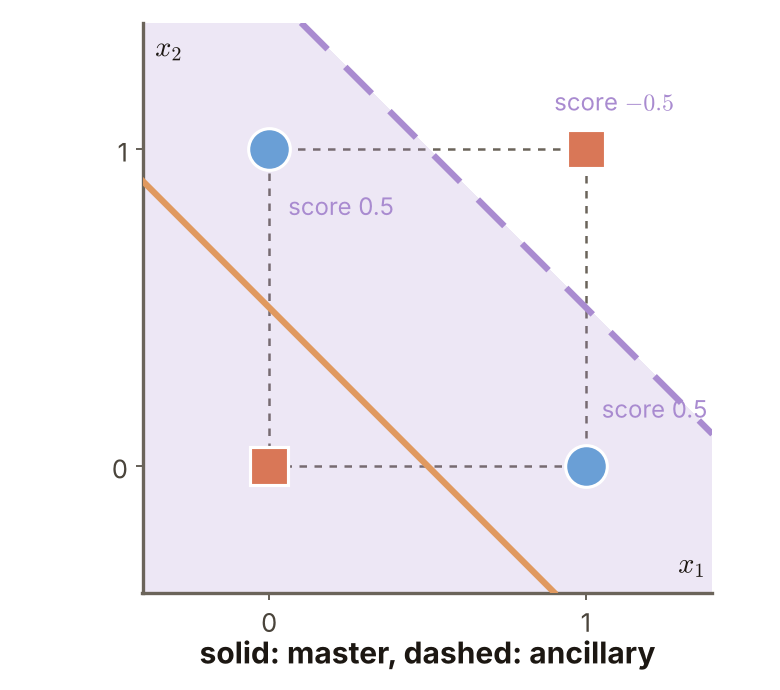
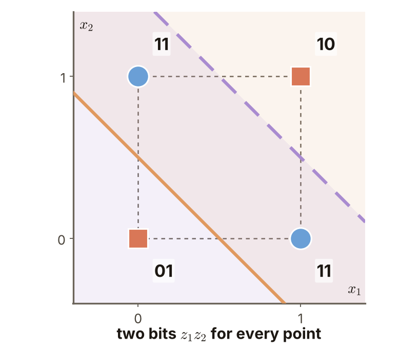
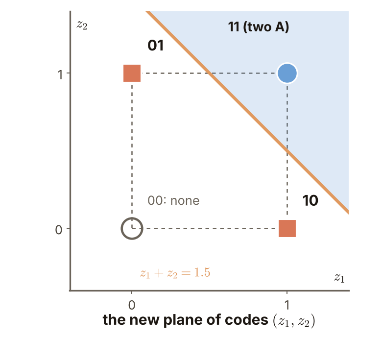
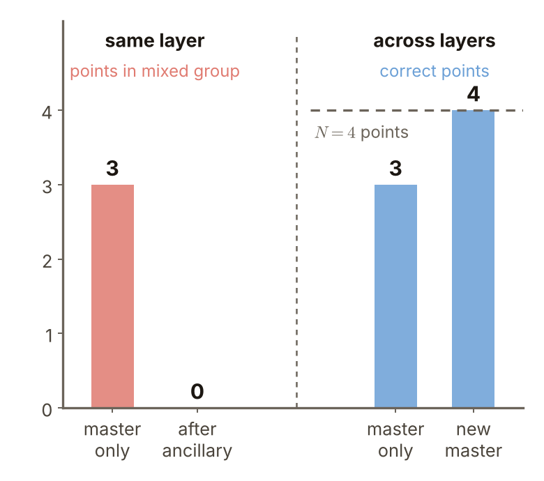
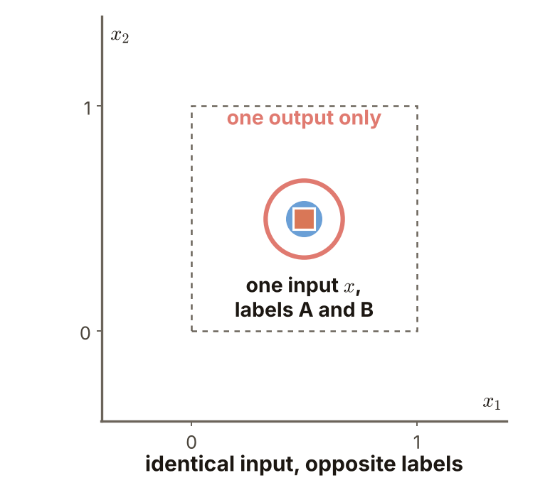
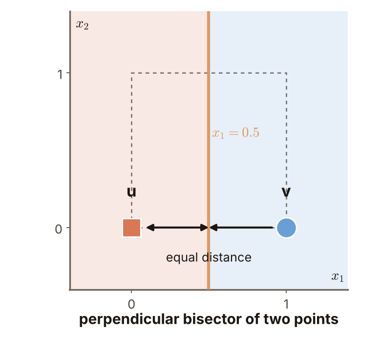
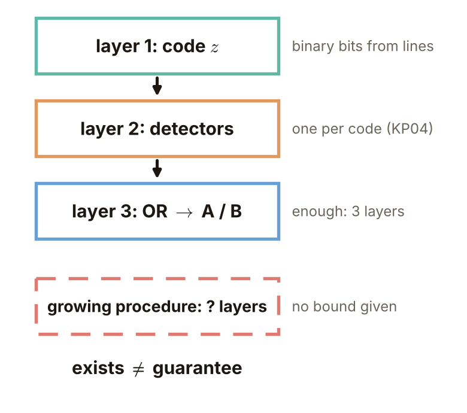
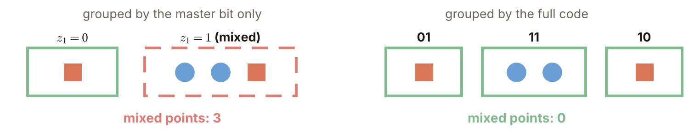

# KP05 構造式方法：從訓練點長出網路

> 程度：大學三年級
>
> 圖型識別｜第四章 §4.5

[簡報閱讀與下載](../slides/lec05-kp05-constructive-methods.jbd.json)

## 學習目標

- 能區分主要節點、輔助節點與純化，並用 XOR 四點手算一次純化。
- 能用有限樣本上的嚴格進展說明停止的理由，並指出它的條件。
- 能說明訓練全對不保證泛化，也不保證小網路。

## KP05 構造式方法：從訓練點長出網路

**一句話重點**：實務只有帶標籤的點。構造式方法先用一個主要節點分一次，再用輔助節點處理仍混雜的群，直到不同類不再共用編碼；這是訓練集上的目標，不等於對未見資料的保證。

### 1. 實務只有帶標籤的點：先用一個主要節點把點分成兩群

**白話說明**：KP04 的構造知道目標區域的方程式，實務上卻只有點與標籤。這一節拿 XOR 四點，從點開始建網路。

- **主要節點（master unit）**：每一層第一個負責分類的單元，把所有點分成輸出 1 的一群和輸出 0 的一群。

**正式定義**：設有限標記訓練集 $X=\{(\mathbf x_n,c_n)\}_{n=1}^N$，類別 $c_n\in\{0,1\}$。這裡取 $z_1=f(x_1+x_2-0.5)$，其中 $f(t)=1$（$t>0$），否則為 0。

圖說 `lec05-kp05-master`：橘色線上方是 1 群，左下角只有 $(0,0)$ 在 0 群。

### 2. 主要節點只分對 3 點：1 群裡有兩個 A 和一個 B

**混雜群**：同一個輸出群裡，兩個類別的點都有。$(0,0)$ 單獨在 0 群（B，對）。1 群是 $(0,1)$、$(1,0)$、$(1,1)$，一律判 A：兩個 A 對，$(1,1)$ 的 B 錯。主要節點共對 3 點。

圖說 `lec05-kp05-mixed`：紅圈標出混雜群的三個點。

### 3. 為了示範，手動選定一條輔助線，把混雜群裡右上角的 B 分出來

**輔助節點（ancillary unit）**：只針對混雜群的點設計的新增單元，多給每個點一個位元；實際方法用訓練演算法求權重，這裡手動選定。

**例子**［補充］：取 $z_2=f(1.5-x_1-x_2)$，線 $x_1+x_2=1.5$ 剛好夾在 $(1,1)$ 與 $(0,1),(1,0)$ 之間：$(0,1)$ 與 $(1,0)$ 得 $0.5$，位元 1；$(1,1)$ 得 $-0.5$，位元 0。$(0,0)$ 不在混雜群，不參與訓練，它的 $z_2=f(1.5)=1$ 只是順便算出的值。這是機制示範，不是實際跑過某個訓練演算法。

圖說 `lec05-kp05-anc`：實線是主要節點，紫色虛線是輔助節點。

### 4. 加上輔助位元後，四個點的編碼是 01、11、11、10

**純化**：新增位元，讓不同類的點不再共用完全相同的編碼。

| 輸入 | 編碼 $z_1z_2$ | 真值 |
|---|---|---|
| $(0,0)$ | 01 | B |
| $(0,1)$ | 11 | A |
| $(1,0)$ | 11 | A |
| $(1,1)$ | 10 | B |

純化不要求一類只有一個碼：B 佔 01 與 10 兩個碼沒有關係。

圖說 `lec05-kp05-codes`：每個點旁邊是它的兩位編碼。

### 5. 在新編碼上，一個新的主要節點就能分對四個點

新主要節點取 $z_1+z_2-1.5$，大於 0 判 A：11 得 $1+1-1.5=0.5$，判 A；01 得 $-0.5$、10 得 $-0.5$，判 B。四個點全對；兩個 A 合併在 11 沒有關係，因為同類。

圖說 `lec05-kp05-code-plane`：新的 $(z_1,z_2)$ 平面，兩個 A 合併在 11，00 沒有點。

### 6. 停止的理由：混雜群縮小、答對的點增加，而點的總數是有限的

- **進展一**：同一層裡，還需要分辨的混雜群嚴格變小。本例從 3 點降到 0 點。
- **進展二**：在適當的層間構造下，新主要節點保留原來答對的點，並至少多對一點。令 $C_k$ 為第 $k$ 層主要節點答對的點數：

$$
C_{k+1}\ge C_k+1,\qquad C_k\le N.
$$

這個條件是所引構造要求的，不是本例驗出的一般結論，本頁不證明；本例 $C$ 從 3 增加到 4。整數不可能一直增加，所以會停。注意 3→0 數的是混雜群的點數，不是錯誤率。這是條件成立時的停止理由，不是宣稱任何不可分的子群都能被完美分開。

圖說 `lec05-kp05-progress`：紅色是混雜群的點數，藍色是答對的點數，虛線是 $N=4$；數值是本例實算，不是原文實驗曲線。

### 7. 停止是有條件的：標籤不能互相矛盾，全對也只是這批點全對

兩筆完全相同的輸入被標成不同類時，確定性的網路對同一個輸入只有一個輸出，不可能兩筆都對。節點要依規則增加才有嚴格進展；隨便增加神經元不保證會停。

**常見迷思**：既然最後能把訓練點全分對，新資料也一定對。全對只涉及給定的這批點，不保證沒看過的位置也對，也不保證網路最小。

圖說 `lec05-kp05-conflict`：圓點與方塊疊在同一位置，標籤相反。

下一個知識點問：先固定網路的架構，再用代價函數學權重，可以嗎？

### 延伸：最近鄰、三層足夠、練習與解題示範

**另一條路（最近鄰）**：用兩個訓練點的垂直平分線比距離。 ［補充］令 $\mathbf u,\mathbf v$ 為兩個訓練點。等距條件展開，共同的二次項消掉：

$$
\|\mathbf x-\mathbf u\|^2=\|\mathbf x-\mathbf v\|^2\iff 2(\mathbf v-\mathbf u)^T\mathbf x=\|\mathbf v\|^2-\|\mathbf u\|^2.
$$

取 $\mathbf u=(0,0)$、$\mathbf v=(1,0)$ 得 $2x_1=1$，即 $x_1=0.5$。這只是兩點的距離比較，不是完整的最近鄰網路實驗。$N$ 個點最多有 $N(N-1)/2$ 個點對，比較可能成二次成長；這不表示都要保留，也不是最小網路大小。

圖說 `lec05-kp05-nearest`：兩個訓練點 $u$、$v$ 與中間的垂直平分線 $x_1=0.5$。

**三層足夠不等於最多三層**：第一層之後的輸入是二元編碼，用 KP04 的偵測器加或合併就能分類純化後的編碼，說明適當的三層表示足夠；但一層一層增長的程序並不保證在三層內停止。存在性與程序的深度保證不是同一個定理。

圖說 `lec05-kp05-layers`：後面各層的輸入是二元編碼，偵測器加或合併就夠；增長的程序沒有給出層數上限。

**小練習**：

1. 依完整編碼把四個點分組，列出每組的真值，並算混雜群的點數。提示：先寫出 01、11、10 各有哪些點。
2. 若同一個輸入出現矛盾標籤，新增再多節點，兩筆都能分對嗎？提示：確定性輸出。

**題 1、2 解題示範**：① 依主要節點：$\{(0,0)\}$ 是 B，純；$\{(0,1),(1,0),(1,1)\}$ 是 A、A、B，混雜 3 點。② 依完整編碼：01：B；11：A、A；10：B，全純，混雜 0 點。③ 3→0 數的是還混雜的點；錯誤率數答錯的點，主要節點單獨答錯 1 點。④ 相同輸入得到相同輸出，確定性網路只能給一個答案，不可能同時對 A 與 B。

圖說 `lec05-kp05-groups`：左邊依主要節點位元分群，右邊依完整編碼分群。

## 術語與來源

| 中文 | English |
|---|---|
| 構造式方法 | Constructive method |
| 主要節點 | Master unit |
| 輔助節點 | Ancillary unit |
| 混雜群 | Mixed group |
| 純化 | Purification |
| 垂直平分超平面 | Perpendicular-bisector hyperplane |
| 泛化 | Generalization |

來源：第四章 KP05，§4.5（2026-10-24 讀取）。保留 tiling、pocket、LMS、二元中介表示及最近鄰構造的比較；未查得原始論文完整演算法，故不宣稱重現其全部更新或證明。XOR 純化數值、等距式與資料一致性條件為［補充］。
