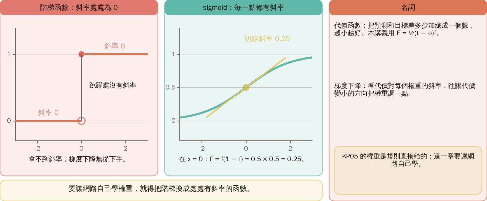
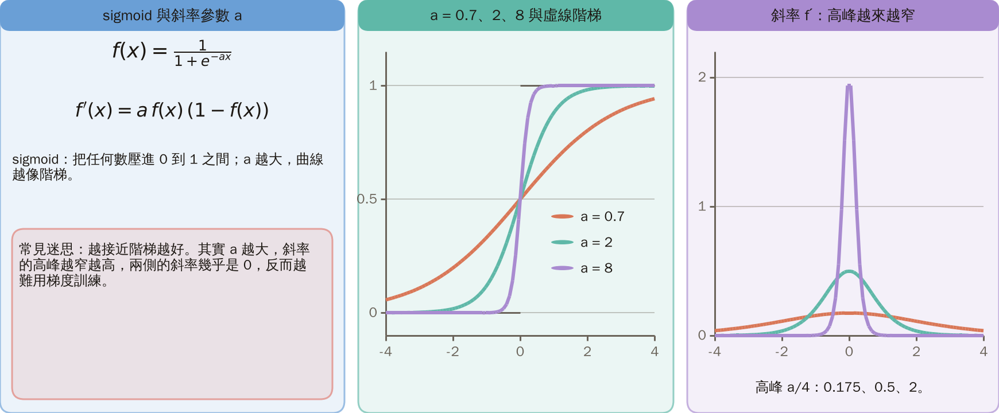
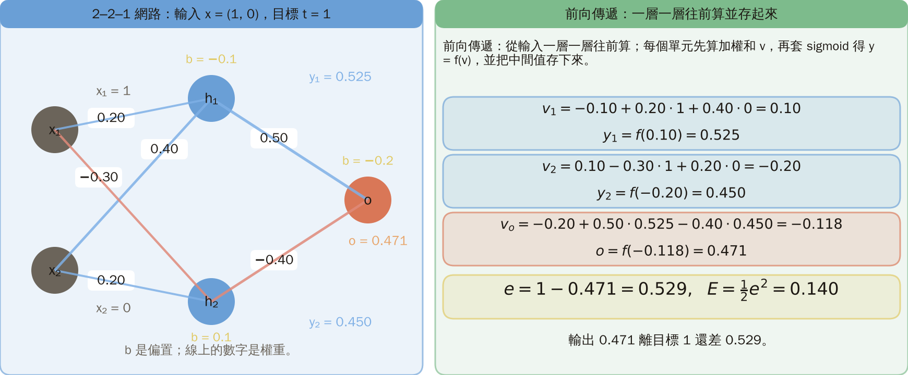
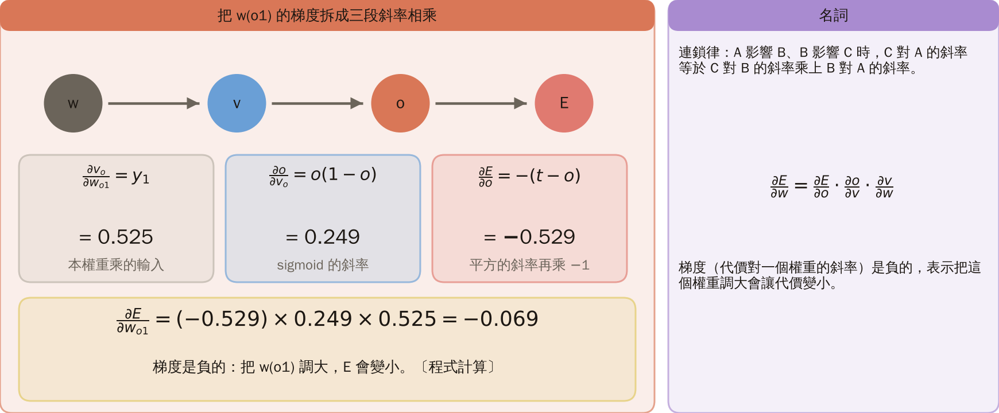
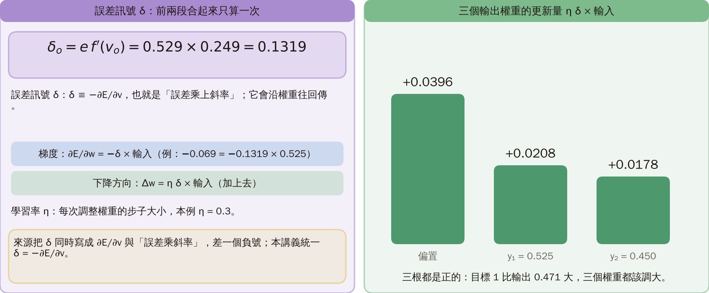
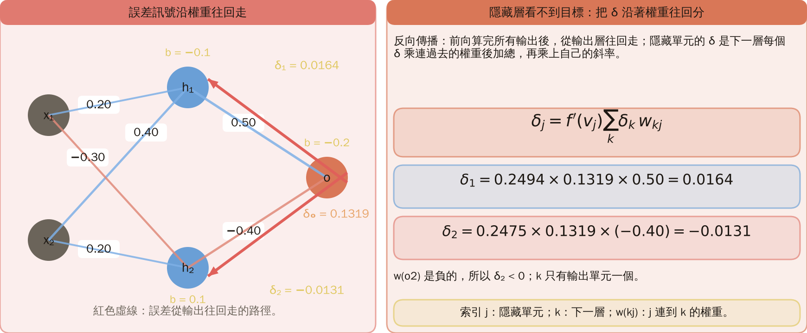
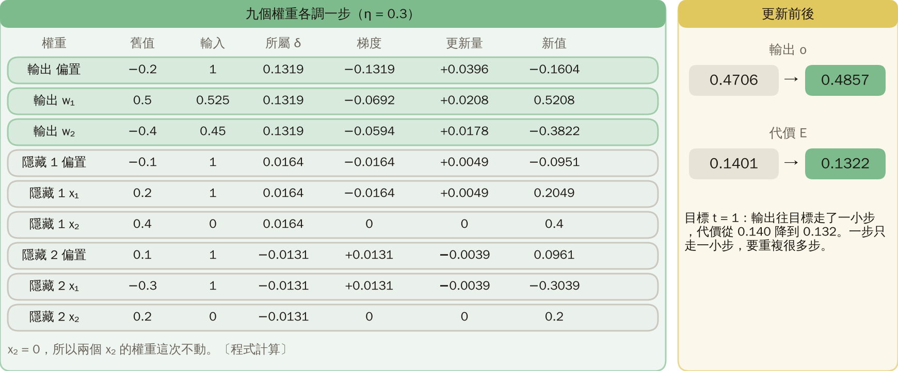
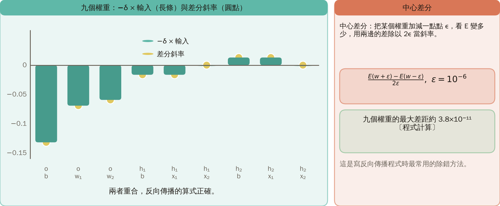
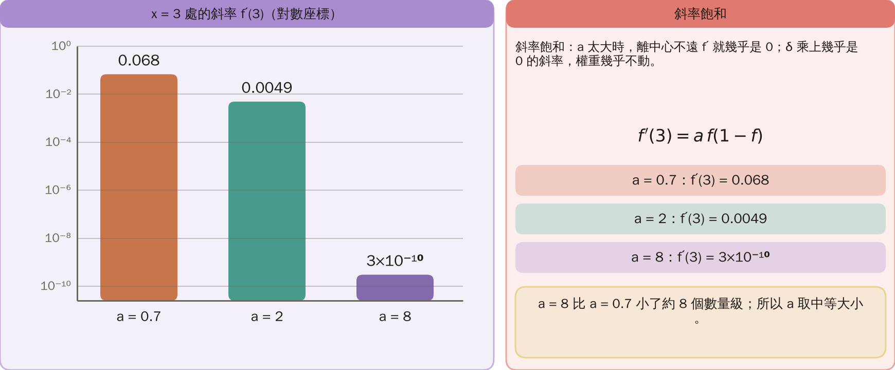
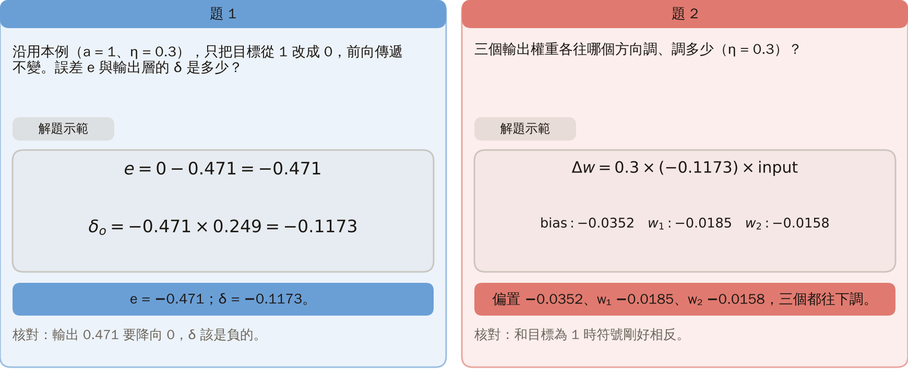

# KP06 從階梯到反向傳播的梯度

> 程度：大學三年級
>
> 圖型識別｜第四章 §4.6

[簡報閱讀與下載](../slides/lec05-kp06-backprop-gradient.jbd.json) | [English version](en/lec05-kp06-backprop-gradient.md)

## 學習目標

- 能說明為什麼要把階梯函數換成 sigmoid，以及斜率參數 $a$ 的取捨。
- 能用連鎖律把一個權重的斜率寫成「$-\delta$ 乘上輸入」，並用 2–2–1 網路逐步算出每個 $\delta$。
- 能把九個權重各更新一步，列出「舊值、梯度、更新量、新值」，並用數值差分核對梯度。

## KP06 從階梯到反向傳播的梯度

**一句話重點**：階梯函數不可微，換成 sigmoid 才有斜率可用。用連鎖律，每個權重的梯度（代價對它的斜率）等於「$-\delta$ 乘上這個權重的輸入」，所以往下降的方向調，就是加上「$\delta$ 乘上輸入」。而 $\delta$ 從輸出層沿著權重一層層往回算，這就是反向傳播。

### 先備與符號

**你需要先會的三件事**（各用一句白話複習）：

- **斜率（導數）**：函數在某一點「每多走一小步，輸出變多少」。斜率為正表示往右會升高，為負表示往右會降低。例如 $y=x^2$ 在 $x=3$ 的斜率是 $6$。
- **偏導數**：函數有很多輸入時，只讓其中一個動、其他固定，看輸出變多少。寫成 $\partial E/\partial w$，讀作「$E$ 對 $w$ 的偏導數」。
- **連鎖律**：$A$ 影響 $B$、$B$ 影響 $C$ 時，$C$ 對 $A$ 的斜率等於「$C$ 對 $B$ 的斜率」乘上「$B$ 對 $A$ 的斜率」。

**符號表**（本講義固定使用）：

| 符號 | 意義 | 說明 |
|---|---|---|
| $x_1,x_2$ | 輸入 | 本例 $x=(1,0)$；每個單元另有一個恆為 $1$ 的「偏置輸入」 |
| $w$ | 權重 | 一條連線上的乘數；每個單元有 3 個（偏置、$x_1$、$x_2$ 或偏置、$y_1$、$y_2$） |
| $v$ | 加權和 | 單元把輸入乘權重再相加的結果 |
| $f$ | sigmoid | $f(v)=1/(1+e^{-av})$，本例 $a=1$ |
| $y_1,y_2$ | 隱藏單元的輸出 | $y_j=f(v_j)$ |
| $o$ | 網路輸出 | 輸出單元的 $f(v_o)$ |
| $t$ | 目標 | 本例 $t=1$ |
| $e$ | 誤差 | $e=t-o$ |
| $E$ | 代價 | $E=\tfrac12 e^2$ |
| $\delta$ | 誤差訊號 | $\delta\equiv-\partial E/\partial v$，本講義的符號約定 |
| $\eta$ | 學習率 | 一次調整的步子大小，本例 $\eta=0.3$ |

**本講義固定的設定**：$a=1$（所以 $f'(v)=f(v)\bigl(1-f(v)\bigr)$）、$\eta=0.3$、偏置輸入恆為 $1$、輸入 $x=(1,0)$、目標 $t=1$。

### 1. 階梯函數沒有斜率可看

**白話說明**：KP05 的權重是規則直接給的。要讓網路自己學權重，就得看代價對每個權重的斜率，往讓代價變小的方向調。

- **代價函數**：把預測和目標差多少加總成一個數，越小越好。本講義用 $E=\tfrac12(t-o)^2$。
- **梯度下降**：看代價對每個權重的斜率，往讓代價變小的方向把權重調一點。

階梯函數除了跳躍的那一點，斜率都是 0。跳躍的那一點沒有斜率。拿不到斜率，梯度下降就無從下手。

圖說 `lec05-kp06-step-slope`：先看左圖：階梯函數兩段平線的斜率都是 0，跳躍處沒有斜率；再看右圖：sigmoid 在 x = 0 的切線斜率是 0.25。這張圖說明階梯為什麼不能用梯度。〔功能：1〕

接下來的問題：能不能把階梯磨圓，讓每一點都有斜率？

### 2. 把階梯磨圓成 sigmoid：斜率處處有，但越像階梯，斜率越只剩一小段

**正式定義**：

$$
f(x)=\frac{1}{1+e^{-ax}},\qquad f'(x)=a\,f(x)\,\bigl(1-f(x)\bigr).
$$

**sigmoid** 把任何數壓進 0 到 1 之間。$a$ 越大，曲線越像階梯。

**為什麼要這個形狀**：它處處可微，而且斜率可以用函數值自己算出來（$f(1-f)$），不必另外求導。

**常見迷思**：越接近階梯越好。其實 $a$ 越大，斜率的高峰越窄越高，兩側的斜率幾乎是 0，反而越難用梯度訓練。另外，離開階梯後，KP03「映射到立方體頂點」的幾何說法不再成立，正確分類改由代價函數來扛。

圖說 `lec05-kp06-sigmoid-a`：先看中間三條 sigmoid（a = 0.7、2、8）與虛線階梯，a 越大越貼近階梯；再看右邊的斜率，高峰 a/4 = 0.175、0.5、2 越來越窄。〔功能：1、2〕

接下來的問題：有了斜率，怎麼知道一個權重該調多少？先用一個小網路走一遍。

### 3. 用一個 2–2–1 小網路走一遍

**網路長什麼樣**：2–2–1 的意思是 2 個輸入、2 個隱藏單元、1 個輸出單元。每個單元有 3 個權重（偏置、對 $x_1$ 或 $y_1$、對 $x_2$ 或 $y_2$）。

**前向傳遞**：從輸入一層一層往前算。每個單元先算加權和 $v$，再套 sigmoid 得 $y=f(v)$，並把中間值存下來。

**例子**：輸入 $x=(1,0)$，目標 $1$。權重依序是（偏置、$x_1$、$x_2$）：

- 隱藏單元 1：$(-0.10,\ 0.20,\ 0.40)$。
- 隱藏單元 2：$(0.10,\ -0.30,\ 0.20)$。
- 輸出單元：$(-0.20,\ 0.50,\ -0.40)$，這裡後兩個權重乘的是 $y_1,y_2$。

計算：

- 隱藏單元 1：$v_1=-0.10+0.20\cdot1+0.40\cdot0=0.10$，$y_1=f(0.10)=0.525$。
- 隱藏單元 2：$v_2=0.10-0.30\cdot1+0.20\cdot0=-0.20$，$y_2=f(-0.20)=0.450$。
- 輸出單元：$v_o=-0.20+0.50\cdot0.525-0.40\cdot0.450=-0.118$，$o=f(-0.118)=0.471$。
- 誤差與代價：$e=1-0.471=0.529$，$E=\tfrac12e^2=0.140$。

圖說 `lec05-kp06-net-forward`：先看左邊權重標在線旁、偏置寫在單元旁，再順著箭頭看 x → y → o 的三個數字 0.525、0.450、0.471；右邊是逐步的算式，E = 0.140。〔功能：1〕

接下來的問題：輸出 0.471 離目標 1 還差 0.529。每個權重要往哪個方向調、調多少？

### 4. 一個權重該調多少：把代價的斜率拆成三段斜率相乘

**連鎖律**：$E$ 要經過 $o$、$v$ 才依賴權重 $w$，所以

$$
\frac{\partial E}{\partial w}=\frac{\partial E}{\partial o}\cdot\frac{\partial o}{\partial v}\cdot\frac{\partial v}{\partial w}.
$$

**三段斜率各是什麼**（以「隱藏單元 1 到輸出」的權重 $w_{o1}$ 為例）：

1. $E=\tfrac12(t-o)^2$。把 $(t-o)$ 看成一個整體，平方的斜率是「它自己」，再乘上 $\partial(t-o)/\partial o=-1$，得 $\partial E/\partial o=-(t-o)=-e=-0.529$。
2. $o=f(v_o)$，所以 $\partial o/\partial v_o=f'(v_o)=o(1-o)=0.471\times0.529=0.249$。
3. $v_o=\ldots+w_{o1}y_1+\ldots$，只有 $w_{o1}y_1$ 這一項含 $w_{o1}$，所以 $\partial v_o/\partial w_{o1}=y_1=0.525$，也就是這個權重乘的輸入。

相乘：$(-0.529)\times0.249\times0.525=-0.069$。梯度是負的，表示把 $w_{o1}$ 調大，$E$ 會變小。

圖說 `lec05-kp06-chain`：先看 w → v → o → E 的三個箭頭，每段下面是一段斜率：0.525、0.249、−0.529；再看最下面三段相乘的結果 −0.069。〔功能：1、2〕

接下來的問題：每個權重都要這樣乘三段，太麻煩了。能不能把前兩段合起來，只算一次？

### 5. 誤差訊號 $\delta$：梯度是 $-\delta$ 乘上輸入，往下降就是加上 $\delta$ 乘上輸入

**符號約定**：$\delta\equiv-\partial E/\partial v$，也就是「誤差乘上斜率」。輸出單元：

$$
\delta_o=e\,f'(v_o)=0.529\times0.249=0.1319.
$$

**兩個等價的說法**（請特別注意正負號）：

- **梯度**：$\partial E/\partial w=-\delta\cdot(\text{這個權重乘的輸入})$。例如第 4 節的 $-0.069=-0.1319\times0.525$。
- **下降方向**：$-\partial E/\partial w=+\delta\cdot(\text{輸入})$。更新量 $\Delta w=\eta\,\delta\cdot\text{輸入}$。

**學習率** $\eta$：每次調整權重的步子大小，本例 $\eta=0.3$。三個輸出權重的輸入是 $1$（偏置）、$y_1=0.525$、$y_2=0.450$，所以更新量是 $+0.0396$、$+0.0208$、$+0.0178$。

**符號說明**［補充］：來源把 $\delta$ 同時寫成 $\partial E/\partial v$ 與「誤差乘斜率」，兩者差一個負號。本講義統一定義 $\delta=-\partial E/\partial v$，所以梯度是 $-\delta\times$輸入，更新是加 $\eta\,\delta\times$輸入。

圖說 `lec05-kp06-out-bars`：先看三根長條，各是一個輸出權重的更新量 ηδ × 輸入（+0.0396、+0.0208、+0.0178）；再注意三根都是正的，因為目標 1 比輸出 0.471 大。〔功能：1、2〕

接下來的問題：隱藏單元不直接連到目標，它的 $\delta$ 怎麼來？

### 6. 隱藏層看不到目標：把輸出的 $\delta$ 沿著權重往回分

**反向傳播**：前向算完所有輸出後，從輸出層往回走。隱藏單元 $j$ 只透過連到下一層的權重影響 $E$。所以它的 $\delta$ 等於「下一層每個 $\delta_k$ 乘上連過去的權重 $w_{kj}$ 後加總」，再乘上自己的斜率：

$$
\delta_j=f'(v_j)\sum_k\delta_k\,w_{kj}.
$$

**索引**：$j$ 是隱藏單元的編號（這裡是 1、2）；$k$ 是下一層的單元編號（本例只有輸出單元一個）；$w_{kj}$ 是從隱藏單元 $j$ 連到單元 $k$ 的權重，本例就是 $w_{o1}=0.50$ 與 $w_{o2}=-0.40$。

**算例**：

- $\delta_1=f'(v_1)\,\delta_o\,w_{o1}=0.2494\times0.1319\times0.50=0.0164$。
- $\delta_2=f'(v_2)\,\delta_o\,w_{o2}=0.2475\times0.1319\times(-0.40)=-0.0131$。$w_{o2}$ 是負的，所以 $\delta_2<0$。

圖說 `lec05-kp06-net-backward`：先看紅色虛線，它是誤差從輸出往回走的路徑；再比較兩條路徑上的權重正負，隱藏單元 2 走的是負權重，所以 δ₂ = −0.0131 是負的。〔功能：1〕

接下來的問題：九個權重的 $\delta$ 都有了，一次更新後代價真的下降嗎？

### 7. 九個權重各調一步，代價從 0.140 降到 0.132

下表每一列是一個權重：「輸入」是這個權重乘的量，「梯度」$=-\delta\times$輸入，「更新量」$=\eta\,\delta\times$輸入（$\eta=0.3$）。

| 權重 | 舊值 | 輸入 | 所屬 $\delta$ | 梯度 | 更新量 | 新值 |
|---|---:|---:|---:|---:|---:|---:|
| 輸出 偏置 | $-0.2000$ | $1$ | $0.1319$ | $-0.1319$ | $+0.0396$ | $-0.1604$ |
| 輸出 $w_{o1}$ | $0.5000$ | $0.525$ | $0.1319$ | $-0.0692$ | $+0.0208$ | $0.5208$ |
| 輸出 $w_{o2}$ | $-0.4000$ | $0.450$ | $0.1319$ | $-0.0594$ | $+0.0178$ | $-0.3822$ |
| 隱藏 1 偏置 | $-0.1000$ | $1$ | $0.0164$ | $-0.0164$ | $+0.0049$ | $-0.0951$ |
| 隱藏 1 $x_1$ | $0.2000$ | $1$ | $0.0164$ | $-0.0164$ | $+0.0049$ | $0.2049$ |
| 隱藏 1 $x_2$ | $0.4000$ | $0$ | $0.0164$ | $0$ | $0$ | $0.4000$ |
| 隱藏 2 偏置 | $0.1000$ | $1$ | $-0.0131$ | $+0.0131$ | $-0.0039$ | $0.0961$ |
| 隱藏 2 $x_1$ | $-0.3000$ | $1$ | $-0.0131$ | $+0.0131$ | $-0.0039$ | $-0.3039$ |
| 隱藏 2 $x_2$ | $0.2000$ | $0$ | $-0.0131$ | $0$ | $0$ | $0.2000$ |

$x_2=0$，所以兩個 $x_2$ 的權重這次不動。用新權重重新前向傳遞：輸出 $o=0.4857$（原 $0.4706$），$E=0.1322$（原 $0.1401$）。一步只走一小步，要重複很多步才會接近目標。

圖說 `lec05-kp06-before-after`：先看左邊九個權重的「舊值、輸入、δ、梯度、更新量、新值」；再看右邊：輸出從 0.4706 走到 0.4857，代價從 0.1401 降到 0.1322。〔功能：1、2〕

接下來的問題：怎麼確定上表的梯度沒有算錯？

### 8. 用數值斜率核對

把某個權重加減一點點 $\varepsilon=10^{-6}$，看 $E$ 變多少：$[E(w+\varepsilon)-E(w-\varepsilon)]/(2\varepsilon)$，這叫**中心差分**。九個權重的 $-\delta\times\text{輸入}$ 與差分斜率最大相差約 $4\times10^{-11}$（程式重算，用的是上表同一組權重、$a=1$）。

這是寫反向傳播程式時最常用的除錯方法。下一個知識點把整個流程寫成演算法。

圖說 `lec05-kp06-numcheck`：先看長條，是九個權重的 −δ × 輸入（也就是梯度）；再看圓點，是用差分算出的斜率。兩者重合，最大只差約 3.8×10⁻¹¹，表示反向傳播的算式正確。〔功能：2〕

### 延伸：斜率飽和、練習與解題示範

**斜率飽和**：在 $x=3$，$f'(3)=a\,f(1-f)$：$a=0.7$ 是 $0.068$，$a=2$ 是 $0.0049$，$a=8$ 是 $3\times10^{-10}$。$a$ 太大時，離中心不遠就進入「飽和」，$\delta$ 乘上幾乎是 0 的斜率，權重幾乎不動。所以 $a$ 取中等大小。

圖說 `lec05-kp06-saturation`：先看對數座標的三根長條，a 越大，x = 3 處的斜率越小：0.068、0.0049、3×10⁻¹⁰，差約 8 個數量級；右邊說明 δ 乘上幾乎是 0 的斜率，權重幾乎不動。〔功能：2〕

**小練習**：沿用本例（$a=1$、$\eta=0.3$），只把目標從 1 改成 0，前向傳遞不變。

1. 誤差 $e$ 與輸出層的 $\delta_o$ 是多少？提示：$e=$ 目標 $-$ 輸出，$f'(v_o)=0.249$ 不變。
2. 三個輸出權重各往哪個方向調、調多少（$\eta=0.3$）？

**題 1、2 解題示範**：① $e=0-0.471=-0.471$，$\delta_o=-0.471\times0.249=-0.1173$。② $\Delta w=0.3\times(-0.1173)\times\text{輸入}$：偏置 $-0.0352$、$w_{o1}$ $-0.0185$、$w_{o2}$ $-0.0158$，三個都往下調。③ 核對：輸出 0.471 要降向 0，輸出層權重都該降，和目標為 1 時符號剛好相反。

圖說 `lec05-kp06-practice-sol`：左邊是題 1：e = −0.471、δ = −0.1173；右邊是題 2：偏置 −0.0352、w₁ −0.0185、w₂ −0.0158，三個都往下調，各附核對。〔功能：1、2〕

## 術語與來源

| 中文 | English |
|---|---|
| 代價函數 | Cost function |
| 梯度下降 | Gradient descent |
| 梯度 | Gradient |
| 偏導數 | Partial derivative |
| sigmoid | Sigmoid (logistic function) |
| 前向傳遞 | Forward pass |
| 連鎖律 | Chain rule |
| 誤差訊號 | Error signal ($\delta$) |
| 反向傳播 | Backpropagation |
| 學習率 | Learning rate |
| 中心差分 | Central difference |

來源：第四章 KP06，§4.6（2026-10-25 讀取）。sigmoid 家族、連鎖律與 $\delta$ 的反向遞迴依來源；2–2–1 的權重、輸入與目標取自來源互動例的初始設定，所有算例、更新量、九個權重的更新表與數值核對由本講義重算（［補充］，（程式重算），$a=1$、$\eta=0.3$）；$\delta$ 的符號約定為本講義統一。
