# KP07 反向傳播的演算法

> 程度：大學三年級
>
> 圖型識別｜第四章 §4.7

[簡報閱讀與下載](../slides/lec05-kp07-backprop-algorithm.jbd.json) | [English version](en/lec05-kp07-backprop-algorithm.md)

## 學習目標

- 能寫出反向傳播訓練的四個步驟，並說明 epoch、批次訓練與停止條件。
- 能用 XOR 的 2–2–1 網路走完第一個 epoch，並看懂代價 $J$ 隨 epoch 下降的曲線。
- 能說明學習率、初始值、區域極小值與逐筆訓練各自影響訓練的方式。

## KP07 反向傳播的演算法

**一句話重點**：KP06 只走了一筆樣本的一步；真正的訓練是「先給起始值，之後每個 epoch 重複前向、反向、更新」，直到代價夠小。學習率、起始值與是否卡在區域極小值，決定訓練快慢與成敗。

### 1. 訓練重複四個步驟

**白話說明**：真實訓練有很多筆資料，例如 XOR 的四個點。要決定的是：什麼時候才更新權重？

- **epoch**：把全部 $N$ 筆訓練資料呈現完一次。本例 $N=4$。
- **批次訓練**：一個 epoch 裡每筆都先算出 $\delta$，加總後只更新一次，$\Delta w=\eta\sum_i\delta(i)\,y^{r-1}(i)/N$。除以 $N$ 只是改變 $\eta$ 的尺度。

**正式定義**：批次更新 $\Delta w=\dfrac{\eta}{N}\sum_{i=1}^{N}\delta(i)\,y^{r-1}(i)$，其中 $y^{r-1}(i)$ 是第 $i$ 筆在上一層的輸出（偏置的輸入固定是 1）。

**例子**：XOR 的 $N=4$，一個 epoch 看完四個點、更新一次。

**步驟**：①給每個權重一個小的隨機起始值（只做一次）；②前向並存值；③反向算每筆的 $\delta$；④更新。重複②到④，直到停止。

圖說 `lec05-kp07-loop`：四步驟的流程；跑完 $N=4$ 筆算一個 epoch。

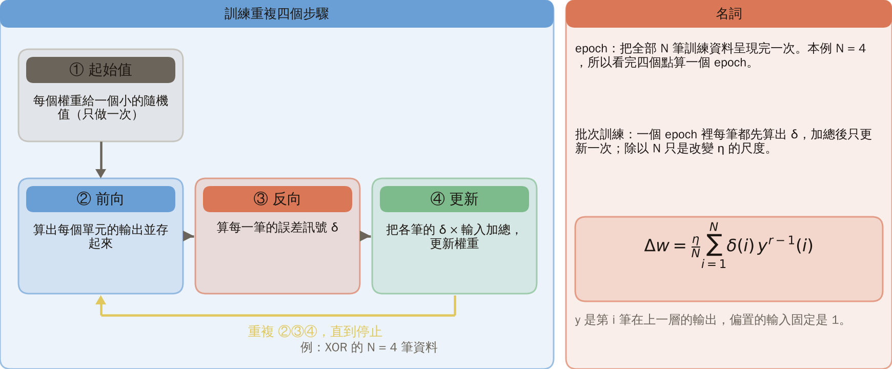

### 2. 第一個 epoch：四個點先各自前向

以來源互動例的初始權重為例（偏置、$x_1$、$x_2$）：隱藏單元 1 為 $(-2,5,5)$，單元 2 為 $(-7,5,5)$，輸出單元為 $(-2,8,-12)$。四個點的輸出：$(0,0)$ 為 $0.2578$，$(1,1)$ 為 $0.0043$（目標 0）；$(0,1)$、$(1,0)$ 為 $0.9851$（目標 1）。代價 $J$ 是四筆 $\tfrac12(\text{目標}-o)^2$ 的平均，$J=0.0084$（程式計算）。四個點都已在 0.5 的正確一側。

圖說 `lec05-kp07-epoch1-forward`：四個輸入的隱藏輸出與最終輸出。

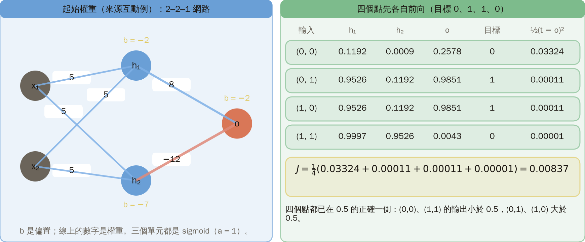

### 3. 第一個 epoch：反向與更新

各筆的輸出層 $\delta_o$：$(0,0)$ 為 $-0.0493$，$(0,1)$ 與 $(1,0)$ 各約 $+0.0002$，$(1,1)$ 約 $-0.00002$。把四筆的「$\delta\times$ 輸入」加總、除以 4、乘 $\eta=1.5$，九個權重各更新一次：輸出偏置 $-0.0183$、隱藏單元 1 的偏置 $-0.0155$，其餘都更小。一個 epoch 後 $J$ 從 $0.00837$ 降到 $0.00799$（程式計算），只走了一小步。

圖說 `lec05-kp07-epoch1-update`：九個權重的更新量，深淺代表大小。

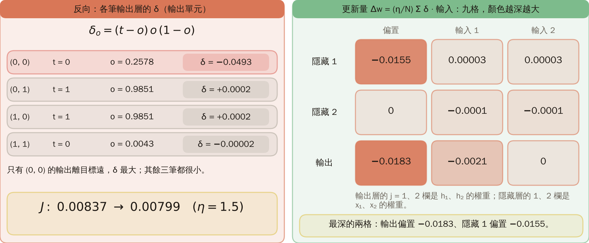

### 4. J 慢慢降到門檻

**停止條件**：代價 $J$ 小於門檻，或梯度小到幾乎不變。本例取 $J<0.0002$ 且四點全對。重複 epoch，$J$ 在第 1、10、100、1000 個 epoch 是 $0.00799$、$0.00567$、$0.00175$、$0.00046$，到第 3707 個 epoch 才低於門檻；此時輸出為 $0.029$、$0.982$、$0.982$、$0.010$（程式計算）。

圖說 `lec05-kp07-curve`：對數座標的 $J$ 曲線與停止門檻。

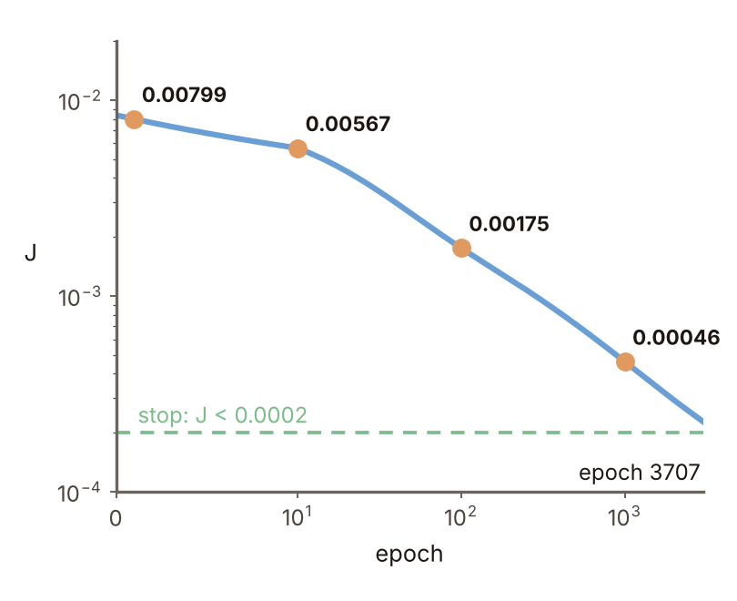

### 5. 學習率的兩難

用來源的初始權重，所需 epoch 數隨 $\eta$：$0.1\to55607$、$0.5\to11121$、$1.5\to3707$、$3\to1853$、$6\to926$、$30\to185$、$100\to53$（程式計算）。$\eta=200$ 時 $J$ 前兩步就變大，最後四個輸出都是 $1.00$、$J=0.25$，只對 2 點，訓練失敗。來源指出最佳 $\eta$ 取決於代價在權重空間的形狀：平坦的極小值可以大步走，陡峭狹窄的要小步。

**常見迷思**：學習率越大越好。其實過大會衝過頭、甚至發散；本例不是「愈大愈快」到底，而是在某個範圍內愈大愈快。

圖說 `lec05-kp07-eta-bars`：不同 $\eta$ 所需 epoch 數，對數座標。

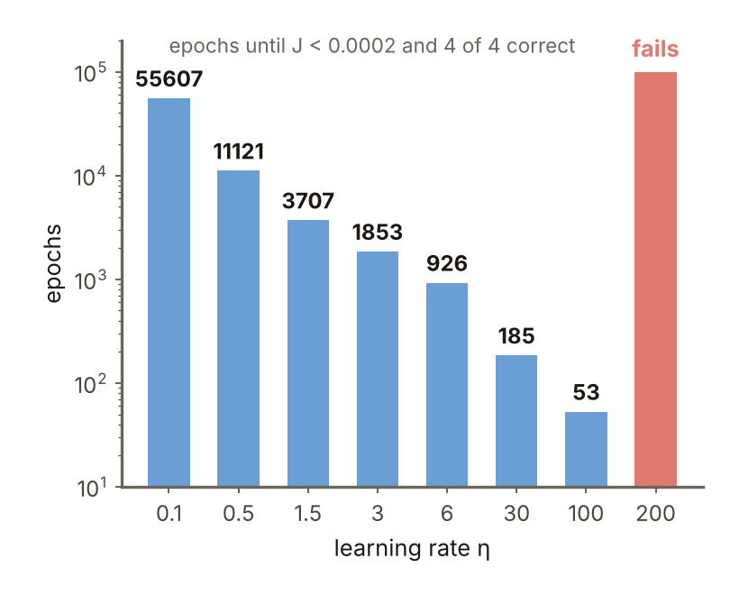

### 6. 初始值不能全是 0

**初始化**：訓練前先給每個權重一個起始值，通常是小的隨機值（來自偽隨機數產生器）。若全設成 0：每個輸出都是 0.5，輸出層四筆的 $\delta$ 正負抵銷，隱藏層的 $\delta$ 乘輸出權重 0 也是 0，所有梯度剛好是 0，$J=0.125$ 一動也不動（程式計算）。20 組 $\pm0.5$ 的隨機起點，$\eta=1.5$，全部達到 $J<0.0002$，用了 10890 到 23926 個 epoch。

圖說 `lec05-kp07-zero-init`：全 0 與來源起始值的 $J$ 曲線對照。

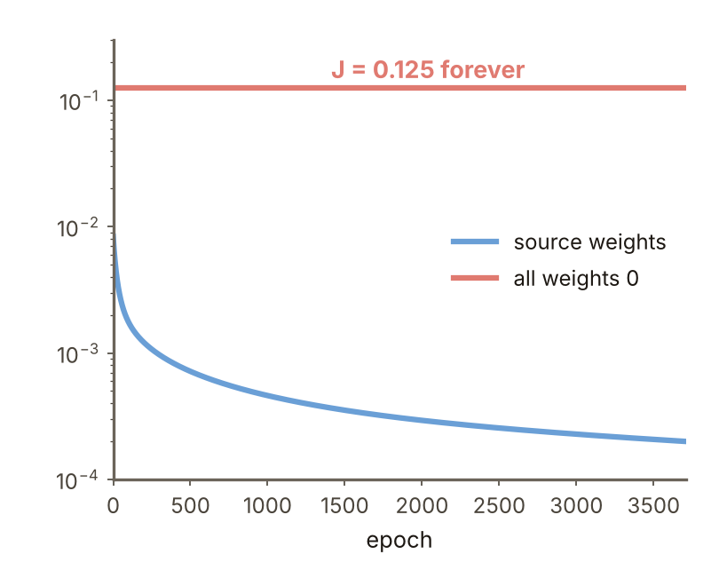

### 7. 區域極小值

**區域極小值**：附近最低、但不是最低的點，梯度為 0，梯度下降走進去就出不來。取 300 組 $\pm3$ 內的隨機起點（$\eta=3$、最多 20000 個 epoch）：176 組達標，124 組沒有。起點 A（種子 0）卡在 $J=0.0626$，輸出 $0.01$、$0.99$、$0.5$、$0.5$，梯度長度只有 $3\times10^{-5}$；再多跑 6 萬個 epoch 也沒離開。起點 B（種子 4）在 8204 個 epoch 收斂（程式計算）。

圖說 `lec05-kp07-stuck`：兩組起點的 $J$ 曲線。

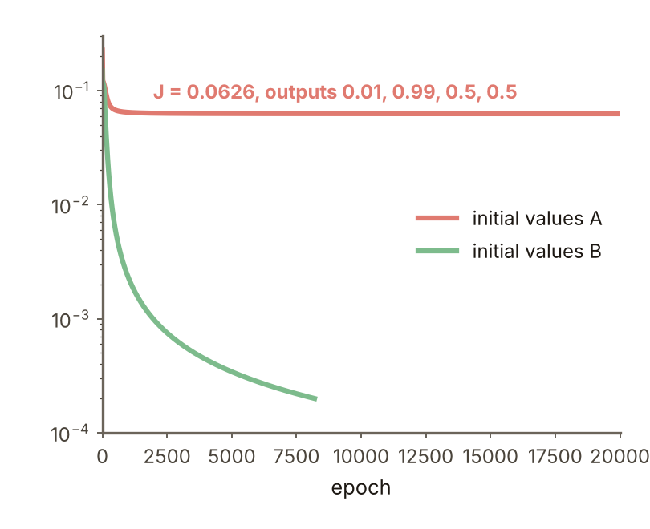

### 8. 逐筆更新

**逐筆訓練**：每看一筆就用那一筆的 $\delta$ 更新一次，$w\leftarrow w+\eta\,\delta\,y^{r-1}$；隨機性大，來源說有機會跳出區域極小值。用來源權重：逐筆 $\eta=1.5$ 要 924 個 epoch，批次 $\eta=1.5$ 要 3707，批次 $\eta=6$（總步長相同）要 926，幾乎一樣，所以逐筆快主要是步長，不是魔法。卡住的起點 A：逐筆（固定順序或每個 epoch 洗牌）20000 個 epoch 後仍在 $J\approx0.063$，本例沒有跳出；「有機會」不是保證（程式計算）。

圖說 `lec05-kp07-batch-pattern`：三種做法的 epoch 數，以及起點 A 的結果。

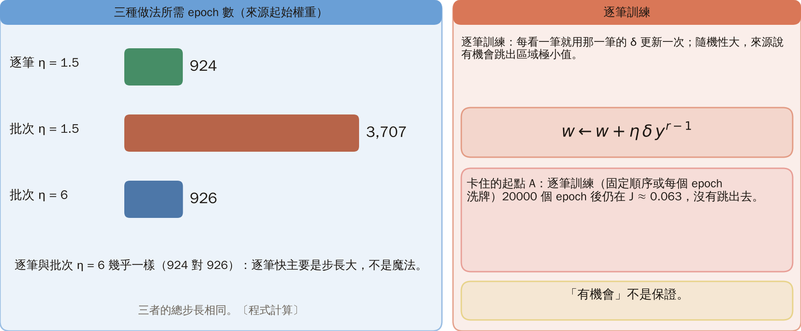

### 延伸：凍結權重、練習與解題示範

**凍結權重**：訓練完成後權重不再更新，之後分類只做乘加與 sigmoid。本例 9 個權重為隱藏 1 $(-2.862,5.465,5.465)$、隱藏 2 $(-7.843,4.636,4.636)$、輸出 $(-3.989,9.089,-11.977)$；每個輸入要 6 次乘法與 3 次 sigmoid，四個輸出 $0.0292$、$0.9821$、$0.9821$、$0.0103$。同一層的單元彼此獨立，所以可以平行，有光學、VLSI 與專用神經計算機的實作（來源）。

圖說 `lec05-kp07-frozen`：凍結後的權重與四個輸出。

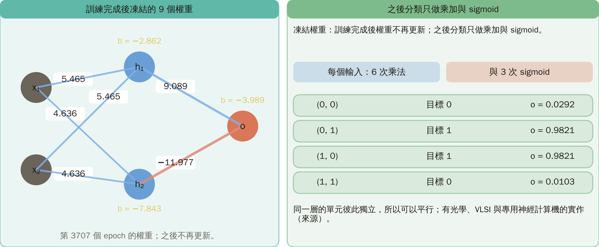

**小練習**：用起始權重，逐筆模式只看樣本 $(0,0)$（目標 0），$\eta=1.5$。已知前向：$h_1=0.1192$、$h_2=0.0009$、$o=0.2578$。

1. 輸出層的 $\delta_o$ 是多少？提示：$\delta_o=(\text{目標}-o)f'(v_o)$，$f'(v_o)=o(1-o)$。
2. 輸出層三個權重的更新量是多少？

圖說 `lec05-kp07-practice-forward`：樣本 $(0,0)$ 的前向傳遞。

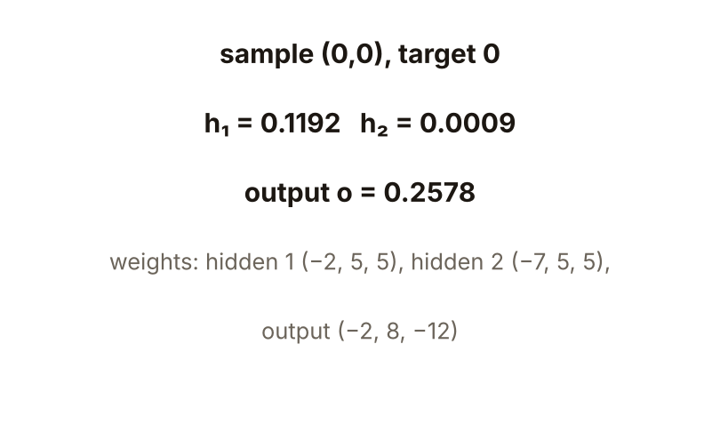

**題 1、2 解題示範**：① $\delta_o=(0-0.2578)\times0.2578\times(1-0.2578)=-0.0493$。② $\Delta w=1.5\times(-0.0493)\times\text{輸入}$：偏置 $-0.0740$、$w_{o1}$ $-0.0088$、$w_{o2}$ $-0.0001$。③ 核對：目標 0、輸出 0.2578 偏高，輸出層權重都往下調；隱藏單元 1 的 $\delta=-0.0414$，偏置 $-0.0622$。

圖說 `lec05-kp07-practice-sol`：三個輸出權重的更新量，都是負的。

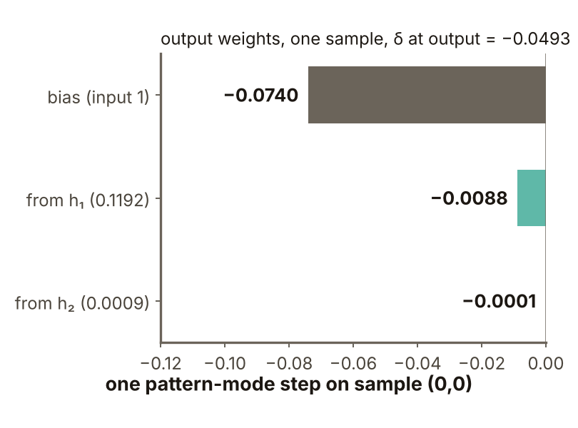

## 術語與來源

| 中文 | English |
|---|---|
| epoch | Epoch |
| 批次訓練 | Batch training |
| 停止條件 | Stop rule |
| 初始化 | Initialization |
| 區域極小值 | Local minimum |
| 逐筆訓練 | Pattern (online) training |
| 凍結權重 | Frozen weights |

來源：第四章 KP07，§4.7（2026-10-25 讀取）。四步驟、批次與逐筆兩種模式、學習率與初始值的討論、區域極小值與凍結權重依來源；XOR 的 2–2–1 網路與初始權重取自來源互動例，所有 epoch 數、輸出與更新量由本講義重算（［補充］，（程式計算））。全 0 起點、300 組 $\pm3$ 隨機起點與逐筆模式的卡住實驗是本講義自行做的程式實驗（［補充］）。符號沿用 KP06：$\delta=-\partial E/\partial v$，更新為 $+\eta\,\delta\cdot$輸入。
