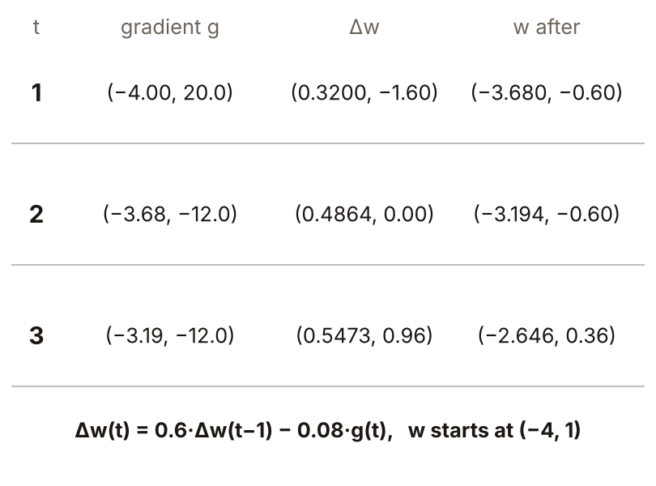
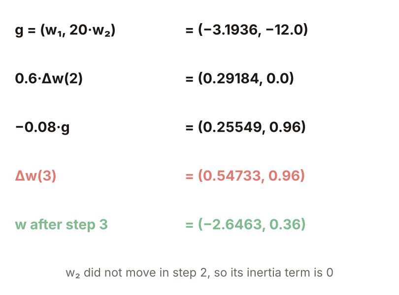

# KP08 反向傳播的加速變形

> 程度：大學三年級
>
> 圖型識別｜第四章 §4.7

[簡報閱讀與下載](../slides/lec05-kp08-backprop-speedups.jbd.json) | [English version](en/lec05-kp08-backprop-speedups.md)

## 學習目標

- 能說明狹長谷底為什麼讓梯度下降慢又來回擺。
- 能寫出動量的更新式，手算幾步，並說明它為什麼在平的方向加速、在陡的方向抵銷。
- 能說明自適應學習率與 quickprop 的規則，並知道它們各自的代價與限制。

## KP08 反向傳播的加速變形

**一句話重點**：梯度下降在狹長谷底裡走得慢又來回擺；動量把上一步的 $\alpha$ 倍加進這一步，平的方向被放大、陡的方向被抵銷；自適應學習率讓 $\mu$ 自己調，quickprop 用兩次斜率直接估谷底。加速一律以複雜度為代價。

### 1. 狹長谷底

**白話說明**：KP07 的訓練動輒上千個 epoch，原因之一是梯度下降本身慢。

- **曲率**：代價面彎得多厲害。某個方向曲率大，沿那個方向走一小步，代價就變很多。
- **狹長谷底（病態代價面）**：一個方向曲率很大、另一個很小，等高線是很扁的橢圓；來源稱為 ill-conditioned，即 Hessian 的特徵值差距很大。

**例子**：本講義為了看清機制自行設計 $J=\tfrac12(w_1^2+20w_2^2)$，$w_2$ 方向曲率 20，$w_1$ 方向曲率 1，起點 $(-4,1)$，$\mu=0.08$。普通梯度下降走 100 步才到 $|w|<0.001$，軌跡在 $w_2$ 方向上下擺（程式計算）。

圖說 `lec05-kp08-valley`：等高線與普通梯度下降的軌跡。

### 2. 為什麼來回擺

陡的方向：$w_2$ 的梯度是 $20w_2$，更新 $w_2\leftarrow w_2-0.08\cdot20\,w_2=-0.6\,w_2$，每步變號、只縮到 0.6 倍。平的方向：$w_1\leftarrow w_1-0.08\cdot1\cdot w_1=0.92\,w_1$，同方向、每步只縮 8%。

**兩難**：$\mu$ 要小於 $2/20=0.1$，$w_2$ 才不會越擺越大；$\mu=0.12$ 時 60 步後 $|w|$ 已超過 $10^8$。但這麼小的步長讓 $w_1$ 走得慢。

圖說 `lec05-kp08-zigzag`：前 15 步的 $w_1$ 與 $w_2$。

### 3. 動量項

**動量**：讓更新帶著慣性，這一步除了本次的梯度步，還加上上一步的 $\alpha$ 倍。

**正式定義**：

$$
\Delta w(t)=\alpha\,\Delta w(t-1)-\mu\,g(t),
$$

$g$ 是梯度，$\alpha$ 叫動量因子，實務上取 0.1 到 0.8；$\alpha=0$ 就是普通梯度下降。

**手算**（$\mu=0.08$、$\alpha=0.6$）：第 1 步 $(0.32,-1.6)$，$w=(-3.68,-0.6)$；第 2 步 $0.6\times(0.32,-1.6)-0.08\times(-3.68,-12)=(0.4864,0)$，$w_2$ 的兩股力量（慣性 $-0.96$、梯度 $+0.96$）剛好抵銷。第 3 步 $(0.5473,0.96)$，$w=(-2.646,0.36)$。

圖說 `lec05-kp08-mom-steps`：動量前三步的表。

### 4. 為什麼有效：歷史梯度的指數加權平均

**指數加權平均**：最近的梯度權重最大，越久以前的每回合再乘 $\alpha$ 變小，權重是 $1,\alpha,\alpha^2,\dots$。

展開 $T$ 步：$\Delta w(T)=-\mu\sum_{t}\alpha^{t}g(T-t)+\alpha^{T}\Delta w(0)$，最後一項幾步就趨近 0。梯度不變（平的方向）時，總權重 $1+\alpha+\alpha^2+\cdots=1/(1-\alpha)$，等於把學習率放大 $1/(1-\alpha)$ 倍：$\alpha=0.6$ 是 2.5 倍，$\alpha=0.8$ 是 5 倍（固定梯度跑 80 步驗證）。梯度正負交替（陡的方向）時，加權平均讓它們互相抵消。一個機制，該快時快、該穩時穩。

圖說 `lec05-kp08-expo`：權重 $0.6^t$ 與 $0.8^t$，與固定梯度下的總權重。

### 5. 兩條軌跡

同起點、同 $\mu=0.08$：普通 100 步，$\alpha=0.6$ 的動量 28 步（程式計算）。紅色軌跡在 $w_2$ 方向上下擺很多回，綠色的擺幅縮得更快，$w_1$ 方向也走得更快。代價是多存一份上一步的更新量，多一個旋鈕 $\alpha$。

圖說 `lec05-kp08-two-paths`：兩條軌跡的比較。

### 6. $\alpha$ 的最佳值

**常見迷思**：$\alpha$ 越大越好。$\mu=0.08$ 時，$\alpha=0,0.3,0.5,0.6,0.7,0.8,0.9,0.95$ 依序要 100、65、36、28、44、63、137、247 步。$\alpha\ge0.9$ 比不用動量更慢：慣性太大，在谷底衝過頭，像單擺晃很久才停。實務上常取 0.1–0.8，最佳值看問題，要試；來源報告過 2 倍以上的加速。

圖說 `lec05-kp08-alpha-curve`：各 $\alpha$ 所需步數。

### 7. 自適應學習率

**自適應學習率**：看代價 $J$ 的前後比值自動調 $\mu$：

$$
\mu(t)=\begin{cases}1.05\,\mu(t-1), & J(t)/J(t-1)<1\\ 0.7\,\mu(t-1), & J(t)/J(t-1)>1.04\\ \mu(t-1), & \text{其餘}\end{cases}
$$

典型值 $r_i=1.05$、$r_d=0.7$、$c=1.04$（來源）。不對稱：變好慢慢加，變壞大力煞車；代價上升時，本講義的做法是這一步不採用、動量歸零（來源建議之一）。

**結果**（程式計算）：$\mu_0=0.02$，普通 411 步、自適應 61 步；$\mu_0=0.12$，普通直接爆開，自適應拒絕 12 步後 95 步收斂；$\mu_0=0.08$ 本來就接近最佳，自適應 93 步，沒比普通的 100 步好多少。

圖說 `lec05-kp08-adaptive`：$|w|$ 對步數的半對數曲線。

### 8. quickprop 與五種做法的比較

**quickprop**：把每個權重當成各自獨立，用最近兩次的斜率估出拋物線的谷底，直接跳過去：

$$
\Delta w(t)=\alpha(t)\,\Delta w(t-1),\qquad \alpha(t)=\min\Bigl\{\frac{g(t)}{g(t-1)-g(t)},\ \alpha_{\max}\Bigr\},\ \alpha_{\max}\approx1.75.
$$

**例子**（$w_2$）：第 1 步普通步 $1\to-0.6$，斜率 $20\to-12$；$\alpha=-12/(20+12)=-0.375$，$\Delta=-0.375\times(-1.6)=+0.6$，第 2 步剛好落在 0。整個二次例 5 步到達（普通 $\mu=0.02$ 411、自適應 61、普通 $\mu=0.08$ 100、動量 28）。但這個例子每個切面剛好是拋物線，最合 quickprop；真實代價不是二次的。加速都要付出複雜度。

圖說 `lec05-kp08-compare`：五種做法的步數。

### 延伸：牛頓法、練習與解題示範

**牛頓法**：用曲率資訊（Hessian 矩陣 $H$）直接算出谷底，$\Delta w=-H^{-1}g$，二次函數一步就到。本例 $H=\mathrm{diag}(1,20)$，$\Delta w=-w$，一步到原點；代價是要算、存、反轉 Hessian。quickprop 可看成每個權重各做一維牛頓法。來源還列了共軛梯度、Newton 家族、Kalman 濾波與 Levenberg–Marquardt，多半需要 Hessian 的元素；delta-delta 與 delta-bar-delta 讓每個權重各有一個學習率，梯度連續同號就加大、變號就縮小。

圖說 `lec05-kp08-secant`：沿 $w_2$ 的拋物線與 quickprop 的跳躍。

**小練習**：同一個谷底，$\mu=0.08$、$\alpha=0.6$。第 2 步後 $w=(-3.1936,-0.6)$，第 2 步更新量 $(0.4864,0)$。

1. 此處的梯度 $g=(w_1,20w_2)$ 是多少？
2. 第 3 步的更新量 $\Delta w(3)=0.6\,\Delta w(2)-0.08\,g(3)$ 與新的 $w$ 是多少？

圖說 `lec05-kp08-practice`：前兩步的數字與要求。

**題 1、2 解題示範**：① $g=(-3.1936,\,20\times(-0.6))=(-3.1936,-12)$。② $\Delta w(3)=0.6\times(0.4864,0)-0.08\times(-3.1936,-12)=(0.29184+0.25549,\,0.96)=(0.54733,0.96)$；$w=(-3.1936+0.5473,\,-0.6+0.96)=(-2.6463,0.36)$。③ 核對：第 2 步 $w_2$ 沒有動，這一步 $w_2$ 的慣性是 0，梯度那份 0.96 全成了位移。

圖說 `lec05-kp08-practice-sol`：第 3 步的各項。

## 術語與來源

| 中文 | English |
|---|---|
| 曲率 | Curvature |
| 狹長谷底（病態代價面） | Narrow valley (ill-conditioned surface) |
| 動量 | Momentum |
| 指數加權平均 | Exponentially weighted average |
| 自適應學習率 | Adaptive learning rate |
| quickprop | quickprop |
| 牛頓法 | Newton's method |

來源：第四章 KP08，§4.7（2026-10-25 讀取）。動量式、$1/(1-\alpha)$ 的推導、自適應學習率的規則與典型值、quickprop 公式、牛頓法家族依來源；$J=\tfrac12(w_1^2+20w_2^2)$ 這個例子、起點與所有步數、軌跡由本講義設計並重算（［補充］，（程式計算））。
