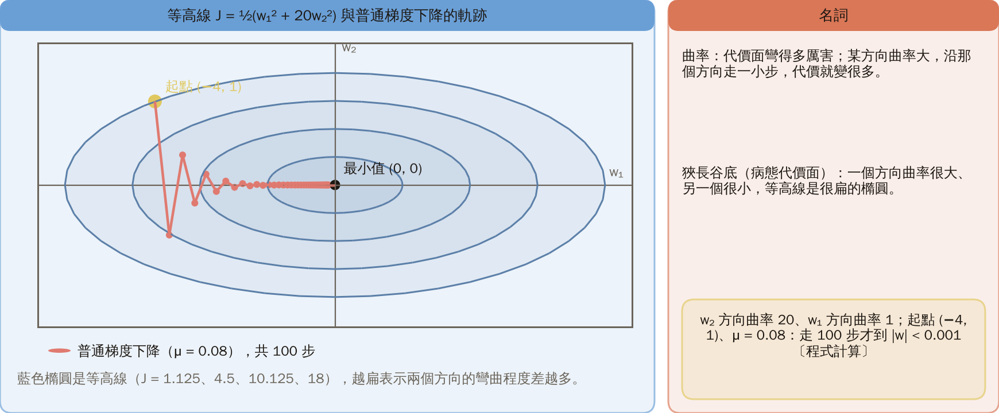
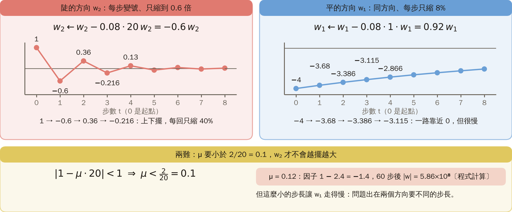
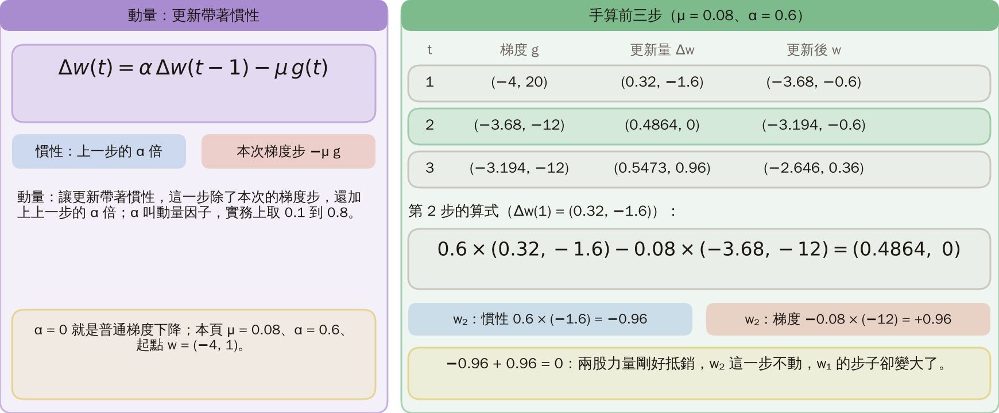
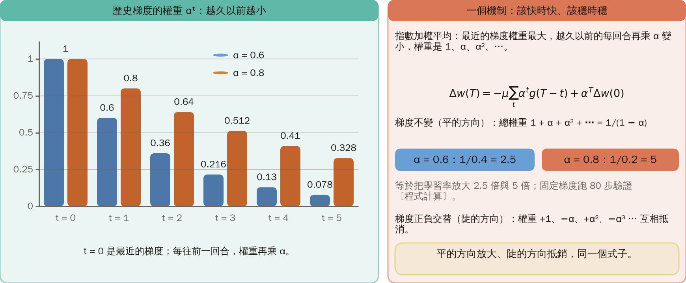
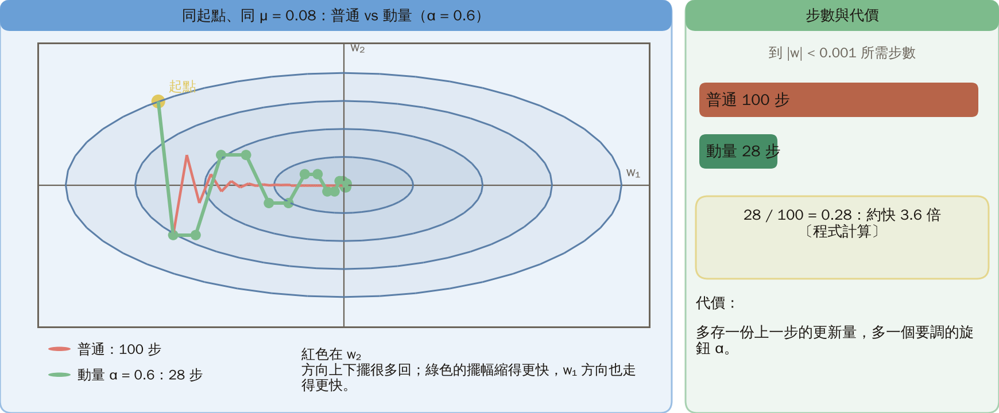
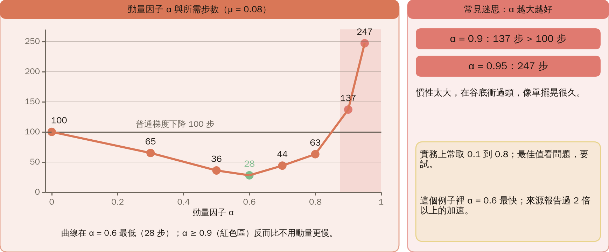
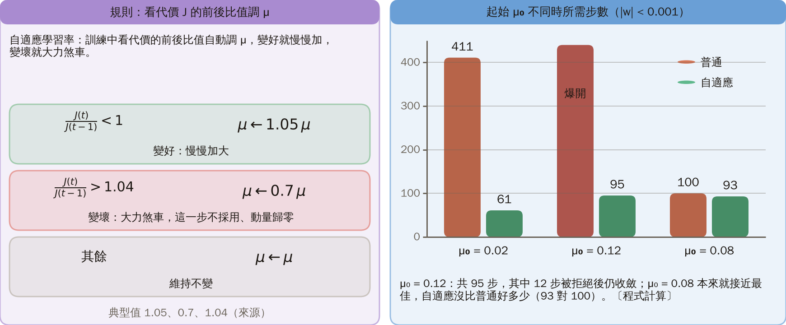
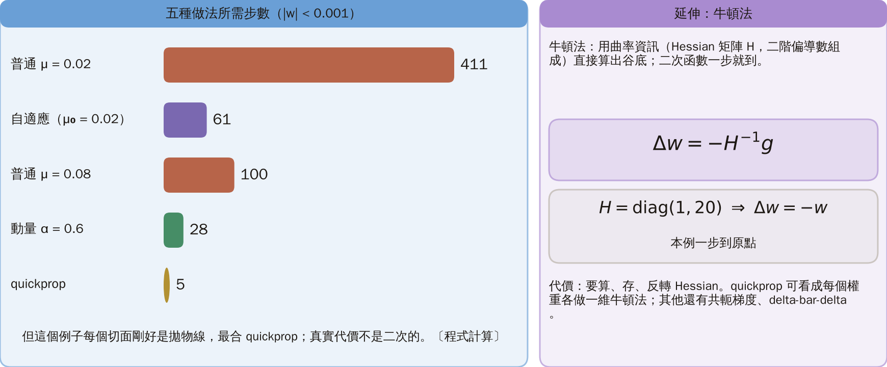
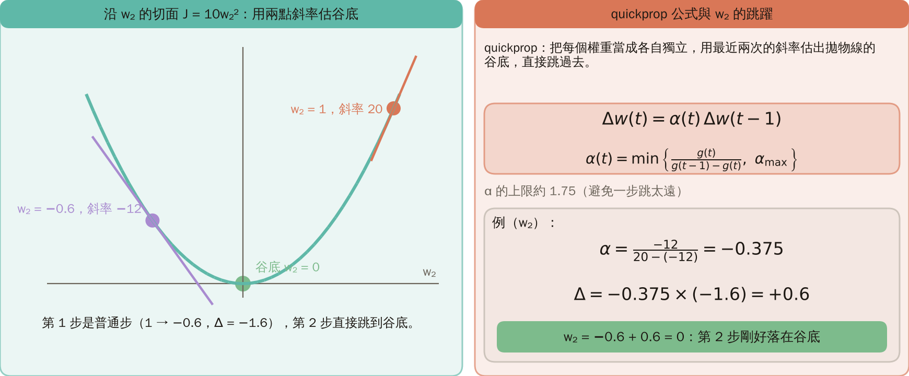
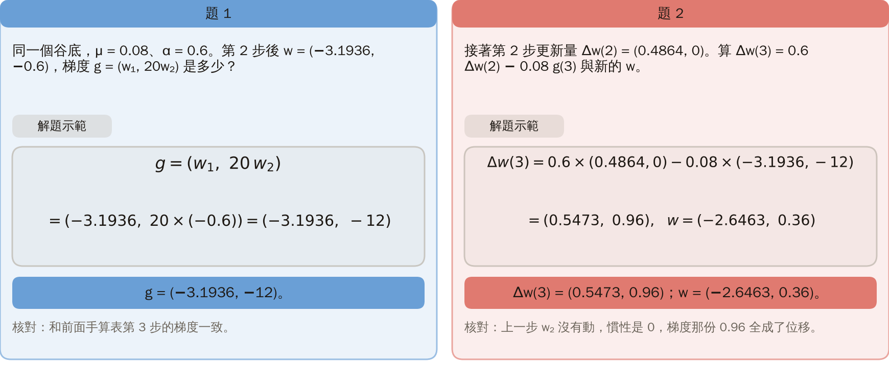

# KP08 反向傳播的加速變形

!!! note "自主學習"
    本單元（KP08）列為自主學習，課堂不講授，請同學課前或課後自行閱讀。

> 程度：大學三年級
>
> 圖型識別｜第四章 §4.7

[簡報閱讀與下載](../slides/lec05-kp08-backprop-speedups.jbd.json) | [English version](en/lec05-kp08-backprop-speedups.md)

## 學習目標

- 能說明狹長谷底為什麼讓梯度下降慢又來回擺。
- 能寫出動量的更新式，手算幾步，並說明它為什麼在平的方向加速、在陡的方向抵銷。
- 能說明自適應學習率與 quickprop 的規則，並知道它們各自的代價與限制。

## KP08 反向傳播的加速變形

**一句話重點**：梯度下降在狹長谷底裡走得慢又來回擺；動量把上一步的 $\alpha$ 倍加進這一步，平的方向被放大、陡的方向被抵銷；自適應學習率讓 $\mu$ 自己調，quickprop 用兩次斜率直接估谷底。加速一律以複雜度為代價。

### 先備與符號

**你需要先會的三件事**：

- **梯度下降**（KP06、KP07）：每一步往梯度的反方向走，步子是學習率 $\mu$ 乘梯度。
- **等高線**：把代價相同的點連起來的線；等高線越密，代價變化越快。
- **平方與二次函數**：二次函數的圖是拋物線（一維）或碗形（多維）。

**符號表**（本講義固定使用；注意這份講義的學習率寫成 $\mu$，KP06、KP07 寫 $\eta$，意思相同）：

| 符號 | 意義 | 說明 |
|---|---|---|
| $w=(w_1,w_2)$ | 權重 | 本例只有兩個 |
| $J(w)$ | 代價 | 本例 $J=\tfrac12(w_1^2+20w_2^2)$ |
| $g(t)$ | 第 $t$ 步的梯度 | $g=(w_1,\,20w_2)$ |
| $\mu$ | 學習率 | 本講義的步長 |
| $\Delta w(t)$ | 第 $t$ 步的更新量 | |
| $\alpha$ | 動量因子 | 第 3 節；$\alpha=0$ 就是普通梯度下降 |
| $H$ | Hessian 矩陣 | 二階偏導數組成的矩陣，描述各方向的曲率（延伸） |

### 1. 狹長谷底

**白話說明**：KP07 的訓練動輒上千個 epoch，原因之一是梯度下降本身慢。

- **曲率**：代價面彎得多厲害。某個方向曲率大，沿那個方向走一小步，代價就變很多。
- **狹長谷底（病態代價面）**：一個方向曲率很大、另一個很小，等高線是很扁的橢圓；來源稱為 ill-conditioned，即 Hessian 的特徵值差距很大。

**例子**：本講義為了看清機制自行設計 $J=\tfrac12(w_1^2+20w_2^2)$，$w_2$ 方向曲率 20，$w_1$ 方向曲率 1，起點 $(-4,1)$，$\mu=0.08$。普通梯度下降走 100 步才到 $|w|<0.001$，軌跡在 $w_2$ 方向上下擺（程式計算）。

圖說 `lec05-kp08-valley`：先看藍色橢圓等高線：很扁，表示 w₂ 方向曲率 20、w₁ 方向曲率 1；再看紅色軌跡從起點 (−4, 1) 出發，在 w₂ 方向上下擺，走 100 步才到 |w| < 0.001（程式計算）。〔功能：1〕

### 2. 為什麼來回擺

陡的方向：$w_2$ 的梯度是 $20w_2$，更新 $w_2\leftarrow w_2-0.08\cdot20\,w_2=-0.6\,w_2$，每步變號、只縮到 0.6 倍。平的方向：$w_1\leftarrow w_1-0.08\cdot1\cdot w_1=0.92\,w_1$，同方向、每步只縮 8%。

**兩難**：$\mu$ 要小於 $2/20=0.1$，$w_2$ 才不會越擺越大；$\mu=0.12$ 時 60 步後 $|w|$ 已超過 $10^8$。但這麼小的步長讓 $w_1$ 走得慢。

圖說 `lec05-kp08-zigzag`：先看左圖：w₂ 每步變號、只縮到 0.6 倍（1、−0.6、0.36、−0.216）；再看右圖：w₁ 每步同方向、只縮 8%（−4、−3.68、−3.386）；下方是 μ < 0.1 的限制，μ = 0.12 時 60 步後 |w| = 5.86×10⁸。〔功能：1〕

### 3. 動量項

**動量**：讓更新帶著慣性，這一步除了本次的梯度步，還加上上一步的 $\alpha$ 倍。

**正式定義**：

$$
\Delta w(t)=\alpha\,\Delta w(t-1)-\mu\,g(t),
$$

$g$ 是梯度，$\alpha$ 叫動量因子，實務上取 0.1 到 0.8；$\alpha=0$ 就是普通梯度下降。

**手算**（$\mu=0.08$、$\alpha=0.6$）：第 1 步 $(0.32,-1.6)$，$w=(-3.68,-0.6)$；第 2 步 $0.6\times(0.32,-1.6)-0.08\times(-3.68,-12)=(0.4864,0)$，$w_2$ 的兩股力量（慣性 $-0.96$、梯度 $+0.96$）剛好抵銷。第 3 步 $(0.5473,0.96)$，$w=(-2.646,0.36)$。

| 步 $t$ | 梯度 $g$ | 更新量 $\Delta w$ | 更新後 $w$ |
|---|---|---|---|
| 1 | $(-4,\,20)$ | $(0.32,\,-1.6)$ | $(-3.68,\,-0.6)$ |
| 2 | $(-3.68,\,-12)$ | $(0.4864,\,0)$ | $(-3.194,\,-0.6)$ |
| 3 | $(-3.19,\,-12)$ | $(0.5473,\,0.96)$ | $(-2.646,\,0.36)$ |

起點 $w=(-4,1)$，$\Delta w(t)=0.6\,\Delta w(t-1)-0.08\,g(t)$。

圖說 `lec05-kp08-momentum`：先看左邊的動量式 Δw(t) = αΔw(t−1) − μg(t)，慣性項與梯度步各一格；再看右邊三步手算表，第 2 步 w₂ 的慣性 −0.96 與梯度 +0.96 剛好抵銷，Δw = (0.4864, 0)。〔功能：2〕

接下來的問題：為什麼這樣做有效？

### 4. 為什麼有效：歷史梯度的指數加權平均

**指數加權平均**：最近的梯度權重最大，越久以前的每回合再乘 $\alpha$ 變小，權重是 $1,\alpha,\alpha^2,\dots$。

展開 $T$ 步：$\Delta w(T)=-\mu\sum_{t}\alpha^{t}g(T-t)+\alpha^{T}\Delta w(0)$，最後一項幾步就趨近 0。梯度不變（平的方向）時，總權重 $1+\alpha+\alpha^2+\cdots=1/(1-\alpha)$，等於把學習率放大 $1/(1-\alpha)$ 倍：$\alpha=0.6$ 是 2.5 倍，$\alpha=0.8$ 是 5 倍（固定梯度跑 80 步驗證）。梯度正負交替（陡的方向）時，加權平均讓它們互相抵消。一個機制，該快時快、該穩時穩。

圖說 `lec05-kp08-expo`：先看左邊的長條：α = 0.6 與 α = 0.8 時權重 αᵗ 隨 t 遞減；再看右邊：固定梯度下總權重 1/(1 − α)，α = 0.6 是 2.5、α = 0.8 是 5，梯度正負交替則互相抵消。〔功能：2〕

### 5. 兩條軌跡

同起點、同 $\mu=0.08$：普通 100 步，$\alpha=0.6$ 的動量 28 步（程式計算）。紅色軌跡在 $w_2$ 方向上下擺很多回，綠色的擺幅縮得更快，$w_1$ 方向也走得更快。代價是多存一份上一步的更新量，多一個旋鈕 $\alpha$。

圖說 `lec05-kp08-two-paths`：先看左圖：紅色（普通）軌跡在 w₂ 方向擺很多回，綠色（動量 α = 0.6）的擺幅縮得更快；再看右邊的長條：100 步對 28 步，約快 3.6 倍。〔功能：2〕

### 6. $\alpha$ 的最佳值

**常見迷思**：$\alpha$ 越大越好。$\mu=0.08$ 時所需步數：

| $\alpha$ | 0 | 0.3 | 0.5 | 0.6 | 0.7 | 0.8 | 0.9 | 0.95 |
|---|---:|---:|---:|---:|---:|---:|---:|---:|
| 步數 | 100 | 65 | 36 | 28 | 44 | 63 | 137 | 247 |

$\alpha\ge0.9$ 比不用動量更慢：慣性太大，在谷底衝過頭，像單擺晃很久才停。實務上常取 0.1–0.8，最佳值看問題，要試；來源報告過 2 倍以上的加速。

圖說 `lec05-kp08-alpha-curve`：先看曲線在 α = 0.6 最低（28 步）；再看紅色區：α ≥ 0.9 時 137 步、247 步，比 α = 0 的 100 步（虛線）還高。〔功能：2〕

### 7. 自適應學習率

**自適應學習率**：看代價 $J$ 的前後比值自動調 $\mu$：

$$
\mu(t)=\begin{cases}1.05\,\mu(t-1), & J(t)/J(t-1)<1\\ 0.7\,\mu(t-1), & J(t)/J(t-1)>1.04\\ \mu(t-1), & \text{其餘}\end{cases}
$$

典型值 $r_i=1.05$、$r_d=0.7$、$c=1.04$（來源）。不對稱：變好慢慢加，變壞大力煞車；代價上升時，本講義的做法是這一步不採用、動量歸零（來源建議之一）。

**結果**（程式計算）：

| 起始 $\mu_0$ | 普通梯度下降 | 自適應 |
|---:|---|---|
| 0.02 | 411 步 | 61 步 |
| 0.12 | 直接爆開 | 共 95 步收斂（其中 12 步被拒絕）|
| 0.08 | 100 步 | 93 步 |

$\mu_0=0.08$ 本來就接近最佳，自適應沒比普通好多少。

圖說 `lec05-kp08-adaptive`：先看左邊的三條規則：比值 < 1 乘 1.05、> 1.04 乘 0.7、其餘不變；再看右邊的長條：μ₀ = 0.02 是 411 步對 61 步，μ₀ = 0.12 普通爆開、自適應 95 步，μ₀ = 0.08 是 100 步對 93 步。〔功能：3〕

### 8. quickprop 與五種做法的比較

**quickprop**：把每個權重當成各自獨立，用最近兩次的斜率估出拋物線的谷底，直接跳過去：

$$
\Delta w(t)=\alpha(t)\,\Delta w(t-1),\qquad \alpha(t)=\min\Bigl\{\frac{g(t)}{g(t-1)-g(t)},\ \alpha_{\max}\Bigr\},\ \alpha_{\max}\approx1.75.
$$

**例子**（$w_2$）：第 1 步普通步 $1\to-0.6$，斜率 $20\to-12$；$\alpha=-12/(20+12)=-0.375$，$\Delta=-0.375\times(-1.6)=+0.6$，第 2 步剛好落在 0。

**五種做法所需步數**（程式計算）：

| 做法 | 步數 |
|---|---:|
| 普通 $\mu=0.02$ | 411 |
| 自適應 | 61 |
| 普通 $\mu=0.08$ | 100 |
| 動量 | 28 |
| quickprop | 5 |

但這個例子每個切面剛好是拋物線，最合 quickprop；真實代價不是二次的。加速都要付出複雜度。

圖說 `lec05-kp08-compare`：先看左邊五根長條的長度（步數）：411、61、100、28、5，quickprop 最短，但前提是每個切面是拋物線；再看右邊牛頓法：Δw = −H⁻¹g，本例一步到原點。〔功能：3〕

### 延伸：牛頓法、練習與解題示範

**牛頓法**：用曲率資訊（Hessian 矩陣 $H$）直接算出谷底，$\Delta w=-H^{-1}g$，二次函數一步就到。本例 $H=\mathrm{diag}(1,20)$，$\Delta w=-w$，一步到原點；代價是要算、存、反轉 Hessian。quickprop 可看成每個權重各做一維牛頓法。來源還列了共軛梯度、Newton 家族、Kalman 濾波與 Levenberg–Marquardt，多半需要 Hessian 的元素；delta-delta 與 delta-bar-delta 讓每個權重各有一個學習率，梯度連續同號就加大、變號就縮小。

圖說 `lec05-kp08-secant`：先看沿 w₂ 的拋物線 J = 10w₂² 與兩點的斜率 20 和 −12；再看右邊：α = −12/(20 + 12) = −0.375，Δ = +0.6，第 2 步剛好落在 w₂ = 0。〔功能：3〕

**小練習**：同一個谷底，$\mu=0.08$、$\alpha=0.6$。第 2 步後 $w=(-3.1936,-0.6)$，第 2 步更新量 $(0.4864,0)$。

1. 此處的梯度 $g=(w_1,20w_2)$ 是多少？
2. 第 3 步的更新量 $\Delta w(3)=0.6\,\Delta w(2)-0.08\,g(3)$ 與新的 $w$ 是多少？

**題 1 解題示範**：$g=(-3.1936,\,20\times(-0.6))=(-3.1936,-12)$。

**題 2 解題示範**：

- $\Delta w(3)=0.6\times(0.4864,0)-0.08\times(-3.1936,-12)=(0.29184+0.25549,\,0.96)=(0.54733,0.96)$。
- $w=(-3.1936+0.5473,\,-0.6+0.96)=(-2.6463,0.36)$。

**核對**：第 2 步 $w_2$ 沒有動，這一步 $w_2$ 的慣性是 0，梯度那份 0.96 全成了位移。

圖說 `lec05-kp08-practice`：左邊是題 1：g = (−3.1936, −12)；右邊是題 2：Δw(3) = (0.5473, 0.96)、w = (−2.6463, 0.36)，各附核對。〔功能：2〕

## 術語與來源

| 中文 | English |
|---|---|
| 曲率 | Curvature |
| 狹長谷底（病態代價面） | Narrow valley (ill-conditioned surface) |
| 動量 | Momentum |
| 指數加權平均 | Exponentially weighted average |
| 自適應學習率 | Adaptive learning rate |
| quickprop | quickprop |
| 牛頓法 | Newton's method |

來源：第四章 KP08，§4.7（2026-10-25 讀取）。動量式、$1/(1-\alpha)$ 的推導、自適應學習率的規則與典型值、quickprop 公式、牛頓法家族依來源；$J=\tfrac12(w_1^2+20w_2^2)$ 這個例子、起點與所有步數、軌跡由本講義設計並重算（［補充］，（程式計算））。
