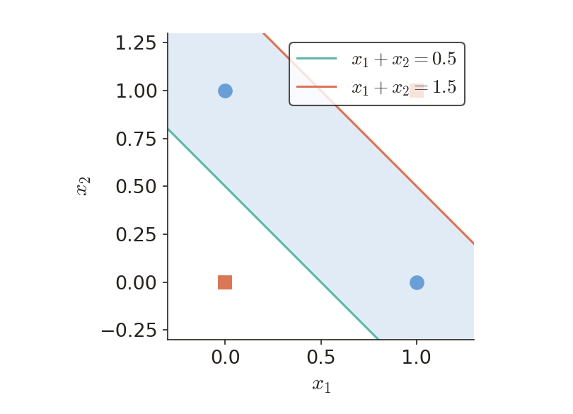

# KP10 網路大小、泛化與早停

!!! note "自主學習"
    本單元（KP10）列為自主學習，課堂不講授，請同學課前或課後自行閱讀。

> 程度：大學三年級（undergrad）｜自主學習教材｜繁體中文版

本份可獨立閱讀；先備為加權計分、基本微分及矩陣。新術語會在使用時說明。

[開啟同語言簡報](../slides/lec05-kp10-network-size.jbd.json)

## 學習目標

- 算出給定架構的參數數，區分單元與參數。
- 用驗證數字選檢查點，區分三種資料角色。
- 解釋區域上界為何不是模型品質保證。

## KP10 網路大小、泛化與早停

**一句話重點**：大小、訓練時間與保留資料一起決定選模，不能只追訓練分數。

**白話說明**：先把「記住訓練答案」與「預測新資料」分開，才知道為何要控制大小。下面的參數計數建立在明確架構上；不同架構不能只拿隱藏單元數比較。

**正式定義**：以下各段會逐一定義名詞、符號與成立條件；公式中的同一個量維持同一符號。

**例子**：所有新增小算例均為［補充］，已用 Python 核對；來源實驗報告另行標示。

**常見迷思**：參數更少或訓練更久，並不各自保證新資料更準。

**小練習**：末段提供先做後核對的題目、提示及解題示範。

### 大小先問能學到什麼

先把「記住訓練答案」與「預測新資料」分開，才知道為何要控制大小。下面的參數計數建立在明確架構上；不同架構不能只拿隱藏單元數比較。

**泛化**：對未參與訓練的新資料仍能正確預測，叫泛化；不是把原來的答案背熟。

圖是連續預測的補充示意；分類也面臨同樣取捨。先找主要規律，再看樣本小波動，不必把每個波動都當成規律。


圖說 `lec05-kp10-trend`：［補充］先看圖中的對照與標籤，再用本段數字核對；圖內的模型示意不代表實驗精確曲線。〔功能：精準度、具象化〕

**自由參數**：訓練時可以獨立改變的數字叫自由參數；權重與偏置都算。

兩個輸入、三個隱藏單元、一個輸出，全部相連，且每個計算單元有偏置。

隱藏層：$(2+1)\times3=9$；輸出層：$(3+1)\times1=4$。總共 $9+4=13$ 個，不是只有三個。

**欠擬合**：模型連主要規律都表達不好，訓練與新資料的表現都可能差，叫欠擬合。

**過擬合**：模型配合這批訓練資料的偶然細節，反而損害新資料預測，叫過擬合。

「較大」不是過擬合的充分條件；資料量、權重大小、限制方式與訓練程序都會影響結果。

### 用保留資料選訓練檢查點

大小固定仍可能過度配合訓練資料，因此要另外控制訓練時間。先看兩條損失曲線，再用五組數字選模型，最後區分驗證與測試的用途。

**驗證集**：不拿來更新權重、用來選模型或訓練檢查點的資料，叫驗證集。

**過度訓練**：架構固定，後續訓練開始追逐訓練集細節，驗證表現反而惡化，稱為過度訓練。

圖中訓練損失持續下降，驗證損失在第 3 輪最低後回升。兩條曲線不必相交，差距也不必從零開始。


圖說 `lec05-kp10-early`：［補充］先看圖中的對照與標籤，再用本段數字核對；圖內的模型示意不代表實驗精確曲線。〔功能：精準度、具象化〕

**早停**：根據驗證表現停止訓練並還原最佳檢查點，叫早停；實作可容許幾次未改善。

第 1–5 輪的驗證損失是 $0.55,0.35,0.25,0.28,0.40$。最小是 $0.25$，在第 3 輪。

第 5 輪的訓練損失較低，驗證卻由 $0.25$ 增至 $0.40$，增加 $0.40-0.25=0.15$。

**訓練集**：用它更新權重，學到資料中的規律。

**驗證集**：用它選大小、懲罰強度及停止點，不直接更新權重。

**測試集**：模型選完後才做最後評估。反覆看它挑模型，就不再是獨立檢查；也要避免重複個體或時間資訊洩漏。

十筆中錯一筆：錯誤率 $1/10=0.1$；錯兩筆：$2/10=0.2$。只差一個案例，估計就差十個百分點。

可用重複切分或交叉驗證輔助選擇，但每次仍須把訓練與評估分開；不能憑空增加獨立資料。

因此沒有一個脫離資料量與任務的「最佳神經元數」。

### 幾何容量上界與 XOR 的實際構造

資料選擇回答預測好不好，幾何計數只回答架構最多能切出幾塊。兩者是不同問題；我們用 XOR 看出最大值和實際值為何不必相同。

**區域數上界**：用 K 個超平面切 d 維空間，區域數最多為 M；一般位置可達此最大值，退化排列可能較少。

$M_{\max}(K,d)=\sum_{m=0}^{d}\binom{K}{m}$。K 是隱藏單元數，d 是輸入維度；$\binom{K}{m}=0$ 若 $m>K$。

一般位置指分界沒有造成重合、平行或多線共點等減少區域的退化情形；條件隨維度改變。


圖說 `lec05-kp10-regions`：［補充］先看圖中的對照與標籤，再用本段數字核對；圖內的模型示意不代表實驗精確曲線。〔功能：精準度、具象化〕

$d=2,K=2$：$M_{\max}=1+2+1=4$；三個組合數分別是選 0、1、2 條線。

XOR 的 $x_1+x_2=0.5$ 與 $x_1+x_2=1.5$ 平行，實際形成三條帶，兩個 A 點住在中間。

「四塊上界容得下三塊」只是容量檢查。兩個單元足夠，還要靠這個明確構造證明。



圖說 `lec05-kp10-xor`：［補充］先看圖中的對照與標籤，再用本段數字核對；圖內的模型示意不代表實驗精確曲線。〔功能：精準度、具象化〕

### 三種選大小的策略

上界沒有告訴我們如何找到合適的權重，於是回到實際模型搜尋。下面比較從大往小與從小往大的兩種方向。

**解析法**：用代數或統計分析估能力，但通常忽略具體的最佳化過程。

**剪枝**：先訓練較大網路，再依規則刪掉較不重要的連線。

**構造式方法**：從小架構逐步增加單元。三條路都需驗證；下一個KP先研究怎麼剪。

### 讀懂來源互動示範的範圍

理論與資料選擇有了區分，再讀來源的正弦示範，就不會把一次實驗當成通用最佳設定。

來源用 15 個訓練點、10 個獨立測試點，目標為 $y=\sin(2\pi x)+\epsilon$，$\epsilon$ 是加到觀測的雜訊。

$\hat y=\sum_{j=1}^{k}v_j\tanh(a_jx+b_j)+c$。a、b、v、c 都可調，參數數為 $3k+1$；k 是隱藏單元數。

來源描述 k 約 3–5 較合適、k=15 可能過擬合；這不是任何資料的通用最佳值，本教材未重跑其訓練。

### 小練習與逐步核對

先遮住解題段落，自己判斷兩題，再用數值核對理由。

題 1：訓練損失為 $0.40,0.20,0.10$，驗證損失為 $0.45,0.25,0.30$。選哪一輪？提示：先找驗證最小值。

題 2：二維三條一般位置直線的最大區域數是多少？提示：算 $\binom30+\binom31+\binom32$；若三線平行還是這個數嗎？

① 驗證值 $0.45,0.25,0.30$ 中，$0.25$ 最小，因此保留第 2 輪；最後一輪的訓練值較低也不改選擇。

② 二維三線：$M_{\max}=1+3+3=7$。三線平行只有四條帶，沒有達到七塊上界。

③ 驗算：第 3 輪驗證比第 2 輪增加 $0.30-0.25=0.05$。選檢查點時，幾何區域數沒有參與這個比較。

#### 為什麼區域數有這個形式？

在一般位置加入第 K 個超平面時，它把原有某些區域切成兩半。這些新切出的部分，對應其他 K−1 個超平面在新平面內形成的低一維區域。因此有遞迴

$$
R(K,d)=R(K-1,d)+R(K-1,d-1).
$$

初始情形為 $R(0,d)=1$、$R(K,0)=1$。利用組合數的 Pascal 關係可得到 $R(K,d)=\sum_{m=0}^d\binom Km$。這個推導計的是空間分割，不包含最後輸出層能否把任意區域標籤分對的條件。

#### 自己可執行的檢查點選擇

```python
validation = [0.55, 0.35, 0.25, 0.28, 0.40]
best_epoch = min(range(len(validation)), key=validation.__getitem__) + 1
assert best_epoch == 3
```

這段只選已提供的檢查點，沒有執行神經網路訓練。真實訓練還要保存及還原該輪的權重、固定資料切分，並記錄使用的評估指標。

#### 平均平方誤差的意義

來源正弦示範是連續數值預測，採平均平方誤差 $L=\frac1N\sum_{n=1}^N(\hat y_n-t_n)^2$；t 是觀測目標，hat y 是預測，N 是這份資料的筆數。例如兩筆誤差為1和−1，$L=(1^2+(-1)^2)/2=1$。分類還要另外指定門檻與分類錯誤率，不可把這兩種指標當成同一量。前面的五組檢查點數字是教學補充，不是這個互動示範的執行結果。


## 術語表與符號提醒

| 中文 | English |
|---|---|
| 泛化 | Generalization |
| 自由參數 | Free parameter |
| 欠擬合 | Underfitting |
| 過擬合 | Overfitting |
| 驗證集 | Validation set |
| 過度訓練 | Overtraining |
| 早停 | Early stopping |
| 測試集 | Test set |
| 區域數上界 | Cell-count bound |

依本段定義讀取符號，特別區分權重、分數、模型預測與損失；不同實驗的同名超參數不一定有相同用途。

## 來源與補充範圍

- [Chapter 4, KP10](https://ndhuccc.github.io/CCC-LNS/PR_115/Ch04-nonlinear-classifiers/index.html#kp10)，讀取日期：2026-10-25。
- 來源將驗證與測試並列、把曲線分岔當停止點，並由區域上界直接推足夠；本教材分別澄清資料角色、驗證最低點與明確構造。一般訓練損失也不保證逐輪單調下降。
- Source reference code: [Mirc 89].
- 來源原圖已檢視：KP10 Figure 4.14；KP11 Figure 4.15、4.16。本教材用自己的圖解講解，沒有把來源圖片或精確實驗曲線冒充新結果。
- 本文使用來源的歷史引用代碼，不宣稱已取得其所有原始論文；無法核對的完整定理與實驗細節均保留限制。
