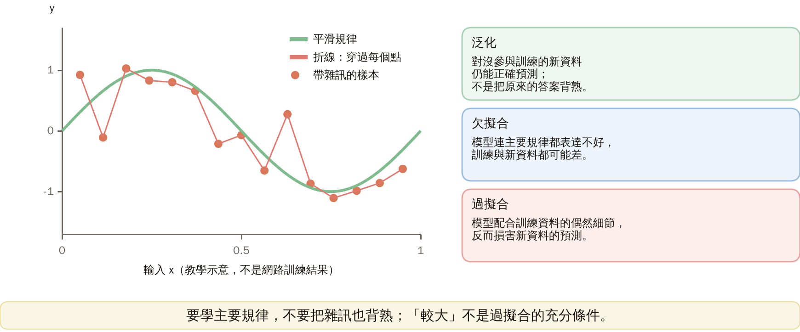
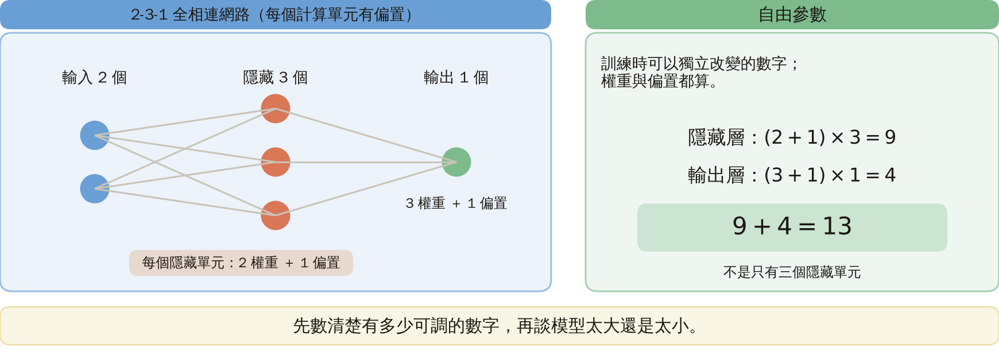
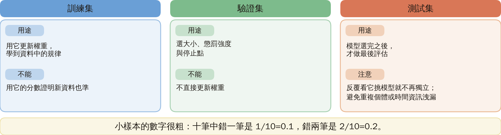
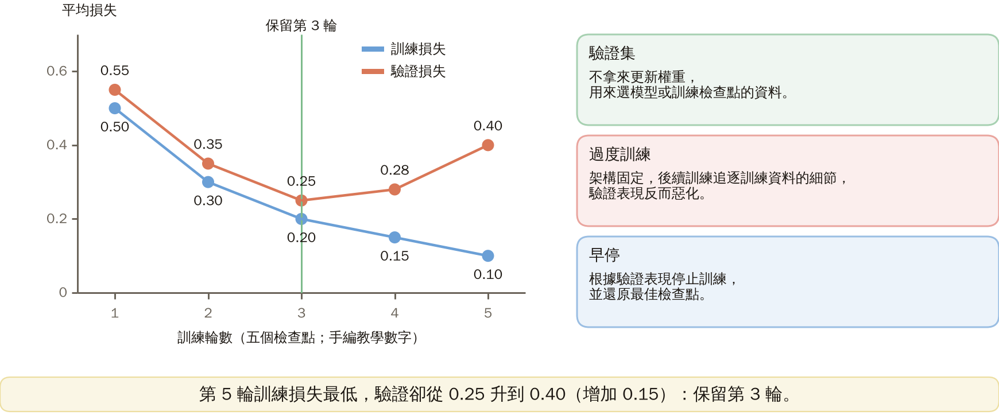
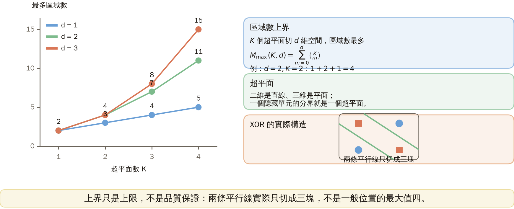
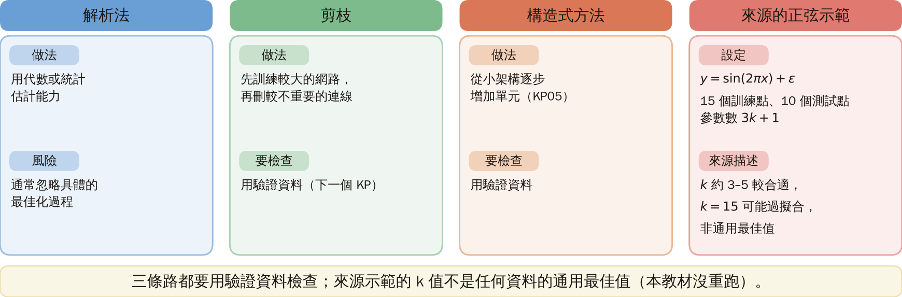
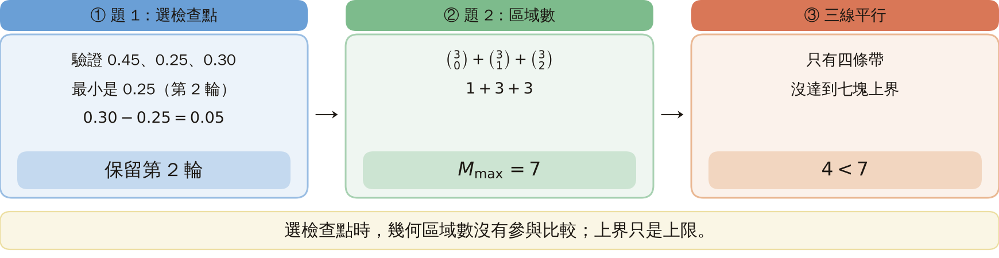

# KP10 網路大小、泛化與早停

!!! note "自主學習"
    本單元（KP10）列為自主學習，課堂不講授，請同學課前或課後自行閱讀。

> 程度：大學三年級
>
> 圖型識別｜第四章

[簡報閱讀與下載](../slides/lec05-kp10-network-size.jbd.json) | [English version](en/lec05-kp10-network-size.md)

## 學習目標

- 能算出給定架構的參數個數，並分清「單元」與「參數」。
- 能用驗證資料的數字選出訓練檢查點，並分清訓練、驗證、測試三種資料的用途。
- 能說明幾何容量上界只是上限，不是模型品質的保證。

## KP10 網路大小、泛化與早停

**一句話重點**：網路要多大、要訓練多久，不能只看訓練分數；要用沒參與訓練的資料一起決定。

### 先備與符號

**你需要先會的三件事**：

- **損失與代價**（KP06、KP09）：損失是預測與目標差多少的罰分；代價是各筆損失的平均。
- **前向傳遞與參數**（KP06）：每個單元有權重與偏置，訓練就是調整它們。
- **超平面**（KP03）：二維是直線、三維是平面；一個隱藏單元的分界線就是一個超平面。

**符號表**（本講義固定使用）：

| 符號 | 意義 | 說明 |
|---|---|---|
| $d$ | 輸入的維度 | 二維資料 $d=2$ |
| $K$、$k$ | 隱藏單元的個數 | 第 5 節用 $K$（超平面數），第 7 節用 $k$ |
| $M_{\max}(K,d)$ | $K$ 個超平面在 $d$ 維空間切出的區域數上限 | 第 5 節 |
| $L$ | 平均平方誤差 | $L=\frac1N\sum_n(\hat y_n-t_n)^2$ |
| $N$ | 這份資料的筆數 | |
| $t_n,\hat y_n$ | 第 $n$ 筆的目標與預測 | |

### 1. 為什麼要控制大小：先分清「背熟」與「學會」

**白話說明**：訓練分數很高，不代表新資料也準。要控制網路的大小，就是要避免只背熟訓練資料。

- **泛化**：對沒參與訓練的新資料仍能正確預測；不是把原來的答案背熟。

圖是連續預測的補充示意，分類也面臨同樣取捨：先找主要規律，再看樣本的小波動；不必把每個波動都當成規律。



圖說 `lec05-kp10-trend`：［補充］先看圓點（帶雜訊的樣本）散在一條平滑曲線上下，再看折線把每個點都穿過去：它背熟了雜訊，不是學到規律。折線僅作教學示意，不是網路訓練結果。〔功能：1、2〕

接下來的問題：網路到底有多少個可以調的數字？

### 2. 自由參數怎麼數，欠擬合與過擬合

- **自由參數**：訓練時可以獨立改變的數字；權重與偏置都算。

**計數例子**：兩個輸入、三個隱藏單元、一個輸出，全部相連，每個計算單元有偏置。

- 隱藏層：每個隱藏單元有 2 個權重加 1 個偏置，$(2+1)\times3=9$。
- 輸出層：輸出單元有 3 個權重加 1 個偏置，$(3+1)\times1=4$。
- 總共 $9+4=13$ 個，不是只有三個隱藏單元。

圖說 `lec05-kp10-params`：先看左邊三層網路，再看右邊的計算：隱藏層 $(2+1)\times3=9$、輸出層 $(3+1)\times1=4$，合計 13。〔功能：2〕



兩種相反的失敗：

- **欠擬合**：模型連主要規律都表達不好，訓練與新資料的表現都可能差。
- **過擬合**：模型配合這批訓練資料的偶然細節，反而損害新資料的預測。

「較大」不是過擬合的充分條件；資料量、權重大小、限制方式與訓練程序都會影響結果。

接下來的問題：架構固定了，訓練多久才好？

### 3. 用保留資料選訓練檢查點

大小固定也可能過度配合訓練資料，所以要另外控制訓練時間。

- **驗證集**：不拿來更新權重、用來選模型或訓練檢查點的資料。
- **過度訓練**：架構固定，後續訓練開始追逐訓練集的細節，驗證表現反而惡化。
- **早停**：根據驗證表現停止訓練並還原最佳檢查點；實作可以容許幾次沒改善。

**示意數字**（手編的教學數字，不是實驗結果）：每個檢查點算訓練損失與驗證損失。

| 輪數 | 1 | 2 | 3 | 4 | 5 |
|---|---:|---:|---:|---:|---:|
| 訓練損失 | 0.50 | 0.30 | 0.20 | 0.15 | 0.10 |
| 驗證損失 | 0.55 | 0.35 | 0.25 | 0.28 | 0.40 |

圖說 `lec05-kp10-roles`：比較三欄：各個資料集用來做什麼、不能拿來做什麼。〔功能：2〕



- 驗證損失最小是 $0.25$，在第 3 輪，所以保留第 3 輪的權重。
- 第 5 輪的訓練損失最低，驗證損失卻從 $0.25$ 升到 $0.40$，增加 $0.40-0.25=0.15$。

圖說 `lec05-kp10-early`：先看藍線（訓練損失）一路下降，再看橘線（驗證損失）在第 3 輪最低後回升；虛線標出要保存的第 3 輪。兩條曲線不必相交，差距也不必從零開始。〔功能：2〕



接下來的問題：驗證資料用來選模型了，最後該用什麼資料報告成績？

### 4. 三種資料各司其職

- **訓練集**：用它更新權重，學到資料中的規律。
- **驗證集**：用它選大小、懲罰強度及停止點，不直接更新權重。
- **測試集**：模型選完之後才做最後評估。反覆看它來挑模型，就不再是獨立檢查；也要避免重複個體或時間資訊洩漏。

**小樣本的數字很粗**：十筆中錯一筆，錯誤率 $1/10=0.1$；錯兩筆是 $2/10=0.2$。只差一個案例，估計就差十個百分點。

可用重複切分或交叉驗證輔助選擇，但每次仍須把訓練與評估分開；不能憑空增加獨立資料。因此沒有一個脫離資料量與任務的「最佳神經元數」。

**常見迷思**：參數更少、或訓練更久，並不各自保證新資料更準。

接下來的問題：能不能不訓練，直接從架構算出它的能力上限？

### 5. 幾何容量上界與 XOR 的實際構造

資料選擇回答「預測好不好」，幾何計數只回答「架構最多能切出幾塊」。兩者是不同的問題。

**正式定義（區域數上界）**：用 $K$ 個超平面切 $d$ 維空間，區域數最多為

$$
M_{\max}(K,d)=\sum_{m=0}^{d}\binom{K}{m},
$$

$\binom Km$ 是從 $K$ 個挑 $m$ 個的方法數，若 $m>K$ 則為 0。一般位置（沒有重合、平行或多線共點等會減少區域的退化情形）可達此最大值；退化的排列可能較少。

**數值表**：

| $d$ \ $K$ | 1 | 2 | 3 | 4 |
|---|---:|---:|---:|---:|
| 1 | 2 | 3 | 4 | 5 |
| 2 | 2 | 4 | 7 | 11 |
| 3 | 2 | 4 | 8 | 15 |

例：$d=2,K=2$：$M_{\max}=1+2+1=4$；三個組合數分別是選 0、1、2 條線。

圖說 `lec05-kp10-regions`：先看橫軸的超平面數 $K$，再比較不同輸入維度 $d$ 的曲線：維度越高、線越多，最大區域數增加越快。右下角小圖是 XOR 的實際構造：兩條平行線只切成三塊。〔功能：2、3〕



**XOR 的實際構造**：KP01 的 $x_1+x_2=0.5$ 與 $x_1+x_2=1.5$ 平行，實際只切成三條帶，兩個 A 點住在中間那條。「四塊上界容得下三塊」只是容量檢查；兩個單元夠不夠，還要靠這個明確構造來證明。

接下來的問題：上界沒有告訴我們怎麼找到適合的大小。實際上有哪些策略？

### 6. 三種選大小的策略

- **解析法**：用代數或統計分析估計能力，但通常忽略具體的最佳化過程。
- **剪枝**：先訓練較大的網路，再依規則刪掉較不重要的連線（下一個 KP）。
- **構造式方法**：從小架構逐步增加單元（KP05）。

三條路都需要用驗證資料檢查。

圖說 `lec05-kp10-strategies`：逐欄比較三種策略；第四欄是來源的示範設定，不是通用最佳值。〔功能：2〕



### 7. 讀懂來源互動示範的範圍

來源有一個正弦示範，我們只說明它的設定，不把一次實驗當成通用最佳設定。

- 目標：$y=\sin(2\pi x)+\epsilon$，$\epsilon$ 是加到觀測上的雜訊。
- 資料：15 個訓練點、10 個獨立測試點。
- 模型：$\hat y=\sum_{j=1}^{k}v_j\tanh(a_jx+b_j)+c$，$k$ 是隱藏單元數；$a_j,b_j,v_j,c$ 都可調，參數數為 $3k+1$。

來源描述 $k$ 約 3 到 5 較合適、$k=15$ 可能過擬合。這不是任何資料的通用最佳值；本教材沒有重跑這個訓練。

### 延伸：練習、遞迴推導與程式

**小練習**：

1. 訓練損失為 $0.40,0.20,0.10$，驗證損失為 $0.45,0.25,0.30$。選哪一輪？提示：先找驗證最小值。
2. 二維三條一般位置直線的最大區域數是多少？提示：算 $\binom30+\binom31+\binom32$；若三線平行還是這個數嗎？

**題 1 解題示範**：驗證值 $0.45,0.25,0.30$ 中，$0.25$ 最小，因此保留第 2 輪；最後一輪的訓練值較低也不改選擇。第 3 輪驗證比第 2 輪增加 $0.30-0.25=0.05$。

**題 2 解題示範**：$M_{\max}=1+3+3=7$。三線平行只有四條帶，沒有達到七塊上界。選檢查點時，幾何區域數沒有參與比較。

圖說 `lec05-kp10-solution`：由左到右看三個框：選第 2 輪、算 1+3+3=7、三線平行只有四條帶。〔功能：3〕



**為什麼區域數是這個形式**：在一般位置加入第 $K$ 個超平面時，它把原有某些區域切成兩半。新切出的部分，對應其他 $K-1$ 個超平面在新平面內形成的低一維區域，所以

$$
R(K,d)=R(K-1,d)+R(K-1,d-1),\qquad R(0,d)=1,\ R(K,0)=1 .
$$

利用組合數的 Pascal 關係得 $R(K,d)=\sum_{m=0}^d\binom Km$。這個推導只計空間分割，不包含輸出層能否把任意區域標籤分對。

**平均平方誤差**：來源的正弦示範是連續預測，用 $L=\frac1N\sum_{n=1}^N(\hat y_n-t_n)^2$。例：兩筆誤差為 1 和 $-1$，$L=(1^2+(-1)^2)/2=1$。分類另外要指定門檻與錯誤率，不可把兩者當成同一個量；前面五組檢查點數字是教學補充，不是這個示範的執行結果。

**自己可執行的檢查點選擇**：

```python
validation = [0.55, 0.35, 0.25, 0.28, 0.40]
best_epoch = min(range(len(validation)), key=validation.__getitem__) + 1
assert best_epoch == 3
```

這段只選已提供的檢查點，沒有訓練神經網路。真實訓練還要保存與還原該輪的權重、固定資料切分，並記錄評估指標。

## 術語與來源

| 中文 | English |
|---|---|
| 泛化 | Generalization |
| 自由參數 | Free parameter |
| 欠擬合 | Underfitting |
| 過擬合 | Overfitting |
| 驗證集 | Validation set |
| 過度訓練 | Overtraining |
| 早停 | Early stopping |
| 訓練集、測試集 | Training set, test set |
| 區域數上界 | Cell-count bound |
| 超平面 | Hyperplane |

來源：[第四章 KP10](https://ndhuccc.github.io/CCC-LNS/PR_115/Ch04-nonlinear-classifiers/index.html#kp10)（2026-10-25 讀取）；參考代碼 [Mirc 89]。來源把驗證與測試並列、把曲線分岔當停止點，並由區域上界直接推出足夠；本講義分別澄清資料角色、驗證最低點與明確構造。一般訓練損失不保證逐輪單調下降。本講義的五個檢查點數字與小練習為［補充］，已用 Python 核對；來源實驗的曲線未重跑。
