# KP11 剪枝、正則化與模擬實證

!!! note "自主學習"
    本單元（KP11）列為自主學習，課堂不講授，請同學課前或課後自行閱讀。

> 程度：大學三年級
>
> 圖型識別｜第四章

[簡報閱讀與下載](../slides/lec05-kp11-pruning-regularization.jbd.json) | [English version](en/lec05-kp11-pruning-regularization.md)

## 學習目標

- 能由 Taylor 近似推導「顯著度」，並說出推導的假設。
- 能手算懲罰值、刪除代價與補償例子。
- 能區分來源的模擬報告與本講義的教學計算。

## KP11 剪枝、正則化與模擬實證

**一句話重點**：先估計刪掉一條連線的代價，再用懲罰與驗證資料控制模型；權重大小或連線數量，都不是唯一的判準。

### 先備與符號

**你需要先會的四件事**：

- **代價與權重**（KP06）：代價 $J$ 隨每個權重 $w_i$ 變化；梯度 $g_i=\partial J/\partial w_i$ 是代價對 $w_i$ 的斜率。
- **二階導數與曲率**：二階導數說明斜率改變得多快；曲率大，代表走一小步代價就變很多。
- **泰勒（Taylor）展開**：在一點附近，用斜率與曲率近似一個函數的變化。
- **驗證資料**（KP10）：不參與更新權重、專門用來選模型的資料。

**符號表**（本講義固定使用）：

| 符號 | 意義 | 說明 |
|---|---|---|
| $w_i$、$\delta w_i$ | 第 $i$ 個權重、它的修改量 | 刪除就是 $\delta w_i=-w_i$ |
| $J$、$\Delta J$ | 代價、刪除後減去刪除前的代價 | $\Delta J$ 不是權重的大小 |
| $g_i$ | 當地斜率 | $\partial J/\partial w_i$ |
| $H$、$H_{ii}$ | 海森矩陣、它的對角元 | 二階偏導數排成的矩陣；$H_{ii}$ 是第 $i$ 個方向的曲率 |
| $s_i$ | 顯著度 | $s_i=\frac12H_{ii}w_i^2$ |
| $\alpha$ | 懲罰的比重（正則化） | 第 4 節；注意與動量的 $\alpha$ 不同 |
| $\tau,\varepsilon$ | 懲罰的尺度、刪除的門檻 | 兩者用途不同 |
| $\rho(w)$ | 飽和懲罰 | $\rho=w^2/(\tau^2+w^2)$ |

### 1. 刪除量不等於刪除代價

**白話說明**：已經訓練好的網路可能有冗餘，但不能只看權重大小就判斷哪條連線重要。

- **剪枝**：移除部分連線或單元，減少模型可調的部分；刪除後仍需檢查表現。

先看單條連線：把它的權重設成零，等於這條輸入不再貢獻分數。目標不是「刪最多」，而是在可接受的損失下，換到較簡單的模型。

- $w_i$ 是第 $i$ 個權重，$\delta w_i$ 是修改量。要設成零，$w_i+\delta w_i=0$，所以 $\delta w_i=-w_i$。
- $J$ 是訓練代價，$\Delta J$ 是刪除後減去刪除前的代價；它不是權重的大小。
- 若 $w_i=0.2$，刪除就是加上 $-0.2$。別把「只改一點點」當成「影響一定小」。

**曲率**：在目前權重附近，曲率描述損失的斜率改變得多快；這裡用二階導數衡量。

**海森矩陣**：把權重之間所有二階偏導數排成矩陣 $H$；$H_{ii}$ 描述第 $i$ 個方向的曲率。

圖說 `lec05-kp11-curvature`：先看左邊兩張圖：A 的權重 0.2 但曲線陡（曲率 100），刪除代價 2；B 的權重 1 但曲線平（曲率 0.02），刪除代價 0.01；右側三張卡片是剪枝、曲率、海森矩陣的定義。〔功能：2〕

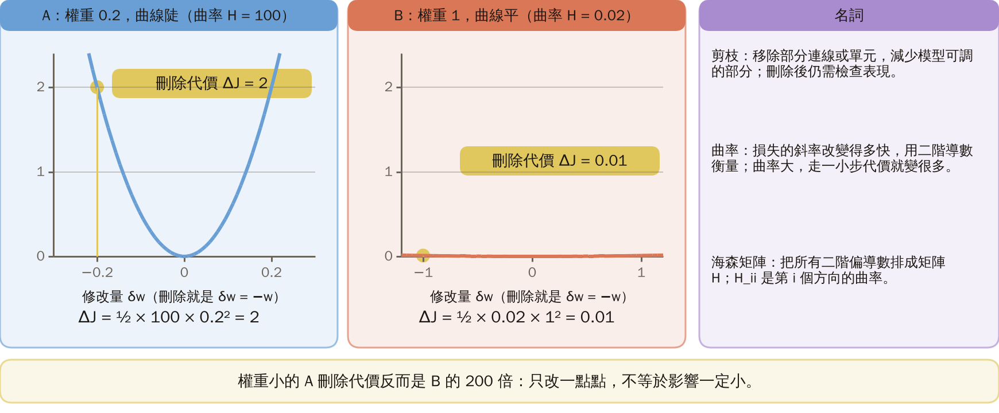

接下來的問題：能不能用斜率與曲率，在不真的刪除之前估計刪除代價？

### 2. 從 Taylor 展開得到顯著度

**推導，一步一步來**：

1. 代價的變化可近似為：$\Delta J\approx\sum_i g_i\delta w_i+\frac12\sum_{i,j}H_{ij}\delta w_i\delta w_j$。
2. 接近極小值時取 $g_i\approx0$，第一項消失。
3. 用「對角近似」忽略不同權重的交互項，得 $\Delta J\approx\frac12\sum_iH_{ii}(\delta w_i)^2$。
4. 代入 $\delta w_i=-w_i$，定義**顯著度** $s_i=\frac12H_{ii}w_i^2$，它是刪除代價的估計；是近似，不是實測損失。

**手算例子**：

- A：$w_A=0.2$、$H_{AA}=100$，$s_A=\frac12\times100\times0.2^2=2$。
- B：$w_B=1$、$H_{BB}=0.02$，$s_B=\frac12\times0.02\times1^2=0.01$。
- 比較：$2/0.01=200$。依這個局部估計先刪 B，雖然它的權重較大。

圖說 `lec05-kp11-saliency`：由上而下看左邊四步：泰勒展開、g≈0、對角近似、代入 δw=−w 得顯著度；再看右邊對數刻度上 A（2）與 B（0.01）的長條，相差 200 倍。〔功能：2〕

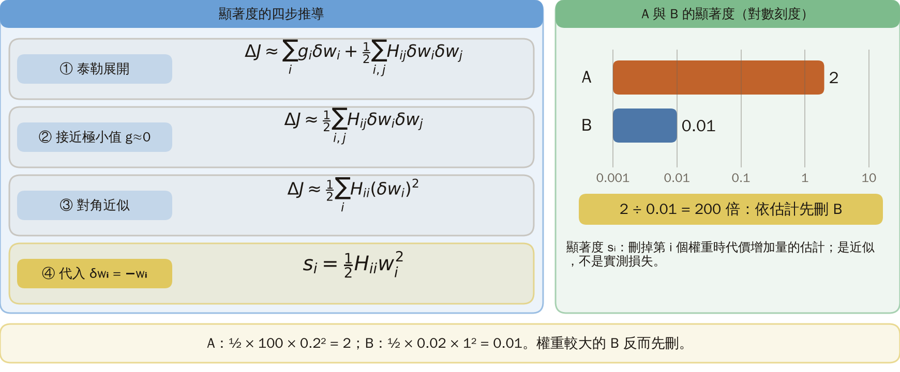

**這個估計的條件**：

- 尚未接近極小值時，一階項未必小。
- 刪除幅度太大時，高階項也可能不可忽略。
- 同時刪多個權重可能有耦合。
- 若海森矩陣有負曲率，不能把負數直接解讀成「安全」。

所以要小步驟刪除、重新量測代價、再訓練剩餘權重，並保留最佳驗證模型。

接下來的問題：怎麼把這個估計放進實際的剪枝流程？

### 3. 把估計放進可檢查的剪枝程序

顯著度不是刪除後的實測值，所以流程必須包含重新評估與再訓練，不能把一個排序永久當成真理。

1. 先訓練到合適的位置。
2. 估每條連線的顯著度。
3. 刪少量低顯著度的連線。
4. 再訓練並用驗證資料檢查。

圖說 `lec05-kp11-flow`：上面由左到右看四步循環：訓練、估顯著度、少量刪除、再訓練並用驗證資料檢查，然後回到第 2 步；下面四格是這個估計會失準的情況。〔功能：2〕

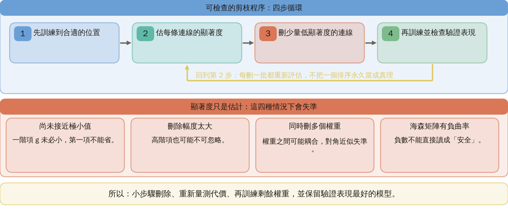

依驗證表現、允許的損失增加或資源預算停止；刪除後的較小網路不保證每次都更準。完整海森矩陣的方法還能考慮其他權重如何補償，代價是較高的儲存與計算需求。

### 4. 在代價函數中加入模型偏好

剪枝改結構，正則化先改目標。

- **正則化**：在資料誤差之外加入對模型的限制或偏好；它改變我們願意接受的解。

$$
J_{\mathrm{total}}=J_{\mathrm{data}}+\alpha P(\mathbf w).
$$

第一項量資料誤差，$P$ 是權重懲罰，$\alpha\ge0$ 控制相對比重。若資料誤差採總和或平均，尺度不同，同一個數值的 $\alpha$ 也有不同作用，不能直接跨設定照抄。

**例子**（$\alpha=0.1$）：

| 模型 | 資料誤差 | 懲罰 $P$ | $J_{\text{total}}$ |
|---|---:|---:|---:|
| A | 0.10 | 4 | $0.10+0.1\times4=0.50$ |
| B | 0.20 | 1 | $0.20+0.1\times1=0.30$ |

此目標選 B。若 $\alpha=0$，反而選 A。$\alpha$ 應以驗證資料選擇；總代價較小不等於測試誤差必然較小。

圖說 `lec05-kp11-reg`：先看上面的總代價公式，再比較兩個面板的堆疊長條：α=0.1 時 A 是 0.50、B 是 0.30，選 B；α=0 時只看資料誤差，選 A。〔功能：2〕

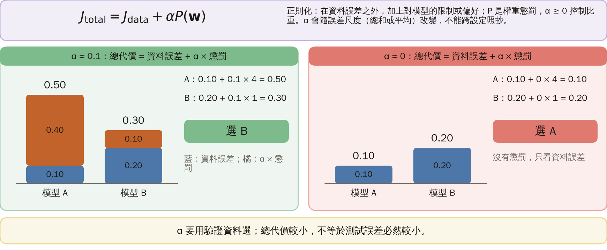

**飽和懲罰**：$\rho(w)=w^2/(\tau^2+w^2)$，$\tau>0$ 是尺度；權重很大時懲罰接近 1，叫飽和。懲罰總和 $P=\sum_i\rho(w_i)$。

取 $\tau=1$：

| $w$ | 0.2 | 1 | 3 |
|---|---:|---:|---:|
| $\rho(w)$ | $0.04/1.04\approx0.0385$ | 0.5 | 0.9 |

比較尺度時要用絕對值：$|w|\ll\tau$ 才是接近零的區段。

圖說 `lec05-kp11-rho`：先看綠色曲線在 w 小時貼近 0、大時飽和到 1，再讀三個點：w=0.2、1、3 時約 0.0385、0.5、0.9；橘色曲線是導數，在原點為零，所以平滑的懲罰本身不保證精確的零權重。〔功能：2〕

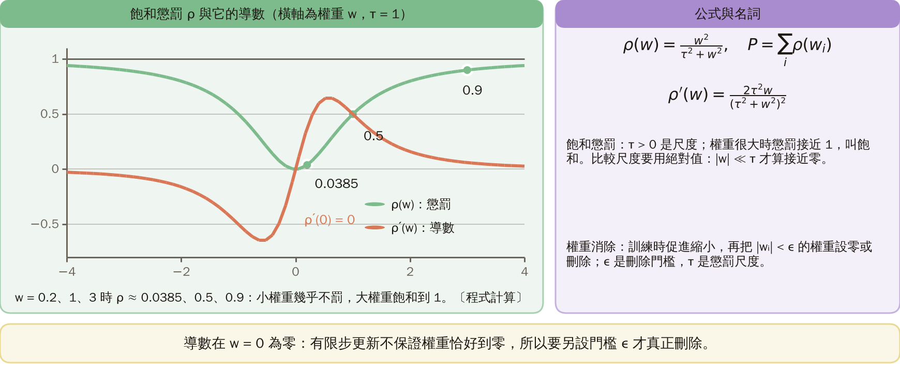

**導數**：$\rho'(w)=2\tau^2w/(\tau^2+w^2)^2$。在 $w=0$ 時導數是 0，所以有限步的更新不保證恰好到零。

**權重消除**：訓練時促進縮小，再定期把小於門檻的權重設零或刪除。門檻以 $|w_i|<\varepsilon$ 判斷；$\varepsilon$ 是刪除門檻，$\tau$ 是懲罰尺度，兩者用途不同。

接下來的問題：只看單一連線夠嗎？單元輸出與權重範數又怎麼影響複雜度？

### 5. 單元輸出與權重範數也需要考慮

一條連線不是整個單元，一個單元也不是整條訊號路徑。

- 來源還考慮對神經元輸出加懲罰，鼓勵某些單元的反應變小；不是只對單一連線計分。
- 單元輸出小，仍可能被很大的下一層權重放大；應檢查整條路徑，以及刪除後的資料表現。
- 刪連線、刪單元、縮小數值是三種不同的操作，必須分別記錄。

來源引述兩層 sigmoid 網路的結果：在小訓練誤差與權重範數限制等條件下，複雜度項包含 $A^3\sqrt{\log d/N}$。$A$ 是每個單元權重絕對值和的共同上界，$d$ 是輸入維度，$N$ 是樣本數。這只是來源的量級摘要，不是完整的機率界。固定 $d,N$、把 $A$ 加倍，此項變為 $2^3=8$ 倍；不能把它直接當成分類錯誤率。

圖說 `lec05-kp11-ops`：逐欄比較：刪連線、刪單元、縮小數值是三種不同的操作；最右欄是來源的複雜度項，A 加倍變 8 倍，只是量級摘要，不是分類錯誤率。〔功能：2〕

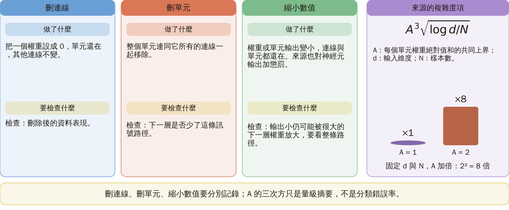

### 6. 級聯相關法用新單元補殘差

另一條路從小架構出發：先找與殘差有關的反應，凍結後再讓輸出側降低誤差；兩個階段不能混成同一個訓練目標。

- **殘差**：真實目標減去目前預測，$e_n=t_n-\hat y_n$，$n$ 是樣本編號。
- **級聯相關法**：每次增加一個能回應目前殘差的隱藏單元，再重訓輸出。

新單元接收原輸入與先前的隱藏單元；先訓練它的輸入側權重，之後凍結這些權重。

**教學分數**（單輸出）：候選輸出 $v$ 與殘差 $e$ 的 $S=\left|\sum_n(v_n-\bar v)(e_n-\bar e)\right|$，橫線代表樣本平均。

- 取 $e=(-1,1)$：候選 $v=(-1,1)$ 得 $S=|-1\times(-1)+1\times1|=2$。
- 常數候選 $v=(1,1)$ 中心化後為零，得 $S=0$。

選好候選並凍結輸入側後，重訓輸出側權重以降低平方誤差。這裡的 $S$ 沒有除標準差，不是 Pearson 係數。

圖說 `lec05-kp11-cascade`：先看上面的階段與四步（兩個階段分開）和殘差、級聯相關法的定義；下面是教學分數 S：候選 v=(−1,1) 得 2，常數候選得 0。〔功能：2〕

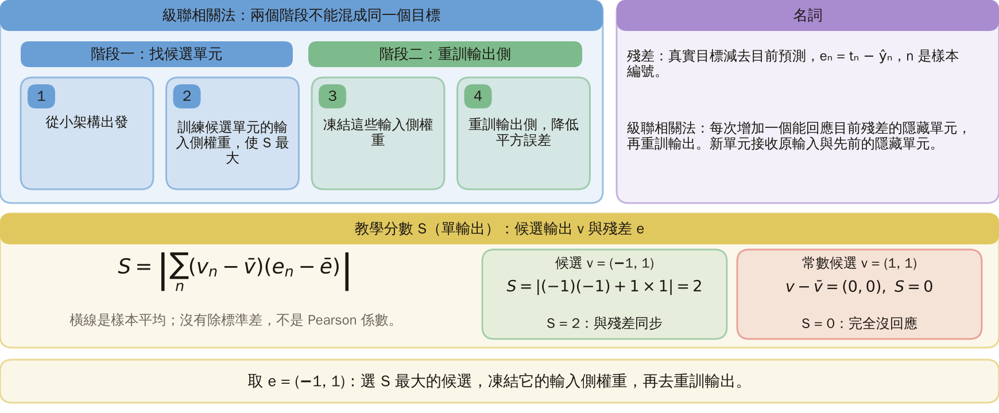

### 7. 把來源模擬報告與本次計算分開

下面完整保留來源的重要設定與報告數字。重新抽樣的散點圖只檢查分布；權重長條只比較報告的數量；沒有用教學示意冒充重跑原實驗。

**資料設定**（來源）：

- A 類四個均值：$(0.4,0.9),(2.0,1.8),(2.3,2.3),(2.6,1.8)$；B 類：$(1.5,1.0),(1.9,1.0),(1.5,3.0),(3.3,2.6)$。
- 每群 50 點，共 $8\times50=400$ 點。
- 每群協方差 $0.08I$（$I$ 是二維單位矩陣），標準差 $\sqrt{0.08}\approx0.283$，不是 0.08。

圖說 `lec05-kp11-data`：先看八個群的位置（A 四群、B 四群）與它們互相穿插的情形；右側是資料、網路與兩組動量設定。圖用相同的分布設定與固定種子 20261025 重抽，只核對資料分布，不是原始樣本，也沒有重跑網路訓練。〔功能：1〕

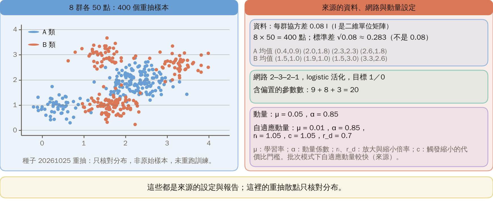

**網路與訓練設定**（來源）：

- 網路為 2–3–2–1，logistic 活化的斜率參數為 1，目標為 1／0；計入偏置的參數數為 $9+8+3=20$。
- 動量設定：$\mu=0.05$、$\alpha=0.85$。
- 自適應動量：$\mu=0.01$、$\alpha=0.85$、$r_i=1.05$、$c=1.05$、$r_d=0.7$。
- 這裡 $\mu$ 是學習率，$\alpha$ 是動量係數，$r_i,r_d$ 是學習率放大與縮小的倍率，$c$ 是觸發縮小的代價比門檻；同名的 $\alpha$ 在第 4 節用途不同。
- 來源報告：批次模式下自適應動量較快。

**剪枝報告**（來源）：兩個各 20 單元的隱藏層，先訓練含 480 權重的模型，每 100 輪檢查顯著度，最後保留 25 個權重。

- 剩下比例 $25/480\approx0.0521$，約 5.21%。
- 刪除 $480-25=455$ 個，約 94.79%。
- 來源報告效能改善，邊界由彎曲變得近似直線；這個案例不能保證剪枝普遍提升泛化。

圖說 `lec05-kp11-counts`：左邊先看三根長條：剪枝前 480、刪除 455、保留 25，再讀比例：保留約 5.21%、刪除約 94.79%；右邊是［補充］p=0.5 等高線，不是訓練實驗。來源案例報告權重數從 480 減至 25；本講義未宣稱重跑原實驗。〔功能：2〕

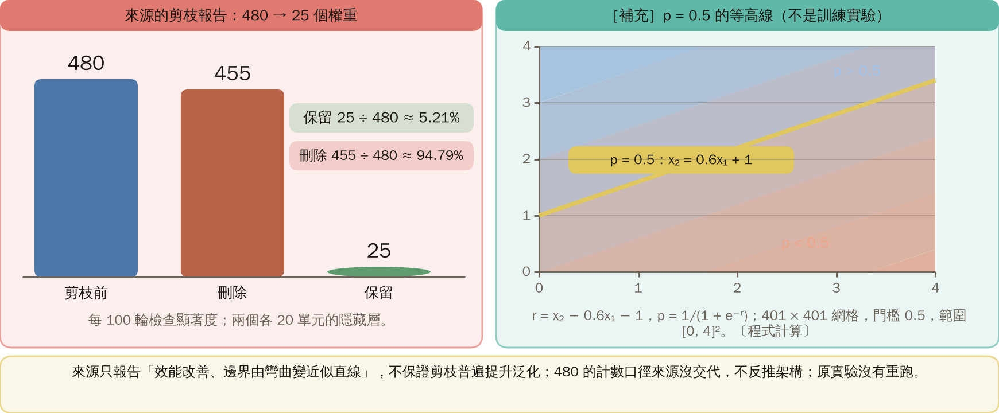

**補充示範**（不是來源訓練出的模型）：取輸入分數 $r=x_2-0.6x_1-1$，連續輸出 $p=1/(1+e^{-r})$，以 0.5 為門檻。在二維座標鋪網格（$401\times401$）、計算每點 $p$、畫出 $p=0.5$ 的等高線；只有類別值才會在 0 與 1 之間翻轉。網格解析度、門檻與座標範圍都要記錄；平滑的圖形不等於正確率的比較。

### 延伸：完整二階補償、練習與推導

**補充二次例子**：$H=\begin{bmatrix}4&1\\1&2\end{bmatrix}$，刪除 $w_1=0.5$，所以 $\delta w_1=-0.5$。

- 若 $\delta w_2=0$：代價 $\frac12\times4\times0.5^2=0.5$。
- 允許補償：$\Delta J=0.5-0.5\delta w_2+(\delta w_2)^2$。
- 對 $\delta w_2$ 微分得 $-0.5+2\delta w_2=0$，取 $\delta w_2=0.25$；代價 $0.5-0.125+0.0625=0.4375$，比 0.5 小。

圖說 `lec05-kp11-comp`：由左到右看三步：只刪 w₁ 代價 0.5；允許 w₂ 補償出現交叉項；取最小得 δw₂=0.25、代價 0.4375；右邊是拋物線與中心差分的數值檢查。〔功能：2〕

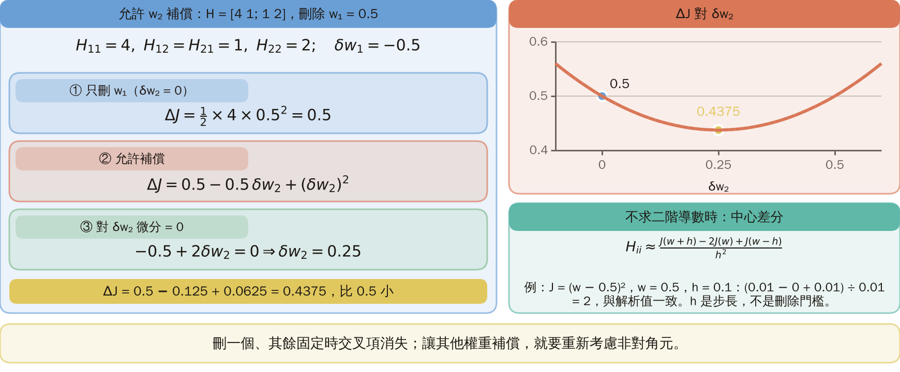

**小練習**：

1. C 的權重 0.5、曲率 8；D 的權重 2、曲率 0.1。依顯著度先刪誰？提示：先算 $s=Hw^2/2$。
2. 取 $\tau=2$、$w=2$，算 $\rho(w)$。它是否已經代表這個權重被刪掉？提示：區分懲罰與實際操作。

**題 1 解題示範**：$s_C=\frac12\times8\times0.5^2=1$；$s_D=\frac12\times0.1\times2^2=0.2$。依估計先刪 D。

**題 2 解題示範**：$\rho(2)=2^2/(2^2+2^2)=4/8=0.5$。權重仍是 2，只有執行設零或移除才叫刪除。

**驗算**：較大的權重也可以有較小的顯著度。下一個 KP 改問：能否一開始就讓多條連線共用少數參數？

圖說 `lec05-kp11-solution`：由左到右看兩個框：C 與 D 的顯著度 1 與 0.2，先刪 D；ρ(2)=0.5，權重仍是 2；懲罰不等於刪除。〔功能：3〕

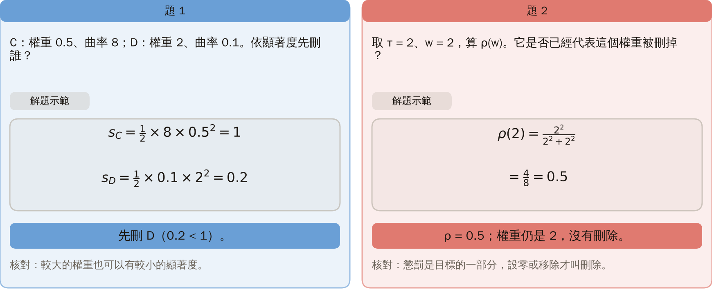

**把 Taylor 近似的條件寫完整**：記目前權重向量為 $\mathbf w$、擾動為 $\delta\mathbf w$。若代價二次可微，附近可寫成

$$
J(\mathbf w+\delta\mathbf w)-J(\mathbf w)\approx\nabla J(\mathbf w)^T\delta\mathbf w+\frac12\delta\mathbf w^TH\delta\mathbf w.
$$

接近駐點才可忽略第一項。對角近似是計算上的簡化，不代表所有神經網路的權重真的互相獨立。若只刪一個權重且其餘固定，二階交叉項因其他擾動為零而消失；若讓其他權重補償，就必須重新考慮非對角元素。上面的 $2\times2$ 例子正好展示這個差別。

**飽和懲罰的導數**：令 $u=w^2$、$v=\tau^2+w^2$，由商數微分法則

$$
\rho'(w)=\frac{2w(\tau^2+w^2)-w^2(2w)}{(\tau^2+w^2)^2}=\frac{2\tau^2w}{(\tau^2+w^2)^2}.
$$

正權重的導數為正，梯度下降的懲罰部分往零拉；負權重則往相反方向拉回零。很大的權重處導數也很小，因為曲線已飽和。這不是凸的 L1 懲罰，也不能保證有限次更新得到精確的零。

**來源報告的計數疑義**：來源報告剪枝模型有兩個各 20 單元的隱藏層及 480 個權重，但沒有完整交代輸入、輸出及偏置的計數口徑。不能反推一個唯一的架構，再把推得的數字當成原文事實。400 樣本的 2–3–2–1 模擬與 480→25 的剪枝展示分開記錄，不假定是同一批資料。

**不直接求二階導數時的數值檢查**：只沿第 $i$ 個權重改動小步長 $h$，其他權重固定，可用中心差分估計

$$
H_{ii}\approx\frac{J(\mathbf w+h\mathbf e_i)-2J(\mathbf w)+J(\mathbf w-h\mathbf e_i)}{h^2}.
$$

$\mathbf e_i$ 是第 $i$ 個座標為 1、其餘為 0 的方向；$h$ 是差分步長，不是刪除門檻。取 $J(w)=(w-0.5)^2$、目前 $w=0.5$、$h=0.1$，三個代價為 $0.01,0,0.01$，估得 $(0.01-2\times0+0.01)/0.01=2$，與解析的二階導數一致。步長太大會有近似誤差，太小可能有浮點相消；不能把差分公式當成完全精確的黑盒。

## 術語與來源

| 中文 | English |
|---|---|
| 剪枝 | Pruning |
| 曲率 | Curvature |
| 海森矩陣 | Hessian |
| 顯著度 | Saliency |
| 正則化 | Regularization |
| 飽和懲罰 | Saturating penalty |
| 權重消除 | Weight elimination |
| 殘差 | Residual |
| 級聯相關法 | Cascade correlation |
| 泰勒展開 | Taylor expansion |

來源：[第四章 KP11](https://ndhuccc.github.io/CCC-LNS/PR_115/Ch04-nonlinear-classifiers/index.html#kp11)（2026-10-25 讀取）；參考代碼 [Lecu 90], [Hass 93], [Wein 90], [Bart 98], [Fahl 90]。480→25、每 100 輪檢查與兩組動量參數均為來源報告；本次沒有重跑這些實驗，也沒有原始的精確曲線。Bartlett 結果只有來源的量級摘要，未讀得原始完整定理，不作無條件的誤差證書。本講義的手算例子、重抽散點圖與練習為［補充］，已用 Python 核對。
