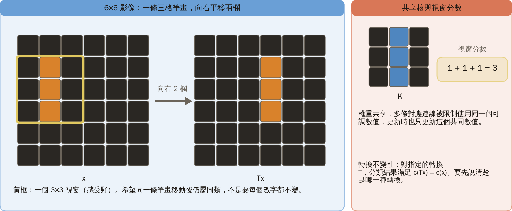
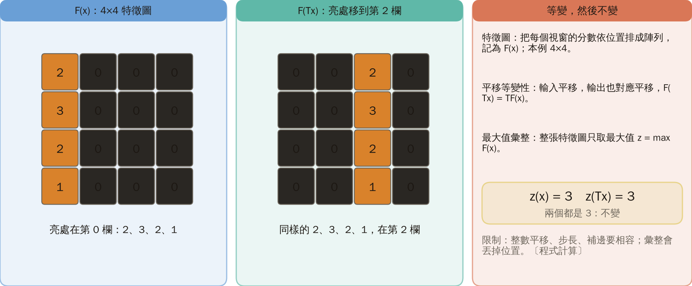
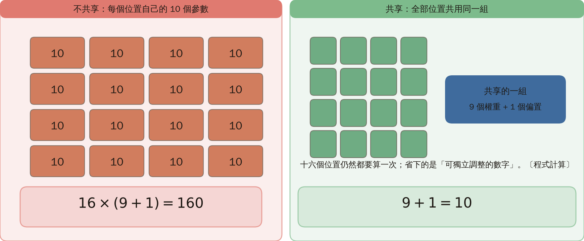
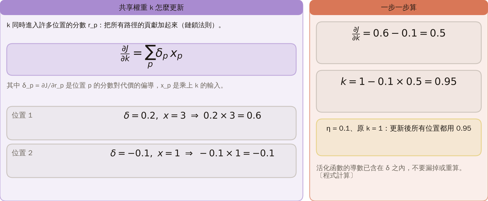
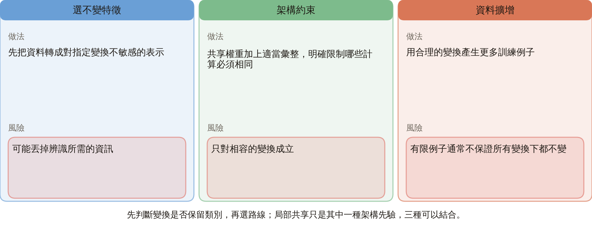
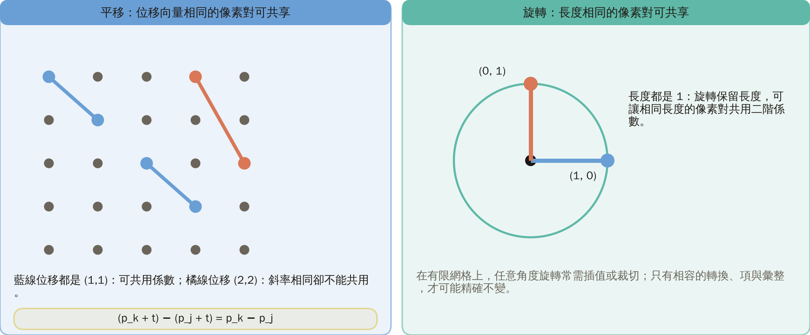
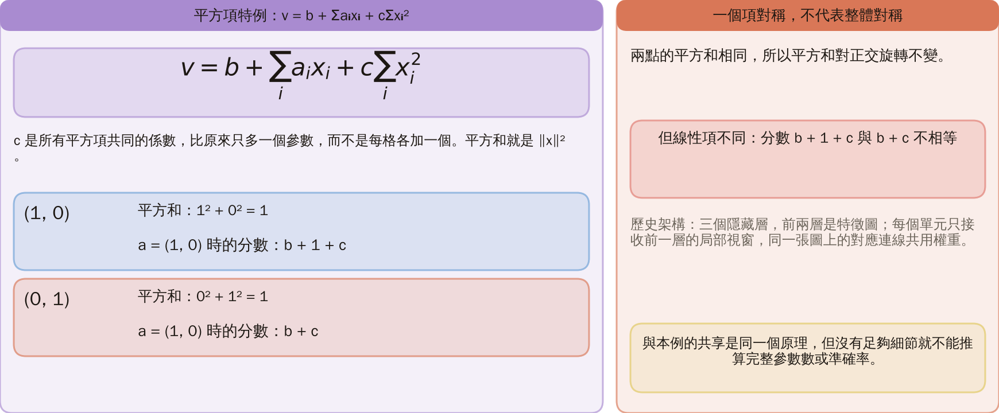
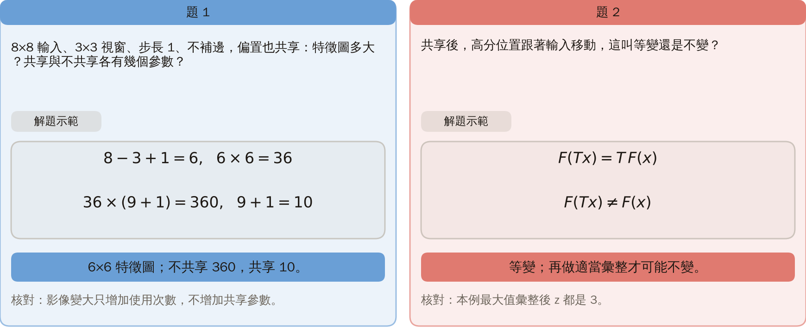
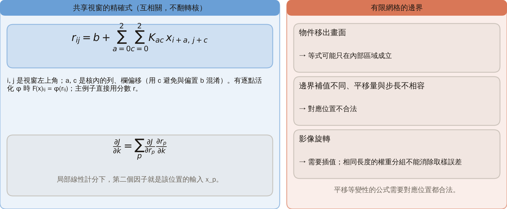

# KP12 權重共享與轉換不變性

!!! note "自主學習"
    本單元（KP12）列為自主學習，課堂不講授，請同學課前或課後自行閱讀。

> 程度：大學三年級
>
> 圖型識別｜第四章

[簡報閱讀與下載](../slides/lec05-kp12-weight-sharing.jbd.json)

## 學習目標

- 手算共享核、特徵圖與參數數量。
- 用同一個例子分清「等變」與「不變」。
- 指出平移與旋轉共享的條件與限制。

## KP12 權重共享與轉換不變性

**一句話重點**：所有位置重用同一組權重，通常先得到「跟著輸入移動」的反應（等變）；再用適當的讀出，才可能得到「不隨位置改變」的結果（不變）。

### 先備與符號

**你需要先會的三件事**：

- **加權計分**（KP06）：分數 $r=b+\sum w_ix_i$，$b$ 是偏置。
- **鏈鎖法則**（KP06）：一個參數經過多條路徑影響代價時，把各條路徑的貢獻加起來。
- **矩陣與陣列**：用「第 $i$ 列、第 $j$ 欄」指出一格的位置。

**符號表**（本講義固定使用）：

| 符號 | 意義 | 說明 |
|---|---|---|
| $x$、$Tx$ | 影像、平移後的影像 | 6×6；$T$ 表示指定的轉換 |
| $K$、$b$ | 共享的 3×3 權重矩陣、偏置 | 本例 $b=0$ |
| $r_{ij}$ | 視窗左上角在 $(i,j)$ 的分數 | 第 $i$ 列、第 $j$ 欄 |
| $F(x)$ | 特徵圖 | 把所有 $r_{ij}$ 排成陣列；本例 4×4 |
| $z$ | 最大值彙整的結果 | $z=\max_{i,j}F(x)_{ij}$ |
| $k$、$x_p$、$\delta_p$ | 共享權重、位置 $p$ 的輸入、位置 $p$ 的分數對代價的偏導 | 第 3 節 |
| $\eta$ | 學習率 | 第 3 節取 0.1 |

### 1. 從移動的筆畫建立局部共享規則

**白話說明**：希望同一個物件移動後仍屬同類，不等於要求網路裡每個數字都不變。做法是兩步：先限制每個單元只看一小塊範圍，再讓所有位置用同一組權重。

- **轉換不變性**：對指定的轉換 $T$，分類結果滿足 $c(Tx)=c(x)$。要先說清楚是哪一種轉換。
- **感受野**：某個單元直接接收的輸入範圍；本例是影像中一塊 3×3 的視窗。
- **權重共享**：多條對應連線被限制使用同一個可調數值；更新時也只更新這個共同數值。
- **卷積核**：滑動視窗重用的權重矩陣，本節稱 $K$。

**本節的設定**：

- 影像 $x$ 是 6×6，只有一條三格直筆畫（值為 1），其餘為 0。筆畫在第 1 欄、第 1 至 3 列（列、欄都從 0 起算）。
- $x$ 向右平移兩欄得到 $Tx$，筆畫在第 3 欄，沒有被裁掉。
- 視窗每次移一格、不補邊，左上角共有 $4\times4=16$ 個合法位置。

圖說 `lec05-kp12-idea`：［補充］先看左邊：黃框是 6×6 影像上的一個 3×3 視窗（感受野），再看同一條三格筆畫向右平移兩欄；右邊是共享核 K（中間欄為 1）與視窗分數 1 + 1 + 1 = 3。我們要的是類別不變，不是每個數字都不變。〔功能：1、2〕

一個位置看九個數字；不同位置看到的資料不同，但可以使用相同的判斷規則。

接下來的問題：把這個核滑過整張影像，得到的是什麼？平移後又怎麼變？

### 2. 先有等變的特徵圖，再談不變的讀出

完整保留位置，會得到跟著輸入移動的反應。只有再選擇合適的彙整方式，才可能把位置差異消去；這是本單元最重要的觀念轉折。

- **特徵圖**：把每個視窗的分數依位置排成陣列，記為 $F(x)$；本例大小是 4×4。

用上面的 $x$、$K$、$b=0$，逐格算出：

$$
F(x)=\begin{bmatrix}2&0&0&0\\3&0&0&0\\2&0&0&0\\1&0&0&0\end{bmatrix},\qquad
F(Tx)=\begin{bmatrix}0&0&2&0\\0&0&3&0\\0&0&2&0\\0&0&1&0\end{bmatrix}.
$$

**怎麼讀這兩個矩陣**：

1. 視窗的中欄是影像的第 $j+1$ 欄；筆畫在第 1 欄時，只有 $j=0$ 的視窗中欄會碰到筆畫。
2. 視窗列範圍 $i$ 到 $i+2$ 與筆畫列 1 至 3 的重疊格數，$i=0,1,2,3$ 依序是 $2,3,2,1$，這就是第一欄的 $2,3,2,1$。
3. 平移後，筆畫在第 3 欄，只有 $j=2$ 的視窗碰到它；分數的樣子一樣，位置從第 0 欄移到第 2 欄。

圖說 `lec05-kp12-maps`：［補充］先看左邊兩張 4×4 特徵圖：F(x) 的亮處在第 0 欄（2、3、2、1）、F(Tx) 在第 2 欄；再看右邊取最大值，兩個都是 z = 3。反應跟著筆畫移動（等變），讀出不隨位置改變（不變）。〔功能：2〕

- **平移等變性**：輸入平移，輸出也按對應的方式平移，寫成 $F(Tx)=TF(x)$。此時通常 $F(Tx)\ne F(x)$，因為高分的位置變了。
- **最大值彙整**：從整張特徵圖只取最大值，$z=\max_{i,j}F(x)_{ij}$。本例平移前後都是 $z=3$。

**限制**：

- 整數平移、步長、補邊與邊界條件必須相容；物件被裁掉時，不能保證同樣的反應。
- 彙整會丟掉位置；需要精確定位的任務未必適合。
- 這只驗證本例中保留完整特徵的平移；若後續分類只依 $z$，這兩張影像就有相同的判斷依據。

接下來的問題：共享到底省了多少參數？訓練時共享的權重怎麼更新？

### 3. 參數如何計數，又如何共同更新

共享省下的是「可獨立調整的數字」，不是取消各位置的計算：十六個位置仍然都要算一次。

| 做法 | 參數數 | 算式 |
|---|---:|---|
| 不共享 | 160 | 16 個位置，各有 9 個權重與 1 個偏置：$16\times(9+1)$ |
| 共享 | 10 | 所有位置共用 9 個權重與 1 個偏置：$9+1$ |

這個減量需要「共享假設適合任務」；參數少不代表每個問題都更準，也不代表運算次數只剩十分之一。

**共享權重怎麼更新，一步一步來**：

1. 設共享的某個權重為 $k$；位置 $p$ 的輸入分數是 $r_p$，乘上 $k$ 的輸入是 $x_p$，所以局部線性時 $\partial r_p/\partial k=x_p$。
2. 令 $\delta_p=\partial J/\partial r_p$。鏈鎖法則把所有路徑加起來：$\dfrac{\partial J}{\partial k}=\sum_p\delta_px_p$。
3. 數值例子：兩個位置給出 $0.2\times3$ 與 $-0.1\times1$，總梯度 $0.6-0.1=0.5$。
4. 學習率 $\eta=0.1$、原 $k=1$ 時，更新為 $k=1-0.1\times0.5=0.95$；所有位置接著都用 0.95。

若某些路徑還有活化函數，其導數已含在 $\delta_p$ 之內，不應漏掉或重算。

圖說 `lec05-kp12-count`：［補充］先看左邊：每個位置各有 10 個參數，16 × 10 = 160；再看右邊：全部共用同一組，9 + 1 = 10。十六個位置仍然都要算一次。〔功能：1、3〕

圖說 `lec05-kp12-grad`：［補充］先看上方公式：共享梯度是各位置 δ 乘 x 的總和；再看兩個位置的乘積 0.6 與 −0.1，總梯度 0.5；右邊更新 k = 1 − 0.1 × 0.5 = 0.95。〔功能：2、3〕

接下來的問題：讓分類對平移不變，除了共享，還有哪些路線？

### 4. 把不變性的三條路線放在一起比較

局部共享只是其中一種架構先驗。實際系統可以結合以下三種，但要先判斷變換是否保留類別。

| 路線 | 做法 | 風險 |
|---|---|---|
| 選不變特徵 | 先把資料轉成對指定變換不敏感的表示 | 可能丟掉辨識所需的資訊 |
| 架構約束 | 共享權重加上適當彙整，明確限制哪些計算必須相同 | 只對相容的變換成立 |
| 資料擴增 | 用合理的變換產生更多訓練例子 | 有限例子通常不保證所有變換下都不變 |

圖說 `lec05-kp12-routes`：［補充］先看三欄的標題（選不變特徵、架構約束、資料擴增）；再比較每一欄的做法與風險。〔功能：1、2〕

### 5. 高階輸入乘積中的幾何共享

將兩個像素相乘，會讓「一對位置的幾何關係」進入模型。分清平移保留位移、旋轉保留長度，才不會用錯共享條件。

- **高階網路**：活化前的分數包含輸入乘積，例如 $v=b+\sum_i a_ix_i+\sum_{j,k}c_{jk}x_jx_k$，再經活化 $f(v)$。
- 符號：$x_i$ 是像素值，$a_i$ 是單點權重，$c_{jk}$ 是像素對的權重，$b$ 是偏置。
- 例如兩格都為 1，乘積為 1；只要其中一格為 0，乘積就為 0。所以像素對能描述位置之間的聯合作用。

**平移時，什麼不變？** 兩端點同時加位移 $t$，差向量不變：$(p_k+t)-(p_j+t)=p_k-p_j$。所以能共用係數的，是「位移向量相同」的像素對。

圖說 `lec05-kp12-geometry`：［補充］先看左邊：兩條藍線位移都是 (1,1)，可共享；橘線位移 (2,2)，斜率相同卻不能共用；再看右邊的圓：(1,0) 與 (0,1) 長度都是 1。〔功能：2〕

因此「同斜率就夠」過於粗略；若要整體不變，單點項、邊界處理及讀出方式也須符合相同的對稱要求。

**旋轉時，什麼不變？**

- 旋轉保留線段長度，因此可讓「相同長度的像素對」共用二階係數；這是把幾何先驗放進模型。
- 在有限像素網格上，任意角度旋轉常需插值或裁切；只有相容的轉換、項與彙整，才可能得到精確不變性。
- 高階網路可減少自由參數，但來源也提醒這類方法未廣泛成為主流；幾何直覺不是無條件的效能保證。

### 6. 平方項特例與歷史架構的限制

特殊的平方和只需多一個係數，但「一個項具備對稱性」不代表「整體模型具備」。

- 模型：$v=b+\sum_i a_ix_i+c\sum_i x_i^2$。$c$ 是所有平方項共同的係數，比原來只多一個參數，而不是每格各加一個。
- 平方和就是 $\|x\|^2$：$(1,0)$ 與 $(0,1)$ 都得 $1^2+0^2=1$，所以平方和本身對正交旋轉不變。
- 但線性項可能不同：若 $a=(1,0)$，兩點的分數分別為 $b+1+c$ 與 $b+c$，不相等。

**歷史架構**：來源描述三個隱藏層，前兩層由特徵圖組成；每個單元只接收前一層的局部視窗，同一張圖上的對應連線共用權重。

- 這與本例的三格筆畫是同一個共享原理，但不是同一個架構。
- 沒有足夠的原始細節，不能推算其完整參數數或準確率；來源的泛化效益是引用的主張，不是本講義算例的保證。

下一步：先問「什麼變換該保留標籤」，再決定特徵、共享規則與讀出方式；別只問「共享一定比較好嗎」。

圖說 `lec05-kp12-square`：［補充］先看上方的模型 v = b + Σaᵢxᵢ + cΣxᵢ²；再看 (1,0) 與 (0,1) 的平方和都是 1，但 a = (1,0) 時分數是 b + 1 + c 與 b + c，不相等：一個項對稱，不代表整體對稱。〔功能：2〕

### 7. 小練習與參數計數核對

改變影像大小，重新算一次，再用「等變」與「不變」的式子描述輸出，檢查是否把「位置數」與「參數數」分開。

**小練習**：

1. 8×8 輸入、3×3 視窗、步長 1、不補邊，且偏置也共享。特徵圖多大？共享與不共享各有幾個參數？
2. 共享後，高分位置跟著輸入移動，這叫等變還是不變？提示：比較 $F(Tx)=TF(x)$ 與 $F(Tx)=F(x)$。

**題 1 解題示範**：

1. 每個方向 $8-3+1=6$ 個位置，共 $6\times6=36$，特徵圖為 6×6。
2. 不共享：$36\times(9+1)=360$。共享：$9+1=10$。
3. 影像變大只增加使用次數，不增加這一組共享參數。

**題 2 解題示範**：高分位置跟著移動，是等變；若再做適當的彙整且條件成立，才可能得到不變的特徵。

圖說 `lec05-kp12-solution`：［補充］左邊是題 1：8×8 輸入得 6×6 特徵圖，不共享 360、共享 10 個參數；右邊是題 2：F(Tx) = TF(x)，是等變。〔功能：2〕

### 延伸：共享視窗的精確計算、邊界與梯度

**共享視窗的精確式**：令影像為 $x$、卷積核為 $K$、偏置為 $b$。這裡採用「不翻轉卷積核」的互相關：

$$
r_{ij}=b+\sum_{a=0}^{2}\sum_{c=0}^{2}K_{ac}x_{i+a,j+c}.
$$

$i,j$ 是視窗左上角位置；$a,c$ 是核內的列、欄偏移（這裡用 $c$，避免與偏置 $b$ 混淆）。若有逐點活化 $\phi$，特徵圖可取 $F(x)_{ij}=\phi(r_{ij})$；本講義的主例子直接使用分數 $r$，沒有額外活化。

**有限網格的邊界**：平移等變性的公式需要對應位置都合法。

- 物件移出畫面、邊界補值不同，或平移量與步長不相容時，等式可能只在內部區域成立。
- 影像旋轉也可能需要插值；單純相同長度的權重分組不能消除取樣誤差。

**共享梯度的來源**：一個參數 $k$ 同時進入許多分數 $r_p$。鏈鎖法則把所有路徑相加：

$$
\frac{\partial J}{\partial k}=\sum_p\frac{\partial J}{\partial r_p}\frac{\partial r_p}{\partial k}.
$$

在局部線性計分下，第二個因子就是該位置的輸入 $x_p$（見第 3 節）。

圖說 `lec05-kp12-exact`：［補充］先看左邊的視窗精確式 r_ij 與共享梯度的鏈鎖法則；再看右邊有限網格的三種邊界情形：物件移出畫面、補值或步長不相容、影像旋轉需要插值。〔功能：2〕

## 術語與來源

| 中文 | English |
|---|---|
| 轉換不變性 | Transformation invariance |
| 感受野 | Receptive field |
| 權重共享 | Weight sharing |
| 卷積核 | Kernel |
| 特徵圖 | Feature map |
| 平移等變性 | Translation equivariance |
| 最大值彙整 | Global max pooling |
| 高階網路 | Higher-order network |

來源：[第四章 KP12](https://ndhuccc.github.io/CCC-LNS/PR_115/Ch04-nonlinear-classifiers/index.html#kp12)（2026-10-25 讀取）；參考代碼 [Fuku 82], [Rume 86], [Fuku 92], [Lecu 89], [Ride 97]。來源將共享直接稱為平移不變，本講義區分局部等變與彙整後不變；來源「同斜率」的約束不足以刻畫純平移，改用位移向量。本講義的例子、特徵圖與練習為［補充］，已用 Python 核對；來源原圖（第 4.14–4.16 圖）已檢視，本講義用自己的圖解，沒有把來源圖片或精確曲線冒充新結果。引用的完整定理與實驗細節無法核對的，均保留限制。
