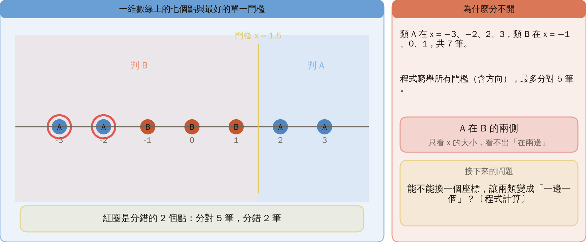
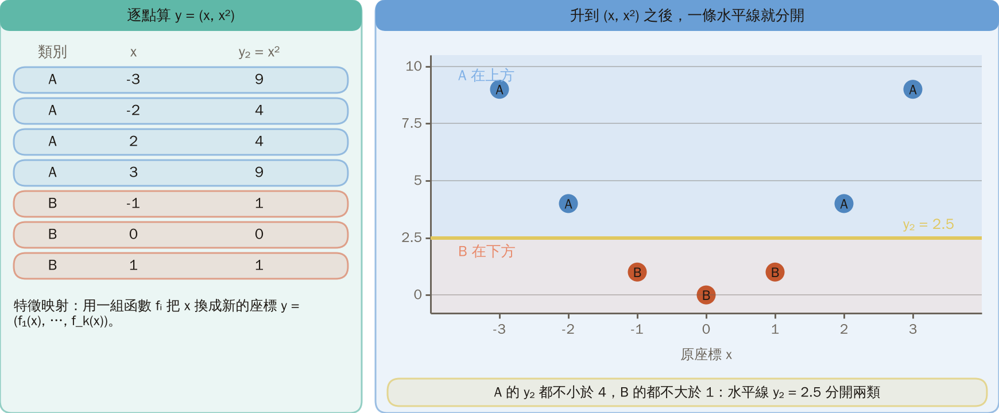
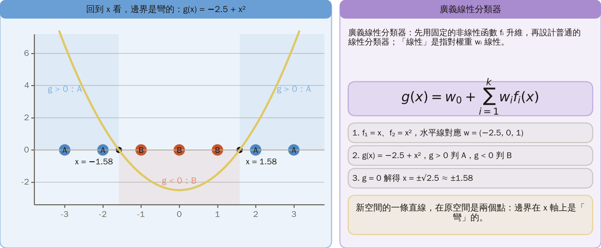
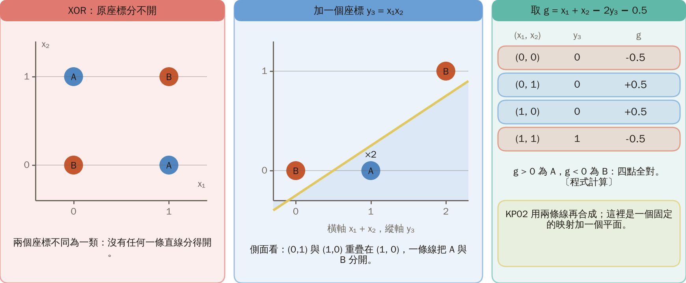
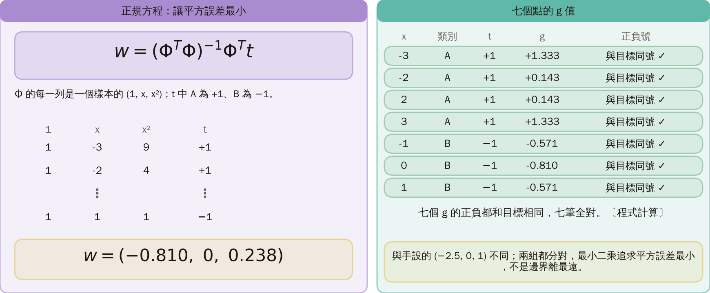
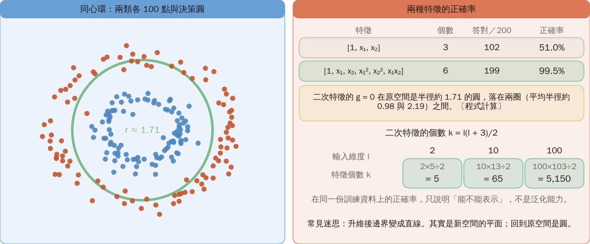
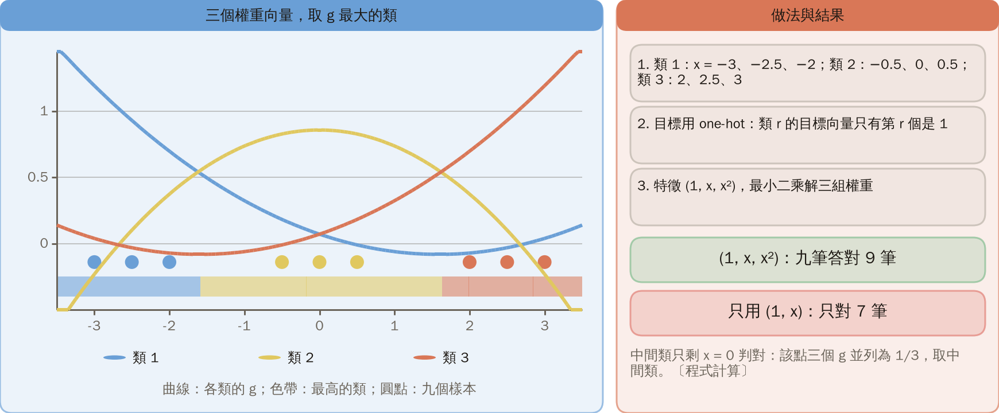
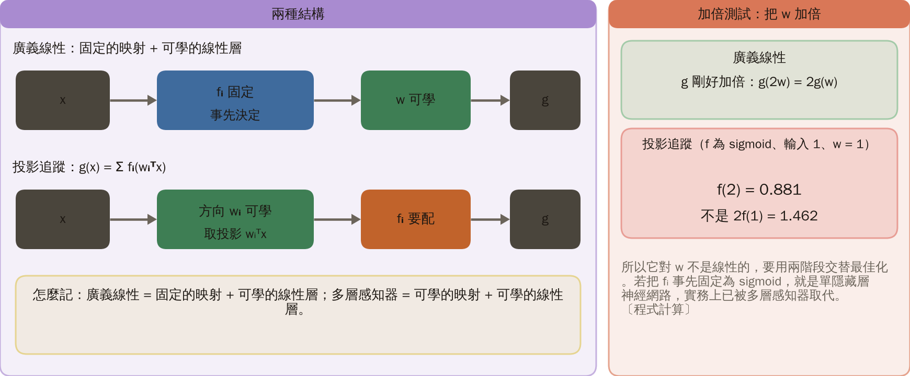
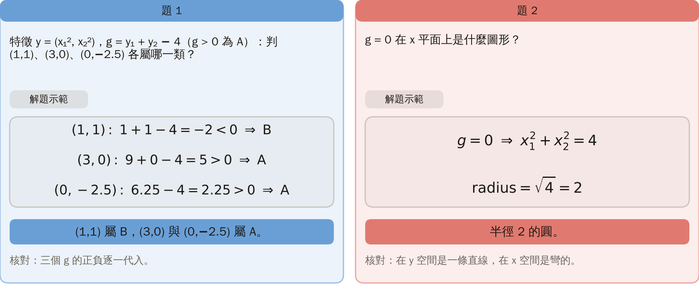

# KP13 廣義線性分類器

> 程度：大學三年級
>
> 圖型識別｜第四章 §4.12

[簡報閱讀與下載](../slides/lec05-kp13-generalized-linear.jbd.json) | [English version](en/lec05-kp13-generalized-linear.md)

## 學習目標

- 能說明為什麼先升維再用線性分類器，能把原空間的非線性邊界變成新空間的平面。
- 能用最小二乘（正規方程）算出廣義線性分類器的權重，並處理多類別。
- 能說明廣義線性分類器與投影追蹤、多層感知器的差別，以及升維的代價。

## KP13 廣義線性分類器

**一句話重點**：先用一組固定的非線性函數 $f_i$ 把 $x$ 送到 $k$ 維空間，再在那裡設計一個普通的線性分類器；非線性全部由 $f_i$ 承擔，判別函數對權重仍是線性的。

### 先備與符號

**你需要先會的三件事**：

- **線性判別函數**（KP01–KP03）：$g(x)=w^Tx+w_0$，$g>0$ 判一類、$g<0$ 判另一類；邊界 $g=0$ 是直線或平面。
- **平方誤差**（KP06）：預測與目標之差的平方，總和越小越好。
- **矩陣乘法與轉置**：$\Phi w$ 是把矩陣 $\Phi$ 的每一列與 $w$ 做內積。

**符號表**（本講義固定使用）：

| 符號 | 意義 | 說明 |
|---|---|---|
| $x$、$l$ | 原空間的點、它的維度 | 第 1–3 節 $l=1$，第 6 節 $l=2$ |
| $f_i(x)$、$k$ | 第 $i$ 個固定的非線性函數、函數個數 | 新空間維度為 $k$ |
| $y$ | 新空間的點 | $y=(f_1(x),\dots,f_k(x))$ |
| $w_0,w_i$ | 偏置與權重 | 可學習的只有這些 |
| $g(x)$ | 判別函數 | 本講義 $g>0$ 判 A、$g<0$ 判 B |
| $\Phi$ | 設計矩陣 | 每一列是一個樣本的 $(1,f_1,\dots,f_k)$ |
| $t$ | 目標向量 | A 為 $+1$、B 為 $-1$ |
| $M$、$w_r$ | 類別數、第 $r$ 類的權重向量 | 第 7 節 |

### 1. 夾住的類別

**白話說明**：資料在原空間用一條線分不開時，怎麼辦？先看最簡單的一維情形。

**例子**（一維，本講義設計）：

- 類 A 在 $x=-3,-2,2,3$，類 B 在 $x=-1,0,1$，共 7 筆。
- 任何單一門檻（含方向）最多分對 7 筆中的 5 筆（程式窮舉所有門檻）。
- 原因：A 在 B 的兩側，只看 $x$ 的大小，看不出「在兩邊」這件事。

圖說 `lec05-kp13-sandwich`：先看數線上的七個點：A 在兩側、B 在中間；再看黃色虛線的最佳單一門檻 x = 1.5，紅圈是分錯的 2 個點：只能分對 5 筆。〔功能：1〕

接下來的問題：能不能換一個座標，讓兩類變成「一邊一個」？

### 2. 換個座標

- **特徵映射**：用一組函數 $f_i$ 把 $x$ 換成新的座標 $y=(f_1(x),\dots,f_k(x))$。

這裡取 $y=(x,x^2)$，逐點算：

| 類別 | $x$ | $y_2=x^2$ |
|---|---|---|
| A | $-3,-2,2,3$ | $9,4,4,9$ |
| B | $-1,0,1$ | $1,0,1$ |

A 的 $y_2$ 都不小於 4，B 的都不大於 1；一條水平線 $y_2=2.5$ 就把兩類分開，也就是新座標裡的一個線性分類器。

圖說 `lec05-kp13-lift`：先看左邊逐點算 (x, x²) 的表；再看右邊七個點升到 (x, x²) 後的位置：A 在上方、B 在下方，一條水平線 y₂ = 2.5 把兩群分開。〔功能：1、2〕

接下來的問題：這條水平線，回到原來的 $x$ 軸看是什麼？

### 3. 回到 x 看是彎的

- **廣義線性分類器**：

$$
g(x)=w_0+\sum_{i=1}^{k}w_if_i(x).
$$

先用固定的非線性 $f_i$ 升維，再設計普通的線性分類器；「線性」是指對權重 $w_i$ 線性。

**本例，一步一步來**：

1. 取 $f_1=x$、$f_2=x^2$，水平線 $y_2=2.5$ 對應 $w_0=-2.5$、$w_1=0$、$w_2=1$。
2. 所以 $g(x)=-2.5+0\cdot x+1\cdot x^2$；$g>0$ 判 A，$g<0$ 判 B。
3. $g=0$ 解得 $x=\pm\sqrt{2.5}\approx\pm1.58$。外側（$|x|>1.58$）是 A，內側是 B。
4. 新空間的一條直線（一般是超平面），在原空間是兩個點；也就是說，邊界在 $x$ 軸上是「彎」的。

也可以反過來看：原空間若被非線性超曲面 $g(x)=0$ 分開，就是把 $g$ 寫成 $f_i$ 的線性組合，是經典的內插函數近似問題（來源）。

圖說 `lec05-kp13-curve`：先看拋物線 g(x) = −2.5 + x² 與七個點；再看它與 x 軸的兩個交點 ±1.58：外側 g > 0 是 A，中間 g < 0 是 B；右邊是廣義線性分類器的定義與三步推導。〔功能：2〕

### 4. XOR 再看一次

XOR 的四個點 $(0,0),(0,1),(1,0),(1,1)$，類別是「兩個座標不同」為一類。

1. 加上一個座標 $y_3=x_1x_2$（兩個座標的乘積）。
2. 取 $g=x_1+x_2-2y_3-0.5$，逐點代入：

| $(x_1,x_2)$ | $y_3$ | $g$ |
|---|---|---|
| $(0,0)$ | 0 | $-0.5$ |
| $(0,1)$ | 0 | $+0.5$ |
| $(1,0)$ | 0 | $+0.5$ |
| $(1,1)$ | 1 | $-0.5$ |

四個點用一個平面分開。KP02 是用兩條線再合成，這裡是一個固定的映射加一個平面。

圖說 `lec05-kp13-xor`：先看左邊：XOR 的四個點在原座標分不開；再看中間：加上 y₃ = x₁x₂ 後從側面（x₁ + x₂ 與 y₃）看，一條線把 A 與 B 分開；右邊的表逐點算 g = x₁ + x₂ − 2y₃ − 0.5：−0.5、+0.5、+0.5、−0.5。〔功能：2〕

接下來的問題：映射是固定的，那三個權重 $w_0,w_1,w_2$ 怎麼算，而不是用眼睛猜？

### 5. 權重怎麼算

- **正規方程**：讓 $\Phi w$ 與目標 $t$ 的平方誤差最小的解是

$$
w=(\Phi^T\Phi)^{-1}\Phi^Tt.
$$

$\Phi$ 的每一列是一個樣本的 $(1,f_1,\dots,f_k)$；$t$ 中 A 為 $+1$、B 為 $-1$。

**第 1 節的七個點**：$\Phi$ 的列是 $(1,x,x^2)$，解得 $w=(-0.810,\,0,\,0.238)$。

- 七個 $g$ 的正負都和目標相同，七筆全對（程式計算）。
- 注意它和第 3 節手設的 $(-2.5,0,1)$ 不同；兩組都分對，最小二乘追求的是「平方誤差最小」，不是「邊界離哪裡最遠」。

圖說 `lec05-kp13-fit`：先看左邊的正規方程與 Φ、t 的樣子，以及解出的 w = (−0.810, 0, 0.238)；再看右邊七個點的 g 值逐點比對正負號：全部和目標同號。〔功能：2〕

### 6. 同心環

一維的例子手算得動，換到二維的同心環，用程式實驗。

**實驗設定**（本講義設計，可重現）：

- 資料：兩類各 100 點。角度在 $[0,2\pi)$ 均勻取；半徑 A 類取常態 $N(1.0,0.15^2)$、B 類取 $N(2.2,0.2^2)$。亂數用 NumPy `default_rng(0)`（種子 0）。
- 目標：A 為 $+1$、B 為 $-1$；兩種特徵都用最小二乘求權重，預測取 $g$ 的正負號。
- 評估：在同一份訓練資料上計算正確率；沒有另外的測試資料，所以只說明「能不能表示」，不是泛化能力。

| 特徵 | 特徵個數 | 答對筆數／200 | 正確率 |
|---|---:|---:|---:|
| 直線 $[1,x_1,x_2]$ | 3 | 102 | 51% |
| 二次 $[1,x_1,x_2,x_1^2,x_2^2,x_1x_2]$ | 6 | 199 | 99.5% |

直線特徵等於亂猜。二次特徵的 $g=0$ 在原空間是半徑約 1.71 的圓，落在兩圈（平均半徑約 0.98 與 2.19）之間（程式計算）。

**常見迷思**：升維後邊界就變成直線了。其實是新空間的平面；回到原空間，是圓。

圖說 `lec05-kp13-rings`：先看左邊兩圈散點與綠色的決策圓；再讀右邊的表：直線特徵 102 筆（51%）、二次特徵 199 筆（99.5%），圓的半徑約 1.71，以及二次特徵的個數 5、65、5150。〔功能：1、3〕

### 7. 多類別

$M$ 類就設計 $M$ 個權重向量 $w_r$，選 $w_r^Ty+w_{r0}$ 最大的類。

**例子**（本講義設計）：

- 一維九點：$x=-3,-2.5,-2$ 為類 1，$x=-0.5,0,0.5$ 為類 2，$x=2,2.5,3$ 為類 3。
- 目標用 one-hot（類 $r$ 的目標向量只有第 $r$ 個是 1），特徵 $(1,x,x^2)$，最小二乘解三組權重：九筆全對。
- 只用 $(1,x)$：只對 7 筆；中間類只剩 $x=0$ 判對（該點三個 $g$ 並列為 $1/3$，取中間類）。

圖說 `lec05-kp13-multi`：先看三條 g 曲線，每個區段最高的那條就是判定的類（底部色帶）；再看九個點是否落在對應類最高的區段；右邊是做法與結果：九筆全對，只用 (1, x) 只對 7 筆。〔功能：2〕

### 8. 對照：投影追蹤

- **投影追蹤**：$g(x)=\sum_i f_i(w_i^Tx)$。$f_i$ 的引數是 $x$ 在方向 $w_i$ 上的投影；方向與函數要一起最佳化。

**加倍測試**：把 $w$ 加倍，看輸出怎麼變：

- 廣義線性的 $g$ 剛好加倍。
- 投影追蹤（$f$ 為 sigmoid、輸入 1、$w=1$）：$f(2)=0.881$，不是 $2f(1)=1.462$。

所以它對 $w$ 不是線性的，要用兩階段交替最佳化（來源）。若把 $f_i$ 事先固定為 sigmoid，就是單隱藏層神經網路，實務上已被多層感知器取代。

**怎麼記**：廣義線性 = 固定的映射 + 可學的線性層；多層感知器 = 可學的映射 + 可學的線性層。

圖說 `lec05-kp13-pp`：先看上下兩列方塊圖：上列映射 fᵢ 固定、只學 w；下列先學方向 wᵢ 再配函數 fᵢ；再讀右邊的加倍測試：廣義線性剛好加倍，投影追蹤不是（f(2) = 0.881，2f(1) = 1.462）。〔功能：2〕

圖說 `lec05-kp13-practice`：左邊是題 1：(1,1) 屬 B、(3,0) 與 (0,−2.5) 屬 A；右邊是題 2：g = 0 是半徑 2 的圓，各附核對。〔功能：3〕

### 延伸：座標的個數、練習與解題示範

**座標的個數**：$l$ 維輸入的二次特徵有 $l$ 個 $x_i$、$l$ 個 $x_i^2$、$l(l-1)/2$ 個 $x_ix_j$，共

$$
k=l+l+\frac{l(l-1)}{2}=\frac{l(l+3)}{2}.
$$

| 輸入維度 $l$ | 2 | 10 | 100 |
|---|---:|---:|---:|
| 二次特徵個數 $k$ | 5 | 65 | 5150 |

升維真的有幫助嗎？來源用 Cover 定理回答（KP14）；多項式與 RBF 兩類映射見 KP15、KP16。

**小練習**：特徵 $y=(x_1^2,x_2^2)$，$g=y_1+y_2-4$（$g>0$ 為 A）。

1. 判 $(1,1)$、$(3,0)$、$(0,-2.5)$ 各屬哪一類？
2. $g=0$ 在 $x$ 平面上是什麼圖形？

**題 1 解題示範**：

- $(1,1)$：$1+1-4=-2$，B。
- $(3,0)$：$9+0-4=5$，A。
- $(0,-2.5)$：$0+6.25-4=2.25$，A。

**題 2 解題示範**：$g=0$ 即 $x_1^2+x_2^2=4$，半徑 2 的圓：在 $y$ 空間是一條直線，在 $x$ 空間是彎的。

## 術語與來源

| 中文 | English |
|---|---|
| 特徵映射 | Feature mapping |
| 廣義線性分類器 | Generalized linear classifier |
| 正規方程 | Normal equation |
| 投影追蹤 | Projection pursuit |

來源：第四章 KP13，§4.12（2026-10-25 讀取）。廣義線性分類器的定義、函數近似的看法、多類別做法、投影追蹤的對照與「怎麼記」依來源；一維夾住的例子、XOR 的新座標、同心環資料（來源有互動示範，本講義另以程式產生資料，種子 0）、三類一維資料與所有數字由本講義設計並重算（［補充］，（程式計算））。
