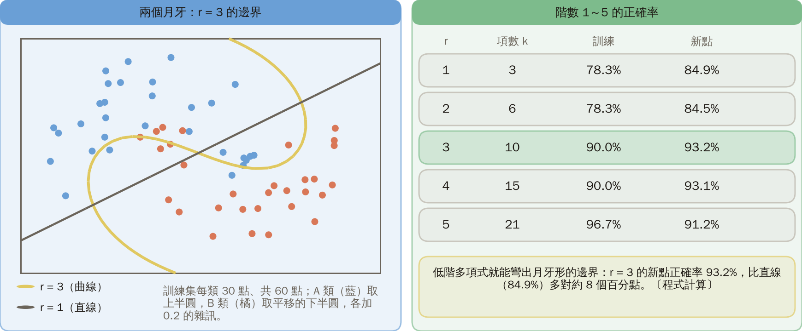
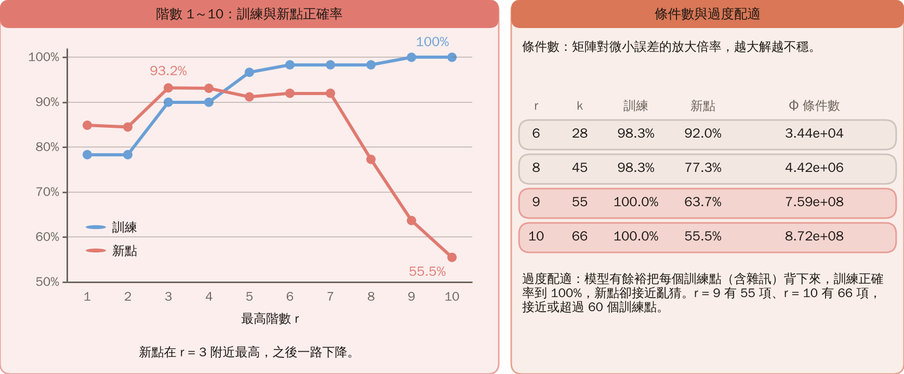

# KP15 多項式分類器

> 程度：大學三年級
>
> 圖型識別｜第四章 §4.14

[簡報閱讀與下載](../slides/lec05-kp15-polynomial.jbd.json) | [English version](en/lec05-kp15-polynomial.md)

## 學習目標

- 能把二階多項式判別函數寫成新座標上的線性分類器，並用一個交互項解 XOR。
- 能用 $k=(l+r)!/(r!\,l!)$ 算項數，並說明為什麼會組合爆炸。
- 能說明高階多項式的能力與代價（記憶體、過度配適、數值不穩），以及核內積為什麼能避開爆炸。

## KP15 多項式分類器

**一句話重點**：用最高 $r$ 階的多項式當判別函數，理論上想多準有多準，實際上項數爆炸；威力來自交互項，災難也來自它們。

### 先備與符號

**你需要先會的三件事**：

- **廣義線性分類器**（KP13）：先用固定函數升維，再學一個線性分類器；對權重線性。
- **階乘與組合數**：$n!=1\times2\times\cdots\times n$；$\binom{n}{i}=n!/(i!\,(n-i)!)$。
- **XOR 與升維可分**（KP02、KP14）：XOR 的四點在二維不可分，升維後可分。

**符號表**（本講義固定使用）：

| 符號 | 意義 | 說明 |
|---|---|---|
| $l$ | 輸入的個數（維度） | $x=(x_1,\dots,x_l)$ |
| $r$ | 多項式的最高階數 | 次數總和不超過 $r$ |
| $k$ | 新座標的個數（含常數項） | $k=(l+r)!/(r!\,l!)$ |
| $g(x)$ | 判別函數 | $g>0$ 判 A、$g<0$ 判 B |
| $w_0,w_i,w_{ij}$ | 偏置、一次項權重、二次項權重 | 可學習的只有這些 |
| $\Phi$ | 設計矩陣 | 每一列是一個樣本的所有新座標，大小為「筆數 × $k$」 |

### 1. 二階展開

**白話說明**：KP14 說升維能提高可分機率。新座標最直接的造法，是把乘積項全寫出來。

- **多項式分類器**：用最高 $r$ 階的多項式當判別函數，也就是把次數總和不超過 $r$ 的乘積項當新座標，再學一個線性分類器。
- **交互項**：兩個以上不同輸入相乘的項，例如 $x_1x_2$；單獨的 $x_1^2$ 叫平方項。

**兩個輸入、二階**：

$$
g(x)=w_0+w_1x_1+w_2x_2+w_{12}x_1x_2+w_{11}x_1^2+w_{22}x_2^2.
$$

新座標 $y=[x_1,x_2,x_1x_2,x_1^2,x_2^2]$，加偏置共 6 項；$g=w^Ty+w_0$ 對 6 個權重是線性的。

圖說 `lec05-kp15-terms`：先看上方的式子：兩個輸入、二階的 g(x) 共 6 項；再看下方六個方塊，橘色的是交互項 x₁x₂；右側定義多項式分類器與交互項。〔功能：1〕

接下來的問題：這六項裡，哪一項對 XOR 最關鍵？

### 2. XOR 只缺一個交互項

只取 $y=(x_1,x_2,x_1x_2)$，四點的新座標：

| $(x_1,x_2)$ | $y=(x_1,x_2,x_1x_2)$ |
|---|---|
| $(0,0)$ | $(0,0,0)$ |
| $(0,1)$ | $(0,1,0)$ |
| $(1,0)$ | $(1,0,0)$ |
| $(1,1)$ | $(1,1,1)$ |

**一步一步來**：

1. 取平面 $y_1+y_2-2y_3-\tfrac14=0$。
2. 代回 $x$：$g=-\tfrac14+x_1+x_2-2x_1x_2$。
3. 四點的 $g$：$-0.25,\ +0.75,\ +0.75,\ -0.25$，符號全對。

只多一個交互項 $x_1x_2$ 就解掉 XOR；常數取 $-\tfrac14$ 或 KP13 的 $-0.5$ 都行：四點的 $x_1+x_2-2x_1x_2$ 是 $0,1,1,0$，只要常數 $-c$ 的 $c$ 介於 0 與 1 之間，符號就全對。

### 3. 雙曲線

$g=0$ 即 $x_1+x_2-2x_1x_2=\tfrac14$，是一對雙曲線分支。

- A（$g>0$）是 $(0,1)$、$(1,0)$ 所在的帶狀區。
- B 是 $(0,0)$、$(1,1)$ 所在的兩個角。

**例子**：$(0.5,0.5)$ 的 $g=-0.25+1-0.5=+0.25$，在 A 的一側。同一個規則，在三維是平面，在二維是彎的。

圖說 `lec05-kp15-hyper`：先看左邊的表：四個 XOR 點加上 x₁x₂ 後，g 依序是 −0.25、+0.75、+0.75、−0.25；再看右邊：雙曲線把平面切成兩個角與一條帶，(0,1)、(1,0) 在帶狀區，(0,0)、(1,1) 在兩個角。〔功能：2〕

### 4. 共有幾項

$l$ 個輸入、最高 $r$ 階，新座標（含常數項）共

$$
k=\frac{(l+r)!}{r!\,l!}
$$

項。

**驗算**：

- $l=2,r=2$：$4!/(2!\,2!)=6$。
- $l=3,r=2$：$5!/(2!\,3!)=10$。

$l=2$、$r=1,\dots,5$：

| $r$ | 1 | 2 | 3 | 4 | 5 |
|---|---:|---:|---:|---:|---:|
| 項數 $k$ | 3 | 6 | 10 | 15 | 21 |

圖說 `lec05-kp15-kcount`：先看左邊的公式 k = (l + r)! / (r! l!)，下方兩個驗算；再看右邊的長條：l = 2 時 r = 1 到 5 是 3、6、10、15、21 項。〔功能：2〕

### 5. 組合爆炸

$l=10,r=10$ 得 $k=184{,}756$ 項。

| 輸入數 $l$ | 二階 | 三階 |
|---|---:|---:|
| 10 | 66 | 286 |
| 100 | 5151 | 176,851 |

輸入少才慢：$l=2$ 時 $r=10$ 也才 66 項。這是第 5 章「維度詛咒」的預告（來源）。

圖說 `lec05-kp15-explode`：先看左圖：橫軸是階數、縱軸是項數（對數座標），l = 2、10、100 三條線，輸入越多線越高、爬得越快；l = 10、r = 10 是 184,756 項。再看右邊的記憶體：Φ 約 1.48 GB、ΦᵀΦ 約 273 GB。〔功能：2〕

### 6. 記憶體

**估算**（1 GB 以 $10^9$ 位元組計）：$l=10,r=10$，$k=184{,}756$，每個數 8 位元組，1000 筆資料。

| 矩陣 | 大小 | 記憶體 |
|---|---|---:|
| 設計矩陣 $\Phi$ | $1000\times k$ | 約 1.48 GB |
| $\Phi^T\Phi$（KP13 正規方程用到） | $k\times k$ | 約 273 GB |

一般電腦的記憶體裝不下（程式計算）。

接下來的問題：項數雖然爆炸，高階多項式的能力到底有多強？

### 7. 能力

**實驗設定**（本講義設計，可重現）：

- 資料：兩個月牙形。A 類取上半圓 $(\cos t,\sin t)$，B 類取平移的下半圓 $(1-\cos t,\ 0.5-\sin t)$，$t$ 在 $[0,\pi]$ 均勻取；再各加標準差 0.2 的高斯雜訊。
- 訓練集：每類 30 點，共 60 點，亂數種子 0（NumPy `default_rng(0)`）；新點：每類 500 點，共 1000 點，種子 1。
- 模型：用最小二乘（NumPy `lstsq`）解階數 $r=1,\dots,10$ 的多項式分類器，目標為 $\pm1$，預測取 $g$ 的正負號。

**結果**：

| $r$ | 項數 $k$ | 訓練正確率 | 新點正確率 |
|---|---:|---:|---:|
| 1 | 3 | 78.3% | 84.9% |
| 2 | 6 | 78.3% | 84.5% |
| 3 | 10 | 90.0% | 93.2% |
| 4 | 15 | 90.0% | 93.1% |
| 5 | 21 | 96.7% | 91.2% |

低階多項式就能彎出月牙形的邊界：$r=3$ 比直線多對約 8 個百分點。

圖說 `lec05-kp15-boundary`：先看左圖：實線是 r = 3 的彎曲邊界，虛線是 r = 1 的直線，藍點與橘點是兩類訓練點；再看右邊的表：r = 3 的新點正確率 93.2%，直線 84.9%。〔功能：3〕

### 8. 階數過頭

- **條件數**：矩陣對微小誤差的放大倍率，越大解越不穩。

同一個實驗，繼續往高階：

| $r$ | 項數 $k$ | 訓練正確率 | 新點正確率 | $\Phi$ 的條件數 |
|---|---:|---:|---:|---:|
| 6 | 28 | 98.3% | 92.0% | $3.4\times10^4$ |
| 8 | 45 | 98.3% | 77.3% | $4.4\times10^6$ |
| 9 | 55 | 100% | 63.7% | $7.6\times10^8$ |
| 10 | 66 | 100% | 55.5% | $8.7\times10^8$ |

（$r=1$ 的條件數是 3.25，所以從 $r=1$ 到 $r=8$ 升高約 130 萬倍。）

**常見迷思**：階數越高越準。

- $r=9$ 有 55 項、$r=10$ 有 66 項，接近或超過 60 個訓練點；模型有餘裕把每個點（含雜訊）背下來，叫**過度配適**。
- 訓練正確率到 100%，新點卻掉到 55.5%，接近亂猜。
- 數值也變差：條件數越大，同樣的微小誤差被放大得越多。

圖說 `lec05-kp15-overfit`：先看左圖：橫軸是階數 1 到 10，藍線是訓練、紅線是新點；新點在 r = 3 附近最高（93.2%），之後一路掉到 55.5%，訓練卻升到 100%。再看右邊：條件數從 r = 6 的 3.44×10⁴ 升到 r = 10 的 8.72×10⁸，以及過度配適的定義。〔功能：3〕

圖說 `lec05-kp15-kernel`：先看左邊：直接算 (1 + x·z)² = 4；再看右邊：造 6 項新座標逐項相乘相加，1 + 6 − 4 + 9 + 4 − 12 = 4，結果一樣。〔功能：2〕

圖說 `lec05-kp15-practice`：左邊是題 1：k = C(7, 3) = 35 項；右邊是題 2：g(1.5, 1.5) = −1.75 < 0，屬 B 類，各附核對。〔功能：3〕

### 延伸：不造新座標、練習與解題示範

**核內積預告**：$l=2$、二階，$x=(1,2)$、$z=(3,-1)$。

1. 左邊（直接算）：$(1+x\cdot z)^2=(1+3-2)^2=2^2=4$。
2. 右邊（造新座標）：把 $x$ 映成 $\varphi(x)=(1,\sqrt2x_1,\sqrt2x_2,x_1^2,x_2^2,\sqrt2x_1x_2)$，再做內積，逐項相乘相加得 $1+6-4+9+4-12=4$，一樣。
3. 左邊只做一次內積與一個次方；$l=10,r=10$ 時右邊是 184,756 項的內積。

核方法（KP19）就是為了避開這個爆炸。

**小練習**：

1. $l=4$ 個輸入、最高 $r=3$ 階，共 $k$ 項？
2. $g=-\tfrac14+x_1+x_2-2x_1x_2$，點 $(1.5,1.5)$ 屬哪一類（$g>0$ 為 A）？

**題 1、2 解題示範**：

1. $k=7!/(3!\,4!)=5040/(6\times24)=35$。
2. $g(1.5,1.5)=-0.25+3-4.5=-1.75<0$，屬類 B。
3. 核對：35 就是 $\binom{7}{3}$；點在右上角的 B 區，和 $(1,1)$ 同一區。

## 術語與來源

| 中文 | English |
|---|---|
| 多項式分類器 | Polynomial classifier |
| 交互項 | Interaction term |
| 條件數 | Condition number |

來源：第四章 KP15，§4.14（2026-10-25 讀取）。二階一般式、項數公式 $k=(l+r)!/(r!\,l!)$ 與 184,756、XOR 的 $g=-\tfrac14+x_1+x_2-2x_1x_2$ 與雙曲線、「怎麼記」與核方法的預告依來源；兩個月牙的階數實驗（種子 0 與 1）、條件數、記憶體估算與核內積驗算由本講義設計並重算（［補充］，（程式計算））。
