# KP16 RBF 網路

> 程度：大學三年級
>
> 圖型識別｜第四章 §4.15

[簡報閱讀與下載](../slides/lec05-kp16-rbf.jbd.json) | [English version](en/lec05-kp16-rbf.md)

## 學習目標

- 能寫出 RBF 網路的形式，並說明局部反應與全域反應的差別。
- 能用兩個中心解 XOR，並說明直線與原空間封閉曲線的關係。
- 能說明中心的選法、局部性的維度代價，以及 MLP 與 RBF 的對照。

## KP16 RBF 網路

**一句話重點**：把內插函數換成「離中心多遠」的函數，每個節點只對自己附近的資料有反應；局部讓它學得快，也讓它必須用大量中心填滿空間，吃維度。

### 1. 高斯節點

**白話說明**：KP15 的乘積項對整個空間都有反應。能不能換成只對附近資料有反應的新座標？

- **徑向基函數**（RBF）：以「到中心 $c_i$ 的距離」為引數的函數，最常用高斯形。

**正式定義**（RBF 網路）：

$$
g(x)=w_0+\sum_{i=1}^{k}w_i\exp\!\Big(-\frac{\|x-c_i\|^2}{2\sigma_i^2}\Big),
$$

一層高斯隱藏節點加線性輸出。它與 Parzen 估計血緣很近，形式幾乎一樣，但 Parzen 每個訓練點一個核（$k=N$），這裡 $k\ll N$。

圖說 `lec05-kp16-bumps`：上方一個 sigmoid 在整條線上反應；下方三個高斯各在中心附近反應。

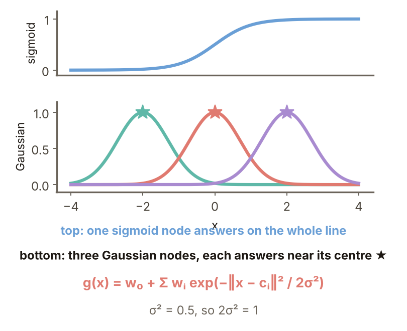

### 2. 局部對全域

**局部反應**：節點只在中心附近回應，離開就趨近 0；相對的**全域反應**是沿整個超平面回應。sigmoid 節點的等值集合是超平面（二維是直線）；RBF 節點是超球面（二維是圓）。**例子**（$2\sigma^2=1$）：距中心 0、1、2、3 時高斯回應 $1,0.368,0.0183,0.000123$。

圖說 `lec05-kp16-contours`：左為 sigmoid 的等值線，右為 RBF 的同心圓。

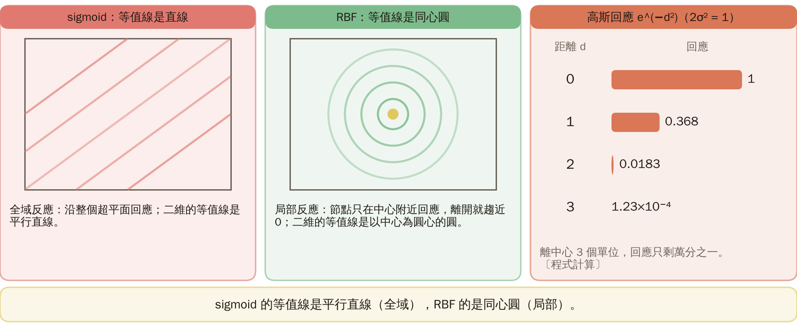

### 3. XOR 只要兩個中心

$k=2$，$c_1=(1,1)$、$c_2=(0,0)$，$f(x)=\exp(-\|x-c\|^2)$：$(0,0)\to(0.135,1)$、$(1,1)\to(1,0.135)$、$(1,0)$ 與 $(0,1)$ 都到 $(0.368,0.368)$，又被「摺疊」到同一點。$g(y)=y_1+y_2-1$：前兩點 $+0.135$，後兩點 $-0.264$，一條直線就分開。

圖說 `lec05-kp16-xormap`：輸入平面（兩個中心為星號）與映射後的特徵平面。

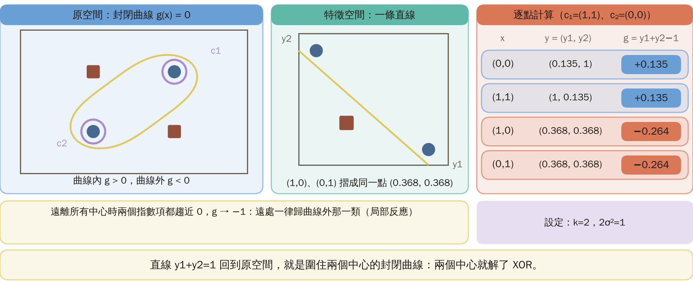

### 4. 回到原空間

$g(x)=e^{-\|x-c_1\|^2}+e^{-\|x-c_2\|^2}-1=0$ 是圍住兩個中心的封閉曲線。四點的 $g$：$(0,0)$、$(1,1)$ 是 $+0.135$（曲線內）；$(1,0)$、$(0,1)$ 是 $-0.264$（曲線外）。離所有中心都很遠時 $g\to-1$，遠處一律歸曲線外那一類，這是局部反應的特性。

圖說 `lec05-kp16-xorcurve`：原平面上的決策曲線與四個點。

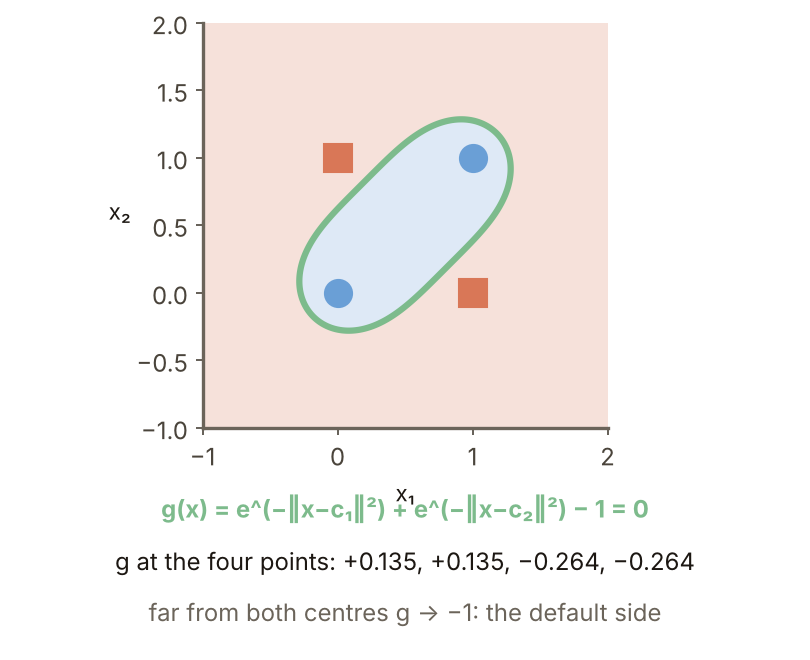

### 5. 固定中心

**固定中心**：從訓練資料隨機挑 $k$ 個點當中心；中心固定後只剩 $w$ 要學，就是 KP13 的線性問題（最小二乘）。**例子**（本講義設計）：同心環資料（內圈半徑約 1、外圈約 2.2），200 個訓練點、500 個沒用來訓練的新點，$\sigma^2=0.5$，每個 $k$ 隨機挑 20 次取平均。新點準確率：$k=2$ 是 64.2%、$k=8$ 是 91.5%、$k=16$ 是 99.5%、$k=32$ 是 99.9%。

圖說 `lec05-kp16-ringsk`：準確率對中心數 $k$。

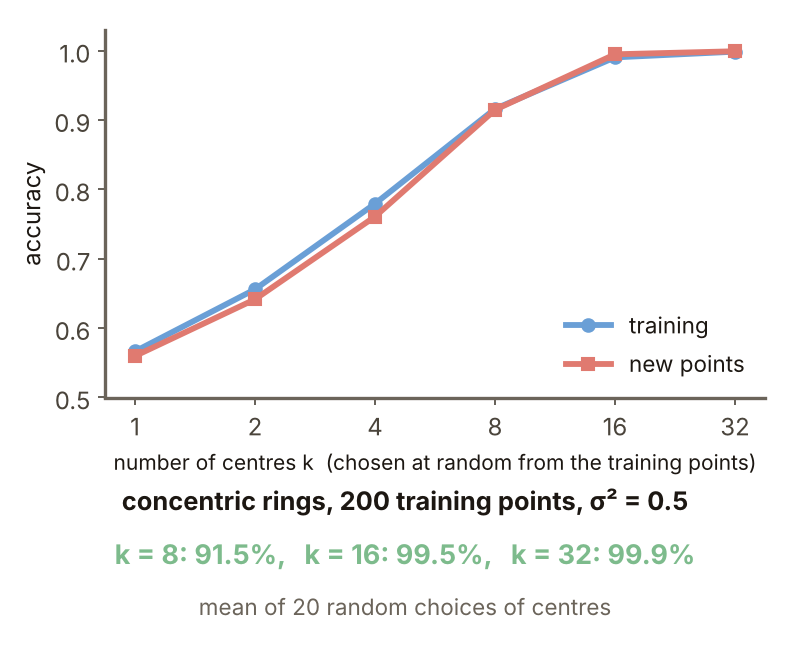

### 6. 中心怎麼選

**分群**（這裡用 k-means）：先把資料分成 $k$ 群，每群的平均當中心，再用監督式的最小二乘學 $w$，是非監督加監督的混合。**例子**（本講義設計）：兩個月牙各 60 點加雜訊、500 個新點，$\sigma^2=0.3$，各重複 20 次。新點準確率：$k=6$：90.5% 對 92.7%；$k=8$：93.3%（標準差 0.018）對 95.0%（0.004）；$k=2,4$ 時隨機反而略高。

**常見迷思**：分群一定比隨機準。其實主要是更穩。

圖說 `lec05-kp16-centers`：隨機與 k-means 中心的新點準確率。

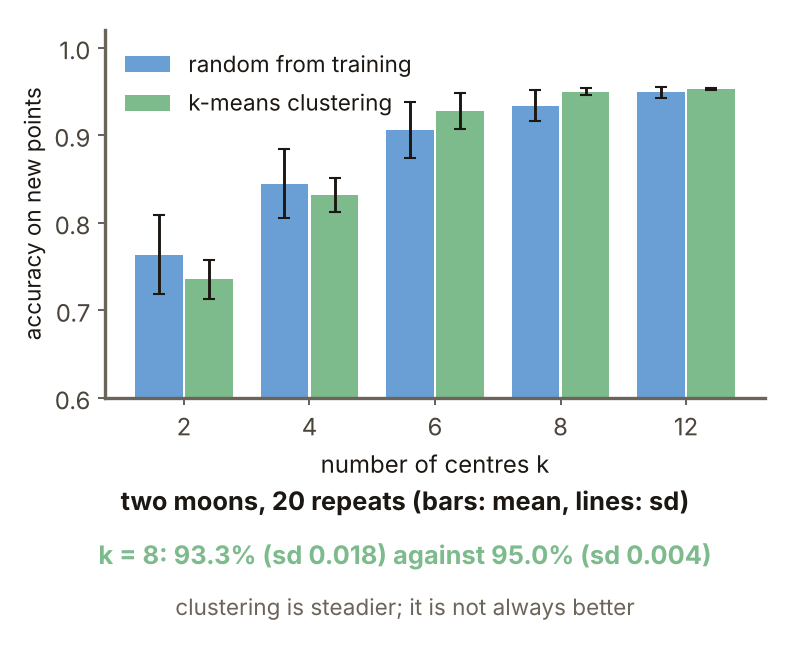

### 7. 局部的代價

**維度詛咒**：維度升高，要填滿空間所需的點或中心數呈指數成長，而資料與中心卻永遠不夠。**例子**（本講義設計）：$l$ 是輸入維度；單位立方體裡隨機放 100 個中心，$\sigma=0.3$，測 2000 個新點；最近中心的距離中位數 $l=2,5,10,20$ 是 $0.05,0.30,0.67,1.22$。回應大於 0.1 的點：$l\le5$ 是 100%，$l=10$ 是 40%，$l=20$ 是 0%。每軸 5 個中心的格子要 25、3125、9,765,625 個（$l=2,5,10$）。

圖說 `lec05-kp16-curse`：回應大於 0.1 的測試點比例。

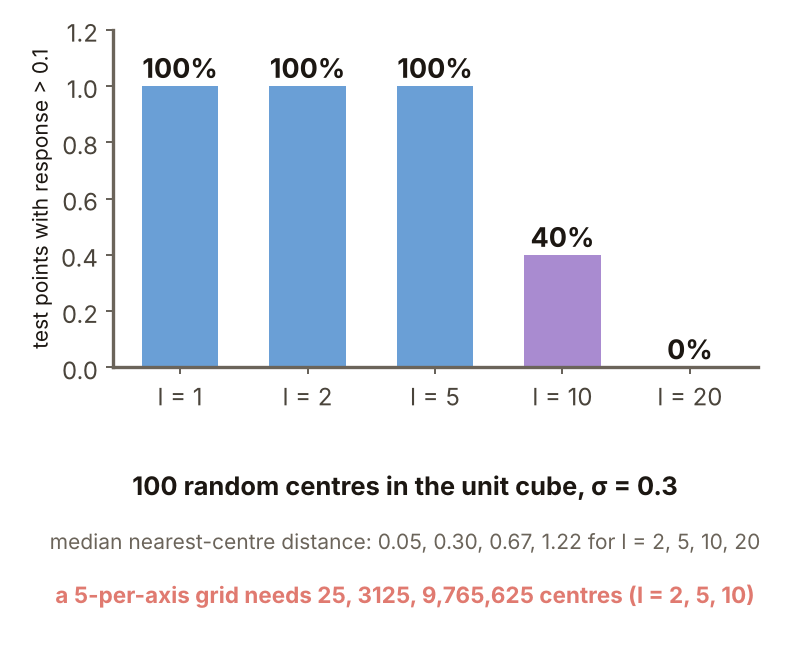

### 8. MLP 對 RBF

MLP 的節點是 $\sum_jw_jx_j$、等值集合是超平面、反應全域；RBF 是 $\|x-c_i\|$、超球面、局部。RBF 學得較快；MLP 在訓練資料稀疏的地方泛化較好；達到相同效能，RBF 要的節點多很多（來源）。**怎麼記**：MLP 用「在超平面哪一側」思考，RBF 用「離中心多近」思考；局部學得快，但吃維度。

圖說 `lec05-kp16-compare`：MLP 與 RBF 網路的比較表。

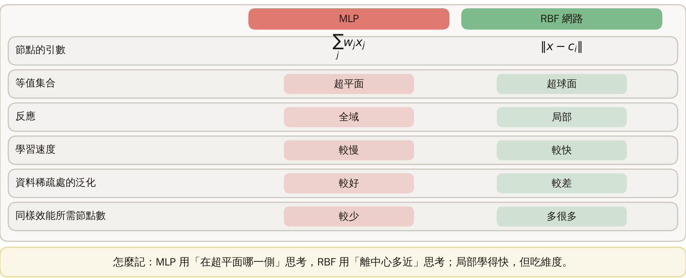

### 延伸：其他選法、練習與解題示範

**中心的其他選法**（來源）：訓練中心（$w_i,c_i,\sigma_i$ 全用梯度下降，成本高）；正交最小平方（先給一大堆候選，再用前向回歸挑出精簡中心，順便估出 $k$）；支持向量（把 RBF 網路看成核映射，訓練是二次規劃、保證全域最佳，中心個數自動決定）；成長式（新樣本若離所有中心都遠、誤差又大，就成為新中心）。

圖說 `lec05-kp16-ways`：中心的六種選法一覽。

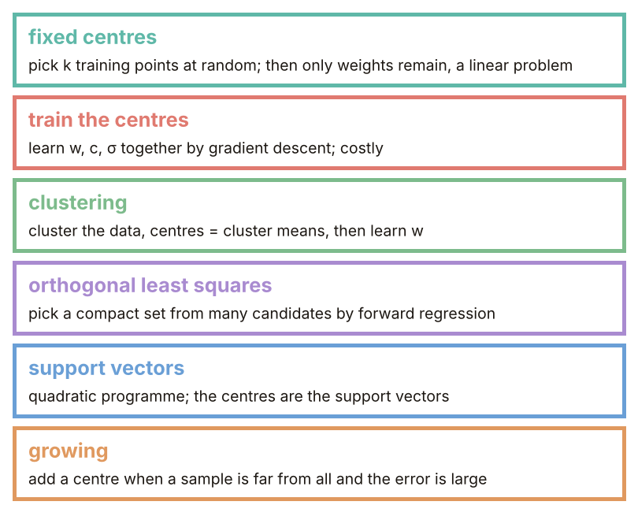

**小練習**：$c_1=(1,1)$、$c_2=(0,0)$，$f=\exp(-\|x-c\|^2)$，$g=y_1+y_2-1$（$g>0$ 為 $\omega_1$）。

1. 把 $(0.5,0.5)$ 映射到 $y$ 並判類。提示：到兩個中心的距離平方都是 0.5。
2. 對遠點 $(3,3)$ 做同樣的事。

圖說 `lec05-kp16-practice`：練習的設定。

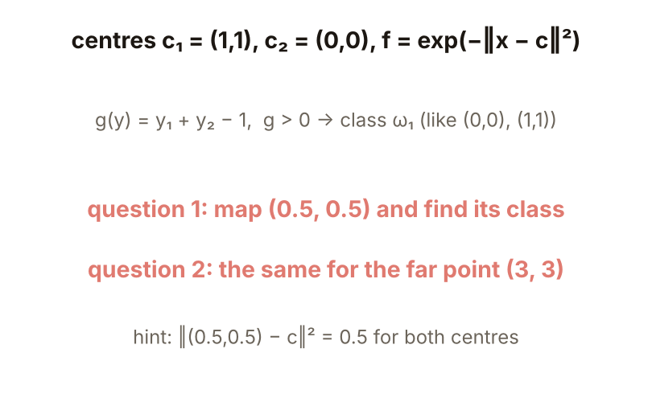

**題 1、2 解題示範**：① $y=(e^{-0.5},e^{-0.5})=(0.607,0.607)$，$g=0.607+0.607-1=+0.213>0$，屬 $\omega_1$。② 距離平方 8 與 18，$y=(0.0003,1.5\times10^{-8})$，$g\approx-1.0<0$，屬 $\omega_2$。③ 核對：中間點在兩個中心之間，被圍進曲線內；遠點落到偏置 $-1$，歸預設那一類。

圖說 `lec05-kp16-practice-sol`：兩個點的映射與 $g$。

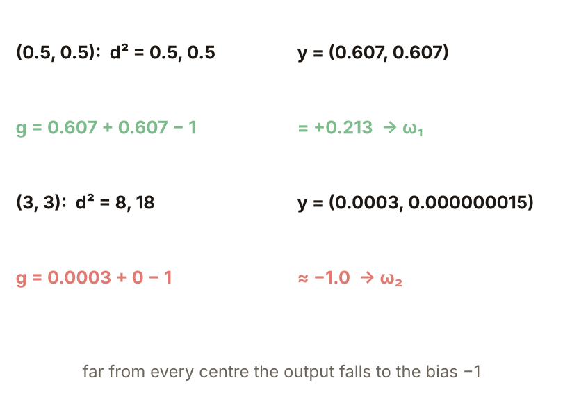

## 術語與來源

| 中文 | English |
|---|---|
| 徑向基函數 | Radial basis function |
| 局部反應 | Local response |
| 固定中心 | Fixed centres |
| 分群 | Clustering |
| 維度詛咒 | Curse of dimensionality |

來源：第四章 KP16，§4.15（2026-10-25 讀取）。RBF 的形式、與 Parzen 的關係、局部對全域的比較表、XOR 的兩個中心與 0.135、0.368 的數字、中心選擇方法與「怎麼記」依來源；環形與月牙的中心數實驗、隨機對 k-means 的比較與局部性的維度實驗由本講義設計並重算（［補充］，（程式計算））。
