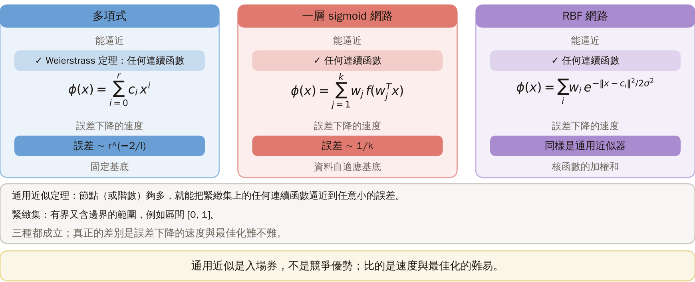
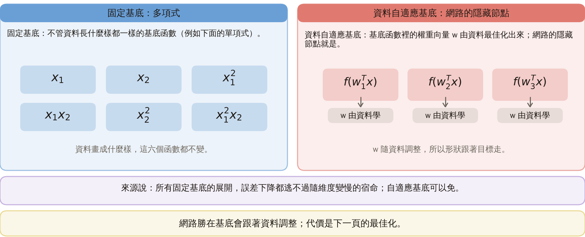

# KP17 通用近似定理

!!! note "自主學習"
    本單元（KP17）列為自主學習，課堂不講授，請同學課前或課後自行閱讀。

> 程度：大學三年級
>
> 圖型識別｜第四章 §4.16

[簡報閱讀與下載](../slides/lec05-kp17-universal-approx.jbd.json) | [English version](en/lec05-kp17-universal-approx.md)

## 學習目標

- 能說明多項式、一層 sigmoid 網路與 RBF 都是通用近似器，差別在誤差下降的速度與最佳化的難易。
- 能說出 Weierstrass 定理與龍格現象，並看懂一維平滑目標與高維脊函數的不同結果。
- 能說明固定基底與資料自適應基底的差別，以及多層為什麼可能更有效率。

## KP17 通用近似定理

**一句話重點**：多項式、sigmoid 網路、RBF 都是通用近似器，通用近似是入場券而不是競爭優勢；真正的差別在誤差下降的速率（多項式 $O(r^{-2/l})$ 對網路 $O(1/k)$）與最佳化的難易。

### 先備與符號

**你需要先會的三件事**：

- **多項式分類器與 RBF 網路**（KP15、KP16）：兩種把輸入換成新座標、再用線性層的作法。
- **sigmoid 與一層網路**（KP06）：隱藏節點 $f(w^Tx)$ 的加權和。
- **最大誤差**：把目標與近似的差取絕對值，在整個區間取最大者；比平均誤差嚴格。

**符號表**（本講義固定使用）：

| 符號 | 意義 | 說明 |
|---|---|---|
| $g(x)$ | 要被近似的目標函數 | 連續函數 |
| $\phi(x)$ | 近似函數 | 多項式或網路 |
| $\epsilon$ | 允許的誤差 | 任意小的正數 |
| $r$ | 多項式階數 | 參數個數 $r+1$（一維） |
| $k$ | 網路隱藏節點數 | 一維時參數個數 $3k+1$ |
| $l$ | 輸入維度 | 第 6、7 節 |
| $n$ | 帽函數疊的層數 | 延伸 |

### 1. 入場券

**白話說明**：哪一種新座標最後能逼近任何函數？誰又逼近得最快？

- **通用近似定理**：節點夠多（或階數夠高），就能把緊緻集上的任何連續函數逼近到任意小的誤差。
- **緊緻集**：有界又含邊界的範圍，例如區間 $[0,1]$。

多項式（Weierstrass 定理）、一層 sigmoid 網路、RBF 網路都成立；差別在誤差下降的速度與最佳化難不難。

| 近似器 | 能逼近什麼 | 速度（誤差） |
|---|---|---|
| 多項式 | Weierstrass：任何連續函數 | $\sim r^{-2/l}$ |
| 一層 sigmoid 網路 | 任何連續函數 | $\sim 1/k$ |
| RBF 網路 | 任何連續函數 | 同樣是通用近似器 |

通用近似是入場券，不是競爭優勢；差別在速度。

圖說 `lec05-kp17-entry`：先看三張卡片：多項式、一層 sigmoid 網路、RBF 網路，每張寫著能逼近什麼與誤差下降的速度；再看下方的定義：通用近似定理與緊緻集。三種都成立，所以通用近似是入場券，不是競爭優勢。〔功能：2〕

### 2. 多項式的保證

**Weierstrass 定理**：緊緻集 $S$ 上的連續函數 $g$，對任何 $\epsilon>0$，存在 $r$ 階多項式 $\phi$ 使

$$
|g(x)-\phi(x)|<\epsilon,\qquad\forall x\in S.
$$

**實驗設定**（本講義設計，可重現）：目標 $g=\sin2\pi x+0.3x^2$，區間 $[0,1]$，取 401 個等距點，用最小二乘配 $r$ 階多項式（以 Chebyshev 基底解，避免數值不穩）。

| $r$ | 1 | 3 | 5 | 7 | 9 | 11 |
|---|---:|---:|---:|---:|---:|---:|
| 最大誤差 | 0.998 | 0.198 | 0.0152 | 0.000607 | 0.000015 | $2.5\times10^{-7}$ |

- 最大誤差是整個區間最差的一點，不是平均。
- 從 $r=3$ 起，階數 $2m-1$ 與 $2m$（$m\ge2$）的誤差相同（$r=1$ 是 0.998、$r=2$ 是 0.948）：令 $t=2x-1$，目標的偶數部分只是 $t^2$ 加常數，$r=2$ 就配完，之後全靠奇數階。

圖說 `lec05-kp17-polyerr`：先看橫軸是階數、縱軸是最大誤差（對數座標）；再看曲線一路下降，r = 3 與 4、5 與 6 …… 連成一個台階，每台階約降一到兩個數量級；右側是 Weierstrass 定理與最大誤差的定義。〔功能：3〕

### 3. 龍格現象

- **龍格現象**：用等距的點內插（強迫多項式通過每個取樣點）高階多項式，端點附近會劇烈擺動，誤差反而變大。

**常見迷思**：階數越高擬合越好。

**實驗設定**：$g=1/(1+25x^2)$，區間 $[-1,1]$；比較兩種作法。

| 階數 $r$ | 4 | 8 | 12 | 16 | 20 |
|---|---:|---:|---:|---:|---:|
| 等距內插（$r+1$ 個等距點，通過每個點）的最大誤差 | 0.44 | 1.05 | 3.66 | 14.4 | 59.8 |
| 400 個等距點的最小二乘的最大誤差 | 0.33 | 0.15 | 0.068 | 0.031 | 0.014 |

內插越高階越糟；最小二乘降得慢但穩。來源也提醒高階多項式有連乘的數值誤差與自由參數太多的問題，折衷是分段近似。

圖說 `lec05-kp17-runge`：先看龍格函數（虛線）與兩條 12 階多項式；再看通過等距點的紅線在兩端劇烈擺動，最小二乘的藍線貼著目標；右側表列階數 4 到 20 的最大誤差。〔功能：2〕

### 4. sigmoid 網路

- **擠壓函數**：把任何輸入壓進一個有限範圍的單調遞增函數，例如 sigmoid。

定理（來源引 Cybenko、Funahashi、Hornik 等）：活化函數是擠壓函數時，單隱藏層、$k$ 夠大的網路

$$
\phi(x)=\sum_{j=1}^{k}w_j^{o}f\bigl(w_j^{hT}x\bigr)+w_o^{o}
$$

能把緊緻集上的連續函數逼近到任意誤差。

**實驗設定**（本講義設計，可重現）：目標與第 2 節相同；網路參數 $3k+1$ 個（每個節點兩個隱藏權重加一個輸出權重，外加一個常數）；初始值取隱藏斜率 $N(0,8^2)$、偏置 $N(0,4^2)$、輸出權重 $N(0,1)$；用 L-BFGS-B 最小化均方誤差（最多 3000 輪）；每個 $k$ 以種子 0 到 7 各訓練一次（共 8 個隨機起點），取最大誤差最好的一個。

| $k$ | 1 | 2 | 3 | 4 | 6 | 8 |
|---|---:|---:|---:|---:|---:|---:|
| 最大誤差（最好的起點） | 0.819 | 0.0142 | 0.0056 | 0.0058 | 0.0045 | 0.0011 |

圖說 `lec05-kp17-mlpfit`：先看目標波形（虛線）；再看 k = 1、2、4 三條擬合線：k = 1 很粗，k = 2 已經貼近，k = 4 幾乎重合；右側是公式、擠壓函數的定義與 k = 1 到 8 的最大誤差。〔功能：2〕

### 5. 一維公平比

比較「相同參數量」：多項式 $r$ 階有 $r+1$ 個參數；網路 $k$ 個節點有 $3k+1$ 個。

| 參數個數 | 多項式 | 網路 |
|---|---|---|
| 7 | $r=6$：0.0152 | $k=2$：0.0142 |
| 13 | $r=12$：$2.5\times10^{-7}$ | $k=4$：0.0058 |
| 19 | $r=18$：$1.9\times10^{-13}$ | $k=6$：0.0045 |

7 個參數時差不多；參數更多時，多項式反而小得多。網路的優勢不在一維平滑目標；定理說的速率差，要到高維才看得出來。

圖說 `lec05-kp17-equal`：先看左圖：一維相同參數量（7、13、19 個），每組兩根長條，多項式與網路，縱軸是對數座標；再看右圖：5 維脊函數的新點誤差，四根藍柱（多項式）都在 0.2 以上，三根（網路）壓到 0.0001 以下。維度一升，勝負反轉。〔功能：3〕

接下來的問題：維度升高時，這個比較會怎麼變？

### 6. 高維

**實驗設定**（本講義設計，可重現）：

- 輸入維度 $l=5$，$x$ 的每個分量為標準常態；目標 $\tanh(2w^Tx)$，$w$ 是隨機單位向量（`default_rng(0)`），這種只依賴單一方向的函數叫「脊函數」。
- 3000 個訓練點、2000 個新點（同一個亂數產生器接續抽）。誤差為新點的均方根誤差。
- 多項式：最小二乘；網路：$k$ 個 tanh 隱藏節點，初始值 $N(0,0.5^2)$，L-BFGS-B（最多 500 輪），每個 $k$ 以種子 0 到 4 試 5 次取最好。

| 模型 | 階數／節點數 | 參數個數 | 新點誤差 |
|---|---|---:|---:|
| 多項式 | $r=1$ | 6 | 0.326 |
| 多項式 | $r=2$ | 21 | 0.326 |
| 多項式 | $r=3$ | 56 | 0.222 |
| 多項式 | $r=5$ | 252 | 0.257 |
| 網路 | $k=1$ | 8 | $<0.0001$ |
| 網路 | $k=2$ | 15 | $<0.0001$ |
| 網路 | $k=4$ | 29 | $<0.0001$ |

**註記**：這個目標剛好是網路的形狀，是偏袒網路的設計，且常態輸入不是緊緻集；這個例子只說明「脊函數」在高維對多項式有多不友善。

### 7. 速率

**速率**（Barron 93，來源）：

- 多項式：$O(r^{-2/l})$。
- 一層 sigmoid 網路：$O(1/k)$，輸入維度 $l$ 完全沒出現在式子裡。

**誤差減半要多少**：多項式的 $r$ 要乘 $2^{l/2}$；網路的 $k$ 永遠只要加倍。

| $l$ | 2 | 5 | 10 | 20 |
|---|---:|---:|---:|---:|
| 多項式 $r$ 要乘的倍數 $2^{l/2}$ | 2 | 5.7 | 32 | 1024 |

這是最壞情況的漸近速率，不是實測；平滑目標（如第 2 節）可快得多，$r$ 與 $k$ 也不是逐參數的比較。

圖說 `lec05-kp17-halving`：先看左側的兩個速率式：多項式 O(r^(−2/l))、網路 O(1/k)；再看右圖橫軸是維度 l、縱軸是「誤差減半所需的增長倍數」（對數座標）：藍柱（多項式）隨維度長到 1024，紅柱（網路）永遠是 2。〔功能：2〕

### 8. 為什麼與代價

- **固定基底**：像 $x_1^2x_2$ 這種，不管資料長什麼樣都一樣的基底函數；多項式就是。
- **資料自適應基底**：$f(w^Tx)$ 裡的 $w$ 由資料最佳化出來的基底函數；網路的隱藏節點就是。

來源說所有固定基底的展開，都逃不過誤差下降隨維度變慢的宿命。

圖說 `lec05-kp17-basis`：先看左卡：固定基底，六個單項式不隨資料改變；再看右卡：資料自適應基底，三個隱藏節點的權重 w 由資料學出。〔功能：2〕

**代價**：最佳化從線性變成非線性。同一份資料、$k=2$、8 個隨機起點（種子 0 到 7）：5 個最大誤差低於 0.1，3 個卡在 0.82 附近（程式計算）。

圖說 `lec05-kp17-restarts`：先看橫軸是八個隨機起點，每個起點兩根柱：k = 2（藍）與 k = 3（紫），圖上方列出 k = 2 的誤差；再數藍柱：五根低於虛線 0.1，三根卡在 0.82 附近。〔功能：3〕

### 延伸：多層更有效、練習與解題示範

**多層更有效**：帽函數 $h(x)=2\min(x,1-x)$ 用 2 個 ReLU 節點（$\max(0,x)$ 這種折線型活化函數）做得出，原理與 sigmoid 相同；疊 $n$ 層得 $2^n$ 段直線，程式數過 $n=1,\dots,4$：2、4、8、16。

- 深的網路需 $2n$ 個節點；
- 只有一個隱藏層的 ReLU 網路最多 $k+1$ 段，要 $2^n-1$ 個節點。

| 層數 $n$ | 3 | 6 | 10 |
|---|---:|---:|---:|
| 深網路的節點數 $2n$ | 6 | 12 | 20 |
| 單隱藏層的節點數 $2^n-1$ | 7 | 63 | 1023 |

來源說用多於一個隱藏層，可能以較少的神經元達到同樣的精度。

圖說 `lec05-kp17-hat`：先看帽函數疊一層、兩層、三層後的折線：每多一層，段數加倍（2、4、8）；再看下方表：深網路 2n 個節點對單隱藏層 2ⁿ−1 個（n = 10 時 20 對 1023）。〔功能：2〕

**小練習**：

1. $l=8$，多項式誤差 $\sim r^{-2/l}$。誤差減半，$r$ 要乘多少倍？
2. 5 層帽函數有幾段？深網路要幾個 ReLU 節點、單隱藏層要幾個？

**題 1 解題示範**：減半 $r^{-2/8}$，$r$ 要乘 $2^{8/2}=2^4=16$ 倍。

**題 2 解題示範**：5 層有 $2^5=32$ 段；深網路 $2\times5=10$ 個節點；單隱藏層 $2^5-1=31$ 個。

**核對**：32 段要 31 個折點，單層 $k$ 個節點最多 $k$ 個折點，所以 $k\ge31$；題 1 是漸近式，不是精確的實測。

## 術語與來源

| 中文 | English |
|---|---|
| 通用近似定理 | Universal approximation theorem |
| 龍格現象 | Runge phenomenon |
| 擠壓函數 | Squashing function |
| 固定基底 | Fixed basis |
| 資料自適應基底 | Data-adaptive basis |

來源：第四章 KP17，§4.16（2026-10-25 讀取）。Weierstrass 定理、sigmoid 網路的通用近似、$O(r^{-2/l})$ 對 $O(1/k)$ 的速率、固定對自適應基底的解釋、多層更有效率與「入場券」說法依來源；所有實驗（多項式與 sigmoid 網路的最大誤差、龍格現象、高維脊函數、隨機起點、帽函數的片段數）由本講義設計並重算（［補充］，（程式計算））。
