# KP18 機率神經網路（PNN）

> 程度：大學三年級
>
> 圖型識別｜第四章 §4.17

[簡報閱讀與下載](../slides/lec05-kp18-pnn.jbd.json) | [English version](en/lec05-kp18-pnn.md)

## 學習目標

- 能說明 PNN 怎麼把 Parzen 估計搬進網路，以及單位範數正規化如何把距離變成內積。
- 能寫出 PNN 的隱藏層與輸出層，並用小例子算出輸出與類別。
- 能說明 PNN 的成本與限制：隱藏層等於訓練集、正規化丟掉長度。

## KP18 機率神經網路（PNN）

**一句話重點**：Parzen 估計本來就是一堆核函數的平均，那就一個訓練點配一個神經元；向量正規化成長度 1 後，平方距離變成內積，式子正好是網路的形式。訓練就是抄資料，代價是把所有訓練點都留著。

### 1. 1 點配 1 個神經元

**白話說明**：有沒有一種網路幾乎不用訓練？

- **Parzen 估計**：在每個訓練點放一個核函數（這裡是高斯），平均起來估計各類的機率密度 $\hat p(x\mid\omega)$。
- **核寬 $h$**：核函數的寬度；越大越平滑，越小越貼近個別訓練點。

貝氏決策比較 $P(\omega_i)\,\hat p(x\mid\omega_i)$ 的最大值。核函數的加總本來就能平行算，所以一個訓練點配一個神經元。

圖說 `lec05-kp18-parzen`：一維五個訓練點各一個核，平均成估計的密度。

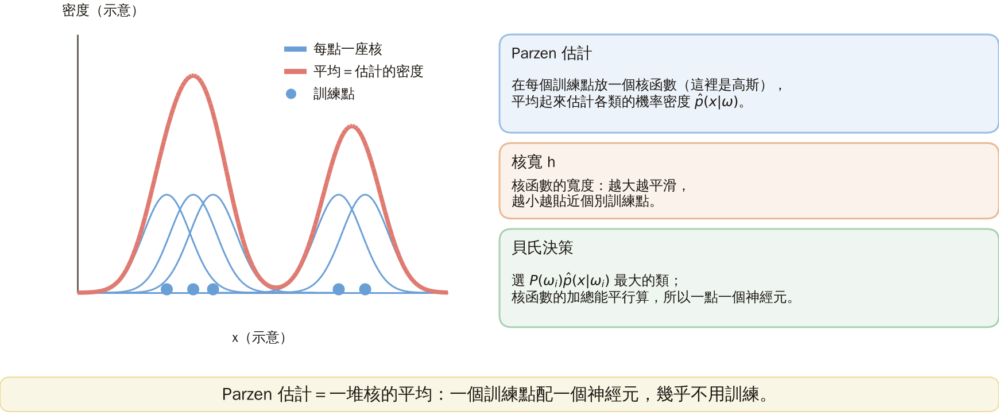

### 2. 距離變內積

**單位範數正規化**：把每個特徵向量除以自己的長度 $\|x\|=\sqrt{\sum_jx_j^2}$，使長度變成 1。平方距離展開

$$
\|x-x_i\|^2=\|x\|^2+\|x_i\|^2-2x_i^Tx,
$$

長度都是 1 時等於 $2-2x_i^Tx$。**例子**：$x=(0.6,0.8)$、$x_i=(1,0)$：內積 $0.6$，距離平方 $2-1.2=0.8$；直接算 $(0.4)^2+0.8^2=0.8$，相同。

圖說 `lec05-kp18-circle`：單位圓上兩個向量與連接它們的弦。

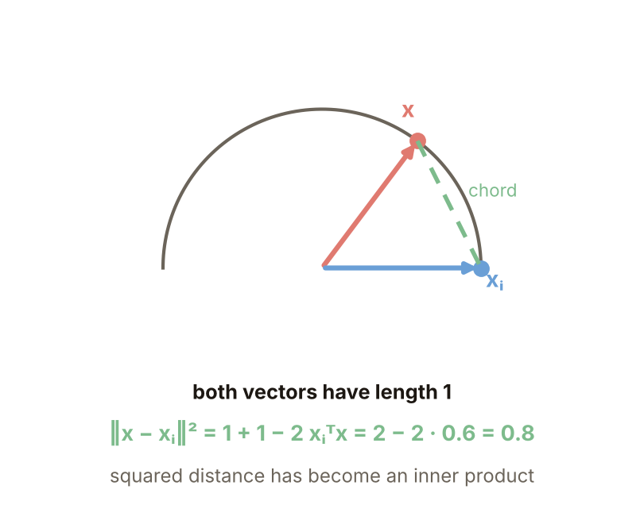

### 3. 判別函數

**正式定義**：代入 $\|x-x_i\|^2=2-2x_i^Tx$ 並丟掉各類共同的 $1/((2\pi)^{l/2}h^l)$ 後，

$$
g(\omega_m)=\frac{P(\omega_m)}{N_m}\sum_{i=1}^{N_m}\exp\Bigl(\frac{x_i^Tx-1}{h^2}\Bigr).
$$

驗算（$h=0.8$）：單位向量 $x=(0.6,0.8)$ 時，距離形式 $\exp(-\|x-x_i\|^2/2h^2)$ 與內積形式 $\exp((x_i^Tx-1)/h^2)$ 都是 $0.5353$。**常見迷思**：不正規化也可以套這個式子。$x=(1.2,1.6)$ 不是單位向量時，距離形式 $0.1312$、內積形式 $1.3668$，差很多；正規化是必要前提。

圖說 `lec05-kp18-kernels`：兩種形式在單位與非單位向量下的值。

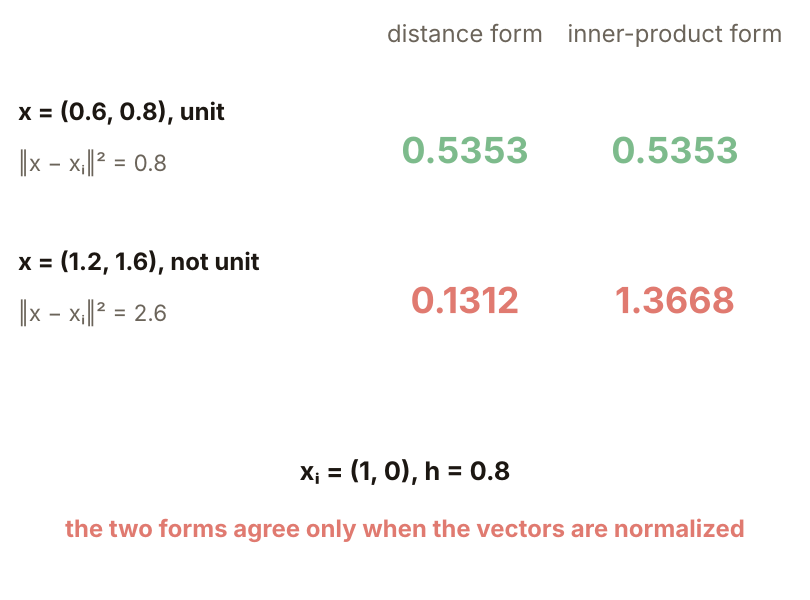

### 4. 網路架構

**機率神經網路**（PNN）：把上式搬進網路。輸入層 $l$ 個節點；隱藏層 $N$ 個節點，第 $k$ 個的權重就是第 $k$ 個訓練向量，輸出 $y_k=\exp((x_k^Tx-1)/h^2)$；輸出層每類一個線性組合器，只連到該類的隱藏節點：$\text{output}_m=\tfrac{P(\omega_m)}{N_m}\sum y_k$，取最大者為類別。這個網路幾乎不用訓練：沒有梯度下降、區域極小值或 epoch。

圖說 `lec05-kp18-arch`：兩個輸入、五個隱藏節點、兩個輸出。

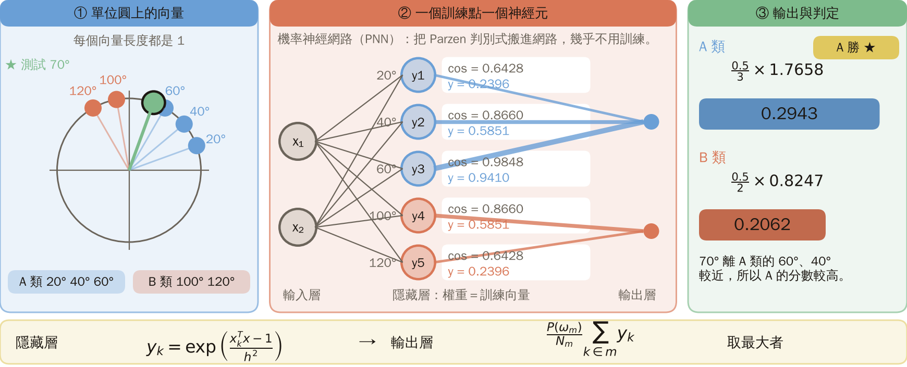

### 5. 完整算一遍

**例子**（本講義設計）：A 類在 $20°,40°,60°$，B 類在 $100°,120°$，測試向量 $70°$，$h=0.5$，先驗各 0.5。隱藏輸出 $y_k$：A：$0.2396,0.5851,0.9410$；B：$0.5851,0.2396$。輸出：A $=\tfrac{0.5}{3}\times1.7658=0.2943$；B $=\tfrac{0.5}{2}\times0.8247=0.2062$；A 勝。

圖說 `lec05-kp18-toy`：五個隱藏輸出與兩個類別輸出。

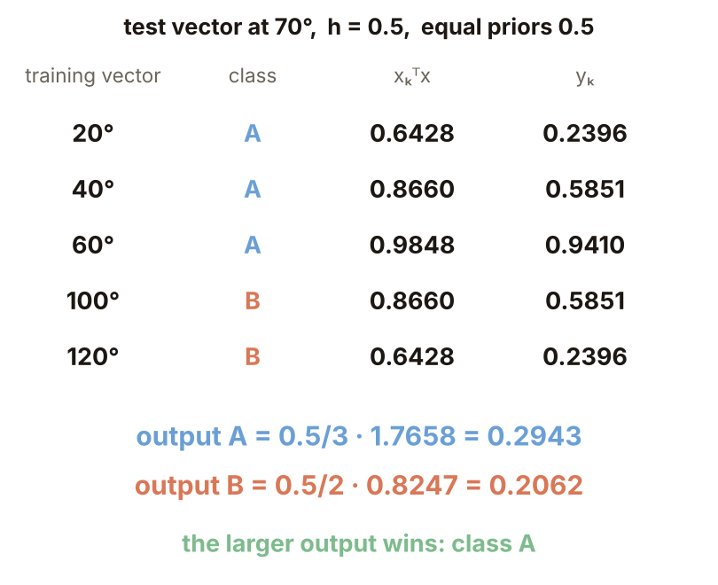

### 6. 核寬的影響

**例子**（本講義設計）：兩類用「方向」區分（平均 $40°$ 與 $110°$、標準差 $25°$），長度隨機；每類 50 個訓練點、500 個新點，正規化後做 PNN。$h=0.02$ 訓練 95%（兩類本來重疊，到不了 100%）、新點 89.6%（貼近個別點）；$h=0.1\sim1$ 新點約 91.6%；$h=5$ 仍有 91.0%。只在 $75°$ 切一刀的新點準確率是 91.9%，PNN 與它接近；這個簡單例子對 $h$ 不敏感，只有太小才傷人。

圖說 `lec05-kp18-hcurve`：準確率對核寬 $h$。

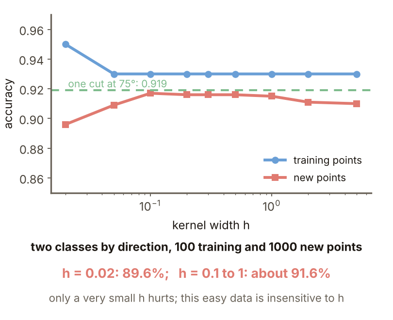

### 7. 留多少點

同樣的資料，每類 $n$ 個訓練點，$h=0.3$，各隨機抽 20 次。新點平均準確率：$n=2$：88.3%（標準差 0.07）；$n=10$：91.8%（0.011）；$n=50$：92.0%；$n=200$：92.0%。這個簡單的資料不必全部保留；留得少，網路就小。

圖說 `lec05-kp18-nsub`：每類訓練點數與新點準確率。

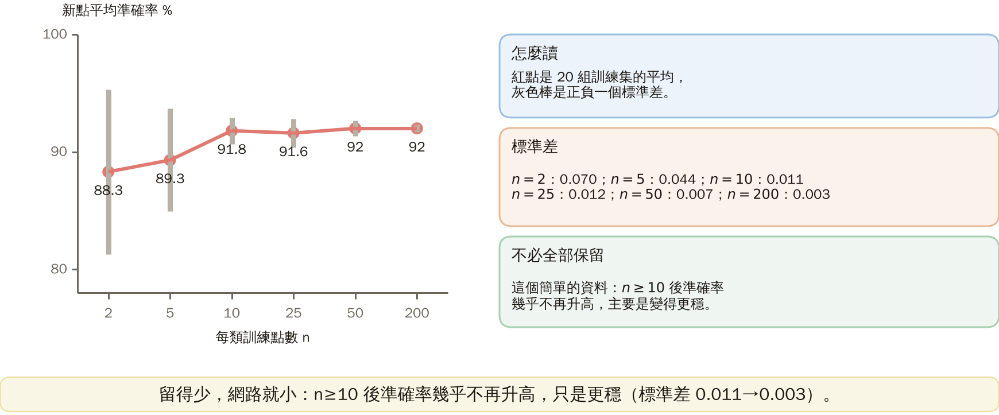

### 8. 成本

每筆測試要 $N\cdot l$ 次乘加，要存 $N\cdot l$ 個數（每個 8 位元組）：$N=100,l=2$：200 次、1.6 KB；$N=10^4,l=10$：$10^5$ 次、0.8 MB；$N=10^6,l=100$：$10^8$ 次、0.8 GB。**怎麼記**：PNN = Parzen 估計的平行硬體版；訓練 = 抄資料，推論 = 全部算一遍，把學習成本轉嫁到推論成本。它與稀疏化（KP21）是光譜兩端：全部保留對只留支撐向量（來源）。

圖說 `lec05-kp18-cost`：算量與記憶體的成本表。

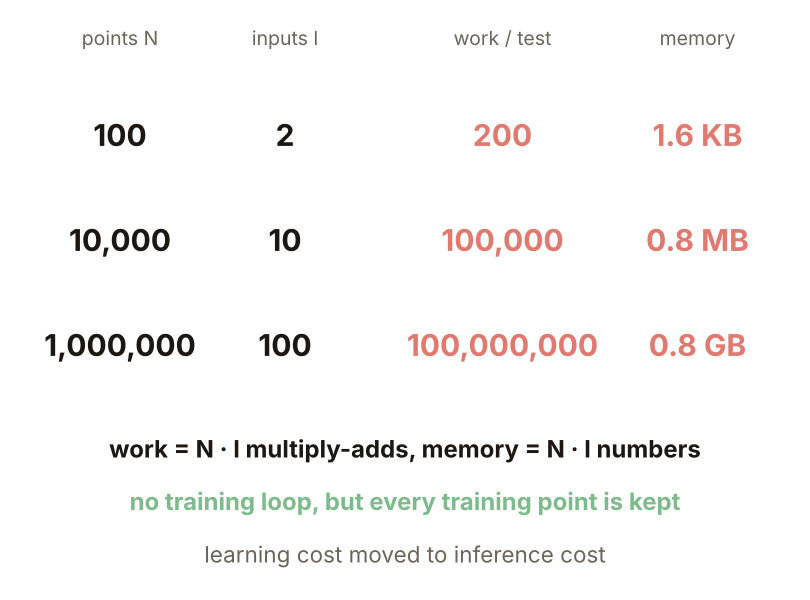

### 延伸：正規化的代價、練習與解題示範

**正規化的代價**（本講義設計）：同心環，兩類只差在半徑（約 1.0 對 2.2），各 200 個點，一半訓練一半測試。正規化後兩類都落在單位圓上、角度分布相同，PNN 新點只對 49.5%，等於亂猜。正規化丟掉了長度；用 PNN 前要確認類別資訊在方向，不在長度。

圖說 `lec05-kp18-rings`：左為兩個同心環，右為正規化後。

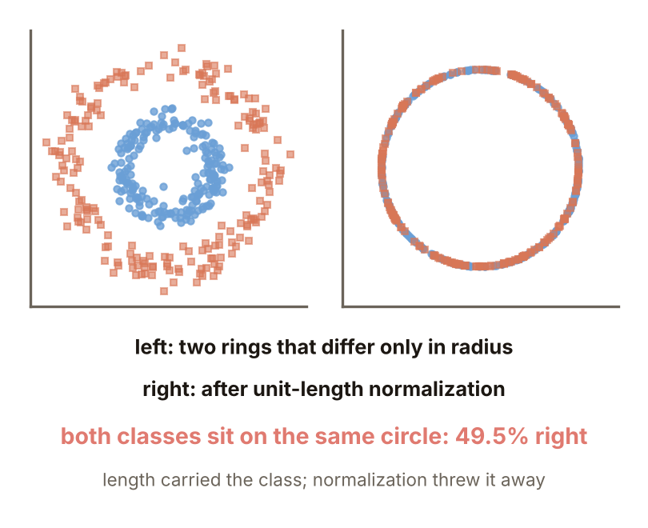

**小練習**：訓練向量 $x_A=(1,0)$、$x_B=(0,1)$，測試向量 $x=(0.8,0.6)$，先驗各 0.5；$y_k=\exp((x_k^Tx-1)/h^2)$。

1. $h=1$，屬哪一類？
2. $h=0.2$，屬哪一類？兩類輸出的比值怎麼變？

圖說 `lec05-kp18-practice`：練習的設定。

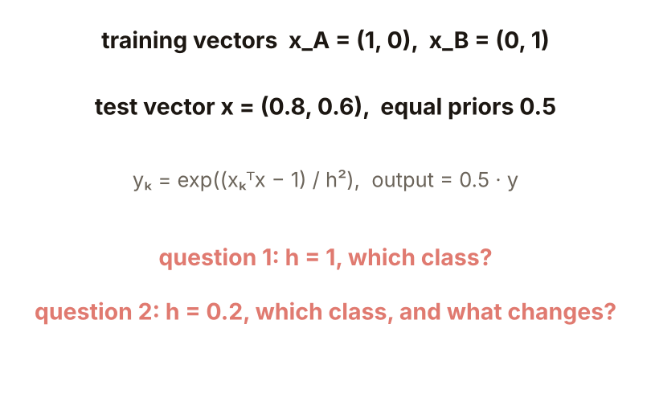

**題 1、2 解題示範**：① $h=1$：$x_A^Tx=0.8$、$x_B^Tx=0.6$；$y_A=e^{-0.2}=0.819$、$y_B=e^{-0.4}=0.670$；輸出 $0.409$ 對 $0.335$，屬 A。② $h=0.2$：$y_A=e^{-5}=0.0067$、$y_B=e^{-10}=0.000045$；輸出 $0.0034$ 對 $0.00002$，仍屬 A，比值從 1.22 變成約 148。③ 核對：$h$ 越小，近的訓練點越被放大，遠的越被壓小。

圖說 `lec05-kp18-practice-sol`：兩種核寬下的計算。

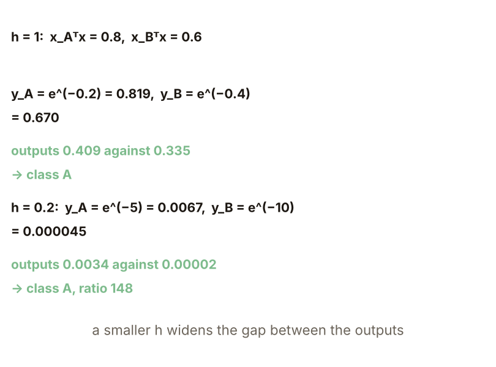

## 術語與來源

| 中文 | English |
|---|---|
| Parzen 估計 | Parzen estimate |
| 核寬 | Kernel width |
| 單位範數正規化 | Unit-norm normalization |
| 機率神經網路 | Probabilistic neural network (PNN) |

來源：第四章 KP18，§4.17（2026-10-25 讀取）。Parzen 估計與貝氏決策、單位範數正規化的化簡、判別函數、網路架構、「幾乎不用訓練」與成本、「怎麼記」依來源；70° 的小例、核寬與訓練點數實驗、成本表與同心環的失敗由本講義設計並重算（［補充］，（程式計算））。
