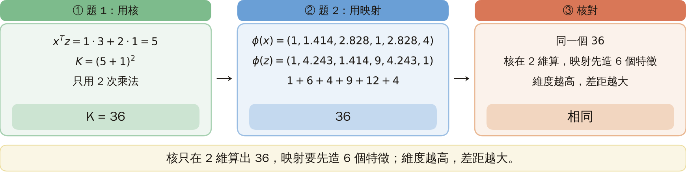

# KP19 非線性 SVM 與 Mercer 核技巧

> 程度：大學三年級
>
> 圖型識別｜第四章 §4.18

[簡報閱讀與下載](../slides/lec05-kp19-kernel-svm.jbd.json) | [English version](en/lec05-kp19-kernel-svm.md)

## 學習目標

- 能說明 SVM 的分類規則只用到內積，以及二次映射的內積恆等式。
- 能說出 Mercer 定理在說什麼、它沒告訴我們什麼，並寫出核化 SVM 的對偶問題與分類規則。
- 能用實驗數字說明核的選擇、超參數 $\gamma$ 與 $C$ 的影響，並用驗證資料（不是測試資料）來選超參數。

## KP19 非線性 SVM 與 Mercer 核技巧

**一句話重點**：SVM 的計算只用到內積，那就把內積換成核函數；於是我們可以在一個從未實際造訪的高維空間裡設計線性分類器，而且算一次核值的工作量與那個空間的維度無關。

### 先備與符號

**你需要先會的四件事**：

- **內積**：兩個向量對應位置相乘再相加，$x^Tz=x_1z_1+x_2z_2$。它的大小反映兩個向量「有多像」。
- **SVM 的基本想法**（KP15）：找一條分界線，讓兩類之間的空白（間隔）最寬；只有最靠近分界線的少數點（支撐向量）決定這條線。
- **軟間隔與 $C$**（KP15）：允許少數點分錯，但每個分錯的點要付出代價；$C$ 是這個代價的權重，$C$ 越大越不容忍分錯。
- **矩陣與特徵值**：特徵值可以想成矩陣沿某些方向的「拉伸係數」。後面只需要知道：係數都不是負的，這個矩陣就叫**半正定**。

**符號表**（本講義固定使用；注意 $y_i$ 只指類別，映射後的向量一律寫 $\phi(x)$）：

| 符號 | 意義 | 說明 |
|---|---|---|
| $x,z$ | 原空間的點 | $l$ 維向量；本講義的實驗 $l=2$ |
| $y_i$ | 第 $i$ 個訓練點的類別 | $y_i\in\{-1,+1\}$ |
| $\phi(x)$ | 映射後的向量 | 把 $x$ 搬到高維（$k$ 維）空間的函數 |
| $K(x,z)$ | 核函數 | $K(x,z)=\phi(x)^T\phi(z)$，直接給出映射後的內積 |
| $\lambda_i$ | 第 $i$ 個點的權重 | 訓練解出；$\lambda_i>0$ 的點是支撐向量 |
| $N,N_s$ | 訓練點數、支撐向量數 | |
| $w_0$ | 偏置 | 分類規則裡的常數 |
| $C$ | 違規代價 | 軟間隔的懲罰權重，也是每個 $\lambda_i$ 的上限 |
| $\gamma$ | 高斯核的寬度參數 | 越大，只有很近的點才「像」 |

### 1. 只用內積

**白話說明**：有沒有只留少數點、又能做非線性分類的辦法？先看 SVM 訓練完成後怎麼分類。

- **支撐向量**：訓練後權重 $\lambda_i>0$ 的訓練點；分類規則只靠它們，數量通常遠少於全部訓練點。

分類規則是：

$$
g(x)=\sum_{i=1}^{N_s}\lambda_iy_i\,x_i^Tx+w_0 .
$$

$g(x)>0$ 判為一類，否則判為另一類。注意式子裡資料只透過內積 $x_i^Tx$ 出現。

若改在 $k$ 維的映射空間設計，只要把 $x_i$ 換成 $\phi(x_i)$，內積換成 $\phi(x_i)^T\phi(x)$。天真的擔心：$k$ 遠大於 $l$，複雜度豈不爆炸？下一節用一個例子回答。

圖說 `lec05-kp19-inner`：先看規則的流程，再看資料在哪一步進入：只有「內積」那一步碰到資料。〔功能：1〕

### 2. 二次映射：高維內積不必真的造出高維向量

**核函數** $K(x,z)$：直接給出映射後內積 $\phi(x)^T\phi(z)$ 的函數，不必先算映射。

**例子**：二維的 $x$ 映射成三維 $\phi(x)=[x_1^2,\ \sqrt2x_1x_2,\ x_2^2]^T$。這時

$$
\phi(x)^T\phi(z)=(x^Tz)^2 .
$$

**驗算**：取 $x=(1,2)$、$z=(2,1)$。

- 先映射：$\phi(x)=(1,\ 2.828,\ 4)$，$\phi(z)=(4,\ 2.828,\ 1)$。
- 內積：$1\times4+2.828\times2.828+4\times1=4+8+4=16$。
- 用核：$x^Tz=1\cdot2+2\cdot1=4$，$4^2=16$。兩者相同。

在高維空間的內積，用原空間的內積再平方就算得出來，不必真的造出三維向量。

圖說 `lec05-kp19-identity`：先看上方核函數的定義與例子，再比較兩條路：路線 A 先映射再內積，路線 B 用核直接算；兩邊都得 16。〔功能：1〕

### 3. 同心環升維

**實驗設定**（本講義設計，程式產生）：兩個同心環。每個點取一個均勻亂數角度，半徑取自常態分布：內環（標籤 $-1$）平均 1、外環（標籤 $+1$）平均 2，標準差都是 $0.25$。訓練集每類 60 點（亂數種子 1），新資料每類 500 點（種子 2）。

**映射的效果**：令 $y_1=x_1^2$、$y_3=x_2^2$，則 $y_1+y_3=x_1^2+x_2^2=\|x\|^2$。映射把「半徑」變成座標。

內環的 $\|x\|^2$ 約 1，外環約 4。我們手動取中間的 $2.5$，畫線 $y_1+y_3=2.5$，這條線沒有經過訓練。

**結果**：取新資料中每類前 100 點共 200 點，這條線判對 195 點，即 97.5%；錯的是兩環邊緣重疊處。

三維裡的平面，回到原空間就是一個圓。圖右沒有畫中間的座標 $\sqrt2x_1x_2$。

圖說 `lec05-kp19-lift`：先看左邊的同心環，沒有任何直線能分開；再看右邊映射後，一條直線 $y_1+y_3=2.5$ 切開兩類。〔功能：1、3〕

### 4. Mercer 定理：什麼樣的函數可以當核？

**問題**：能不能隨便寫一個 $K(x,z)$，就當作某個映射的內積？不能。

**Mercer 條件**：$K$ 是對稱的（$K(x,z)=K(z,x)$）、連續的，而且對任何平方可積的函數 $g$，

$$
\iint K(x,z)\,g(x)\,g(z)\,dx\,dz\ \ge 0 .
$$

平方可積的意思是 $\int g(x)^2dx$ 有限。這個積分條件是「半正定」在連續情形的寫法。

**正式定義（Mercer 定理）**：滿足條件的 $K$，必有一個向量空間 $H$（數學上叫 RKHS，本課不需要它的細節）和映射 $\phi$，使 $K(x,z)=\langle\phi(x),\phi(z)\rangle$。反過來，內積形式的核也滿足條件。

**定理沒告訴我們的事**：它不告訴我們 $\phi$ 長什麼樣，也不告訴我們 $H$ 有幾維；高斯核對應的 $H$ 是無窮維。

**有限點的檢查**（補充）：對任意有限個點 $x_1,\dots,x_n$，**Gram 矩陣** $G_{ij}=K(x_i,x_j)$ 都必須半正定，也就是特徵值都 $\ge0$。

- 小例子：二次核 $K=(x^Tz+1)^2$，兩點 $e_1=(1,0)$、$e_2=(0,1)$：$G=\begin{pmatrix}4&1\\1&4\end{pmatrix}$，特徵值 $3$ 與 $5$，都是正的。
- 30 個隨機點（亂數種子 0）：高斯核最小特徵值 $8.8\times10^{-8}$；二次核 $-8\times10^{-15}$（捨入誤差，視為 0）。

**這個檢查的限制**：找到一個負特徵值，就證明這個核不合法；但沒找到負特徵值，只代表這一組點沒問題，不能證明對所有資料都合法。

圖說 `lec05-kp19-mercer`：先看左欄 Mercer 條件，再看中欄定理與它沒告訴我們的事，最後看右欄有限點檢查的例子；下方黃色列是這個檢查的限制。〔功能：2〕

### 5. 核化 SVM：把內積換成核

**常用的核**：

- 多項式核：$(x^Tz+1)^q$，$q$ 是次數。
- 高斯核（RBF）：$\exp(-\gamma\|x-z\|^2)$。兩點越近值越接近 1，越遠越接近 0；$\gamma$ 越大，「近」的範圍越小。
- 雙曲正切核：$\tanh(\beta x^Tz+\gamma)$，不一定合法，見延伸。

**對偶問題**（SVM 在內積形式下的訓練問題）：

$$
\max_\lambda\ \sum_i\lambda_i-\tfrac12\sum_{i,j}\lambda_i\lambda_jy_iy_jK(x_i,x_j),\qquad 0\le\lambda_i\le C,\quad \sum_i\lambda_iy_i=0 .
$$

**怎麼讀這個式子**：

- 我們要選 $N$ 個權重 $\lambda_1,\dots,\lambda_N$，讓上面的量最大。
- 第一項 $\sum\lambda_i$ 鼓勵權重大；第二項扣掉「相似（$K$ 大）且同類（$y_iy_j=+1$）的點同時權重大」的重複貢獻。
- $0\le\lambda_i\le C$：每個點的影響不能超過 $C$。$C$ 在原本的目標裡是違規的懲罰權重，在這裡變成 $\lambda_i$ 的上限。
- $\sum\lambda_iy_i=0$：兩類的權重總量互相抵消。

訓練好之後，分類規則是

$$
g(x)=\sum_{i=1}^{N_s}\lambda_iy_iK(x_i,x)+w_0 ,
$$

$g>0$ 判給 $\omega_1$。由於核的非線性，這在原空間就是非線性分類器。

**驗算**（補充）：把解出的 $\lambda$ 代入此式，與函式庫給的決策值最大相差 $10^{-14}$。

圖說 `lec05-kp19-kernels`：先看左欄三種常用的核，再看右欄對偶問題（目標、兩個限制與四句讀法），最後看訓練後的分類規則。〔功能：2〕

### 6. 同心環實驗：只換核

**實驗設定**（本講義設計，程式產生）：沿用第 3 節的同心環（標準差 $0.25$，每類 60 點訓練，種子 1；新資料每類 500 點，共 1000 點，種子 2）。用 scikit-learn 的 SVC，核值由我們預先算好再傳入，$C=10$；高斯核 $\gamma=0.5$，二次核 $(x^Tz+1)^2$。只抽這一組資料，沒有重複。

| 核 | 訓練判對 | 新點判對 | 新點準確率 | 支撐向量數 |
|---|---:|---:|---:|---:|
| 線性核 $x^Tz$ | 66/120 | 562/1000 | 56.2% | 118 |
| 二次核 | 117/120 | 976/1000 | 97.6% | 10 |
| 高斯核 | 119/120 | 968/1000 | 96.8% | 19 |

**怎麼看這張表**：資料與演算法都沒換，只換核，新點準確率從近乎亂猜的 56.2% 升到 97% 上下。高斯核的支撐向量只有 19 個；若用 PNN（KP18），要留下全部 120 個訓練點（稀疏化見 KP21）。

圖說 `lec05-kp19-regions`：先看三種核的決策區域，線性核是一條直線、其他兩個是圈；再看圓圈標出的支撐向量，線性核幾乎全部點都是支撐向量。〔功能：1、3〕

### 7. 超參數：用驗證資料來選

**超參數**：訓練前要自己決定、不是由資料解出來的參數，這裡是高斯核的 $\gamma$ 與違規代價 $C$。

**實驗設定**（本講義設計，程式產生）：把同心環弄得更重疊，標準差改成 $0.45$。訓練每類 60 點（種子 3）；**驗證資料**每類 500 點（種子 5），專門用來挑超參數；**測試資料**每類 500 點（種子 4），最後只用來報告一次。先固定 $C=10$ 掃 $\gamma$。

| $\gamma$ | 訓練判對（/120） | 驗證判對（/1000） | 測試判對（/1000） | 支撐向量數 |
|---:|---:|---:|---:|---:|
| 0.01 | 90 | 778 | 772 | 117 |
| 0.1 | 106 | 863 | 870 | 51 |
| **0.5** | 106 | **866** | 861 | 47 |
| 2 | 110 | 835 | 840 | 54 |
| 10 | 118 | 798 | 794 | 99 |
| 50 | 119 | 753 | 747 | 118 |

再固定 $\gamma=0.5$ 掃 $C$：

| $C$ | 訓練判對（/120） | 驗證判對（/1000） | 測試判對（/1000） |
|---:|---:|---:|---:|
| 0.01 | 98 | 838 | 843 |
| 0.1 | 98 | 840 | 848 |
| 1 | 104 | 864 | 864 |
| **10** | 106 | **866** | 861 |
| 1000 | 111 | 807 | 828 |

**怎麼看這兩張表**：

- 訓練判對隨 $\gamma$ 或 $C$ 增大而上升（$\gamma=50$ 時 119/120），驗證與測試卻在中間最好，兩端都下降：貼得太緊，新資料反而變差。
- 選超參數看**驗證**那一欄：$\gamma=0.5$、$C=10$ 最高（866/1000）。把它拿去考測試資料，得 861/1000，即 86.1%。
- 若偷看測試欄挑 $\gamma=0.1$ 可得 87.0%，那是被挑過的數字，偏樂觀。

**常見迷思**：訓練準確率越高越好。其實 $\gamma$ 太大時訓練貼得越緊，新點反而越差。

圖說 `lec05-kp19-hyper`：先看左右兩張圖：訓練（藍）隨 $\gamma$ 或 $C$ 一路上升；再看驗證（綠）與測試（紅）先升後降；黑圈是驗證最高的點，$\gamma=0.5$、$C=10$。〔功能：1、2〕

### 8. 維度無關，但不是沒有代價

**核空間的維度**：維度 $l$、次數 $q$ 的多項式核，顯式特徵有 $\binom{l+q}{q}$ 個：

| $(l,q)$ | 顯式特徵數 |
|---|---:|
| $(2,2)$ | 6 |
| $(10,3)$ | 286 |
| $(100,5)$ | 96,560,646 |
| $(784,5)$ | 2,515,874,132,157（約 $2.5\times10^{12}$） |

**算一次核**：一個內積再取次方，約 $l$ 次乘法，與核空間的維度無關。高斯核的空間是無窮維，一次也只算一個距離。

**限制**（要誠實講）：

- 避免的是「把高維特徵造出來」，不是所有計算。每算一次分類或訓練，都需要核值；訓練有 $N$ 個點，就要處理 $N\times N$ 個核值（Gram 矩陣），樣本一多就是瓶頸。
- 沒人知道怎麼選最好的核；核的好壞要靠驗證資料判斷。

**怎麼記**：只用內積的演算法，都能把內積換成核，升到高維去設計線性分類器；代價是不知道自己到底在哪個空間，而且要付 Gram 矩陣的成本。

圖說 `lec05-kp19-cost`：先看左邊四組 $(l,q)$ 的顯式特徵數（對數刻度橫條），再看右邊三張卡：算一次核與維度無關、限制、核的選擇靠驗證資料。〔功能：3〕

### 延伸：不合法的核、練習與解題示範

**雙曲正切核不一定合法**（本講義設計）：$K=\tanh(2x^Tz+1)$（$\beta=2$、$\gamma=1$）。取三個點 $(-1,0)$、$(1.6,0.9)$、$(0.1,-0.8)$，Gram 矩陣的特徵值是 $-0.132$、$0.875$、$2.232$，有負的，違反 Mercer 條件。

**統計**：每次取 10 個隨機點（亂數種子 5）、抽 200 次：雙曲正切核 200 次都有負特徵值，高斯核 0 次。

對這組參數，雙曲正切不是合法核，對偶問題不保證是凸的（理論推論，非本實驗量測）；用之前先檢查，或改用高斯核。

**小練習**：$K(x,z)=(x^Tz+1)^2$，$x=(1,2)$，$z=(3,1)$；映射 $\phi(x)=[1,\sqrt2x_1,\sqrt2x_2,x_1^2,\sqrt2x_1x_2,x_2^2]$。

1. 直接用核算 $K(x,z)$。
2. 先算 6 個特徵 $\phi(x)$、$\phi(z)$，再算內積，核對與題 1 是否相同。

**題 1、2 解題示範**：① $x^Tz=1\cdot3+2\cdot1=5$，$K=(5+1)^2=36$，只用 2 次乘法。② $\phi(x)=(1,1.414,2.828,1,2.828,4)$、$\phi(z)=(1,4.243,1.414,9,4.243,1)$；內積 $1+6+4+9+12+4=36$，與題 1 相同。③ 核對：同一個 36，核只在 2 維算，映射要先造 6 個特徵；維度越高，差距越大。

圖說 `lec05-kp19-tanh`：先看左邊三個點的 Gram 矩陣特徵值（有一個負的），再看右邊 200 次抽樣：雙曲正切核 200 次都有負特徵值，高斯核 0 次。〔功能：2〕

圖說 `lec05-kp19-solution`：先看題 1 用核算得 36（只用 2 次乘法），再看題 2 用 6 個特徵的映射也得 36，最後核對兩者相同。〔功能：1〕

## 術語與來源

| 中文 | English |
|---|---|
| 支撐向量 | Support vector |
| 核函數 | Kernel function |
| 內積 | Inner product |
| Mercer 條件 | Mercer condition |
| Gram 矩陣 | Gram matrix |
| 半正定 | Positive semi-definite |
| 特徵值 | Eigenvalue |
| 超參數 | Hyperparameter |
| 驗證資料 | Validation data |
| RKHS（再生核希爾伯特空間） | Reproducing kernel Hilbert space |
| 高斯核（RBF） | Gaussian (RBF) kernel |

來源：第四章 KP19，§4.18（2026-10-25 讀取）。SVM 只用內積、二次映射恆等式、Mercer 定理與它沒告訴我們的事、核化對偶與分類規則、複雜度與核空間維度無關、「怎麼記」依來源；同心環實驗、$\gamma$ 與 $C$ 的掃描（含驗證資料的做法）、特徵數表、雙曲正切核的負特徵值與練習由本講義設計並重算（［補充］，（程式計算）；scikit-learn 的 SVC，資料生成式、種子與資料量見各節）。「有限點的 Gram 矩陣必須半正定」是 Mercer 條件的有限點版本，屬補充說明。
