# KP20 超越 SVM：核技巧的通用化與 kernel perceptron

> 程度：大學三年級
>
> 圖型識別｜第四章 §4.19

[簡報閱讀與下載](../slides/lec05-kp20-beyond-svm.jbd.json) | [English version](en/lec05-kp20-beyond-svm.md)

## 學習目標

- 能寫出核技巧的三步配方，並用它核化歐氏分類器，說明它與 Parzen 估計的關係。
- 能寫出 kernel perceptron 的更新與判別式，並手算一個小例子。
- 能比較 hinge、指數、logistic 與 0/1 損失，並說明 logistic 損失為何要正規化。

## KP20 超越 SVM：核技巧的通用化與 kernel perceptron

**一句話重點**：核技巧不是 SVM 的專利；任何只用內積的線性演算法，都能核化成非線性版本。權重向量從不需要被算出來。

### 1. 三步配方

**白話說明**：別的只用內積的演算法，也能像 KP19 那樣升維嗎？

- **核化**：把只用內積的演算法，內積換成核函數，變成原空間裡的非線性版本。

**三步配方**：(1) 把演算法改寫成只含內積；(2) 內積換成 $K$；(3) 把解寫成訓練點的線性組合。權重向量永遠不必算出來；$K$ 與 KP19 一樣，要滿足 Mercer 條件。

圖說 `lec05-kp20-recipe`：三步配方。

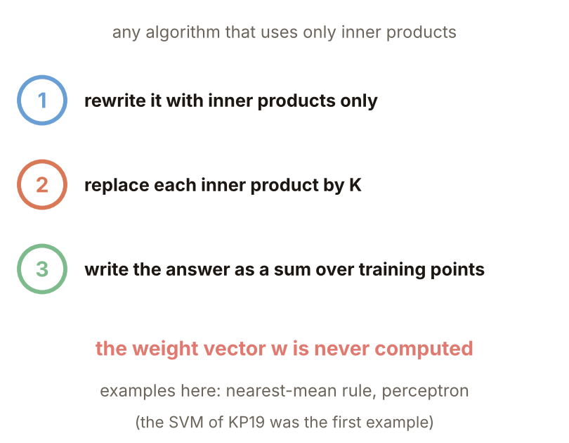

### 2. 歐氏分類器

**正式定義**：在核空間比 $\|\phi(x)-\mu_1\|^2$ 與 $\|\phi(x)-\mu_2\|^2$，$\mu_k$ 是第 $k$ 類 $\phi(x_i)$ 的平均；展開並消去 $\|\phi(x)\|^2$，剩 $\langle\phi(x),\mu_2-\mu_1\rangle>\theta$，$\theta=(\|\mu_2\|^2-\|\mu_1\|^2)/2$，成立判類 2（$y=-1$）。全部換成核：

$$
\frac{1}{N_2}\sum_{i:y_i=-1}K(x,x_i)-\frac{1}{N_1}\sum_{i:y_i=+1}K(x,x_i)>\theta,
$$

$2\theta$ 是類 2 內部核值平均減類 1 內部核值平均。兩個和長得像 Parzen 密度估計（KP18），用高斯核時就是。

圖說 `lec05-kp20-kmean`：核化的歐氏分類器。

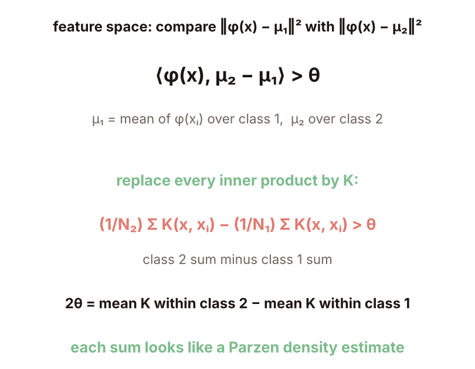

### 3. 同心環上比較

**例子**（本講義設計）：同心環（半徑 1 與 2，標準差 0.25），每類 60 點訓練、500 點新資料；高斯核 $\gamma=0.5$，二次核 $(x^Tz+1)^2$。新點準確率：線性核 48.8%；二次核 93.8%；高斯核 97.4%。拿掉 $\theta$（只比兩個和，等於等先驗的 Parzen 比較）只剩 79.8%。兩類內部的核值平均不同，$\theta$ 就是在補這個差，所以「≈ Parzen」不能忽略它。**常見迷思**：兩個和像 Parzen 估計，所以直接比兩個和就是 Parzen 分類器；實際上少了 $\theta$ 就差很多。

圖說 `lec05-kp20-kmeanres`：四種版本的新點準確率。

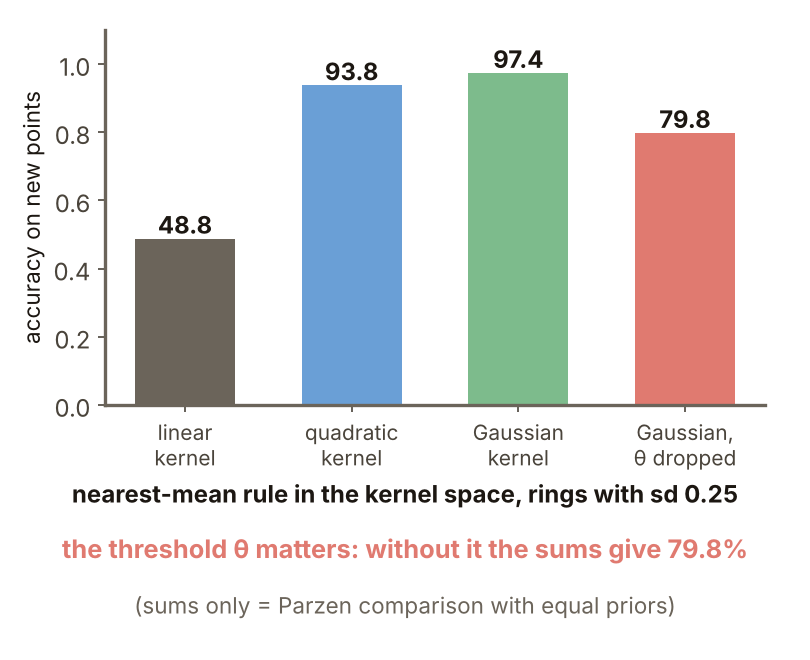

### 4. 核感知器

**核感知器**：在核空間跑感知器，每次誤分類就把該點的計數器 $\alpha_i$ 加 1，不直接算 $w$。更新：$y_tg(x_t)\le0$ 時 $w\leftarrow w+y_t\phi(x_t)$；從零出發，最後 $w=\sum\alpha_iy_i\phi(x_i)$、$w_0=\sum\alpha_iy_i$，所以 $g(x)=\sum\alpha_iy_iK(x,x_i)+\sum\alpha_iy_i$。演算法：全部 $\alpha_i=0$，一輪輪掃過訓練點，$y_ig(x_i)\le0$ 就 $\alpha_i\leftarrow\alpha_i+1$，直到整輪沒有錯。線性感知器要線性可分才收斂；核映射到高維後，依 Cover 定理（KP14）有很高機率可分。

圖說 `lec05-kp20-kperc`：更新、判別式與演算法。

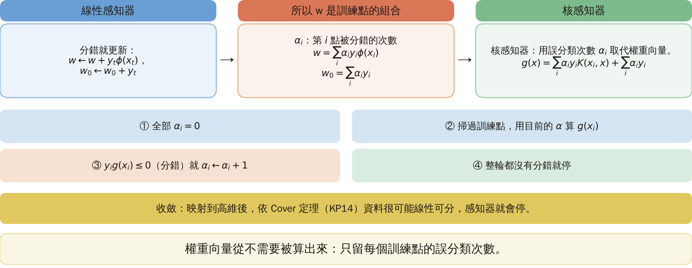

### 5. 手算追蹤

**例子**（本講義設計）：點 $(1,0)+$、$(-1,0)+$、$(0,1)-$、$(0,-1)-$，$K=(x^Tz+1)^2$；沒有直線能分開它們。第 1 輪點 1、3、4 錯，$\alpha=(1,0,1,1)$；第 2 輪點 2 錯，$\alpha=(1,1,1,1)$；第 3 輪沒有錯，停。四個核加起來，$g(x)=2(x_1^2-x_2^2)$；$(2,0)$ 得 $+8$，$(0,2)$ 得 $-8$。

圖說 `lec05-kp20-trace`：每輪的錯誤數與 $\alpha$。

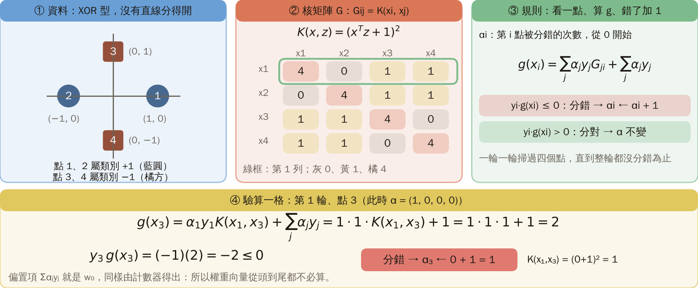

### 6. 同心環實驗

**例子**（本講義設計）：同心環，每類 60 點訓練、500 點新資料；高斯核 $\gamma=0.5$；標準差 0.15（分得開）與 0.25（邊緣相碰）。線性感知器 500 輪後仍有錯，新點 50.0%。核感知器：標準差 0.15 共 8 輪停、新點 98.2%；0.25 共 428 輪停、新點 95.6%，22 個點 $\alpha>0$。可分時保證有限步停，但兩類靠得近時輪數大增；同樣標準差 0.25、一次隨機抽樣：$\gamma=0.1,2,8$ 要 191、571、175 輪。

圖說 `lec05-kp20-epochs`：每輪的錯誤數（橫軸為對數刻度）。

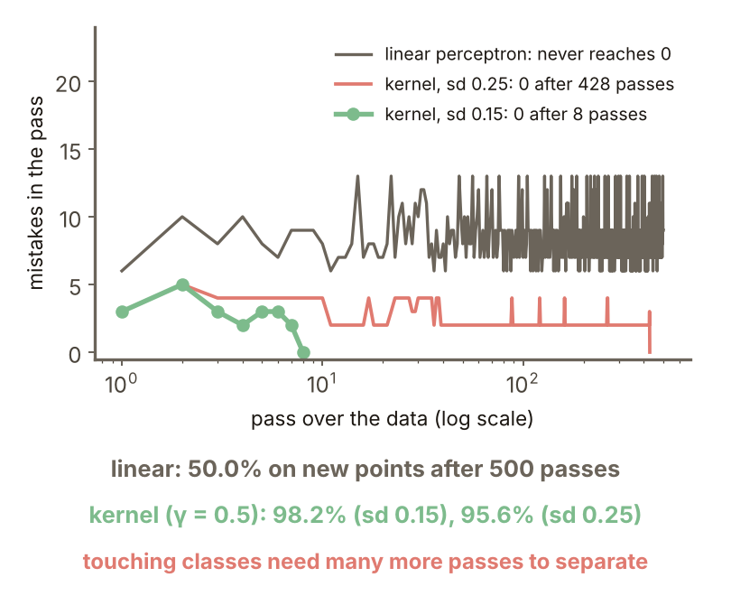

### 7. 損失函數

**間隔值** $z=y\,g(x)$：$z>0$ 分對，$z\le0$ 分錯；越負錯得越離譜。**損失函數**給每個 $z$ 一個罰分，演算法的個性由它決定。四種：hinge $\max(0,1-z)$；指數 $e^{-z}$；logistic $\ln(1+e^{-z})$；0/1（$z\le0$ 記 1）。hinge 是 SVM 的軟間隔；指數用於 AdaBoost（KP25）；logistic 是 logistic 機率模型的負對數概似；0/1 不可微。

圖說 `lec05-kp20-losses`：四種損失對 $z$ 的曲線。

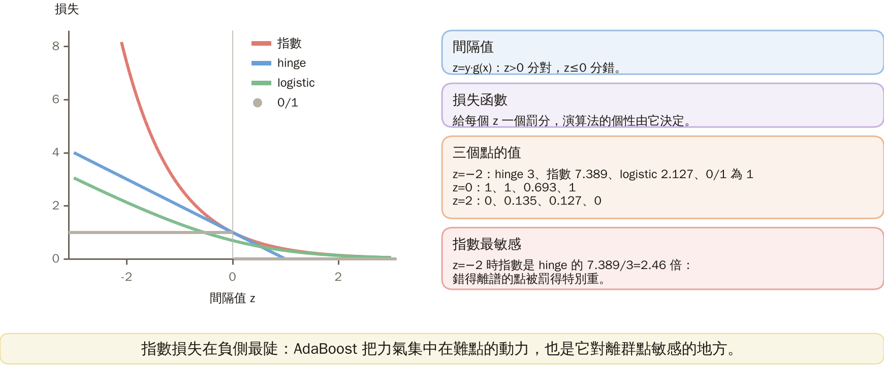

### 8. 損失的性格

$z=-2$：hinge 3、指數 7.389、logistic 2.127、0/1 為 1；$z=0$：1、1、0.693、1；$z=2$：0、0.135、0.127、0。指數在負側最陡，一個錯得離譜的點罰分是 hinge 的 $7.389/3=2.46$ 倍；這是 AdaBoost 的動力，也是它對錯得離譜的點（雜訊、離群點）敏感之處（來源說在高貝氏誤差任務上是弱點，KP25 再談）。**怎麼記**：核技巧通用配方：(1) 只含內積，(2) 內積換成 $K$，(3) 解表示成訓練點的線性組合；權重向量永遠不必算。

圖說 `lec05-kp20-lossvals`：四種損失在五個 $z$ 的數值。

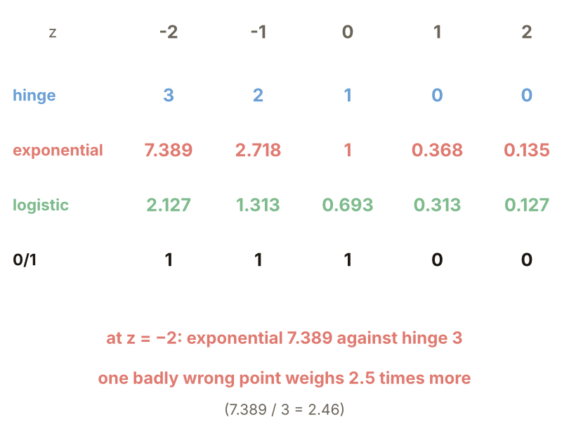

### 延伸：logistic 上界、練習與解題示範

**logistic 損失要正規化**：hinge 與指數都不小於 0/1；logistic $\ln(1+e^{-z})$ 在 $z=0$ 只有 $\ln2=0.693<1$，所以不是上界。除以 $\ln2$ 後 $z=0$ 剛好是 1，$z\le0$ 都 $\ge1$，才是 0/1 的凸上界（來源稱 normalized logistic）。驗算：$z=-2$：$2.127/0.693=3.069$；$z=-1$：$1.313/0.693=1.895$。

圖說 `lec05-kp20-logup`：0/1、logistic 與除以 $\ln2$ 的 logistic。

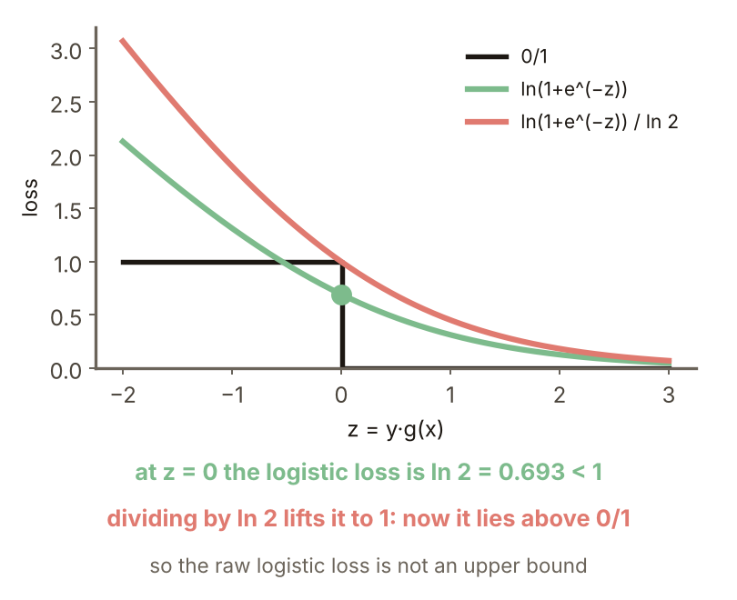

**小練習**：點 $(1,0)+$、$(-1,0)+$、$(0,1)-$、$(0,-1)-$，$K=(x^Tz+1)^2$，$\alpha=(1,1,1,1)$。

1. 用四個核算 $x=(1,2)$ 的 $g(x)$，屬哪一類？
2. 把 $g$ 化簡成 $x_1,x_2$ 的式子，核對題 1。

圖說 `lec05-kp20-practice`：練習的設定。

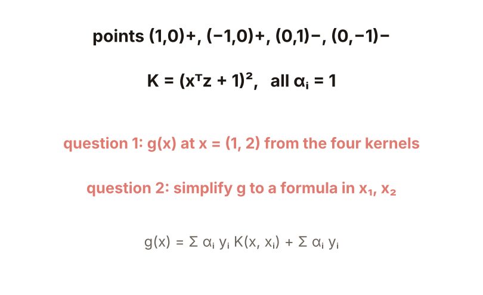

**題 1、2 解題示範**：① $K(x,(1,0))=4$、$K(x,(-1,0))=0$、$K(x,(0,1))=9$、$K(x,(0,-1))=1$；$\sum\alpha_iy_i=0$；$g=4+0-9-1+0=-6$，屬負類。② 四個平方相加，$g=2(x_1^2+1)-2(x_2^2+1)=2(x_1^2-x_2^2)$；$x=(1,2)$：$2(1-4)=-6$，與題 1 相同。③ 核對：$g>0$ 就是 $|x_1|>|x_2|$，判給正類；邊界是兩條斜線，直線分不了的四點被核感知器分開。

圖說 `lec05-kp20-practice-sol`：兩種算法的計算。

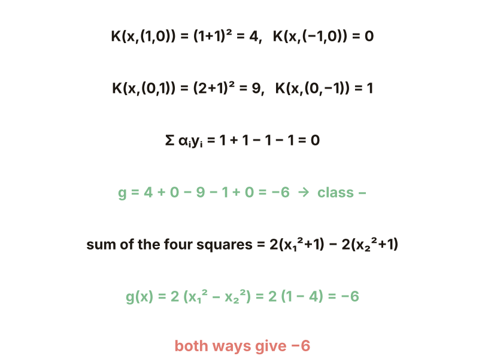

## 術語與來源

| 中文 | English |
|---|---|
| 核化 | Kernelization |
| 核感知器 | Kernel perceptron |
| 間隔值 | Margin value |
| 損失函數 | Loss function |

來源：第四章 KP20，§4.19（2026-10-25 讀取）。核化三步配方、核化的歐氏分類器與 Parzen 的關係、kernel perceptron 的更新與判別式、四種損失與用途、「怎麼記」依來源；同心環比較、4 點手算、感知器的輪數與準確率、損失表、logistic 正規化與練習由本講義設計並重算（［補充］，（程式計算））。
