# KP21 Representer 定理、核函數展開與模型稀疏化

> 程度：大學三年級
>
> 圖型識別｜第四章 §4.19.1

[簡報閱讀與下載](../slides/lec05-kp21-representer.jbd.json) | [English version](en/lec05-kp21-representer.md)

## 學習目標

- 能說明 SVM 的解與 Parzen 展開的差別，以及什麼叫稀疏解。
- 能陳述 Representer 定理，並用數字驗證它；能解 kernel least squares 與加上 $CI$ 的版本。
- 能說明稀疏性來自正則化項，且不是自動有的；能列出稀疏化的四條路線。

## KP21 Representer 定理、核函數展開與模型稀疏化

**一句話重點**：就算在無窮維空間裡找解，最佳解也只是放在 $N$ 個訓練點上的 $N$ 個核的線性組合；正則化項決定這 $N$ 個係數裡有多少個是零。

### 1. 稀疏解

**白話說明**：SVM 的解也是核的加總，到底用了幾個核？

- **稀疏解**：展開式中大多數係數是 0，只有少數項真正用到。

SVM 的解 $g(x)=\sum_{i=1}^{N_s}a_iK(x,x_i)+w_0$，$a_i=\lambda_iy_i$，用高斯核時和 Parzen 展開很像。兩個差別：(1) $g$ 不是密度（積分不為 1）；(2) 項數：Parzen 用全部 $N$ 個點，SVM 只用支撐向量 $N_s$。**例子**（KP19 的資料，$C=10$、$\gamma=0.5$）：120 個訓練點只有 19 個是支撐向量，新點 96.8%。

圖說 `lec05-kp21-sparse`：左為 Parzen 的 120 個核，右為 SVM 的 19 個。

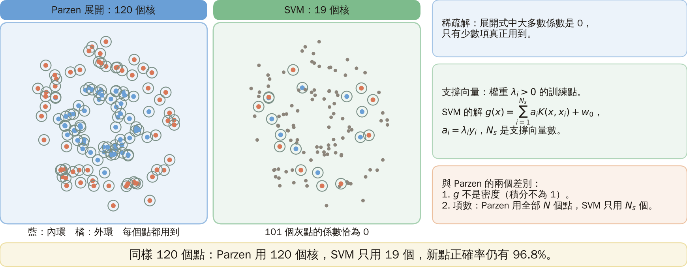

### 2. 表示定理

**Representer 定理**（正式定義）：設 $\mathcal L$ 為任意非負損失，$\Omega$ 嚴格遞增，則正則化代價

$$
\sum_{i=1}^{N}\mathcal L(g(x_i),y_i)+\Omega(\|g\|)
$$

在 RKHS 裡有形如 $g(x)=\sum_{j=1}^{N}a_jK(x,x_j)$ 的最小解。**正則化項** $\Omega(\|g\|)$ 懲罰解的範數，讓解小而簡單。搜尋範圍可能無窮維，最佳解卻只剩 $N$ 個係數。

圖說 `lec05-kp21-rep`：定理的內容。

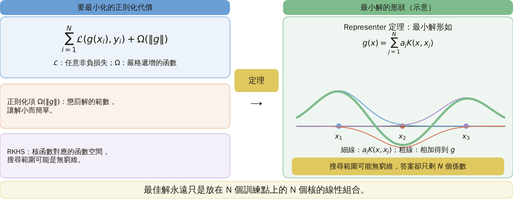

### 3. 數值驗證

**Gram 矩陣** $\mathcal K$：把 $K(x_i,x_j)$ 排成的 $N\times N$ 方陣。**例子**（本講義設計）：二次核對應 6 維特徵；30 個隨機點與目標，$C=0.7$。在 6 維解 $w=(\Phi^T\Phi+CI)^{-1}\Phi^Ty$，用核解 $a=(\mathcal K+CI)^{-1}y$：$w$ 與 $\Phi^Ta$ 最大差 $1.9\times10^{-14}$；新點預測最大差 $2.2\times10^{-14}$。$w=\sum_ja_j\phi(x_j)$ 落在訓練點特徵向量張成的空間裡；這是定理的一個特例。

圖說 `lec05-kp21-repcheck`：6 維與核兩種解法的差。

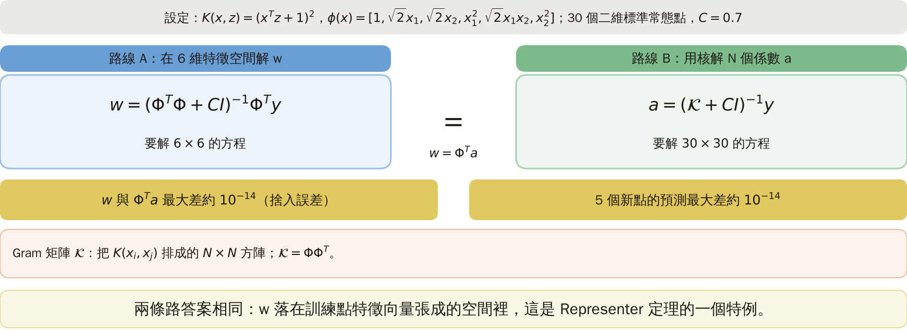

### 4. 核最小平方

代入 $g(x)=\sum_ja_jK(x,x_j)$：$J(a)=(y-\mathcal Ka)^T(y-\mathcal Ka)$，梯度為零得 $a=\mathcal K^{-1}y$，$g(x)=y^T\mathcal K^{-1}p$，$p=[K(x,x_1),\dots,K(x,x_N)]^T$（$\mathcal K$ 要可逆）。**例子**（本講義設計）：點 $x=0,1$，目標 $+1,-1$，核 $K=xz+1$：$\mathcal K=\begin{bmatrix}1&1\\1&2\end{bmatrix}$，$a=(3,-2)$，$g(x)=3-2(x+1)=1-2x$，$g(0.5)=0$。**常見迷思**：Representer 定理保證解稀疏；實際上這個解不稀疏，所有 $a_j$ 通常非零。

圖說 `lec05-kp21-hand`：兩個點的 $g$，$C=0$ 與 $C=1$。

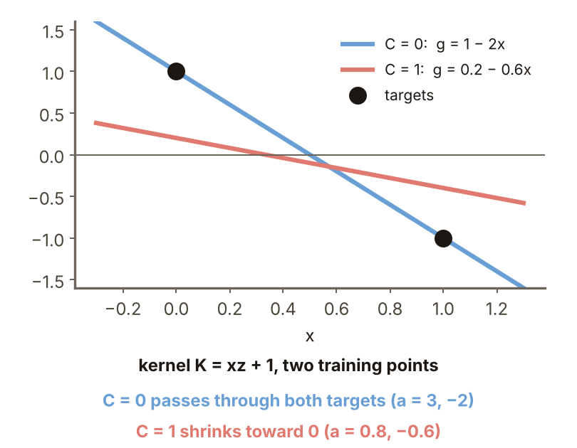

### 5. 有雜訊的資料

**例子**（本講義設計）：$y=\sin x+$雜訊（標準差 0.2），9 點，高斯核 $\exp(-\|x-z\|^2/2\sigma^2)$、$\sigma=0.8$；$\mathcal K$ 的條件數 49。核最小平方：9 個 $a_j$ 全非零（最大 2.82）；訓練誤差 0，穿過每個點；對真正的 $\sin x$ 均方誤差 0.047。這組參數下曲線沒有劇烈震盪；穿過雜訊點是過擬合的方向，但量級不大。

圖說 `lec05-kp21-sin`：9 個點與 $C=0$、0.1、10 的曲線。

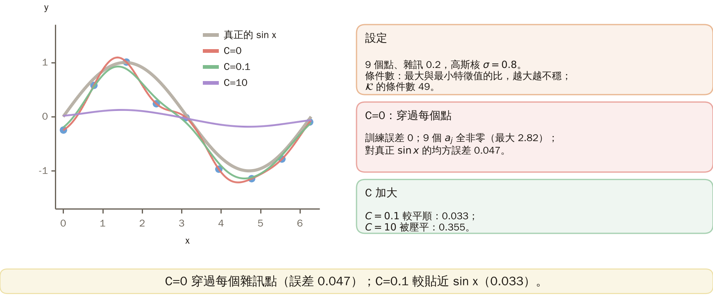

### 6. 加上 C·I

$a=(\mathcal K+CI)^{-1}y$；$C=0$ 就是核最小平方，$C$ 越大解的範數越被壓小；$CI$ 也讓矩陣更好求逆。（訓練、對 $\sin x$ 的誤差）：$C=0.01$：0.0003、0.043；$C=0.1$：0.0063、0.033（最好）；$C=1$：0.078、0.079；$C=10$：0.349、0.355；$C=100$：0.465、0.479。$C$ 太小穿過雜訊，太大曲線被壓平；每個 $C$ 下 9 個 $a_j$ 仍全非零，加 $CI$ 不產生稀疏。

圖說 `lec05-kp21-csweep`：誤差對 $C$。

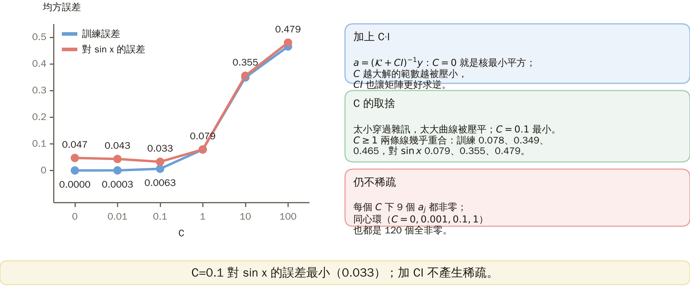

### 7. 稀疏的來源

代價 $J=\tfrac12\|w\|^2+C\sum I(\xi_i)$ 的 $\|w\|^2$ 是正則化項，隱含地把大多數 $\lambda_i$ 逼成 0。**例子**（本講義設計，同心環 120 點，$\gamma=0.5$）支撐向量數（新點準確率）：$C=0.01$：120（94.3%）；$C=1$：39（97.3%）；$C=10$：19（96.8%）；$C=1000$：13（95.4%）。稀疏不是自動的（此處 $C$ 是 SVM 的違規代價，越大越不正則，與脊迴歸的 $C$ 相反）：$\gamma=50$ 時 $C$ 不論多大都有 116 個（86.8%）；$\gamma=0.01$、$C=1$：120 個（71.5%）。

圖說 `lec05-kp21-svcount`：支撐向量數對 $C$。

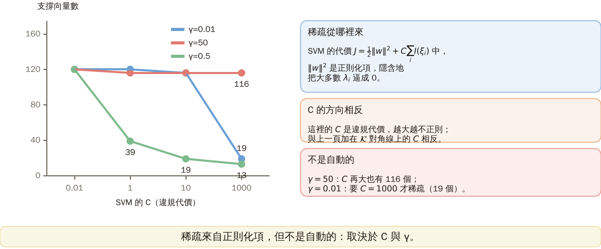

### 8. 稀疏化路線

四條路（來源）：RVM（貝氏先驗，更稀疏，但記憶體隨基底數平方、計算立方）；線上自適應（核化 LMS，範數約束）；投影法（超球約束，等價遺忘因子，複雜度線性）；字典法（相似度低於門檻才加入，複雜度平方）。**字典法實驗**（本講義設計，同心環 120 點、$\gamma=0.5$、點逐一進來、隨機順序）：門檻 0.99 留 90 個；0.9：38；0.7：17；0.5：9。**怎麼記**：Representer 定理把無窮維搜尋化成 $N$ 個係數；SVM 靠正則化項讓多數為零，字典法則靠門檻。

圖說 `lec05-kp21-dict`：門檻 0.7 留下的 17 個點與各門檻的字典大小。

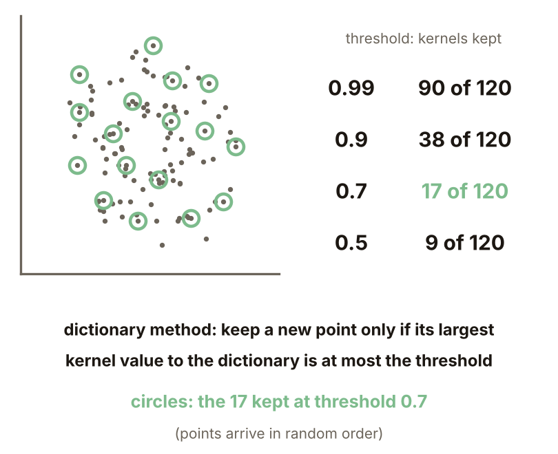

### 延伸：少不一定好、練習與解題示範

**對照**（本講義設計，$C=1000$）：$\gamma=0.01$：19 個支撐向量、96.9%；$\gamma=0.5$：13 個、95.4%；$\gamma=50$：116 個、86.8%。來源提醒：支撐向量太多時，泛化反而退化。但少不保證好（單次實驗，差距可能含雜訊）：$\gamma=0.5$、$C=1$：39 個、97.3%，比 13 個的 95.4% 好；數量只是線索，不是目標。

圖說 `lec05-kp21-dense`：支撐向量數與新點準確率。

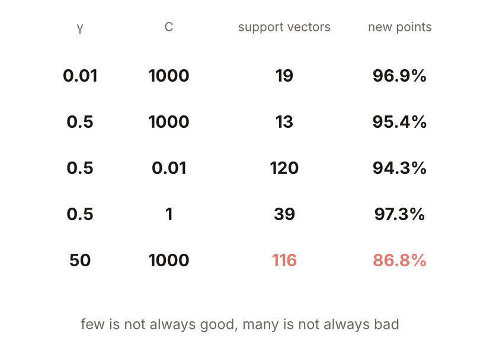

**小練習**：訓練點 $x=0,1$，目標 $+1,-1$，核 $K=xz+1$；$g(x)=a_1K(x,0)+a_2K(x,1)$。

1. $C=1$，解 $a=(\mathcal K+I)^{-1}y$，求 $g(0)$ 與 $g(1)$。
2. 與 $C=0$ 的 $g(0)=1$、$g(1)=-1$ 比，$C$ 對解做了什麼？

圖說 `lec05-kp21-practice`：練習的設定。

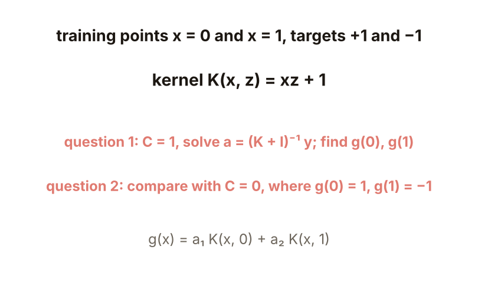

**題 1、2 解題示範**：① $\mathcal K+I=\begin{bmatrix}2&1\\1&3\end{bmatrix}$，行列式 5，反矩陣 $\tfrac15\begin{bmatrix}3&-1\\-1&2\end{bmatrix}$；$a=\tfrac15(3+1,-1-2)=(0.8,-0.6)$；$g(0)=0.8-0.6=0.2$，$g(1)=0.8-1.2=-0.4$。② $C=0$ 時是 $+1$、$-1$（剛好穿過），$C=1$ 縮成 $0.2$、$-0.4$：$C$ 把解壓向 0；兩個係數仍都非零。

圖說 `lec05-kp21-practice-sol`：計算過程。

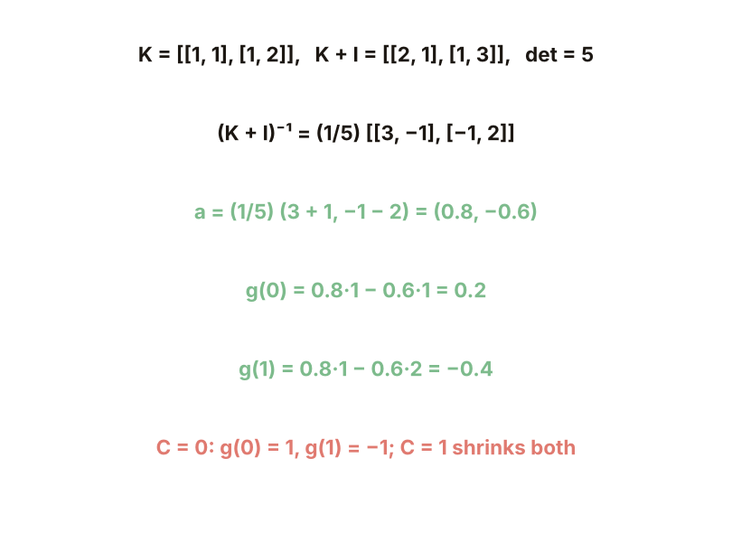

## 術語與來源

| 中文 | English |
|---|---|
| 稀疏解 | Sparse solution |
| Representer 定理 | Representer theorem |
| 正則化項 | Regularization term |
| Gram 矩陣 | Gram matrix |

來源：第四章 KP21，§4.19.1（2026-10-25 讀取）。SVM 解與 Parzen 展開的差別、Representer 定理、核最小平方的封閉解、稀疏性來自正則化項、四條稀疏化路線、「怎麼記」依來源；6 維驗證、手算、雜訊 9 點、支撐向量數表、字典法實驗與練習由本講義設計並重算（［補充］，（程式計算））。
