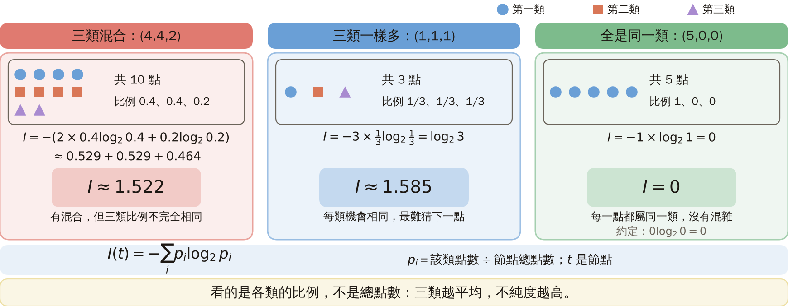
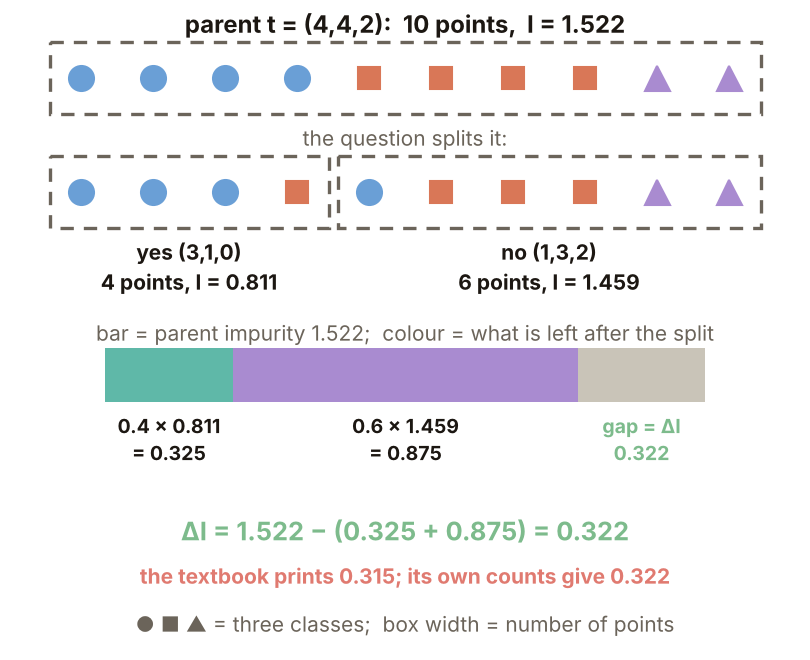
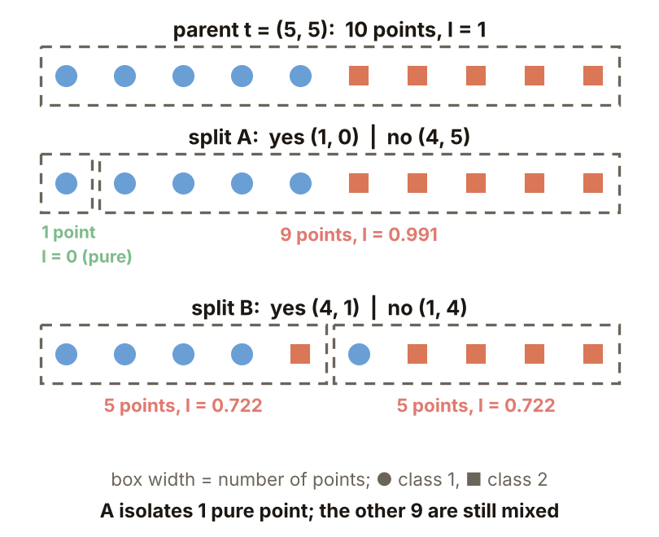
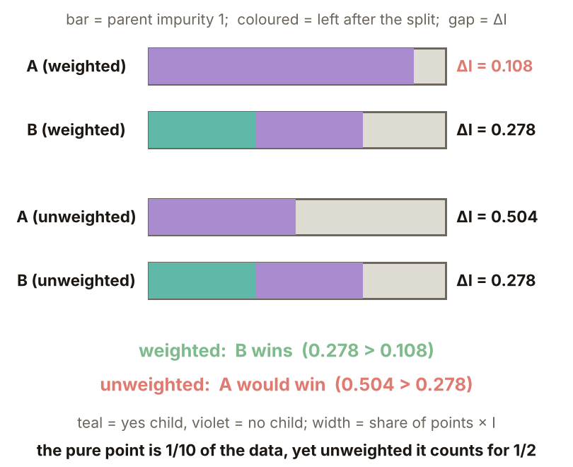
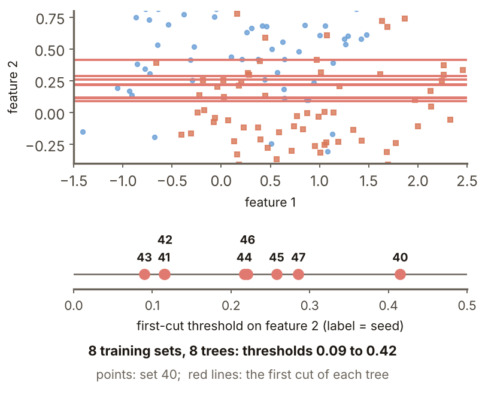
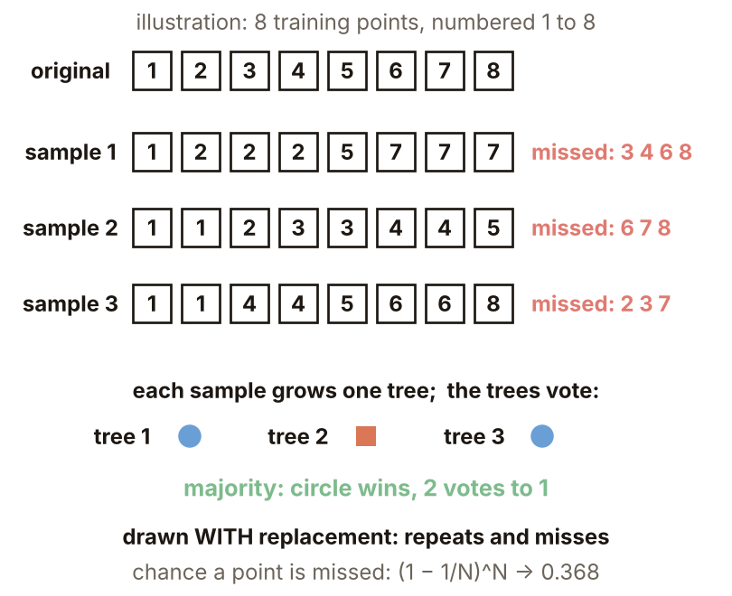
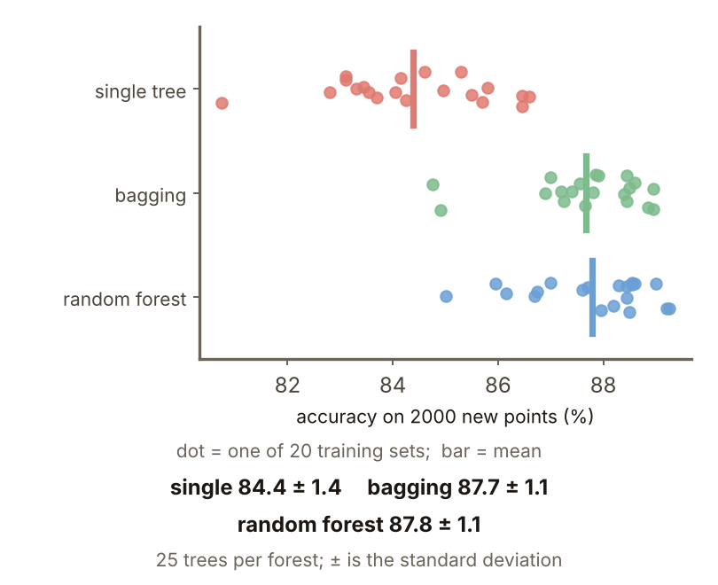

# KP23 決策樹：OBCT、分裂準則與剪枝

> 程度：大學三年級
>
> 圖型識別｜第四章 §4.20

[簡報閱讀與下載](../slides/lec05-kp23-decision-tree.jbd.json) | [English version](en/lec05-kp23-decision-tree.md)

## 學習目標

- 能說明 OBCT 的結構與訓練時要決定的四件事，並算出不純度與不純度下降量。
- 能說明為什麼子節點要加權、樹太大會怎樣、剪枝怎麼做。
- 能說明決策樹的高變異，以及 bagging 與隨機森林怎麼降低它。

## KP23 決策樹：OBCT、分裂準則與剪枝

**一句話重點**：不畫一條複雜的邊界，改問一連串簡單的是非題；每問一次，就把特徵空間切一刀。樹的大小才是關鍵，單棵樹的變異很大，bagging 能平均掉。

### 先備與符號

**你需要先會的幾件事**：

- **機率與比例**：一個節點裡有 $N_t$ 個訓練點，其中第 $i$ 類有 $N_t^i$ 個，第 $i$ 類的比例是 $N_t^i/N_t$。
- **對數 $\log_2$**：$\log_2 8=3$，意思是「2 要乘幾次才到 8」。比例小於 1 時 $\log_2$ 是負的。
- **多數決**：一群分類器各投一票，票數最多的類別勝。
- **過擬合**（KP10）：模型把訓練集的細節也學進去，訓練分數很高，新資料反而變差。

**符號表**（本講義固定使用）：

| 符號 | 意義 | 說明 |
|---|---|---|
| $t$ | 樹的一個節點 | $t_Y,t_N$ 是回答「是」、「否」的兩個子節點 |
| $N_t$ | 節點 $t$ 內的訓練點數 | $N_{tY},N_{tN}$ 是兩個子節點的點數 |
| $N_t^i$ | 節點 $t$ 內第 $i$ 類的點數 | |
| $M$ | 類別數 | |
| $P(\omega_i|t)$ | 節點內第 $i$ 類的比例 | 用 $N_t^i/N_t$ 估計 |
| $I(t)$ | 節點 $t$ 的不純度 | 第 3 節 |
| $\Delta I$ | 不純度下降量 | 第 4 節 |
| $x_k$ | 第 $k$ 個特徵 | |
| $\alpha$ | 門檻（第 1、2 節）、剪枝強度（第 7 節） | 兩個用途不同，由所在節判斷 |
| $B$ | bagging 的樹數 | 第 8 節 |

### 1. 一連串是非題

**白話說明**：分類能不能不畫邊界，只問一連串簡單的是非題？

- **決策樹**：沿著節點路徑做一連串是非決策，逐步排除類別，直到抵達葉節點（沒有再往下問的節點，決定最後的類別）。

最流行的是 OBCT（ordinary binary classification tree，普通二元分類樹）：每個節點只問一個特徵「$x_k\le\alpha$？」，是與否各通往一個子節點。空間因此被切成與座標軸平行的超矩形（二維就是長方形）。

**好處**：

- 類別很多時特別有利。
- 常常不必測完所有特徵。
- 結構簡單、易解釋。
- 數值與類別型特徵都能處理。

圖說 `lec05-kp23-partition`：先看左邊的三塊區域，邊都與座標軸平行；再看右邊的樹，每個內部節點對應左邊的一刀。〔功能：1、3〕

接下來的問題：要建一棵樹，到底要先決定哪些事？

### 2. 四件事與候選問題

**訓練要決定四件事**：

1. 候選問題集：每個節點可以問哪些問題。
2. 分裂準則：哪個問題最好。
3. 停止分裂規則：什麼時候不再分。
4. 葉的類別指派規則：葉裡怎麼決定類別（常用多數）。

**候選問題怎麼來**：特徵 $x_k$ 在節點內有 $N_{tk}$ 個相異值，把它們排序，取相鄰兩個值的中點當門檻。這樣最多有 $N_{tk}-1$ 個問題（教材寫 $N_{tk}$ 個）；全部特徵加起來是有限個。

**例子**（本講義設計）：某特徵有 10 個相異值 1.0、1.4、2.2、2.8、3.5、4.1、5.0、5.5、6.2、7.0，排序後相鄰兩值的中點就是 9 個門檻，例如 $(1.0+1.4)/2=1.2$、$(1.4+2.2)/2=1.8$。

圖說 `lec05-kp23-cands`：先看 10 個值，再看相鄰值之間的 9 個中點。〔功能：1〕

接下來的問題：這麼多候選問題，用什麼標準挑最好的？先要能衡量「一個節點有多亂」。

### 3. 不純度

**白話說明**：節點裡的點如果各類都有，就叫「不純」；全是同一類，就是「純」。不純度用一個數字表示有多亂。

**不純度**（正式定義，熵）：

$$
I(t)=-\sum_{i=1}^{M}P(\omega_i|t)\log_2P(\omega_i|t).
$$

**性質**：

- 各類等量時最大（$M$ 類是 $\log_2M$）。
- 全屬同一類時為 0（約定 $0\log0=0$）。
- 機率用 $N_t^i/N_t$ 估計。

**算例，一步一步來**：

- $(4,4,2)$（三類各有 4、4、2 個點）：比例 $(0.4,0.4,0.2)$；$I=-2\times0.4\log_20.4-0.2\log_20.2=2\times0.529+0.464=1.522$（教材寫 1.521）。
- $(1,1,1)$：$I=-3\times\tfrac13\log_2\tfrac13=\log_23=1.585$。
- $(5,0,0)$：$I=-1\cdot\log_21=0$。

圖說 `lec05-kp23-entropy`：先看兩類時的熵曲線，兩類等量時最高（1）、全屬一類時為 0；再看三個算例落在哪裡。〔功能：1、2〕

圖說 `lec05-kp23-impfull`：［補充］先看三欄的圖示：每欄是一個節點，圓、方、三角各是一類，共幾點與各類比例寫在右邊；再看欄內的代入式與大字的 $I$：(4,4,2) 為 1.522，(1,1,1) 為 1.585（三類時的最大），(5,0,0) 為 0；最後看底部的公式與結論：各類越平均，不純度越高。〔功能：1、2〕

接下來的問題：有了不純度，怎麼比較兩個問題誰切得更好？

### 4. 不純度下降量

**怎麼比較**：問完一個問題，節點分成 Yes 與 No 兩個子節點。看分完之後不純度比分之前少多少：

$$
\Delta I=I(t)-\frac{N_{tY}}{N_t}I(t_Y)-\frac{N_{tN}}{N_t}I(t_N).
$$

選使 $\Delta I$ 最大的問題。

**Example 4.2**（教材例題）：$t=(4,4,2)$，Yes 子節點 $(3,1,0)$，No 子節點 $(1,3,2)$。

- $I(t)=1.522$。
- $I(t_Y)=I(3,1)=-\tfrac34\log_2\tfrac34-\tfrac14\log_2\tfrac14=0.811$。
- $I(t_N)=I(1,3,2)=1.459$。
- 子節點大小：$N_{tY}=4$、$N_{tN}=6$，權重 $0.4$ 與 $0.6$。
- $\Delta I=1.522-0.4\times0.811-0.6\times1.459=0.322$。

**與教材不符之處**：教材寫 $I(t_Y)=0.815$、$I(t_N)=1.472$、$\Delta I=0.315$，與它自己的計數不符（用它印的數字算也只有 0.312）；本講義只重算了這個分裂。

圖說 `lec05-kp23-dI`：［補充］先看上方兩列：父節點的 10 個點被問題分成 4 點與 6 點，框寬與點數成比例；再看下方橫條：灰條長 $I(t)=1.522$，兩段彩色是分完剩下的（$0.4\times0.811=0.325$、$0.6\times1.459=0.875$），灰色缺口就是 $\Delta I=0.322$。教材印 0.315。〔功能：1、3〕

接下來的問題：算 $\Delta I$ 時，為什麼子節點要乘上各自的大小比例，不能直接平均？

### 5. 為什麼要加權

**例子**（本講義設計）：父節點有 5 個 $\omega_1$、5 個 $\omega_2$，$I=1$。

- 分裂 A：Yes $(1,0)$、No $(4,5)$。
- 分裂 B：Yes $(4,1)$、No $(1,4)$。

圖說 `lec05-kp23-split`：［補充］先看最上面的父節點，10 個點（5 個藍圓、5 個橘方）排成一列；再看分裂 A：虛線框的寬度與點數成比例，最左邊只有 1 個點、它是純的，右邊 9 個點（4 藍 5 橘）仍然混；最後看分裂 B：分成 5 與 5 兩堆，不純度都是 0.722。〔功能：1、2〕

**加權**（正確的做法）：

- A：$\Delta I=1-\tfrac1{10}\cdot0-\tfrac9{10}\cdot0.991=0.108$。
- B：$\Delta I=1-\tfrac12\cdot0.722-\tfrac12\cdot0.722=0.278$。
- 選 B。

**不加權**（兩個子節點直接平均）：

- A：$1-(0+0.991)/2=0.504$。
- B：$0.278$。
- 會選 A；一個純點就被誤當成大進步。

圖說 `lec05-kp23-wbars`：［補充］先看灰條：長度 1 是父節點的不純度；彩色是分完剩下的不純度（每段 = 點數比例 × 該堆的 $I$，青色是「是」子節點、紫色是「否」子節點）；灰色缺口就是 $\Delta I$。再比較上下兩組：加權時 A 的缺口只有 0.108、B 是 0.278；不加權時 A 的缺口變成 0.504，被 1 個純點騙了。〔功能：2、3〕

**常見迷思**：只要子節點變純就是好分裂。只讓很小的子集變純沒有實質價值。

接下來的問題：不斷地分裂下去，樹要長到多大才好？

### 6. 樹要多大

**實驗設定**（本講義設計，程式產生）：兩個月牙形加雜訊。每個點先取一個角度 $t$（在 $0$ 到 $\pi$ 均勻），第一類在 $(\cos t,\sin t)$、第二類在 $(1-\cos t,\ 0.5-\sin t)$，再加標準差 $0.35$ 的常態雜訊。訓練每類 100 點，共 200 點（亂數種子 1）；新資料每類 1000 點，共 2000 點（種子 2）。樹用 scikit-learn 的 DecisionTreeClassifier，熵準則，限制最大深度。只抽這一組資料。

| 最大深度 | 葉數 | 訓練判對（/200） | 新點判對（/2000） | 新點準確率 |
|---:|---:|---:|---:|---:|
| 1 | 2 | 153 | 1466 | 73.3% |
| 2 | 4 | 178 | 1673 | 83.7% |
| 4 | 11 | 180 | 1643 | 82.2% |
| 8 | 20 | 198 | 1704 | 85.2% |
| 12（不限制） | 24 | 200 | 1702 | 85.1% |

**怎麼看**：葉變多，訓練判對一路升到 200/200（100%），新點卡在約 85%。樹太大是在學訓練集的細節。

圖說 `lec05-kp23-depth`：先看訓練準確率隨深度一路升到 100%，再看新點準確率在深度 8 左右就停住。〔功能：1、2〕

接下來的問題：既然太大有害，怎麼把長太大的樹修小？

### 7. 剪枝

**剪枝**：先長成大樹，再剪掉不值得的分支。本實驗用「代價加複雜度」剪枝（cost-complexity pruning）：每次剪的目標是讓「不純度的總和 $+\ \alpha\times$ 葉數」最小，$\alpha$ 越大剪得越兇。

教材說：用「不純度下降量夠小就停」這種停止規則，常常停太早或太晚，所以改成先長再剪。

**實驗**（沿用第 6 節的同一份訓練與新資料，熵準則，只改剪枝強度 $\alpha$）：

| 剪枝強度 $\alpha$ | 葉數 | 訓練判對（/200） | 新點判對（/2000） | 新點準確率 |
|---:|---:|---:|---:|---:|
| 0 | 24 | 200 | 1702 | 85.1% |
| 0.01 | 22 | 199 | 1702 | 85.1% |
| 0.02 | 10 | 193 | 1746 | 87.3% |
| 0.05 | 7 | 188 | 1725 | 86.3% |

**怎麼看**：剪到 10 片葉，新點準確率從 85.1% 升到 87.3%，進步約 2 個百分點；剪太兇（7 片葉）又略降。這是一份資料、一次實驗的結果。

**準則選哪個不重要**：熵與 Gini 兩種不純度，各用 20 份不同的訓練集（亂數種子 10 到 29，深度 4）：新點準確率 $86.1\pm2.3\%$ 與 $86.1\pm3.1\%$（平均 ± 標準差），一樣（與來源相符）。

圖說 `lec05-kp23-prune`：先看葉數隨 $\alpha$ 變大而減少，再看新點準確率先升後降，最高點在 10 片葉。〔功能：1、2〕

接下來的問題：同一個問題，換一份訓練資料，樹會長得一樣嗎？

### 8. 高變異與 Bagging

**變異**（本講義設計）：用 8 份同樣大小的訓練集（種子 40 到 47，每份 200 點）各長一棵不限深度的樹。第一刀（根節點）每次都切第二個特徵，但門檻不同：0.42、0.11、0.12、0.09、0.22、0.26、0.22、0.29；葉數 22 到 33。小小的資料差異就長出不同的樹，這叫高變異。

圖說 `lec05-kp23-var`：［補充］先看上圖：點是種子 40 那份訓練資料；每條紅線是一份訓練資料所長的樹的第一刀（第二個特徵 $\le$ 門檻），8 條線的高度在 0.09 到 0.42 之間。下方數線把 8 個門檻標出來，數字是種子；0.22 有兩棵樹（種子 44、46）。

**Bagging**：從訓練集**有放回**地抽 $B$ 份（每份和原訓練集一樣大，有些點會重複出現，有些沒被抽到），各建一棵樹，最後多數決。**隨機森林**是 bagging 再加一招：每個節點分裂時，只從隨機挑的特徵裡選（本實驗每次只看 1 個特徵）。

圖說 `lec05-kp23-bagsample`：［補充］先看上方的編號點：這是示意圖，不是實驗資料。上列是編號 1 到 8 的訓練點；每份樣本抽 8 次（有放回），編號重複表示同一點被抽到多次，紅字是沒被抽到的點；三份樣本各長一棵樹，三票多數決。一個點一次都沒被抽到的機率是 $(1-1/N)^N$，$N$ 變大時趨近 $0.368$。

**實驗**（20 份不同的訓練集，種子 100 到 119；新資料同第 6 節的 2000 點；$B=25$ 棵）：

| 方法 | 新點準確率（平均 ± 標準差） |
|---|---:|
| 單棵樹（不限深度） | $84.4\pm1.4\%$ |
| bagging（25 棵） | $87.7\pm1.1\%$ |
| 隨機森林（25 棵） | $87.8\pm1.1\%$ |

圖說 `lec05-kp23-bagres`：［補充］先看點與直條：每個點是一份訓練集在 2000 個新點上的準確率，直條是 20 份的平均；單棵樹散得最開，bagging 與隨機森林整體右移、散布較小。

**為什麼平均有用**：樹是階層式的，高處的一個錯會傳到下面所有葉；多棵樹的錯不一樣，投票時互相抵消，變異下降。

**怎麼記**：決策樹 = 階層式、序列的硬決策；神經網路 = 平行的軟決策；錯誤率 MLP 占優、訓練時間決策樹占優（來源）。

### 延伸：斜向問題、練習與解題示範

**斜向問題**（本講義設計）：300 個訓練點均勻散在 $[-1,1]^2$（亂數種子 5），類別由 $x_1+x_2>0$ 決定；新資料 3000 點。一個斜向問題 $x_1+x_2\le0$ 就完全分對，但軸平行的樹得用很多刀去逼近這條斜線：

| 最大深度 | 葉數 | 訓練準確率 | 新點判對（/3000） | 新點準確率 |
|---|---:|---:|---:|---:|
| 1 | 2 | 75.3% | 2251 | 75.0% |
| 3 | 7 | 93.7% | 2687 | 89.6% |
| 6 | 13 | 99.7% | 2863 | 95.4% |
| 不限（全長） | 14 | 100% | 2852 | 95.1% |

要 13 到 14 片葉才到約 95%。斜向問題 $\sum c_kx_k\le\alpha$ 切得好，但訓練更複雜（來源）。

圖說 `lec05-kp23-oblique`：先看斜線把兩類一刀分開，再看軸平行的樹用階梯去逼近這條線，葉越多越貼。〔功能：1、3〕

**小練習**：節點 $t$ 有 4 個 $\omega_1$ 與 4 個 $\omega_2$；分裂 A：Yes $(3,1)$、No $(1,3)$；分裂 B：Yes $(2,2)$、No $(2,2)$；已知 $I(3,1)=0.811$。

1. 分裂 A 的 $\Delta I$ 是多少？
2. 分裂 B 的 $\Delta I$ 是多少？哪個分裂比較好？

**題 1、2 解題示範**：① $I(t)=1$；A 的兩個子節點 $I=0.811$；$\Delta I=1-\tfrac48\cdot0.811-\tfrac48\cdot0.811=0.189$。② B 的兩個子節點 $(2,2)$，$I=1$；$\Delta I=1-0.5-0.5=0$。③ 核對：A 比較好；B 完全沒有降低不純度；若分成 $(4,0)$ 與 $(0,4)$，$\Delta I=1$。

## 術語與來源

| 中文 | English |
|---|---|
| 決策樹 | Decision tree |
| OBCT（普通二元分類樹） | Ordinary binary classification tree |
| 葉節點 | Leaf node |
| 不純度（熵） | Impurity (entropy) |
| 不純度下降量 | Impurity decrease |
| 剪枝 | Pruning |
| 代價加複雜度剪枝 | Cost-complexity pruning |
| 高變異 | High variance |
| Bagging（自助聚合） | Bagging |
| 隨機森林 | Random forest |
| 過擬合 | Overfitting |

來源：第四章 KP23，§4.20（2026-10-25 讀取）。OBCT、四大設計要素、候選問題、熵不純度與不純度下降量、停止與類別指派、剪枝、高變異、bagging 與隨機森林、斜向問題、與神經網路的對照依來源；候選問題例子、加權對照、樹深與剪枝實驗、變異與 bagging 實驗、斜向實驗與練習由本講義設計並重算（［補充］，（程式計算）；scikit-learn，資料生成式、種子與資料量見各節）。教材 Example 4.2 的數字依它自己的計數重算有差異，已於正文標出。
