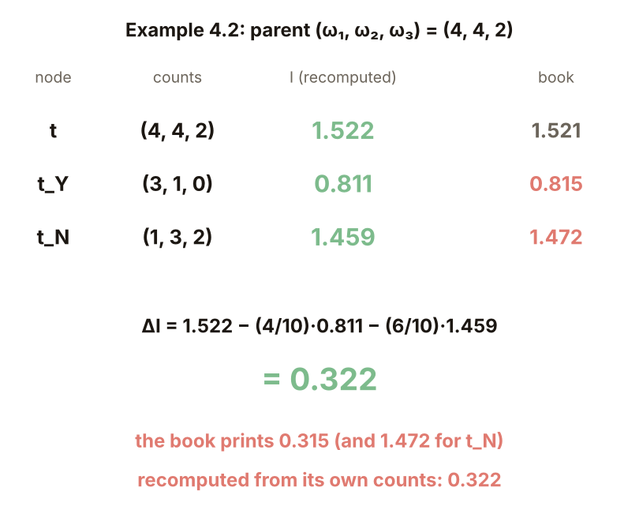
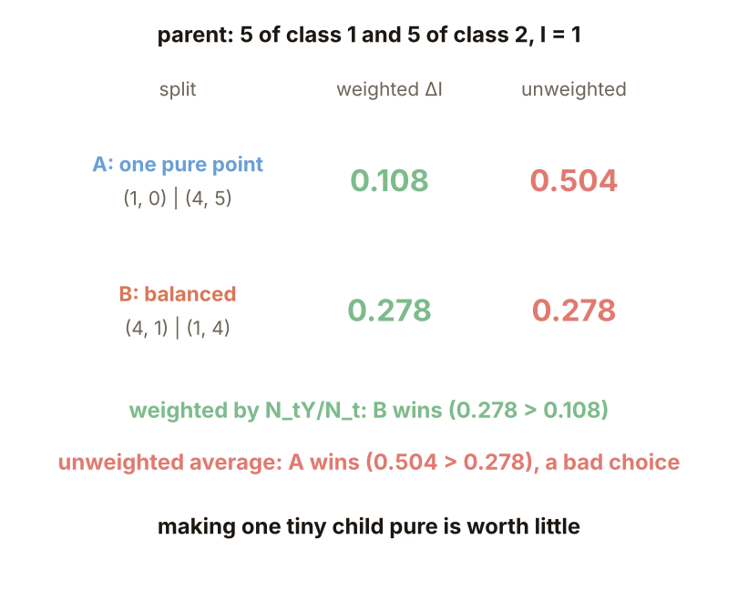
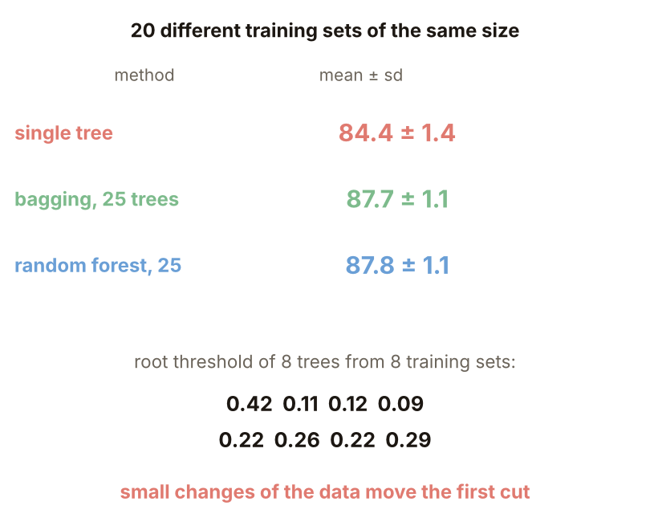
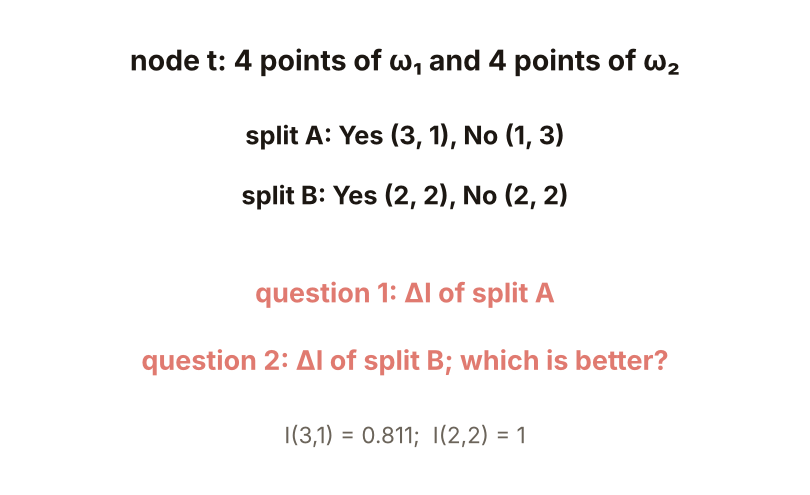
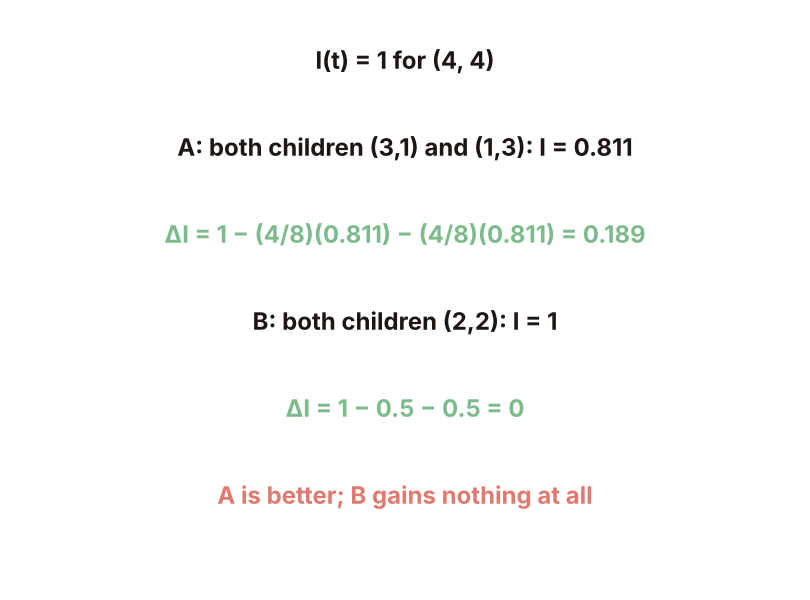

# KP23 決策樹：OBCT、分裂準則與剪枝

> 程度：大學三年級
>
> 圖型識別｜第四章 §4.20

[簡報閱讀與下載](../slides/lec05-kp23-decision-tree.jbd.json) | [English version](en/lec05-kp23-decision-tree.md)

## 學習目標

- 能說明 OBCT 的結構與訓練時要決定的四件事，並算出不純度與不純度下降量。
- 能說明為什麼子節點要加權、樹太大會怎樣、剪枝怎麼做。
- 能說明決策樹的高變異，以及 bagging 與隨機森林怎麼降低它。

## KP23 決策樹：OBCT、分裂準則與剪枝

**一句話重點**：不畫一條複雜的邊界，改問一連串簡單的是非題；每問一次，就把特徵空間切一刀。樹的大小才是關鍵，單棵樹的變異很大，bagging 能平均掉。

### 1. 一連串是非題

**白話說明**：分類能不能不畫邊界，只問一連串簡單的是非題？

- **決策樹**：沿著節點路徑做一連串是非決策，逐步排除類別，直到抵達葉節點。

最流行的是 OBCT（ordinary binary classification tree）：每個節點只問一個特徵「$x_i\le\alpha$？」，空間被切成與座標軸平行的超矩形。好處：類別很多時特別有利；常不必測完所有特徵；結構簡單、易解釋；數值與類別型特徵都能處理。

圖說 `lec05-kp23-partition`：左為三塊區域，右為對應的樹。

### 2. 四件事與候選問題

訓練要定四件事：候選問題集；分裂準則；停止分裂規則；葉的類別指派規則。候選問題：特徵 $x_k$ 在節點內有 $N_{tk}$ 個相異值，取相鄰值的中點當門檻，至多 $N_{tk}-1$ 個（教材寫 $N_{tk}$ 個）；全部特徵加起來是有限個。**例子**（本講義設計）：10 個相異值 1.0、1.4、2.2、…、7.0，中點 9 個。

圖說 `lec05-kp23-cands`：10 個值與 9 個中點。

### 3. 不純度

**不純度**（正式定義）：

$$
I(t)=-\sum_{i=1}^{M}P(\omega_i|t)\log_2P(\omega_i|t),
$$

節點裡類別越混越大。各類等量時最大（$M$ 類是 $\log_2M$）；全屬同一類時為 0（約定 $0\log0=0$）；機率用 $N_t^i/N_t$ 估計。算例：$(4,4,2)$：1.522（教材寫 1.521）；$(1,1,1)$：$\log_23=1.585$；$(5,0,0)$：0。

圖說 `lec05-kp23-entropy`：兩類時的熵曲線與三個算例。

### 4. 不純度下降量

$\Delta I=I(t)-\tfrac{N_{tY}}{N_t}I(t_Y)-\tfrac{N_{tN}}{N_t}I(t_N)$，選使 $\Delta I$ 最大的問題。**Example 4.2**：$t=(4,4,2)$，Yes $(3,1,0)$，No $(1,3,2)$：$I(t)=1.522$、$I(t_Y)=0.811$、$I(t_N)=1.459$；$\Delta I=1.522-0.4\cdot0.811-0.6\cdot1.459=0.322$。教材寫 $I(t_Y)=0.815$、$I(t_N)=1.472$、$\Delta I=0.315$，與它自己的計數不符（用它印的數字算也只有 0.312）；本講義只重算了這個分裂。

圖說 `lec05-kp23-ex42`：Example 4.2 的重算與教材數字。

### 5. 為什麼要加權

**例子**（本講義設計）：父節點 5 對 5（$I=1$）。分裂 A：Yes $(1,0)$、No $(4,5)$；分裂 B：Yes $(4,1)$、No $(1,4)$。加權：A $=0.108$、B $=0.278$，選 B。

不加權（兩個子節點直接平均）：A $=0.504$、B $=0.278$，會選 A；一個純點就被誤當成大進步。**常見迷思**：只要子節點變純就是好分裂；只讓很小的子集變純沒有實質價值。

圖說 `lec05-kp23-weight`：兩個分裂在加權與不加權下的分數。

### 6. 樹要多大

**例子**（本講義設計）：兩個月牙形加雜訊（標準差 0.35），每類 100 點訓練、1000 點新資料，熵準則。深度 1（2 葉）：訓練 76.5%、新點 73.3%；2（4 葉）：89.0%／83.7%；4（11 葉）：90.0%／82.2%；8（20 葉）：99.0%／85.2%；12（24 葉）：100%／85.1%。葉變多，訓練一路升到 100%，新點卡在約 85%；樹太大是在學訓練集的細節。

圖說 `lec05-kp23-depth`：樹深與準確率。

### 7. 剪枝

**剪枝**：先長成大樹，再依「錯誤估計加複雜度（如葉數）」剪掉不值得的分支（教材說用不純度下降門檻當停止規則常停太早或太晚）。同一份資料，剪枝強度 $\alpha$：0：24 葉、訓練 100%、新點 85.1%；0.01：22 葉、85.1%；0.02：10 葉、96.5%／87.3%；0.05：7 葉、94.0%／86.3%。一份資料、一次實驗，進步約 2 個百分點。熵與 Gini 各抽 20 次（深度 4）新點 86.1±2.3% 與 86.1±3.1%，準則選哪個不重要（與來源相符）。

圖說 `lec05-kp23-prune`：剪枝強度與準確率。

### 8. 高變異與 Bagging

**Bagging**：從訓練集有放回地抽 $B$ 份，各建一棵樹，最後多數決。**變異**（本講義設計）：8 份同樣大小的訓練集，第一刀都切第二個特徵，門檻 0.42、0.11、0.12、0.09、0.22、0.26、0.22、0.29；葉數 22 到 33。平均（20 份訓練集，新點）：單棵樹 84.4±1.4%；bagging 25 棵 87.7±1.1%；隨機森林（bagging 再加每節點隨機挑特徵）25 棵 87.8±1.1%。

樹是階層式的，高處的錯會傳到下面所有葉；平均能降低變異。**怎麼記**：決策樹 = 階層式、序列的硬決策；神經網路 = 平行的軟決策；錯誤率 MLP 占優、訓練時間決策樹占優（來源）。

圖說 `lec05-kp23-bag`：三種方法的平均準確率與 8 個根門檻。

### 延伸：斜向問題、練習與解題示範

**斜向問題**（本講義設計）：300 點均勻散在 $[-1,1]^2$，類別由 $x_1+x_2>0$ 決定；一個斜向問題 $x_1+x_2\le0$ 就完全分對。軸平行的樹（3000 新點；要 13 到 14 片葉才到約 95%）：深度 1：2 葉、75.0%；深度 3：7 葉、89.6%；深度 6：13 葉、95.4%；全長 14 葉：訓練 100%、新點 95.1%。斜向問題 $\sum c_kx_k\le\alpha$ 切得好，但訓練更複雜（來源）。

圖說 `lec05-kp23-oblique`：斜線分類與軸平行樹的葉數。

**小練習**：節點 $t$ 有 4 個 $\omega_1$ 與 4 個 $\omega_2$；分裂 A：Yes $(3,1)$、No $(1,3)$；分裂 B：Yes $(2,2)$、No $(2,2)$；已知 $I(3,1)=0.811$。

1. 分裂 A 的 $\Delta I$ 是多少？
2. 分裂 B 的 $\Delta I$ 是多少？哪個分裂比較好？

圖說 `lec05-kp23-practice`：練習的設定。

**題 1、2 解題示範**：① $I(t)=1$；A 的兩個子節點 $I=0.811$；$\Delta I=1-\tfrac48\cdot0.811-\tfrac48\cdot0.811=0.189$。② B 的兩個子節點 $(2,2)$，$I=1$；$\Delta I=1-0.5-0.5=0$。③ 核對：A 比較好；B 完全沒有降低不純度；若分成 $(4,0)$ 與 $(0,4)$，$\Delta I=1$。

圖說 `lec05-kp23-practice-sol`：計算過程。

## 術語與來源

| 中文 | English |
|---|---|
| 決策樹 | Decision tree |
| 不純度 | Impurity |
| 剪枝 | Pruning |
| Bagging | Bagging |

來源：第四章 KP23，§4.20（2026-10-25 讀取）。OBCT、四大設計要素、候選問題、熵不純度與不純度下降量、停止與類別指派、剪枝、高變異、bagging 與隨機森林、斜向問題、與神經網路的對照依來源；候選問題例子、加權對照、樹深與剪枝實驗、變異與 bagging 實驗、斜向實驗與練習由本講義設計並重算（［補充］，（程式計算））。教材 Example 4.2 的數字依它自己的計數重算有差異，已於正文標出。
