# KP24 結合分類器：product、sum、多數投票與貝氏觀點

> 程度：大學三年級
>
> 圖型識別｜第四章 §4.21

[簡報閱讀與下載](../slides/lec05-kp24-combining.jbd.json)

## 學習目標

- 能說明結合分類器的價值（互補資訊），並寫出乘積規則與加總規則及其 KL 推導。
- 能說明多數投票的公式與獨立性假設為什麼是幻覺，並說出製造多樣性的三條路。
- 能說明乘積規則的一票否決與貝氏觀點，並知道沒有一種規則永遠最好。

## KP24 結合分類器：product、sum、多數投票與貝氏觀點

**一句話重點**：即使是最好的分類器，也會在別人答對的樣本上出錯；互補資訊就是結合分類器的全部價值。但結合不保證改善，也沒有萬靈丹。

### 1. 互補資訊

**白話說明**：把分類器合起來到底圖什麼？

**例子**（本講義設計）：logistic、深度 4 的樹、3-NN 在雜訊月牙形資料上（每類 100 點訓練，共 2000 點新資料）：新點 85.2%、82.6%、87.8%。最好的 3-NN 錯 12.2%；這些錯誤裡有 60% 至少有另一個分類器答對。但三者投票只有 86.2%，仍低於 3-NN 的 87.8%；互補資訊要挖得出來才有價值。

圖說 `lec05-kp24-comp`：三個分類器的準確率與互補比例。

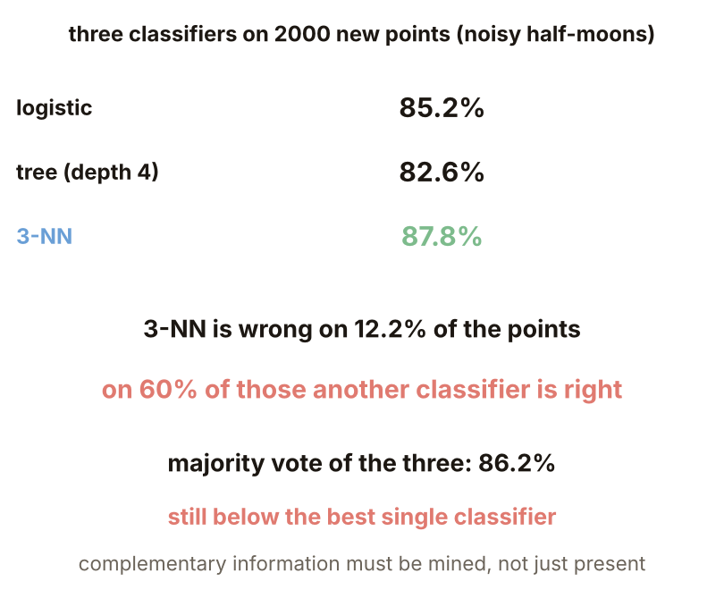

### 2. 乘積規則

**KL 距離** $D=\sum_iP\ln(P/P_j)$：兩個機率分布差多遠；不對稱，嚴格說不是距離。**乘積規則**（正式定義）：最小化 $\tfrac1L\sum_jD_j$，得

$$
P(\omega_i|x)=\frac1C\prod_{j=1}^{L}P_j(\omega_i|x)^{1/L},
$$

取乘積最大的類別。**例**：兩類、三個分類器 $(0.8,0.2)$、$(0.6,0.4)$、$(0.7,0.3)$：乘積 0.336 對 0.024，判 $\omega_1$。

圖說 `lec05-kp24-prod`：乘積規則與例子。

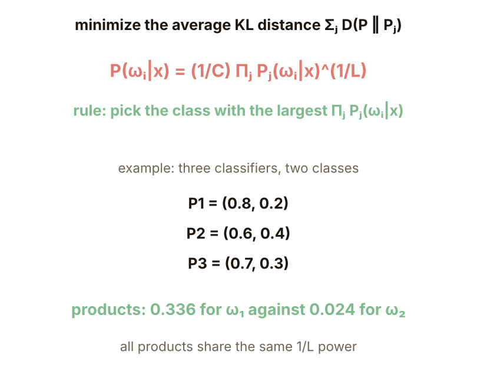

### 3. 加總規則

**加總規則**：把 $D_j$ 的兩個引數對調（$P_j$ 放前面），最佳解 $P(\omega_i|x)=\tfrac1L\sum_jP_j(\omega_i|x)$，即算術平均。同樣三個分類器：平均 0.70 對 0.30，也判 $\omega_1$。兩個規則各有嚴謹的資訊論出身；理論上沒有偏好依據；乘積推導乾淨，但輸出接近零時很脆弱，實務上加總常較穩（來源 [Mill 99]）。

圖說 `lec05-kp24-sum`：加總規則與例子。

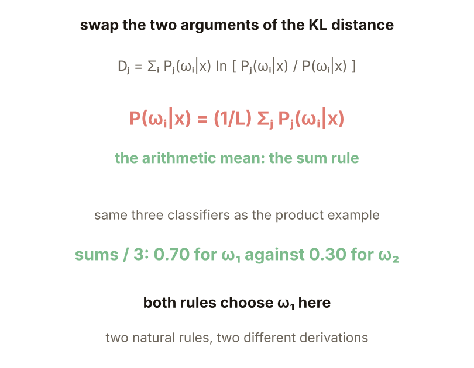

### 4. 一票否決

**例子**（本講義設計）：五個分類器對正確類 $\omega_1$ 給 0.7、0.7、0.7、0.7、0.001（其餘給 $\omega_2$）。乘積 $\omega_1$ 0.00024 對 $\omega_2$ 0.00809，選錯；加總 0.5602 對 0.4398，選對；投票 4 比 1，選對。乘積被一個接近零的因子整個拉到零，等於一票否決。

圖說 `lec05-kp24-veto`：五個分類器的輸出與三種規則的結果。

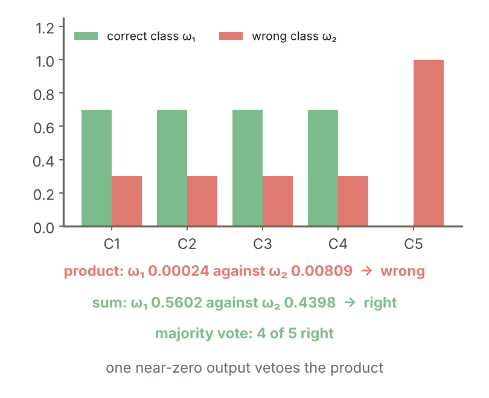

### 5. 多數投票

**多數投票**：至少 $l_c$ 個分類器同意才決定（$L$ 奇數時 $l_c=\tfrac{L+1}2$）；否則拒絕。決策彼此獨立、正確率同為 $p$ 時，

$$
P_c(L)=\sum_{m=l_c}^{L}\binom Lm p^m(1-p)^{L-m}.
$$

$p=0.6$：$L=3$：0.648、$L=11$：0.754、$L=51$：0.927；$p=0.55$：$L=51$：0.764；$p=0.45$：$L=51$：0.236；$p=0.5$ 恆為 0.5。

圖說 `lec05-kp24-vote`：$P_c(L)$ 對 $L$。

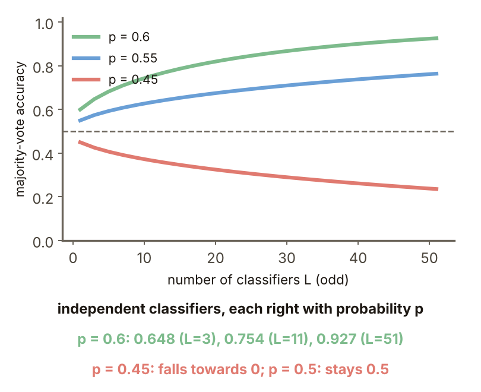

### 6. 獨立的幻覺

**例子**（本講義設計）：KP23 的月牙形資料，20 份訓練集，各做 25 棵 bagging 樹，2000 個新點。單棵樹平均 83.8%；代入獨立公式 $P_c(25,p)$ 得 99.99%；實際多數投票 87.7%；成員與多數決不同的比例 $V=0.095$。這些樹用同一份資料的重抽樣訓練，錯誤高度共享。**常見迷思**：只要每個分類器比亂猜好，投票就會趨近 100%；它依賴獨立假設，而獨立在實務上不成立，$L$ 越大越不切實際（來源）。

圖說 `lec05-kp24-indep`：單棵樹、獨立公式與實際投票。

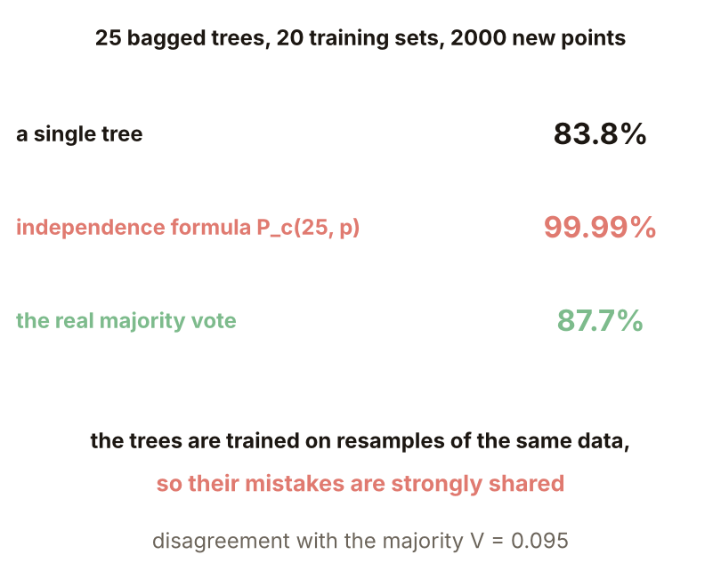

### 7. 製造多樣性

**多樣性**：成員決策彼此不同的程度；一個量法是 $V$：成員決策與多數決不同的比例。三條路（來源）：同特徵空間、不同資料點（bootstrap，對不穩定的樹最有效）；不同分類器類型；不同特徵子空間。**實驗**（本講義設計，10 維、150 點、15 次）：單棵樹 71.2%；bootstrap 樹 11 棵 77.9±2.1%（$V=0.197$）；隨機特徵子集 11 棵 75.9±2.3%（0.241）；5 種分類器 82.1±1.2%（0.114）。$V$ 最大的不是最準的；5 種分類器含 logistic，剛好適合這份資料，不能據此說不同分類器一定較好。

圖說 `lec05-kp24-div`：三種組合法的投票準確率與 $V$。

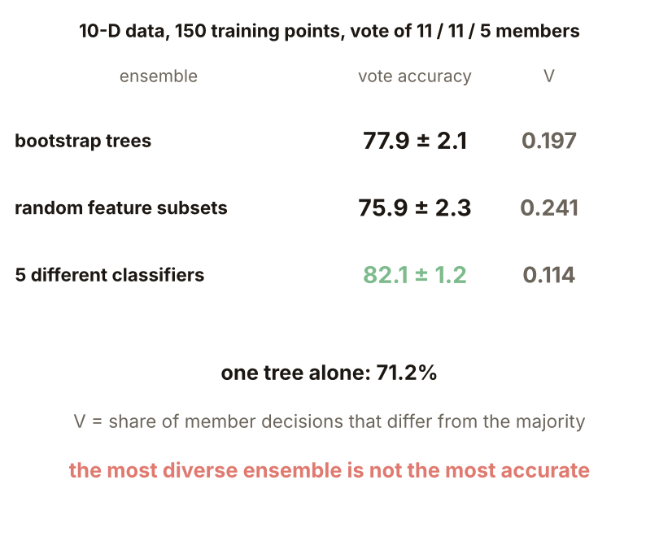

### 8. 貝氏觀點與怎麼記

假設各 $x_j$ 獨立，得 $\max_kP(\omega_k)^{1-L}\prod_jP(\omega_k|x_j)$：又是乘積規則，但對後驗估計的誤差非常敏感；加總較耐誤差，實務上常勝過乘積（來源 [Kitt 98]）。來源的手寫數字實驗：沒有一種規則永遠最好；有的案例結合比最佳單一分類器還差；把同一分類器放在不同特徵集上結合效果最好（我們第 7 頁的隨機特徵子集反而最差）。第 1 頁也是：投票 86.2% < 87.8%。**怎麼記**：加總與多數投票最常用；沒有萬靈丹定理。

圖說 `lec05-kp24-bayes`：貝氏觀點與三種規則的取捨。

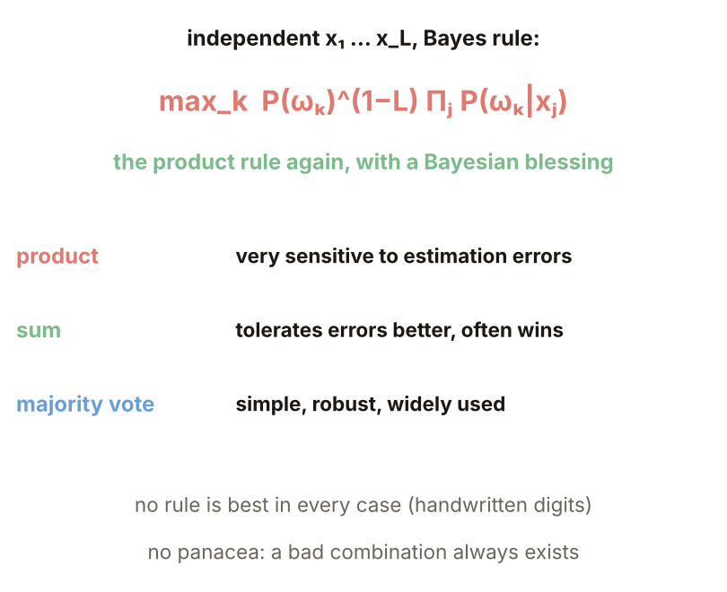

### 延伸：中位數、練習與解題示範

**中位數**（本講義設計）：五個分類器給 $\omega_1$：0.80、0.85、0.75、0.01、0.01。加總 0.484 對 0.516，選錯；乘積 $5.1\times10^{-5}$ 對 $7.4\times10^{-3}$，選錯；中位數 0.75 對 0.25，選對。離群輸出出現時，加總被極端值拉走，中位數較穩健；來源也提到 max、min、median，理由是不等式鏈：乘積 ≤ min ≤ 平均 ≤ max。

圖說 `lec05-kp24-median`：三種規則在兩個極端輸出下的結果。

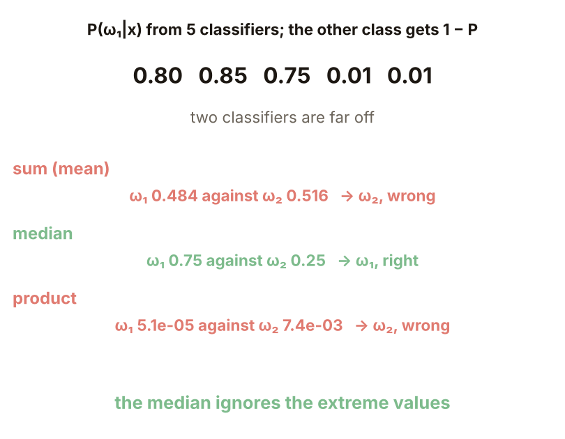

**小練習**：每個分類器答對的機率 $p=0.7$，決策彼此獨立，$L$ 為奇數的多數投票。

1. $L=3$ 的正確率 $P_c(3)$ 是多少？
2. $L=5$ 的正確率 $P_c(5)$ 是多少？比 $L=3$ 多幾？

圖說 `lec05-kp24-practice`：練習的設定。

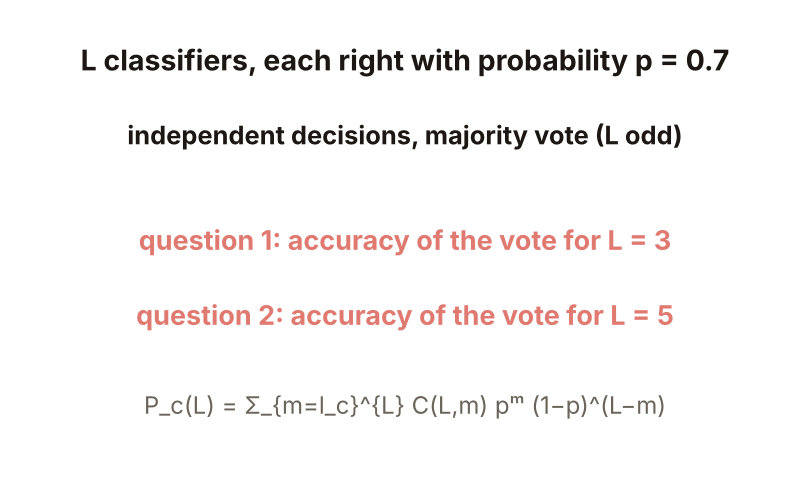

**題 1、2 解題示範**：① $l_c=2$：$3\cdot0.7^2\cdot0.3+0.7^3=0.441+0.343=0.784$。② $l_c=3$：$10\cdot0.7^3\cdot0.3^2+5\cdot0.7^4\cdot0.3+0.7^5=0.3087+0.36015+0.16807=0.837$，比 $L=3$ 多 0.053。③ 核對：$0.7\to0.784\to0.837$ 單調上升（獨立假設下）；真實的相依分類器不會升這麼多。

圖說 `lec05-kp24-practice-sol`：計算過程。

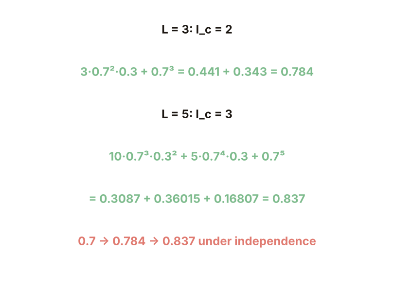

## 術語與來源

| 中文 | English |
|---|---|
| KL 距離 | KL distance |
| 乘積規則 | Product rule |
| 加總規則 | Sum rule |
| 多數投票 | Majority vote |
| 多樣性 | Diversity |

來源：第四章 KP24，§4.21（2026-10-25 讀取）。互補資訊、乘積與加總規則的 KL 推導、多數投票與獨立假設、製造多樣性的三條路、$V$ 量測、貝氏觀點、[Jain 00] 的實驗結論與 no panacea 依來源；三分類器比較、一票否決例子、獨立幻覺實驗、多樣性實驗、中位數例子與練習由本講義設計並重算（［補充］，（程式計算））。
