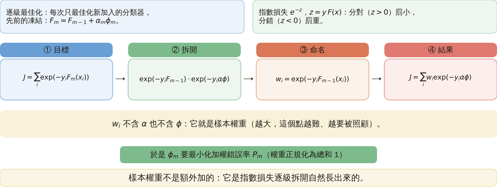
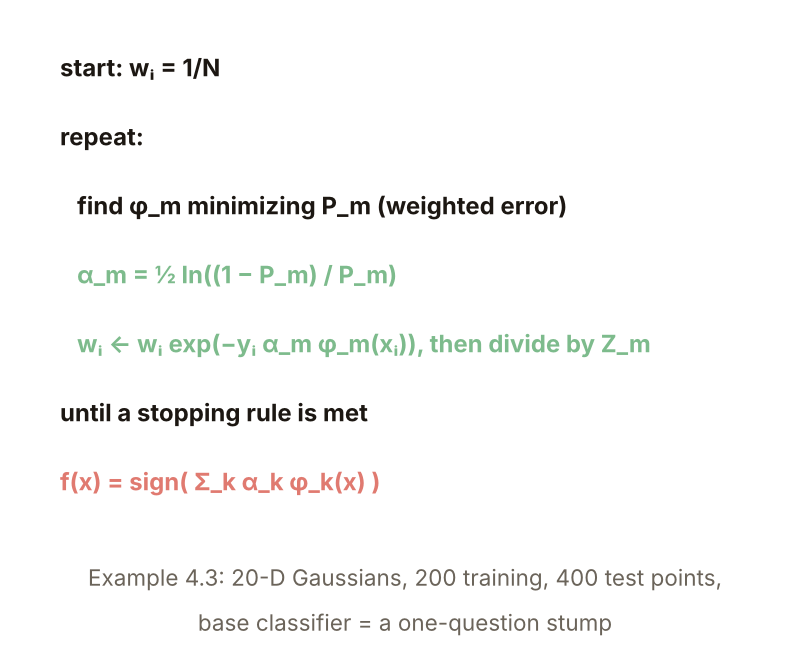
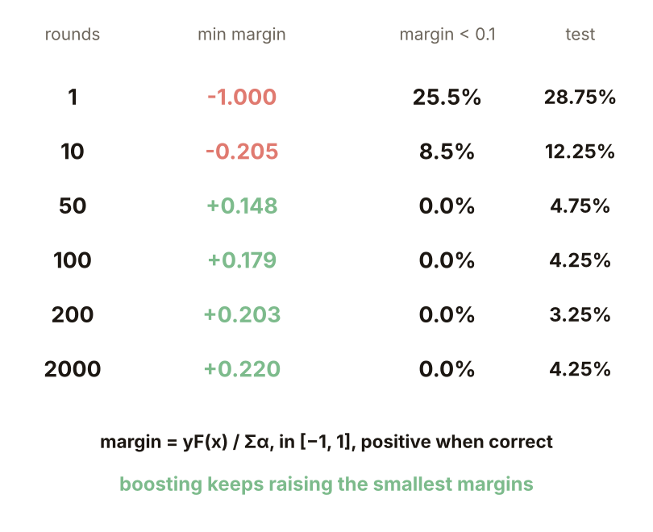
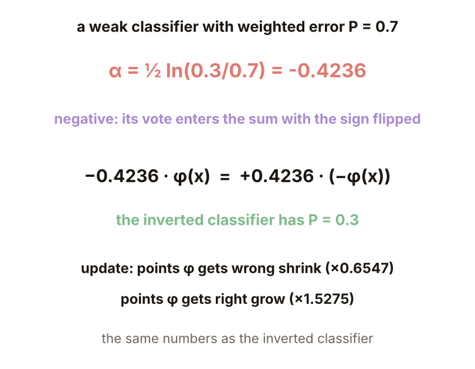
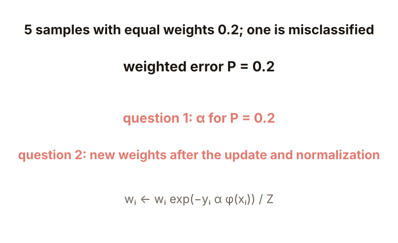
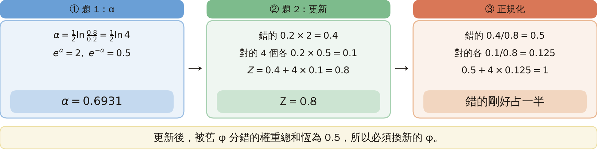

# KP25 Boosting 與 AdaBoost：把「弱」變「強」

> 程度：大學三年級
>
> 圖型識別｜第四章 §4.22

[簡報閱讀與下載](../slides/lec05-kp25-adaboost.jbd.json) | [English version](en/lec05-kp25-adaboost.md)

## 學習目標

- 能推導 AdaBoost 的權重與 $\alpha_m=\tfrac12\ln\tfrac{1-P_m}{P_m}$，並手算一輪權重更新。
- 能說明 AdaBoost 對過擬合相對免疫的邊距解釋，以及這個解釋的限制。
- 能說明 AdaBoost 在標籤有雜訊的困難任務上會退化的原因。

## KP25 Boosting 與 AdaBoost：把「弱」變「強」

**一句話重點**：一個只比亂猜好一點的分類器，反覆針對「上次做錯的樣本」重新訓練並加權投票，訓練誤差可以被壓到任意低；但它不是萬靈丹。

### 1. 弱變強

**白話說明**：弱分類器能不能被提升成強分類器？（標籤 $y\in\{\pm1\}$，分類器輸出 $\phi\in\{\pm1\}$。）

- **弱分類器**：錯誤率只比亂猜（0.5）好一點點的分類器。
- **決策樁**（stump）：只問一個特徵的一個問題，例如「$x_j>0$？」的樹。

**例子**（本講義設計）：20 維兩類高斯（均值 $\mp a$，$a=2/\sqrt{20}$），訓練 200、測試 400 點；20 個「$x_j>0$？」決策樁測試錯誤 27% 到 36%，平均 31.6%。機制：每輪換一個樣本權重分布，給最難（被分錯）的點更多權重，最後加權投票。

圖說 `lec05-kp25-weak`：20 個決策樁的測試錯誤。

### 2. 權重的誕生

**逐級最佳化**：每次只最佳化新加入的分類器，先前的凍結：$F_m=F_{m-1}+\alpha_m\phi_m$。對指數損失（KP20）$\sum_i\exp(-y_iF(x_i))$ 逐級拆開：

$$
J=\sum_iw_i\exp\big(-y_i\alpha\phi(x_i)\big),\qquad w_i=\exp\big(-y_iF_{m-1}(x_i)\big).
$$

$w_i$ 不含 $\alpha$ 也不含 $\phi$，就是樣本權重；於是 $\phi_m$ 要最小化加權錯誤率 $P_m$（權重正規化為總和 1）。

圖說 `lec05-kp25-wts`：權重從指數損失長出來。

### 3. 話語權 α

**正式定義**：代回 $J$，$\alpha_m=\arg\min\{e^{-\alpha}(1-P_m)+e^{\alpha}P_m\}$，微分為零得

$$
\alpha_m=\tfrac12\ln\frac{1-P_m}{P_m}.
$$

$P=0.1$：1.099；0.3：0.424；0.5：0；0.7：$-0.424$。很準 → 話語權大；亂猜 → 0；比亂猜還差（$P>0.5$）→ 負，把答案反過來用。

圖說 `lec05-kp25-alpha`：$\alpha$ 對加權錯誤率。

### 4. 權重更新

$w_i\leftarrow w_i\exp(-y_i\alpha_m\phi_m(x_i))/Z_m$；做錯（$y\phi<0$）變大，做對變小。**手算**（本講義設計）：10 點各 0.1，錯 3 個：$P=0.3$、$\alpha=0.4236$；錯的乘 $e^{\alpha}=1.5275$（0.1528），對的乘 $e^{-\alpha}=0.6547$（0.0655）；$Z=0.9165$。正規化後：錯的各 0.1667，對的各 0.0714；錯的三個合起來剛好 0.5，下一輪的 $\phi$ 必須先照顧它們。

圖說 `lec05-kp25-update`：更新前後的 10 個權重。

### 5. 演算法與設定

$w_i=1/N$；重複：找最小化 $P_m$ 的 $\phi_m$、算 $\alpha_m$、更新並正規化權重；最後 $f(x)=\operatorname{sign}\sum_k\alpha_k\phi_k(x)$。**設定**（本講義重做 Example 4.3）：20 維兩類高斯、訓練 200 點、測試 400 點；每輪從所有特徵與門檻挑最好的決策樁；跑 2000 輪。第 1 輪：訓練錯誤 25.5%、測試 28.75%，比隨便一個固定決策樁（平均 31.6%）好。

圖說 `lec05-kp25-algo`：AdaBoost 演算法。

### 6. 錯誤曲線

訓練錯誤：第 1 輪 25.5%、10 輪 4.5%、第 17 輪起為 0。測試錯誤：28.75%（1）、12.25%（10）、4.75%（50）、3.25%（200）、4.0%（500）、4.25%（2000）。訓練錯誤歸零後測試錯誤還繼續降，約 200 輪後持平在約 4%，在抽樣誤差內沒有上升（400 個測試點，1% 只是 4 點）。

圖說 `lec05-kp25-curve`：訓練與測試錯誤對輪數（對數軸）。

### 7. 邊距解釋

**正規化邊距** $\operatorname{margin}=yF(x)/\sum_k\alpha_k\in[-1,1]$：正的才分對，越大信心越高。上界（Schapire 等）：泛化誤差 $\lesssim\operatorname{prob}\{\operatorname{margin}<\gamma\}+O(\sqrt{V_c/(N\gamma^2)})$，與輪數 $K$ 無關，這就是免疫力的來源。**實驗**（本講義設計）最小邊距：第 1 輪 $-1.000$、10 輪 $-0.205$、50 輪 $+0.148$、200 輪 $+0.203$、2000 輪 $+0.220$；邊距 $<0.1$ 的比例 25.5%、8.5%、0%。批評：這個上界很鬆（除非 $N$ 到數萬），只能當定性解釋；逐級最佳化本身也是隱含的正則化。

圖說 `lec05-kp25-margin`：不同輪數的最小邊距與測試錯誤。

### 8. 不是萬靈丹

**例子**（本講義設計）：同類資料，訓練標籤隨機翻 15%；翻 0% 與 15% 各 5 次新抽樣平均（和前面單次實驗的數字不同；測試標籤乾淨）。測試錯誤：乾淨：14.4%（10 輪）→ 6.6%（100）→ 5.5%（2000）；翻 15%：19.1% → 18.9% → 23.3%，最低 17.8%（30 輪）。可能原因：指數損失對大負邊距的壞樣本懲罰過重；2000 輪後 15.5% 的翻標籤樣本占了 36% 的權重（其中一次實驗）。**常見迷思**：AdaBoost 永遠不會過擬合；在貝氏誤差高、標籤有雜訊的困難任務上它可能急劇退化（來源）。**怎麼記**：弱分類器 + 對錯的點加權 + 加權投票；權重由指數損失長出來，$\alpha$ 由加權錯誤率決定。

圖說 `lec05-kp25-noise`：標籤乾淨與翻 15% 的測試錯誤。

### 延伸：負的 α、練習與解題示範

**負的 $\alpha$**：$P=0.7$：$\alpha=\tfrac12\ln(0.3/0.7)=-0.4236$；$-0.4236\,\phi=+0.4236\,(-\phi)$，$-\phi$ 的加權錯誤率是 0.3。$\phi$ 做錯的點乘 $e^{-0.4236}=0.6547$（變小），做對的乘 1.5275（變大），與反過來的分類器完全一樣。

圖說 `lec05-kp25-neg`：負 $\alpha$ 與反過來的分類器。

**小練習**：5 個樣本權重各 0.2，被 $\phi$ 分錯 1 個，加權錯誤率 $P=0.2$。

1. $\alpha$ 是多少？
2. 更新並正規化後，每個樣本的權重是多少？

圖說 `lec05-kp25-practice`：練習的設定。

**題 1、2 解題示範**：① $\alpha=\tfrac12\ln\tfrac{0.8}{0.2}=\tfrac12\ln4=0.6931$；$e^{\alpha}=2$、$e^{-\alpha}=0.5$。② 錯的 $0.2\times2=0.4$，對的 4 個各 $0.2\times0.5=0.1$；$Z=0.8$；正規化：錯的 0.5，對的各 0.125。③ 核對：總和 $0.5+4\times0.125=1$；錯的點剛好占一半，與第 4 頁的 3 個點占 0.5 同一個規律：更新後，被舊 $\phi$ 分錯的權重總和恆為 0.5，舊 $\phi$ 的加權錯誤率變成 0.5，所以必須換新的 $\phi$。若決策樁家族可取反，搜尋會直接選 $-\phi$（$P=0.3$），負的 $\alpha$ 因而少見。

圖說 `lec05-kp25-practice-sol`：計算過程。

## 術語與來源

| 中文 | English |
|---|---|
| 弱分類器 | Weak classifier |
| 決策樁 | Stump |
| 逐級最佳化 | Stage-wise optimization |
| 正規化邊距 | Normalized margin |

來源：第四章 KP25，§4.22（2026-10-25 讀取）。弱學習的提升問題、指數損失與逐級最佳化、權重的來源、$\alpha$ 公式、權重更新、演算法、邊距解釋與上界很鬆的批評、不是萬靈丹、「怎麼記」依來源；決策樁的錯誤、10 點手算、重做 Example 4.3 的錯誤曲線與邊距表、15% 標籤翻轉實驗、負 $\alpha$ 與練習由本講義設計並重算（［補充］，（程式計算））。
