# KP26 類別不平衡問題

> 程度：大學三年級
> 
> 圖型識別｜第四章 §4.23

[簡報閱讀與下載](../slides/lec05-kp26-imbalance.jbd.json) | [English version](en/lec05-kp26-imbalance.md)

## 學習目標

- 能說明類別不平衡為什麼會損害分類器，以及為什麼準確率會騙人。
- 能說出資料層與代價敏感兩類對策，並比較它們的取捨。
- 能由抓到的稀有點數（TP）與誤報數（FP）算出召回、精確率、準確率與平衡準確率，並能驗算表上的數字。

## KP26 類別不平衡問題

**一句話重點**：一類有一萬筆、另一類只有十筆時，「追求簡單」的分類器會理所當然地忽略稀有類，而稀有類往往正是我們真正在乎的那一類。

### 1. 實驗怎麼做

**白話說明**：KP25 的 AdaBoost 在標籤有雜訊時會退化。資料裡有一類只有 20 筆時，連「準確率很高」都可靠嗎？先看這一課的實驗是怎麼做的。

- **類別不平衡**：某一類樣本極多、另一類極少；常見於文字分類、罕見疾病、浮油偵測。

**資料**（本講義設計，程式產生）：多數類取自 $N((0,0),I)$，稀有類取自 $N((2,0),I)$，兩個座標獨立、標準差 1；訓練 1000＋20 個點，測試固定一份 5000＋100 個點。

**模型與重複**：RBF 核的 SVM（核 $e^{-0.5\|x-z\|^2}$，$C=1$）；訓練集用亂數種子 0 到 19 各抽一次，共 20 次，取平均。

圖說 `lec05-kp26-setup`：一組訓練資料的散佈圖：1000 個藍色多數點以 (0,0) 為中心，20 個橘色稀有點以 (2,0) 為中心，兩團重疊；圖下列出訓練、測試、重複次數與 RBF SVM 的參數。

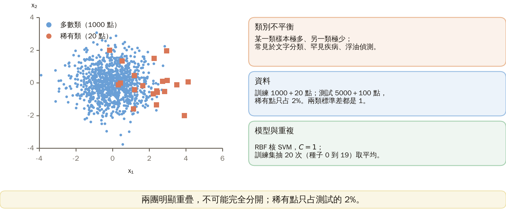

**實驗細節**（可重現）：以 Python 的 scikit-learn 實作（SVC、DecisionTreeClassifier、AdaBoostClassifier，版本 1.9.1 預設值，除下列者）。第 1 至 3、5 至 7 頁的測試集是固定的 5000＋100（亂數種子 998），訓練集用種子 0 至 19；過採樣、欠採樣的抽樣沿用該訓練種子。第 4 頁的測試集固定 2000＋2000（種子 997），訓練集同樣用種子 0 至 19、共 20 次，兩類中心只在 $x_1$ 軸相差 4 或 1.5。

決策樹為 CART（基尼不純度，亂數種子 0）；AdaBoost 以深度 1 的決策樁為弱分類器、100 輪、學習率 1。SVM 的類別權重取 $n/(2n_c)$：稀有類 $1020/(2\times 20)=25.5$、多數類 $1020/(2\times 1000)=0.51$，比值 50。

平均計數是 20 次整數計數的平均，所以會有小數（例如 5.85＝117／20）。第 4 頁各格的 TP（共 2000 個稀有測試點）：簡單任務 1950.9、1831.8、1335.1、1561.1、863.8；困難任務 1571.65、298、0.35、0.65、0。

### 2. 從計數到指標

**白話說明**：上一頁把 20 個稀有點埋在 1000 個多數點裡，測試的 5100 個點上稀有點只佔 2%。怎麼算一個分類器的好壞？

- **召回率**：100 個稀有點裡被抓到的比例 $=\text{TP}/100$；**精確率**：被判為稀有的點裡真的稀有的比例 $=\text{TP}/(\text{TP}+\text{FP})$。TP 是抓到的稀有點數，FP 是誤報數（多數點被判成稀有）。

**準確率** $=(\text{TP}+\text{TN})/5100$，$\text{TN}=5000-\text{FP}$ 是判對的多數點數。**全判多數**：TP 0、FP 0，召回 $0/100=0$，準確率 $5000/5100=98.0\%$。

**例子**（SVM，20 次平均計數）：TP 5.85、FP 2；召回 $5.85/100=5.9\%$，精確率 $5.85/(5.85+2)=74.5\%$，準確率 $(5.85+4998)/5100=98.1\%$。精確率一律用平均計數再相除。

圖說 `lec05-kp26-metrics`：從計數到指標：全判多數 TP 0、FP 0，召回 0、準確率 98.0%；SVM 20 次平均 TP 5.85、FP 2，召回 5.9%、精確率 74.5%、準確率 98.1%，附代入算式。

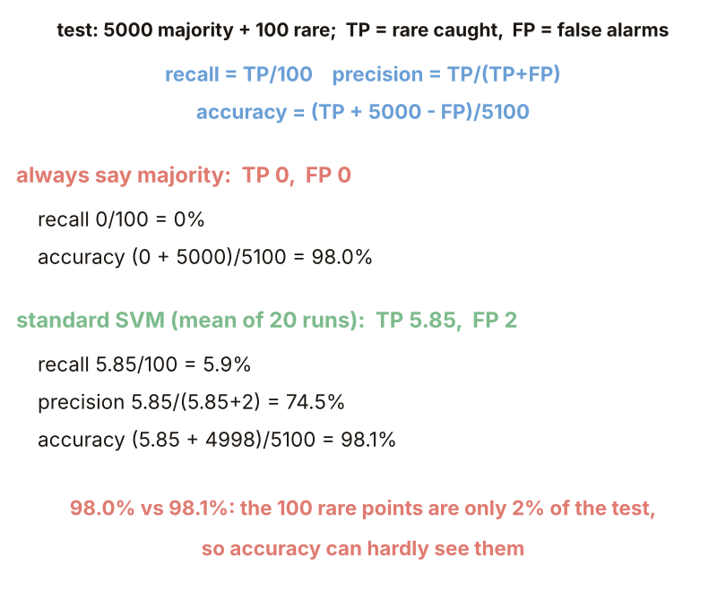

### 3. 簡單性偏好

**白話說明**：SVM 平均只抓到 5.85 個稀有點，其餘 94 個被當成多數。為什麼分類器會忽略稀有的那一類？

**推理**（來源）：為了泛化，我們一路要求分類器簡單（正則化、剪枝）；簡單的假設不會花力氣照顧稀有案例，忽略 20 個點對整體代價影響微乎其微。

**SVM**：$C$ 是錯分的罰分（KP15），越大越不正則。$C=0.01$、$0.1$：TP、FP 都是 0（全判多數）；$C=1$：TP 5.85；$C=100$：TP 16.85、FP 10.9。召回 $=\text{TP}/100$，準確率都約 98%。

**決策樹**（CART，每片葉至少 $k$ 點，越大越簡單）：$k=1$：TP 23.25、FP 73.1；$k=5$：21、29.85；$k=20$：9.45、12.55；$k=50$：0、0。

圖說 `lec05-kp26-simple`：SVM 的 C 為 0.01、0.1、1、10、100 時 TP 為 0、0、5.85、13.45、16.85；決策樹每片葉最少點數為 1、5、20、50 時 TP 為 23.25、21、9.45、0；表中含 FP、召回與準確率。

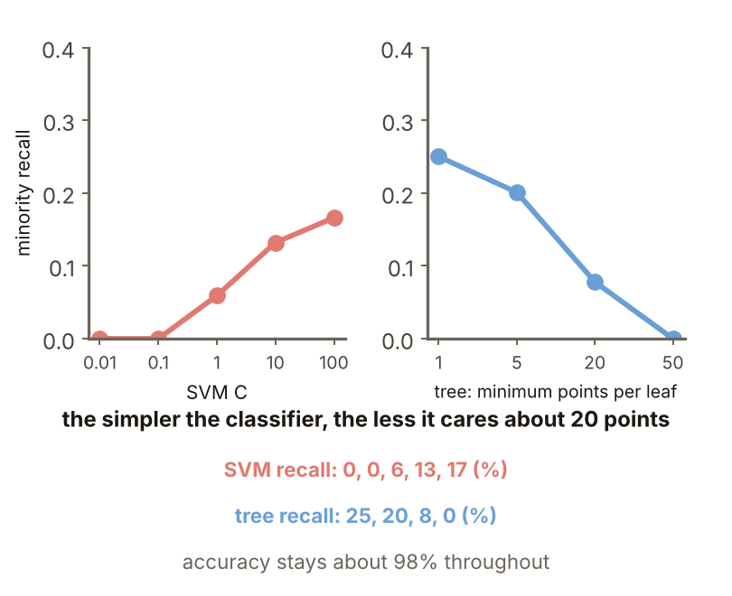

### 4. 難度與資料量

**白話說明**：越簡單的分類器越不在乎 20 個點。是不是只要類別不平衡就一定壞？

**來源**（Japkowicz）：大不平衡未必有害，要與任務難度、訓練點數一起看：簡單任務或資料量大時可能沒問題；困難（類別重疊）或點數不足時，小不平衡也可能致命。

**怎麼做**（本講義設計）：同一個 RBF SVM（$C=1$、$\gamma=0.5$），訓練集改成多數:稀有 $=100{:}100$、$1000{:}100$、$1000{:}10$、$10000{:}100$、$10000{:}10$；測試固定 2000＋2000，召回 $=\text{TP}/2000$。簡單任務兩類中心差 4，困難任務差 1.5。

**結果**：簡單任務召回 97.5%、91.6%、66.8%、78.1%、43.2%；困難任務 78.6%、14.9%、0.0%、0.0%、0.0%。稀有點只有 10 個時，簡單任務也差。

圖說 `lec05-kp26-grid`：少數類召回（TP 除以 2000）：簡單任務 100:100 為 97.5%、1000:10 為 66.8%；困難任務 1000:100 為 14.9%，其餘不平衡組約 0%；格內附 TP。

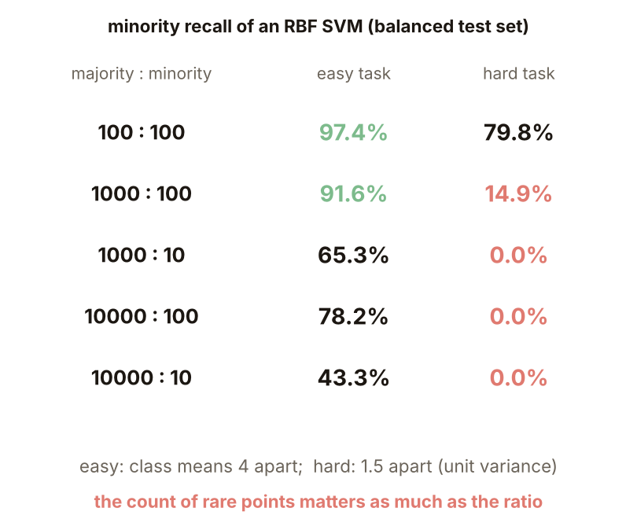

### 5. 改資料

**白話說明**：不平衡不一定壞，但困難任務上 1000 比 100 就把召回壓到 14.9%。第一種對策，改資料：複製稀有類或丟掉多數類，結果如何？

**做法**：過採樣：從 20 個稀有點有放回地再抽 980 個，訓練集變成 1000＋1000；欠採樣：從 1000 個多數點隨機不放回只留 20 個，訓練集變成 20＋20。同一個 SVM（$C=1$）。

**結果**（TP／FP）：一般 5.85／2；過採樣 68.15／605.55；欠採樣 77.05／756.7。例：過採樣召回 $68.15/100=68.2\%$，精確率 $68.15/(68.15+605.55)=10.1\%$。

**代價**：稀有類找回來了，但精確率掉到約 10%，準確率掉到 85% 到 88%。

圖說 `lec05-kp26-data`：資料層對策：一般 SVM TP 5.85、FP 2；過採樣 68.15、605.55；欠採樣 77.05、756.7；表中含訓練集大小、召回、精確率與準確率。

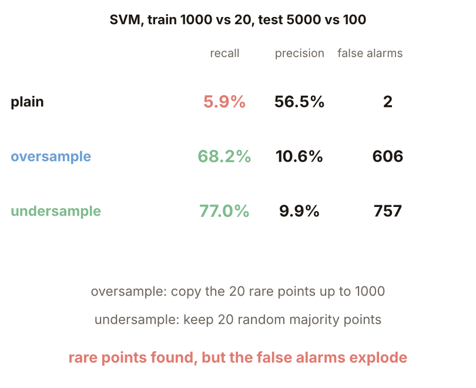

### 6. 聚焦重抽樣

**白話說明**：過採樣與欠採樣都是隨機的，誤報很多。只丟掉遠離邊界、本來就沒提供資訊的多數點，會比較好嗎？

**做法**：聚焦欠採樣刪掉遠離邊界的點（來源）。本講義的具體步驟：先用 20＋1000 個點訓練一個 SVM（$C=1$），對 1000 個多數點算決策值，留下決策值最大（最像稀有類）的 $m$ 個，再用 20 個稀有點加這 $m$ 個重新訓練；$m=20,60,100,200$。

**結果**（TP／FP／準確率）：留 20：82.7／2126.05／58.0%；60：11.45／55.5／97.2%；100：8.3／32.55／97.6%；200：5.95／2／98.1%；全留 1000 就是一般 SVM。

**意思**：目標分布調到多少才對是未解問題（來源）：留 20 與留 60 差很多；留 20 時誤報 2126 個，比隨機欠採樣的 757 個還多。

圖說 `lec05-kp26-focus`：聚焦欠採樣留下 20、60、100、200 個多數點：TP 為 82.7、11.45、8.3、5.95，FP 為 2126.05、55.5、32.55、2；附召回與準確率，最後一列是全留的一般 SVM。

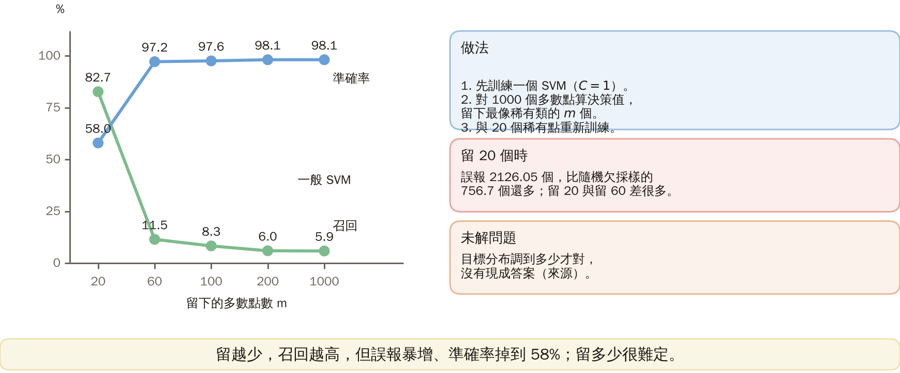

### 7. 改代價

**白話說明**：聚焦欠採樣留幾個很難定。不動資料、改分類器的代價敏感對策，結果如何？

**做法**（來源）：給少數類較重的權重。SVM：少數類的 $C$ 設為多數類的 50 倍（權重 25.5 對 0.51）；AdaBoost：100 個決策樁，少數類初始權重乘 $w=1,10,50$ 後再正規化（KP25 的權重本來就為難樣本設計）。

**SVM**：TP 70.2、FP 619.3；召回 70.2%，精確率 $70.2/(70.2+619.3)=10.2\%$。

**AdaBoost**（TP／FP）：$w=1$：20.1／16.65；$w=10$：48.3／160.65；$w=50$：61.9／373.75。召回 20.1%、48.3%、61.9%；精確率 54.7%、23.1%、14.2%。

圖說 `lec05-kp26-cost`：代價敏感：SVM 少數類 C 為 50 倍時 TP 70.2、FP 619.3；AdaBoost 初始權重 w 為 1、10、50 時 TP 為 20.1、48.3、61.9，FP 為 16.65、160.65、373.75。

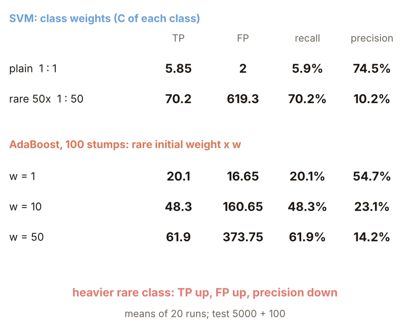

### 8. 怎麼記

**白話說明**：改代價和改資料一樣，TP 與 FP 一起升、精確率下降。到底該記住什麼、怎麼評估？

**怎麼記**（來源）：不平衡的傷害不是來自「數字不一樣」，而是來自「簡單性偏好 × 稀有類」的交互作用。對策兩條：改資料（重抽樣）或改代價（加權）。

**常見迷思**：以為準確率高就夠了。評估要看抓到幾個與誤報幾個（召回與精確率），不只看準確率；全判多數也有 98.0%。

**叮嚀**（來源）：類別不平衡在實務上非常重要；設計者必須意識到它並警覺各種對策。

圖說 `lec05-kp26-recap`：類別不平衡的重點：傷害來自簡單性偏好乘稀有類；兩類對策是改資料或改代價；要看召回與精確率。

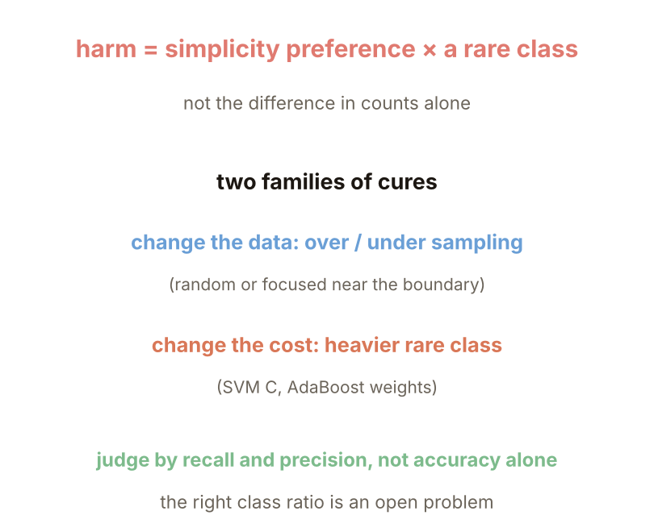

### 延伸：對策比較、平衡準確率與練習

**對策比較與平衡準確率**

**白話說明**：要記住的是取捨。把四種處理放進同一張表，再加上看得見稀有類的指標，有沒有哪個明顯贏？

**正式定義**：平衡準確率 $=(\text{召回}+\text{特異度})/2$，特異度 $=\text{TN}/5000$（多數點被判對的比例）；全判多數 $(0+1)/2=0.50$。例：一般 SVM $(0.0585+4998/5000)/2=0.53$。

**SVM**（TP／FP／平衡準確率）：一般 5.85／2／0.53；過採樣 68.15／605.55／0.78；欠採樣 77.05／756.7／0.81；代價敏感 70.2／619.3／0.79。

**決策樹**（每片葉至少 5 點）：一般 21／29.85／0.60；過採樣 33.75／101.45／0.66；欠採樣 77.85／912.6／0.80；代價敏感 43.15／227.7／0.69。沒有誰明顯贏，差別是取捨。

圖說 `lec05-kp26-table`：SVM 與決策樹四種處理的 TP、FP、召回、精確率、準確率與平衡準確率表：SVM 平衡準確率 0.53、0.78、0.81、0.79。

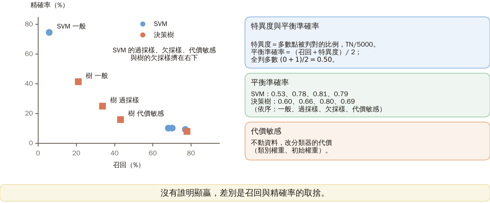

**練習**

**白話說明**：平衡準確率讓全判多數只剩 0.50。回到定義，手算全判多數的 A 與抓到 6 個的 B，兩者的指標各是多少？

**小練習**（設定）：1000 個負例、10 個正例（稀有類）。A：全判負；B：抓到 10 個正例中的 6 個，並誤報 40 個負例。

**題 1**：A 與 B 的準確率與召回各是多少？

**題 2**：A 與 B 的平衡準確率各是多少？

圖說 `lec05-kp26-practice`：練習圖：1000 個負例與 10 個正例；A 全判負，B 抓到 6 個並誤報 40 個。

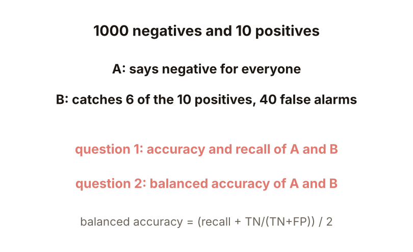

**解題示範**

**白話說明**：練習問 A 與 B 的準確率、召回與平衡準確率。完整做一次，答案是什麼？

**題 1**：A：TP 0、FN 10、FP 0、TN 1000；準確率 $1000/1010=0.990$、召回 0。B：TP 6、FN 4、FP 40、TN 960；準確率 $966/1010=0.956$、召回 0.6。

**題 2**：A：$(0+1)/2=0.5$。B：特異度 $960/1000=0.96$，$(0.6+0.96)/2=0.78$。

**核對**：A 的準確率比 B 高，卻一個稀有點也沒抓到；B 的精確率只有 $6/46=0.13$，這就是取捨。

圖說 `lec05-kp26-practice-sol`：A：準確率 0.990、召回 0、平衡準確率 0.5；B：準確率 0.956、召回 0.6、平衡準確率 0.78。

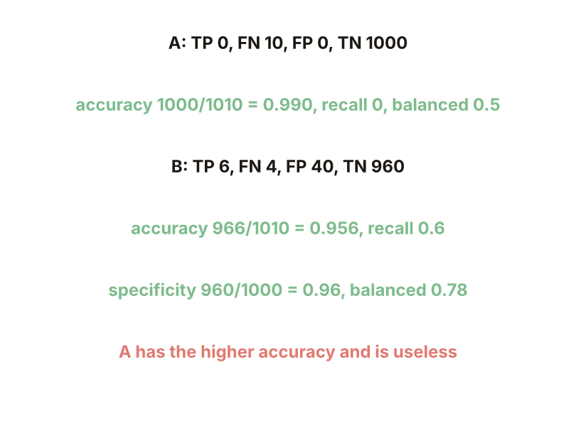

## 術語與來源

| 中文 | English |
|---|---|
| 類別不平衡 | Class imbalance |
| 召回率 | Recall |

來源：第四章 KP26，§4.23（2026-10-25 讀取）。類別不平衡損害分類器、傷害來自簡單性偏好與稀有類的交互作用、要與任務難度和資料量一起看、資料層與代價敏感兩類對策、聚焦重抽樣、目標分布是未解問題、「怎麼記」依來源；實驗設定、指標的計數算式、$C$ 與葉大小掃描、難度與資料量表、各種對策的比較、平衡準確率與練習由本講義設計並用程式重算（［補充］，（程式計算）），資料生成式、參數、種子與重複次數見第 1 頁，計數算式見第 2 頁。
