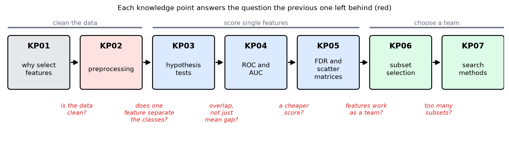
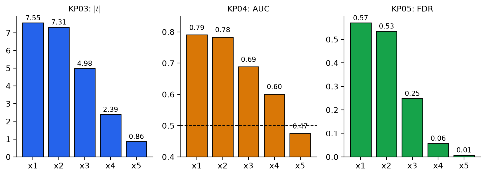

# 特徵選擇路線圖：資料很多維，怎麼挑出值得留下的

> 程度：大學生（undergrad）
>
> 圖型識別｜特徵選擇單元 總覽（KP01–KP07）

## 學習目標

- 能用一個問題串起 KP01 到 KP07，說出每個知識點的問、答與留下的問題。
- 能用白話說出本單元的關鍵詞（離群點、檢定、AUC、FDR、子集、搜尋）是什麼意思。
- 能說明本單元的結論與限制，並知道接下來要學什麼。

## 特徵選擇路線圖

**一句話重點**：特徵很多、樣本有限時，要先清資料，再給特徵打分數，最後挑出「一組」而不是「最高分的幾個」；打分數看不到搭配，所以要評整組，整組太多就用聰明的搜尋。

### 先備與符號

*你需要先會的三件事*：

- *特徵與類別*：每個樣本有許多測量值（特徵），要預測它屬於哪一類（第二、三章）。
- *均值與標準差*：描述一批數字的中心與散開程度。
- *訓練集與測試集*：訓練集用來學，測試集模擬沒見過的新資料。

*本單元用到的符號*：

| 符號 | 意義 | 說明 |
|---|---|---|
| $m$ | 候選特徵的總數 | 例：$m=5$ |
| $l$ | 要選出的特徵數 | $l\le m$ |
| $\omega_1,\ \omega_2$ | 兩個類別 | 本單元多數例子只有兩類 |
| $\bar x,\ \sigma$ | 均值、標準差 | KP02 起使用 |

### 1. 這個單元只問一件事

**問題**：手上有幾十甚至幾百個特徵，怎麼挑出真正有用的，丟掉重複的與沒用的？

為什麼要挑？教科書給了三個理由：計算量；兩個特徵單獨看都有用，合起來因為高度相關而沒什麼增益；樣本數有限時，特徵越多，要估計的參數越多，分類器越難泛化（KP01）。

**貫穿本單元的小例子。** `[補充]` 兩類各 100 筆，5 個特徵（教學設定）：

- $x_1$ 帶有類別訊號；$x_2$ 幾乎是 $x_1$ 的複本；$x_3$ 也帶有訊號。
- $x_4$ 是訊號加上一大團雜訊；$x_5$ 只含同一團雜訊，單獨看沒有訊號。

這個例子會在 KP03 到 KP06 再出現。猜猜看：5 個特徵裡，哪三個最值得留？

### 2. 路線圖：每個知識點接手上一個留下的問題

單元有七個知識點，一個接著一個。每一個都從上一個留下的問題出發。

圖說 `lec07-kp00-overview-f1-map`：先順著箭頭由左讀到右：KP01 到 KP07；再看每個箭頭下面的紅字：那是上一個知識點留下、下一個知識點要回答的問題。最上方的灰線把七個知識點分成三段：清資料、單一特徵打分數、挑一組。〔功能：1〕

### 3. 七個知識點的問、答與留下

**先用白話說六個詞**（後面的知識點逐一展開）：

- **離群點**：離大多數資料很遠的點。一個就能把均值與標準差拉歪。
- **假設檢定**：問「兩類的均值差，是真的有差，還是抽樣運氣」，用 $t$ 統計量判斷。
- **ROC 曲線與 AUC**：把所有門檻下的兩種錯誤畫成一條曲線；曲線下面積 AUC 越大，兩類越分得開。
- **FDR**：兩類均值差的平方，除以兩類變異數的和，一個便宜的「分得開」分數。
- **子集選擇**：評分的對象是一整組特徵，不是單一特徵。
- **搜尋**：子集太多時，一步一步走：加一個、減一個，或加了再回頭檢查。

| KP | 主題 | 問 | 答 | 留下的問題 |
|---|---|---|---|---|
| KP01 | 為什麼挑特徵 | 特徵越多越好嗎？ | 樣本有限時，特徵多使參數多、泛化差；重複的特徵（公分與吋）不增加資訊 | 評估特徵之前，資料乾淨嗎？ |
| KP02 | 前置處理 | 哪些資料問題會把均值與標準差帶歪？ | 離群點（一筆就能把標準差撐大 36 倍）、單位不同、缺值（均值補值壓低變異數 22.2%）；參數只能由訓練集算 | 資料乾淨了，單一特徵有沒有辨識力？ |
| KP03 | 統計檢定 | 兩類的均值差，是真差異還是運氣？ | 差距除以抽樣波動得 $t$；超出臨界值就保留 | 均值有差，兩類也可能糊成一團，重疊多少？ |
| KP04 | ROC 與 AUC | 兩類重疊多少？ | 掃門檻畫 ROC，AUC 濃縮成一個分數；單向門檻看不見均值相同、散布不同的情況 | 有沒有不用掃門檻的便宜分數？ |
| KP05 | FDR 與散布矩陣 | 能不能直接由均值與變異數打分數？ | 一維用 FDR；多維用 $S_w,S_b$ 算 $J_1,J_2,J_3$；$q^2=N\cdot\text{FDR}$ | 逐一打分數，看得到特徵搭配嗎？ |
| KP06 | 子集選擇 | 個別最高分的前 $l$ 名，就是最好的 $l$ 個嗎？ | 不一定：重複與互補；整組一起評（filter 或 wrapper），特徵數由驗證決定，選擇要放進驗證 | 子集太多（$\binom{100}{10}\approx1.7\times10^{13}$），怎麼找？ |
| KP07 | 特徵搜尋 | 不能窮舉，怎麼聰明地走？ | 前向、後向、浮動；都是貪婪法，浮動搜尋可反悔；最佳搜尋需要單調性 | （本單元結束） |

**貫穿例子在各站的樣子**（兩類各 100 筆，種子固定）：

| 特徵 | $\|t\|$（KP03） | AUC（KP04） | FDR（KP05） |
|---|---|---|---|
| $x_1$ | $7.55$ | $0.790$ | $0.570$ |
| $x_2$ | $7.31$ | $0.783$ | $0.535$ |
| $x_3$ | $4.98$ | $0.688$ | $0.248$ |
| $x_4$ | $2.39$ | $0.601$ | $0.057$ |
| $x_5$ | $0.86$ | $0.475$ | $0.007$ |

三種分數給出同一個排序：$x_1>x_2>x_3>x_4>x_5$。$x_5$ 的 AUC 是 $0.475$，比亂猜（$0.5$）還低一點，一眼看去是個沒用的特徵。

圖說 `lec07-kp00-overview-f2-scores`：先看三個長條圖：每個圖都是 $x_1$ 最高、$x_5$ 最低，依序遞減；AUC 圖上的虛線是亂猜的水準 $0.5$，$x_5$ 落在線的下方。〔功能：1、2〕

### 4. 回顧：整個單元的結論，與兩個提醒

**單元的結論（KP06 揭曉）**：只看個別分數，前三名是 $\{x_1,x_2,x_3\}$，在 4000 筆新資料上的準確率是 $0.75$。但 $x_1$ 與 $x_2$ 是重複的，而被判成沒用的 $x_5$ 能消去 $x_4$ 的雜訊：驗證選出的 $\{x_1,x_4,x_5\}$ 準確率是 $0.89$，與用全部 5 個特徵的 $0.90$ 幾乎一樣好。KP07 說明了怎麼在特徵很多時找到這樣的一組。

**兩個提醒**：

- *個別分數是便宜的第一關，不是答案。* 它看不到特徵之間的搭配：重複的會一起入選，互補的會被一起丟掉。
- *選特徵本身也是一種學習。* 先用全部資料選特徵，再交叉驗證，準確率會虛高（純雜訊資料上可達 $0.88$）；選擇要放進每一折之內（KP06）。KP02 說過的資料洩漏，在這裡以另一種形式出現。

**這個單元沒有做的事**：它只「挑」原有的特徵，不「造」新特徵。把原特徵組合或轉換成新特徵（例如主成分），是下一個單元（特徵生成）的主題。散度、Bhattacharyya 距離、VC 維度與 AIC／BIC 等較理論的準則，本單元不教，供自學。

## 術語與來源

| 中文 | English |
|---|---|
| 特徵選擇 | Feature selection |
| 前置處理 | Preprocessing |
| 離群點 | Outlier |
| 假設檢定 | Hypothesis testing |
| ROC 曲線、AUC | ROC curve, AUC |
| 費雪判別比 | Fisher's discriminant ratio (FDR) |
| 散布矩陣 | Scatter matrix |
| 子集選擇 | Subset selection |
| 搜尋 | Search |
| 泛化 | Generalization |

來源：教科書 Theodoridis & Koutroumbas, *Pattern Recognition* 第 5 章 §5.1（導論與全章結構），以及 CCC-LNS 網頁第 5 章的章節地圖；說明、圖與順序為重新撰寫。各知識點的結論取自本單元 KP01–KP07 講義；貫穿的 5 特徵例子為 `[補充]`，數字由 `scripts/lec07-kp00-overview/compute_data.py` 算出（`reports/lec07-kp00-overview/數值驗算.json`），KP06 的準確率取自 `lec07-kp06-subset-selection` 的驗算。
