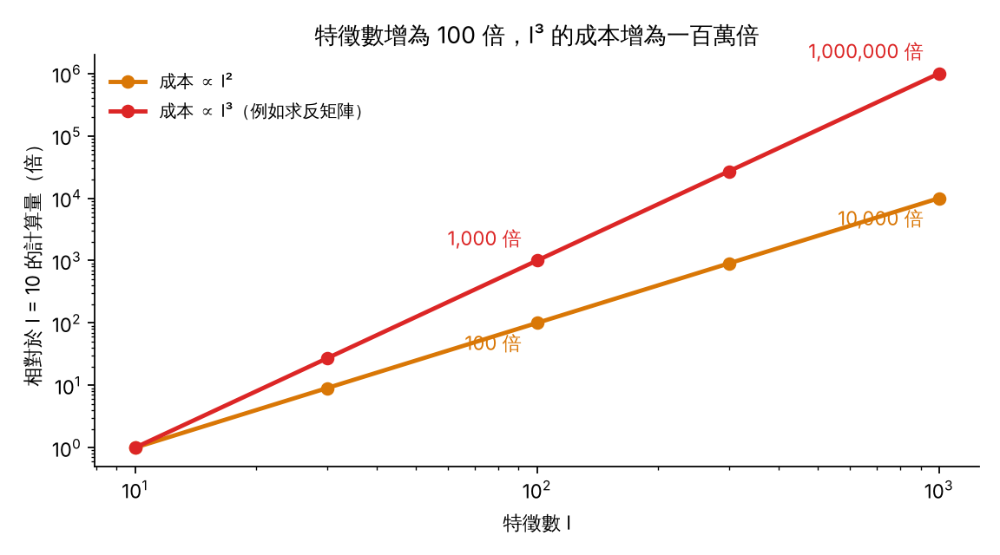
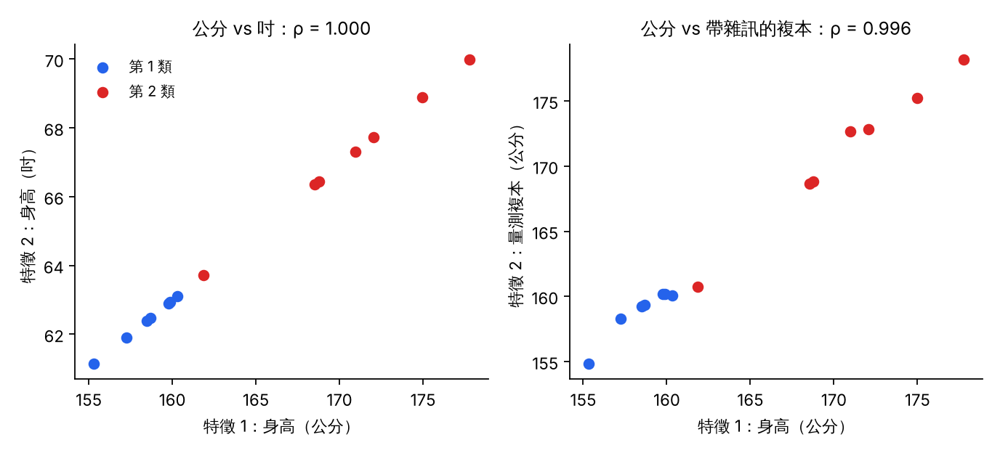
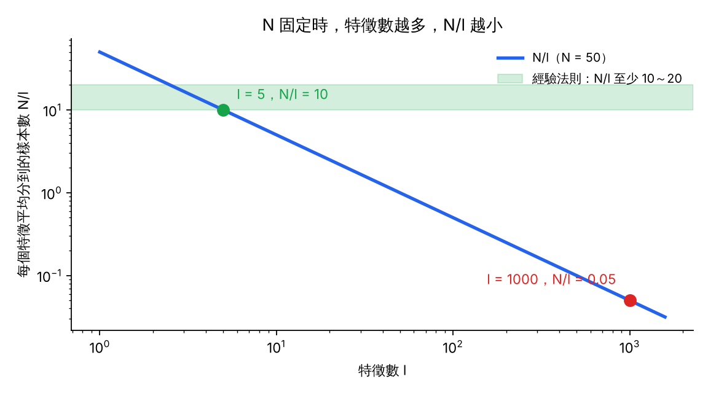
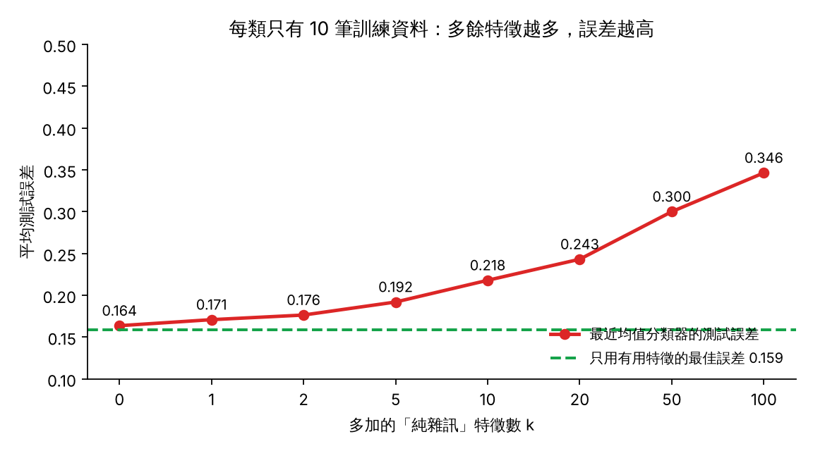

# KP01 為什麼要選特徵：特徵多不一定好

> 程度：大學生（undergrad）
>
> 圖型識別｜特徵選擇單元 第 1 個知識點（KP01）

## 學習目標

- 說出挑選特徵的三個理由：計算量、重複的特徵、樣本有限。
- 用 $O(l^2)$ 與 $O(l^3)$ 說明特徵數增加時，計算量為什麼暴增。
- 判斷兩個特徵是否重複，並說明相關係數 $\rho=\pm1$ 時共變異矩陣為什麼不可逆。
- 用 $N/l$ 比例與經驗法則，判斷手上的樣本數撐得起多少個特徵。
- 分清「特徵選擇」與「特徵產生」，並說出選特徵不只是為了跑得快。

## KP01 為什麼要選特徵：特徵多不一定好

**一句話重點**：特徵不是越多越好。計算量、特徵重複、樣本有限，都會讓多餘的特徵有害。

### 先備與符號

*你需要先會的三件事*：

- *特徵與類別*：每個樣本有許多測量值（特徵），要預測它屬於哪一類。
- *共變異矩陣與反矩陣*：第二章的分類器常要用到 $\Sigma^{-1}$。
- *訓練集與測試集*：訓練集用來學，測試集模擬沒見過的新資料。

*符號表*：

| 符號 | 意義 | 說明 |
|---|---|---|
| $l$ | 特徵數（特徵向量的維度） | 例：$l=1000$ |
| $N$ | 訓練樣本數 | 例：$N=50$ |
| $N/l$ | 每個特徵平均分到的樣本數 | 泛化的粗略指標 |
| $\rho$ | 兩個特徵的相關係數 | $-1\le\rho\le1$ |
| $\hat\mu_c$ | 第 $c$ 類的樣本均值 | 由訓練集算出 |
| $k$ | 多加的雜訊特徵數 | 本講義的實驗用 |

*用語*：**特徵選擇**是從已有的特徵中挑出一部分來用。**泛化**是分類器在沒見過的新資料上仍然有效的能力。**過擬合**是分類器把訓練資料的雜訊也記下來，換新資料就失靈。

### 1. 三個理由：為什麼不把特徵全部丟進去

想像你要出國自助旅行一個月。擔心冷、熱、下雨，結果把一千件東西都塞進行李箱。行李重得拉不動，在機場找護照還得翻遍所有衣服。

特徵就像行李。桌上擺著一千個特徵，全部塞進分類器，會碰到三個麻煩：

- 第一，計算量暴增。
- 第二，有些特徵重複，帶不來新資訊。
- 第三，樣本有限時，分類器容易過擬合。

下面三節各說一個理由。

### 2. 理由一：計算量隨特徵數暴增

**白話說明**：分類器要用特徵向量算距離、算共變異矩陣，還常常要求它的反矩陣。特徵越多，這些矩陣越大，算起來越慢。

**正式定義**：特徵數為 $l$ 時，$l\times l$ 矩陣的乘法與求反矩陣，計算量隨 $l^2$ 到 $l^3$ 成長。

$$\text{成本}\ \propto\ l^2\ \text{到}\ l^3.$$

**例子**：以 $l=10$ 為基準。特徵增為 $l=100$ 時，$l^2$ 的成本變 $100$ 倍，$l^3$ 的成本變 $1000$ 倍。增為 $l=1000$ 時，$l^3$ 的成本是基準的 $1{,}000{,}000$ 倍。

圖說 `lec07-kp01-why-select-f1-cost`：先看橫軸，是特徵數 $l$。橫軸取對數。再看兩條線，金色是 $l^2$，紅色是 $l^3$。縱軸也取對數，所以紅線每上一格，成本就多十倍。〔功能：1〕

**常見迷思**：「電腦很快，計算量不是問題。」不對。維度每增加一個數量級，成本可能增加三個數量級，而且第三個理由還會讓多算的結果更糟。

### 3. 理由二：重複的特徵不增加資訊

**白話說明**：同一個人的身高，用公分量一次、用吋量一次，是兩個特徵。它們的資訊卻一樣。知道公分，就能算出吋。

**正式定義**：兩個特徵的相關係數是

$$\rho=\frac{\operatorname{cov}(x_1,x_2)}{\sigma_1\sigma_2}.$$

$\rho=\pm1$ 時，一個特徵是另一個的線性函數。這時共變異矩陣的行列式為

$$\det\Sigma=\sigma_1^2\sigma_2^2\,(1-\rho^2)=0,$$

矩陣不可逆。需要 $\Sigma^{-1}$ 的分類器就算不下去。

**例子**：`[補充]` 取 14 個人的身高（教學設定，程式以固定種子產生）。特徵 1 是公分，特徵 2 是吋，$x_2=x_1/2.54$，算得 $\rho=1.000$。若特徵 2 是帶了一點量測雜訊的複本，則 $\rho=0.996$。矩陣勉強可逆，卻幾乎沒有新資訊，數值上也很不穩定。

圖說 `lec07-kp01-why-select-f2-redundant`：先看左圖，14 個點排成一條直線。吋是公分的固定倍數。再看右圖，點稍微散開，仍緊貼一條線。兩張圖裡，第 2 個特徵都沒有讓兩類更好分。〔功能：2〕

*先猜一猜*：兩個特徵單獨用，正確率都是 90%。合起來變成二維特徵向量，正確率一定升到 98% 嗎？

答案是不一定，甚至可能完全沒提升。若兩者相關係數接近 $1$，合起來沒有提供新的分類資訊，卻付出了雙倍的計算量。

**常見迷思**：「兩個特徵單獨看都很有用，合起來一定更好。」不對。高度相關時，合起來幾乎沒有增益。

### 4. 理由三：樣本有限時，特徵多會讓泛化崩塌

**白話說明**：特徵越多，分類器要估計的參數越多。樣本數固定時，每個參數分到的資料越來越少。分類器就開始死背訓練資料，包括裡面的雜訊。

**正式定義**：用 $N/l$ 當作粗略的指標。依講義所引的 Fine 經驗法則，$N/l$ 至少要 $10$ 到 $20$，泛化才穩健：

$$\frac{N}{l}\ \ge\ 10\sim20.$$

**例子**：某醫院要診斷一種罕見基因疾病，只有 $N=50$ 筆病人資料。基因晶片一次給出 $l=1000$ 個特徵。

| 做法 | 特徵數 $l$ | $N/l$ | 達到經驗法則？ |
|---|---|---|---|
| 全部都用 | $1000$ | $0.05$ | 否，遠低於 $10$ |
| 精選 5 個核心基因 | $5$ | $10$ | 是，剛好達標 |

全部都用時，平均每個特徵只分到 $0.05$ 筆資料。精選到 $5$ 個後，每個特徵分到 $10$ 筆，估計才穩得住。

圖說 `lec07-kp01-why-select-f3-ratio`：先看藍線，是 $N=50$ 時的 $N/l$。橫軸是特徵數，兩軸取對數。再看綠色帶，是經驗法則要求的 $10$ 到 $20$。紅點（$l=1000$）遠在帶子下方，綠點（$l=5$）剛好落在帶子的下緣。〔功能：3〕

*用模擬看一看*：`[補充]` 教學用的模擬，不是來源的結果。兩類，各 10 筆訓練資料。特徵 1 有用：兩類均值相差 2 個標準差。再加 $k$ 個純雜訊特徵，它們與類別無關。

分類器是最近均值分類器，把測試點判給離哪一類的訓練均值 $\hat\mu_c$ 較近的類別。測試集每類 5000 筆。整個流程重複 300 次，每次換一組訓練資料，種子固定，結果取平均。

| $k$ | 0 | 1 | 2 | 5 | 10 | 20 | 50 | 100 |
|---|---|---|---|---|---|---|---|---|
| 平均測試誤差 | 0.164 | 0.171 | 0.176 | 0.192 | 0.218 | 0.243 | 0.300 | 0.346 |

只用有用特徵時，理論上最好的誤差是 $0.159$。

圖說 `lec07-kp01-why-select-f4-noise`：先看綠色虛線。它是只用有用特徵時的最佳誤差 $0.159$。再看紅色折線，是加了 $k$ 個雜訊特徵後的測試誤差。折線隨 $k$ 往上走，$k=100$ 時約為 $0.35$。〔功能：4〕

這個模擬只用最近均值分類器與高斯資料，樣本數刻意取小。換別的分類器，上升速度會不同，但「樣本有限時，多餘的特徵有害」的方向不變。

CCC-LNS 的醫療例子說，全部都用時「真實測試錯誤率高達 50%，如同亂猜」。這是講義的說明，本講義沒有重現這個數字。

**常見迷思**：「特徵越多，分類器能用的資訊越多，所以不會變差。」不對。多出來的若是雜訊，樣本又有限，誤差會上升。

### 5. 兩個容易搞混的地方

**常見迷思**：「選特徵只是為了讓程式跑快一點。」不對。更核心的目的是提高泛化能力，避免無關的雜訊破壞決策邊界。

**常見迷思**：「特徵選擇和特徵產生是同一件事。」不對。特徵選擇是在現有特徵裡做減法，挑出一個子集。特徵產生是把原始特徵做線性或非線性組合，得到新的空間，例如 PCA。

### 6. 小結：留下的問題

三個理由合起來，說明了為什麼要挑特徵。計算量暴增。重複的特徵沒有用。樣本有限時，多餘的特徵會拖累分類器。

講義後面還會再回到這三點。有峰值現象（特徵過多時誤差反彈）、特徵子集選擇，以及 VC 維度與 SRM。

挑特徵要靠均值與變異數來比較特徵。如果資料裡有離群點，這兩個數字就會騙人。

**留下的問題**：評估特徵之前，資料乾淨嗎？下一個知識點 KP02 前置處理處理這個問題。

### 延伸：練習與解題示範

**小練習**：

1. 電商購買意願預測有 $N=2000$ 筆交易。要符合 $N/l\ge20$，最多保留幾個特徵？
2. 團隊一口氣收集了 $l=500$ 個特徵。目前 $N/l$ 是多少？需要特徵選擇嗎？
3. 兩個特徵滿足 $x_2=3x_1+2$。它們的相關係數是多少？共變異矩陣可逆嗎？

**題 1 解題示範**：$N/l\ge20$ 即 $l\le N/20=2000/20=100$。最多保留 $100$ 個特徵。

**題 2 解題示範**：$N/l=2000/500=4$，低於 $10$ 到 $20$ 的經驗法則，需要特徵選擇。

**題 3 解題示範**：$x_2$ 是 $x_1$ 的線性函數，斜率為正，所以 $\rho=+1$。行列式 $\sigma_1^2\sigma_2^2(1-\rho^2)=0$，矩陣不可逆。

## 術語與來源

| 中文 | English |
|---|---|
| 特徵選擇 | Feature selection |
| 特徵產生 | Feature generation |
| 重複的特徵 | Redundant feature |
| 泛化 | Generalization |
| 過擬合 | Overfitting |
| 相關係數 | Correlation coefficient |
| 共變異矩陣 | Covariance matrix |
| 最近均值分類器 | Nearest-mean classifier |
| 測試誤差 | Test error |
| 主成分分析（PCA） | Principal component analysis (PCA) |
| VC 維度 | Vapnik–Chervonenkis (VC) dimension |
| 結構風險最小化（SRM） | Structural risk minimization (SRM) |

來源：CCC-LNS 網頁第 5 章（特徵選擇）〈為什麼要「挑」特徵？〉與其「教授祕笈」的三個理由、$N/l$ 經驗法則、醫療診斷算例與練習（網址 `https://ndhuccc.github.io/CCC-LNS/PR_115/Ch05-feature-selection/index.html`，2026-11-08 讀取）；說明、順序與圖為重新撰寫。

Fine 的經驗法則是該網頁所引，本講義沒有核對 Fine 原文，也沒有核對教科書 Theodoridis & Koutroumbas 第 5 章原文。標示 `[補充]` 的例子與模擬是教學設定，數字由 `scripts/lec07-kp01-why-select/make_figures.py` 以固定種子計算，並另以獨立程式核算。
