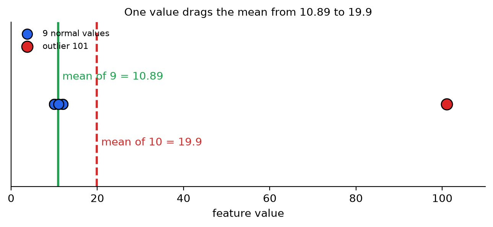
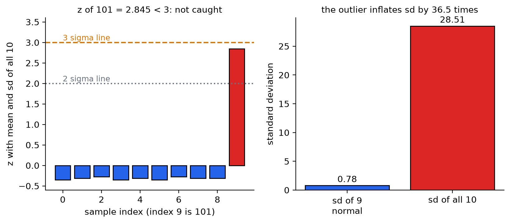
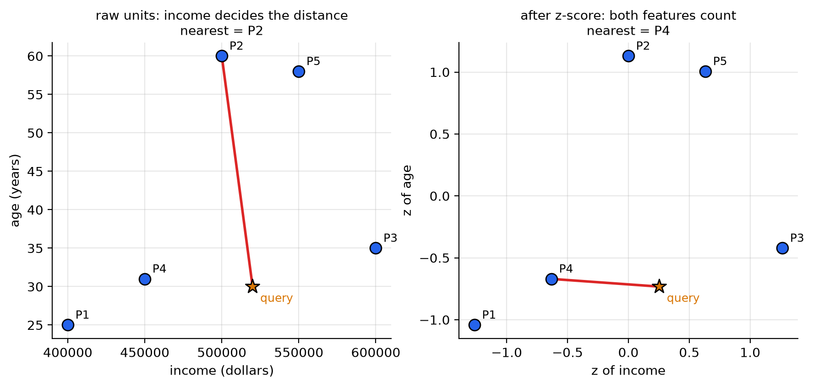
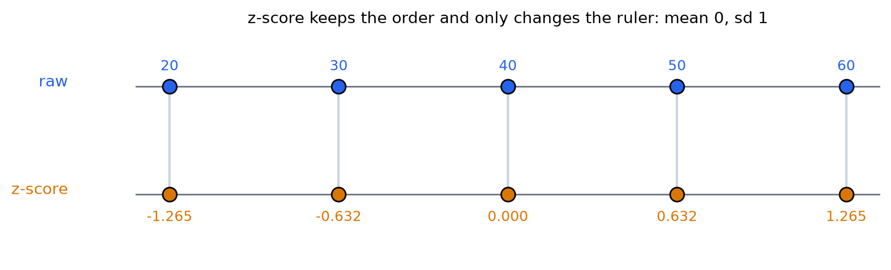
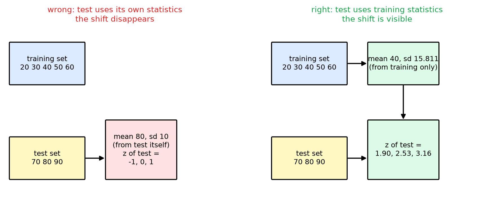
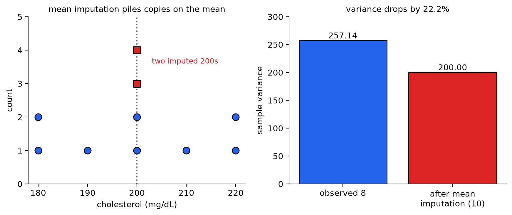
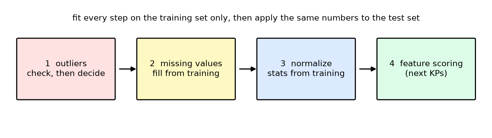

# KP02 前置處理：先清理資料，特徵的統計量才可信

> 程度：大學生（undergrad）
>
> 圖型識別｜特徵選擇單元

[簡報閱讀與下載](../slides/lec07-kp02-preprocessing.jbd.json)

## 學習目標

- 說明離群點如何拉歪均值與變異數，並判斷該刪除還是保留。
- 指出 $3\sigma$ 規則在離群點很極端時會失效，並說出原因。
- 用 z-score 與 min-max 把特徵拉到同一把量尺，並手算一例。
- 說明為什麼正規化的參數只能用訓練集算，並指出資料洩漏的做法。
- 比較刪除樣本、均值補值與多重插補，並說出均值補值的副作用。
- 依序排出離群點、缺值、正規化三道工序，並寫出對應的 scikit-learn 程式。

## KP02 前置處理：先清理資料，特徵的統計量才可信

**一句話重點**：後面要比較特徵好不好，靠的是均值與變異數。資料沒清理，這兩個數字就會騙人；清理的每一步，參數都只能由訓練集算出。

### 先備與符號

*你需要先會的三件事*：

- *均值與標準差*：$\bar x=\frac1N\sum x_i$，$\sigma=\sqrt{\frac{1}{N-1}\sum(x_i-\bar x)^2}$。本講義的標準差都除以 $N-1$。
- *訓練集與測試集*：訓練集用來估參數，測試集模擬沒見過的新資料。
- **特徵**：描述每個樣本的一個數值，例如年齡、膽固醇。上一個 KP 說明了為什麼要評估特徵；這個 KP 讓評估所用的數字可信。

*符號表*：

| 符號 | 意義 | 說明 |
|---|---|---|
| $x_i$ | 第 $i$ 個樣本的某特徵值 | 一維，實數 |
| $N$ | 樣本數 | 整數 |
| $\bar x$ | 樣本均值 | 與 $x_i$ 同單位 |
| $\sigma$ | 樣本標準差 | 除以 $N-1$ |
| $\hat x_i$ | 正規化後的值 | 無單位 |
| $z_i$ | 第 $i$ 個值離均值幾個標準差 | $z_i=(x_i-\bar x)/\sigma$ |

*用語*：**離群點**是離大多數資料很遠的點。**遺失值**是沒有量到的欄位。**正規化**是把不同單位的特徵換成同一把量尺。

### 1. 一個壞點就能把平均拉歪

**白話說明**：想像 9 筆正常的測量值 $\{10,11,12,10,11,10,12,11,11\}$，再混進一筆儀器突波 $101$。用平均與標準差描述這批資料，結果會完全失真。

**正式定義**：**離群點**（outlier）是離均值很遠的樣本點，距離常以 $\sigma$ 的倍數衡量。平方誤差 $(x_i-\bar x)^2$ 會把大偏差放大：偏差 $2$ 平方後是 $4$，偏差 $100$ 平方後是 $10000$。所以只要用到平方（均值、變異數、最小平方），一個離群點就能主導結果。

**例子**：9 筆正常值的總和是 $98$，均值 $10.89$，標準差 $0.78$。加上 $101$ 之後總和是 $199$，均值 $19.9$，標準差 $28.51$。

| 統計量 | 9 筆正常值 | 加上 101（10 筆） | 變化 |
|---|---|---|---|
| 均值 $\bar x$ | $10.89$ | $19.90$ | 移動 $9.01$，約 1.8 倍 |
| 變異數 $\sigma^2$ | $0.611$ | $812.54$ | 約 1330 倍 |
| 標準差 $\sigma$ | $0.78$ | $28.51$ | 約 36.5 倍 |

一筆資料，標準差就膨脹了 36 倍。如果後面用這個標準差去算檢定統計量或 FDR，分母被打大，原本很好的特徵會被判成壞特徵。

圖說 `lec07-kp02-preprocessing-f1-outlier`：先看藍點：9 筆正常值擠在 10 到 12 之間，綠線是它們的均值 $10.89$；再看紅點 $101$ 與紅色虛線：含它的 10 筆均值被拉到 $19.9$，這個數字卻不靠近任何一筆資料。〔功能：1、2〕



**常見迷思**：「資料量大，一個離群點就沒影響。」只要離群點夠極端（例如 $10^6$），平方後是 $10^{12}$，仍可壓過上萬筆正常資料的誤差總和。

### 2. 該刪還是該留：用規則判斷，也要看來源

**白話說明**：判斷離群點最常用的是 **$k\sigma$ 規則**：離均值超過 $k$ 個標準差就起疑。常態分布下，$2\sigma$ 內約含 95% 的資料，$3\sigma$ 內約含 99%（教科書寫 99%；精確值是 99.7%）。

*但它會失效*：用剛才含 101 的 10 筆資料算 $z=(101-19.9)/28.51=2.845$。這小於 $3$，所以 $3\sigma$ 規則**放過了**它。原因是離群點自己把標準差撐大，反過來讓自己看起來不那麼遠。若用 9 筆正常值的均值與標準差算，$z=(101-10.89)/0.78\approx115.3$，一目了然。

圖說 `lec07-kp02-preprocessing-f2-masking`：先看左圖：9 根藍柱都接近 0，紅柱 101 的 $z=2.845$，沒有越過橘色 $3\sigma$ 虛線；再看右圖：那一筆讓標準差從 $0.78$ 膨脹到 $28.51$，這就是它遮住自己的方式。〔功能：1、2〕



*實務做法*：`[補充]` 兩個做法可以減少這種「自己遮住自己」：①先用 $2\sigma$ 或更嚴的門檻標出可疑點，人工檢查來源；②改用不受極端值影響的量：**中位數**與**中位數絕對偏差**（MAD）。這批資料的中位數是 $11$，MAD 是 $1$，$101$ 離中位數 $90$ 個 MAD，不會被遮住。

*刪還是留，要看來源*：若離群點來自儀器故障、輸入錯誤，直接刪除合理。若它來自真實的**長尾分布**（例如極少數高收入戶），刪掉會破壞真實的分布；這時改用對離群點不敏感的穩健代價函數（例如 Huber：誤差小時用平方，誤差大時改用線性）。離群點很少且確定是雜訊，才刪。

**常見迷思**：「$3\sigma$ 之外的一律刪掉。」兩個問題：離群點可能遮住自己；長尾資料中的極端值是真實資料。

### 3. 單位不同，距離就不公平

**白話說明**：特徵 A 是年收入（元），範圍數十萬；特徵 B 是年齡（歲），範圍幾十。直接算歐氏距離，收入的差距動輒幾萬，年齡差 30 歲也只是 30，完全被蓋過。

**例子**：5 位使用者（P1 到 P5）與一位查詢者，用歐氏距離找最近的人。

| 人 | 年收入 | 年齡 | 原始距離到查詢者 | z（收入） | z（年齡） | z 距離 |
|---|---|---|---|---|---|---|
| P1 | 400,000 | 25 | 120,000 | $-1.265$ | $-1.042$ | 1.549 |
| P2 | 500,000 | 60 | 20,000 | $0.000$ | $1.129$ | 1.879 |
| P3 | 600,000 | 35 | 80,000 | $1.265$ | $-0.422$ | 1.058 |
| P4 | 450,000 | 31 | 70,000 | $-0.632$ | $-0.670$ | 0.888 |
| P5 | 550,000 | 58 | 30,000 | $0.632$ | $1.005$ | 1.778 |

查詢者是 $(520000,\ 30)$，z 之後是 $(0.253,\ -0.732)$。用原始單位，最近的是 **P2**（距離 $20000$，其實年齡差了 30 歲）；用 z-score 之後，最近的是 **P4**（z 距離 $0.888$，年齡只差 1 歲、收入也不遠）。同一位查詢者，換了量尺，最近鄰就換人。原始距離中，收入差占了距離平方的 99.9999998%，年齡幾乎不起作用。

圖說 `lec07-kp02-preprocessing-f3-scale-distance`：先看左圖：原始單位下，紅線連到 P2，它的年齡 60 與查詢者差很多，卻因為收入最近而被選中；再看右圖：z-score 後兩軸尺度相同，紅線改連到 P4。〔功能：1、3〕



**常見迷思**：「正規化會改變點的大小順序。」不會。$\hat x=(x-\bar x)/\sigma$ 是嚴格遞增的線性變換，每個特徵內部的排序不變，改變的只是量尺。

### 4. 正規化的做法與參數來源

**正式定義**：三種常用做法。①**z-score**（零均值、單位變異數）：

$$
\hat x_{i}=\frac{x_i-\bar x}{\sigma},\qquad \bar x=\frac1N\sum_i x_i,\quad \sigma^2=\frac1{N-1}\sum_i(x_i-\bar x)^2 .
$$

②*min-max*：$\hat x_i=(x_i-x_{\min})/(x_{\max}-x_{\min})$，值落在 $[0,1]$。③*softmax 縮放*：先算 $y=(x_i-\bar x)/(r\sigma)$，再 $\hat x_i=1/(1+e^{-y})$，把長尾資料平滑壓進 $(0,1)$，$r$ 控制中央線性區的寬度。

**例子**：$x=\{20,30,40,50,60\}$，$\bar x=40$，$\sigma=\sqrt{1000/4}=15.811$。

| $x$ | $x-\bar x$ | z-score | min-max | softmax（$r=1$） |
|---|---|---|---|---|
| 20 | $-20$ | $-1.265$ | $0.00$ | $0.220$ |
| 30 | $-10$ | $-0.632$ | $0.25$ | $0.347$ |
| 40 | $0$ | $0.000$ | $0.50$ | $0.500$ |
| 50 | $+10$ | $0.632$ | $0.75$ | $0.653$ |
| 60 | $+20$ | $1.265$ | $1.00$ | $0.780$ |

z-score 後均值恰好為 $0$、標準差恰好為 $1$。

圖說 `lec07-kp02-preprocessing-f4-zscore`：先看上排藍點：原始值 $20$ 到 $60$；再看下排橘點：z-score 後變成 $-1.265$ 到 $1.265$，連線彼此平行不交叉，說明順序沒變。〔功能：1〕



*參數只能由訓練集算（資料洩漏）*：分類器上線後，會遇到沒見過的資料。所以 $\bar x$ 與 $\sigma$ 必須只用訓練集算，再用同一組數字去轉換測試集。若在測試集上另外算自己的均值與標準差，測試資料的偏移就被抹掉了。

**例子**：訓練集 $\{20,30,40,50,60\}$（$\bar x=40$、$\sigma=15.811$），測試集 $\{70,80,90\}$，整批都偏高。①正確做法：用訓練參數，測試的 z 是 $1.90,\ 2.53,\ 3.16$，清楚顯示「比訓練資料高很多」。②錯誤做法：用測試集自己的均值 $80$ 與標準差 $10$，z 變成 $-1,\ 0,\ 1$，偏移完全消失。第二種做法就是**資料洩漏**：測試集的資訊跑進了轉換參數。

圖說 `lec07-kp02-preprocessing-f5-leakage`：先看左圖（錯誤）：測試集用自己的均值 80 與標準差 10，轉換後 $-1,0,1$；再看右圖（正確）：測試集沿用訓練集的均值 40 與標準差 15.811，轉換後 $1.90,2.53,3.16$。〔功能：1、2〕



*取捨*：min-max 遇到訓練集範圍之外的新值會跑到 $[0,1]$ 以外；z-score 沒有固定上下界，能容納新值。長尾資料用 softmax 縮放或先取對數。`[補充]` scikit-learn 的 `StandardScaler` 用**除以 $N$** 的標準差，與本講義的除以 $N-1$ 略有不同：同一組 $\{20,\dots,60\}$，它得到 $\sigma=14.142$，測試集 z 為 $2.121,\ 2.828,\ 3.536$。$N$ 愈大，兩者差愈小；只要訓練與測試用同一個，結論不變。

**常見迷思**：「把全部資料合起來一起正規化最方便。」那就是資料洩漏；做驗證時，每一折都要在該折的訓練部分重新算參數。

### 5. 遺失值：刪、補平均，還是更好的補法

**白話說明**：問卷有人漏填月收入。直接丟掉整張問卷，樣本變少；填上全體平均，看起來合理，卻會悄悄改變資料。

*四種做法*（教科書另列兩種傳統補法：補零，以及補「條件均值」；條件均值是下面第③種只填均值、不抽樣的特例）：①*刪除樣本*：簡單，樣本少或缺值散落多處時，會丟掉大半資料。②**均值補值**：用已觀測值的均值填入。③*單一條件補值*：假設是**隨機遺失**（MAR，是否缺失只跟已觀測的特徵有關），用已知特徵估計缺值的條件分布，從中抽一個值填入，可保留特徵之間的相關。④**多重插補**（multiple imputation, MI）：重複抽 $m>1$ 組補值，各自分析再合併，結果會反映「補值本身不確定」。

**例子（均值補值的副作用）**：10 位病人，8 位有膽固醇數據 $\{180,190,200,210,220,180,200,220\}$，2 位遺失。已觀測均值 $200$，平方和 $1800$，變異數 $1800/7=257.14$。把兩個缺值都填 $200$：

| 統計量 | 已觀測 8 筆 | 均值補值後 10 筆 |
|---|---|---|
| 均值 | $200.00$ | $200.00$ |
| 平方和 $\sum(x_i-\bar x)^2$ | $1800$ | $1800$（新增兩筆離差為 0） |
| 變異數 | $257.14$ | $200.00$（除以 $9$） |
| 標準差 | $16.04$ | $14.14$ |

均值沒變，變異數被壓低 $22.2\%$：補進去的兩筆都剛好在均值上，資料看起來比實際更集中。變異數變小，檢定統計量與 FDR 的分母會變小，沒有辨識力的特徵會看起來有辨識力。

圖說 `lec07-kp02-preprocessing-f6-imputation`：先看左圖：藍點是 8 筆觀測值，紅色方塊是兩筆被補在 $200$ 的值，疊在均值線上；再看右圖：變異數從 $257.14$ 降到 $200.00$。〔功能：1、2〕



*多重插補的數字例*：`[補充]` 從 $N(200,\ 257.14)$（觀測的均值與變異數）抽補值，重複 $m=3$ 次（種子 0）。三組補值分別是 $(202.0,\ 197.9)$、$(210.3,\ 201.7)$、$(191.4,\ 205.8)$，三組完整資料的均值依序是 $199.99,\ 201.20,\ 199.72$。依 Rubin 規則合併：合併均值 $=200.30$；組內變異 $\bar U=20.77$（各組均值的變異數的平均）；組間變異 $B=0.616$；總變異 $T=\bar U+(1+1/m)B=21.60$，標準誤 $\sqrt T=4.65$。對照：均值補值只給 $4.47$（變異數被壓低，標準誤偏小）。MI 的標準誤比均值補值大，是因為它如實反映「這兩筆是補的」；只用觀測的 8 筆則是 $5.67$。

**常見迷思**：①「均值補值最安全，因為均值沒變。」變異數會被壓低。②「缺值少就隨便補。」補法會影響後面的特徵評估，仍要比較。

### 6. 三道工序的順序，與一條完整的流水線

*順序*：先檢查離群點，再處理缺值，最後正規化。理由：離群點會拉歪均值與標準差，所以必須先處理；補值要用乾淨的均值；正規化要在補值之後，才有完整的資料可算參數。所有「參數」都從訓練集算出，再套到測試集。

圖說 `lec07-kp02-preprocessing-f7-pipeline`：先看四個方塊由左到右：離群點、缺值、正規化、後面的特徵評分；再看上方一句話：每一步都只在訓練集上學習參數，之後用同一組數字轉換測試集。〔功能：1〕



*實作*：`[補充]` scikit-learn 把補值與正規化串成一條流水線，`fit` 只看訓練集，`transform` 再套到測試集。下面的程式已實際執行過，輸出附在註解：

```python
import numpy as np
from sklearn.impute import SimpleImputer
from sklearn.preprocessing import StandardScaler
from sklearn.pipeline import make_pipeline

X_train = np.array([[180], [190], [200], [210], [220], [180], [200], [220],
                    [np.nan], [np.nan]])          # 8 筆觀測，2 筆遺失
X_test = np.array([[np.nan], [240.0]])            # 測試集也可能有缺值

pipe = make_pipeline(SimpleImputer(strategy="mean"), StandardScaler())
pipe.fit(X_train)                                  # 只用訓練集學參數

print(pipe[0].statistics_)    # [200.]      補值用的均值
print(pipe[1].mean_)          # [200.]      正規化的均值
print(pipe[1].scale_)         # [13.4164]   補值後的標準差（除以 N）
print(pipe.transform(X_test).ravel())   # [0.     2.9814]
```

測試集的缺值先補成 $200$，再轉成 $z=0$；$240$ 轉成 $(240-200)/13.416=2.981$。補值後的標準差 $13.416$ 比觀測資料的小，這正是上一節說的「均值補值壓低變異」。

**想深入**（選讀）：離群點、缺值、正規化都會影響後面的特徵評分，例如 KP03 的 $t$ 檢定與 KP05 的 FDR。這就是為什麼本 KP 放在特徵評估之前：評分用的是均值與變異數，這些數字不可信，分數就不可信。

### 延伸：練習與解題示範

**小練習**：

1. 感測器收集到 $\{20,21,22,21,116\}$。①含 $116$ 的均值是多少？②剔除 $116$ 之後呢？③用含 $116$ 的均值與標準差算 $116$ 的 $z$，$3\sigma$ 規則能抓到嗎？
2. 某特徵的 $\bar x=100$、$\sigma=20$：$x=140$ 與 $x=70$ 的 z-score 各是多少？
3. 測試集的一個值，用訓練集的 $\bar x=40$、$\sigma=15.811$ 轉換，原始值是 $70$。z 是多少？若誤用測試集自己的統計量，會發生什麼事？

**題 1 解題示範**：① $(20+21+22+21+116)/5=40.0$。② $(20+21+22+21)/4=21.0$。③ 含 $116$ 的標準差是 $42.49$，$z=(116-40)/42.49=1.79$，小於 $2$，連 $2\sigma$ 都抓不到；剔除後 $z=(116-21)/0.816=116.4$。這是第 2 節的遮住現象：離群點把標準差撐大，自己看起來不離群。

**題 2 解題示範**：$x=140$：$(140-100)/20=2.0$。$x=70$：$(70-100)/20=-1.5$。

**題 3 解題示範**：① $z=(70-40)/15.811=1.897$，約高於訓練均值 $1.9$ 個標準差。② 若用測試集自己的統計量，這個值可能被算成 $-1$、$0$ 或 $1$，看不出它其實偏離訓練資料很遠，也就是資料洩漏。

## 術語與來源

| 中文 | English |
|---|---|
| 離群點 | Outlier |
| 標準差 | Standard deviation |
| $k\sigma$ 規則 | $k$-sigma rule |
| 遮住現象 | Masking |
| 中位數絕對偏差 | Median absolute deviation (MAD) |
| 穩健代價函數 | Robust cost function |
| 正規化 | Normalization |
| z-score | z-score |
| 資料洩漏 | Data leakage |
| 遺失值 | Missing value |
| 隨機遺失 | Missing at random (MAR) |
| 均值補值 | Mean imputation |
| 多重插補 | Multiple imputation (MI) |
| 刪除樣本 | Listwise deletion |
| 單一條件補值 | Single imputation from the conditional distribution |
| min-max 縮放 | Min-max scaling |
| softmax 縮放 | Softmax scaling |
| 費雪判別比（後續 KP） | Fisher discriminant ratio (FDR) |
| `StandardScaler` | scikit-learn 的標準化工具 |

來源：CCC-LNS 網頁第 5 章（特徵選擇）的前置處理三節，並對照教科書 Theodoridis & Koutroumbas 第 5 章 §5.2（離群點、資料正規化、遺失資料三小節）逐項核對；說明、圖與順序為重新撰寫。網頁離群點範例的總和與均值有誤（9 筆正常值總和是 98，不是 97；含離群點的均值是 19.9，不是 19.80；變異數 812.54，不是 810.04），本講義以程式重算的值為準。距離範例、資料洩漏範例、Rubin 合併、MAD 與 scikit-learn 程式為 `[補充]`；所有數字由 `scripts/lec07-kp02-preprocessing/compute_data.py` 算出（`reports/lec07-kp02-preprocessing/數值驗算.json`）。
