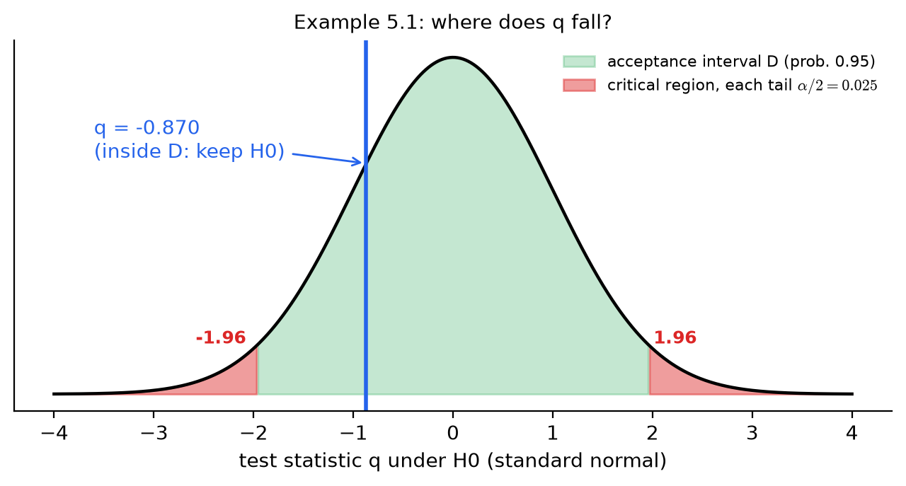
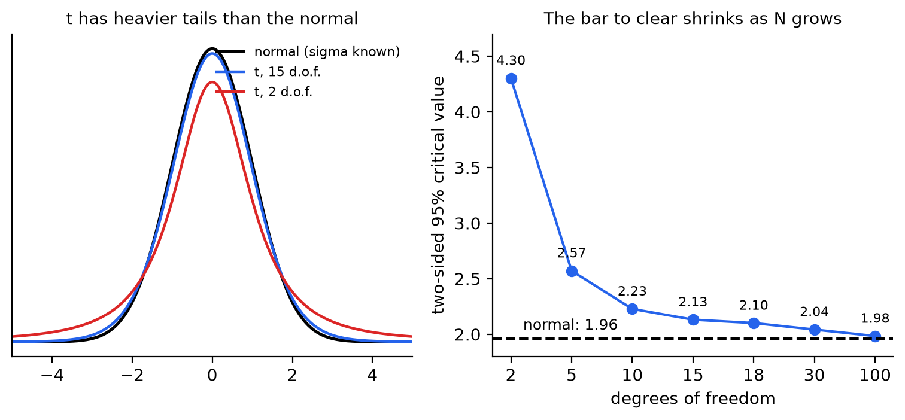
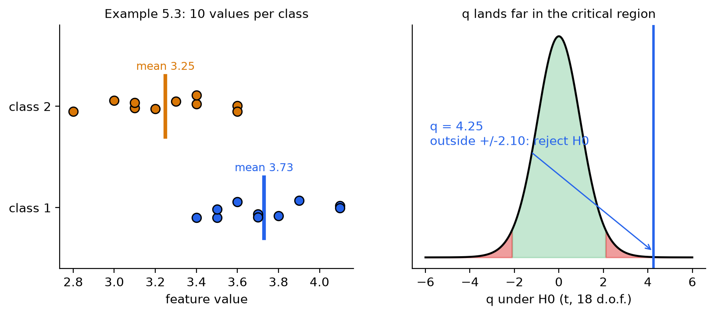
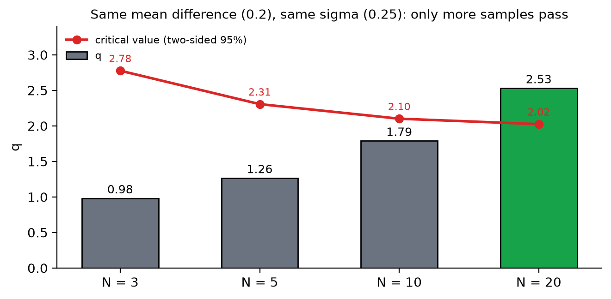
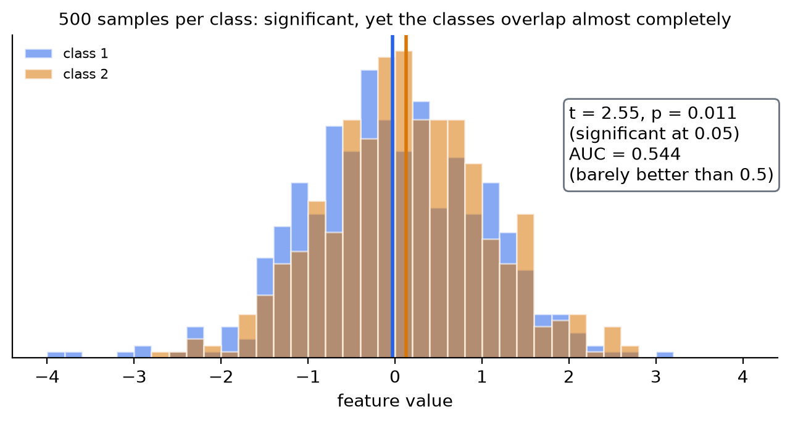
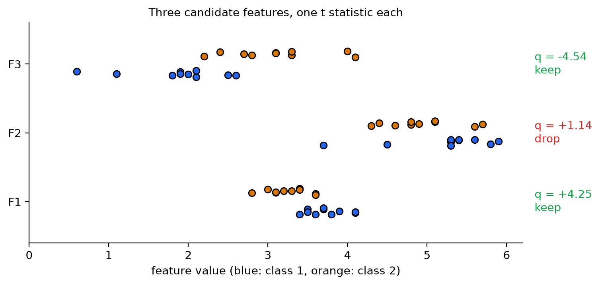

# KP03 統計檢定：先逐一審查特徵，淘汰沒有證據的

> 程度：大學生（undergrad）
>
> 圖型識別｜特徵選擇單元

## 學習目標

- 說出虛無假設、對立假設、檢定統計量與顯著水準各代表什麼。
- 用 $\sigma$ 已知的 $z$ 檢定與 $\sigma$ 未知的 $t$ 檢定，判斷一個均值是否等於某個指定值。
- 手算一個特徵在兩類之間的 $t$ 統計量，用臨界值決定保留或淘汰，並說明自由度為何是 $2N-2$。
- 說明同一個均值差在樣本數不同時，檢定結論為什麼會不同。
- 指出「檢定顯著」不等於「兩類分得開」，並說出下一步要看什麼。

## KP03 統計檢定：先逐一審查特徵，淘汰沒有證據的

**一句話重點**：把每個特徵單獨拿出來，問「兩類的均值差，是真的有差，還是抽樣運氣」。差距必須除以抽樣的波動才算證據；過了這一關，只代表均值有差，還不代表分得開。

### 先備與符號

*你需要先會的三件事*：

- *均值與標準差*：$\bar x=\frac1N\sum x_i$，$\hat\sigma=\sqrt{\frac{1}{N-1}\sum(x_i-\bar x)^2}$。除以 $N-1$ 的原因見 KP02。
- *常態分布的臨界值*：標準常態中間 95% 的區間是 $[-1.96,\,1.96]$。
- *KP02 的結論*：離群點與缺值處理不好，均值與變異數就不可信；本 KP 算的全是這兩個量。

*符號表*：

| 符號 | 意義 | 說明 |
|---|---|---|
| $H_0$、$H_1$ | 虛無假設、對立假設 | $H_0$：沒有差；$H_1$：有差 |
| $\bar x,\ \bar y$ | 兩類的樣本均值 | 單位同特徵 |
| $\sigma,\ \hat\sigma$ | 母體標準差、由樣本估計的標準差 | $\hat\sigma$ 除以 $N-1$ |
| $q$ | 檢定統計量 | 無單位；差距除以波動 |
| $\alpha$ | 顯著水準 | 你容許自己冤枉 $H_0$ 的機率，常取 $0.05$ |
| $D$ | 接受域 | $q$ 落在其中就保留 $H_0$ |
| $s_z^2$ | 兩類合併後的變異數估計 | 兩類樣本變異數的平均 |
| $N$ | 每一類的樣本數 | 本講義兩類樣本數相同 |

*用語*：**特徵**是描述樣本的一個數值。**類別**是你要預測的標籤，這裡有兩類 $\omega_1,\omega_2$。**抽樣波動**是：換一批樣本，算出來的均值會跟著跳動的程度。

### 1. 為什麼先逐一審查特徵

**白話說明**：KP02 之後資料乾淨了，你手上可能有幾十到幾百個特徵。後面的子集挑選很貴（KP06、KP07）。所以先做最便宜的一步：一個一個看，把明顯沒有分辨力的特徵先淘汰。

**正式定義**：令 $x$ 是某個特徵。想問的是它在兩個類別 $\omega_1,\omega_2$ 的值是否有顯著差別。把問題寫成統計假設檢定：

- $H_1$：特徵的值（的均值）在兩類之間有顯著差別。
- $H_0$：沒有顯著差別。

教科書直接指出這一步的限制：逐一看特徵「離最佳解還很遠」。它看不到特徵之間的搭配。它的價值是便宜，用來丟掉明顯的壞選擇。

**常見迷思**：「每個特徵都通過檢定，組起來一定好。」不一定。兩個通過檢定的特徵可能是同一件事的兩種寫法，重複而冗餘（KP01 的單位換算例）。組合要到 KP06 才處理。

### 2. 差距要除以波動，才叫證據

**白話說明**：想像法庭。$H_0$ 是「被告無罪」，你要找證據推翻它。證據不是「均值差了 0.05」，而是「差了 0.05，而且這差距比抽樣的運氣大得多」。同樣差 0.05：測量很穩、樣本很多，是強證據；測量亂跳、樣本很少，可能只是巧合。所以要把差距除以它的不確定性，這個「標準化後的證據強度」就叫**檢定統計量**。

**正式定義**：先看一般的檢定。令 $\theta$ 是未知參數（例如均值），$\theta_0$ 是被檢驗的指定值：

$$
H_1:\ \theta\ne\theta_0,\qquad H_0:\ \theta=\theta_0 .
$$

取 $N$ 個樣本 $x_1,\dots,x_N$，經一個函數得到檢定統計量 $q$，並設計成：在 $H_0$ 成立時，$q$ 的分布已知。把 $q$ 的軸切成兩段：

- **接受域** $D$：$H_0$ 成立時，$q$ 有高機率（$1-\alpha$）落在這裡。
- **臨界域** $\bar D$：$H_0$ 成立時，$q$ 只有低機率（$\alpha$）落在這裡。

$\alpha$ 稱為**顯著水準**。$q$ 落在 $D$ 就保留 $H_0$，落在 $\bar D$ 就拒絕 $H_0$。注意 $\alpha$ 的意思：就算 $H_0$ 是真的，你仍有 $\alpha$ 的機率因為運氣不好而拒絕它。這個犯錯機率是你事先選的。

**$\sigma$ 已知的情況**：令 $x$ 的均值是 $\mu$、標準差是 $\sigma$。樣本均值 $\bar x$ 本身也會抖動，它的標準差是 $\sigma/\sqrt N$：樣本越多，抖得越小。要檢驗 $H_0:\mu=\hat\mu$，用

$$
q=\frac{\bar x-\hat\mu}{\sigma/\sqrt N}.
$$

由中央極限定理，$H_0$ 成立時 $q$ 近似服從標準常態 $N(0,1)$。標準常態中間 95% 的區間是 $[-1.96,\,1.96]$，所以取 $\alpha=0.05$ 時 $D=[-1.96,\,1.96]$。

**例子（教科書 Example 5.1）**：某特徵 $\sigma=0.23$，$N=16$，量到 $\bar x=1.35$。檢驗 $\hat\mu=1.4$，$\alpha=0.05$。

| 步驟 | 算式 | 結果 |
|---|---|---|
| ① 均值的標準差 | $\sigma/\sqrt N=0.23/\sqrt{16}$ | $0.0575$ |
| ② 差距 | $\bar x-\hat\mu=1.35-1.4$ | $-0.05$ |
| ③ 檢定統計量 | $q=-0.05/0.0575$ | $-0.870$ |
| ④ 接受域 | 標準常態中間 95% | $[-1.96,\,1.96]$ |
| ⑤ 決定 | $-0.870$ 在 $D$ 內 | 保留 $H_0$ |

結論：沒有證據顯示均值不是 $1.4$。這不是「證明均值就是 $1.4$」，只是這批樣本不足以推翻它。反過來也能算出一個區間：均值的**信賴區間**是 $\bar x\pm1.96\cdot0.0575=[1.237,\,1.463]$，$1.4$ 在裡面。課本的 Table 5.1 在 95% 欄寫的是 $1.967$，精確值是 $1.960$；兩者算出的區間端點只差在小數第 4 位，結論相同。

圖說 `lec07-kp03-hypothesis-tests-f1-acceptance`：先看綠色的中間區：它占 95% 的機率，就是接受域 $D$；再看兩端紅色的小尾巴，各 2.5%，是臨界域；最後看藍線：$q=-0.870$ 落在綠區內，所以保留 $H_0$。〔功能：1、2〕



**常見迷思**：「$q$ 落在接受域，就證明 $H_0$ 為真。」不是。接受域只表示證據不夠推翻它。樣本太少時，真有差也可能被放過（見第 6 節）。

### 3. $\sigma$ 不知道時：用 $t$，門檻放寬

**白話說明**：實務上你幾乎不知道 $\sigma$，只能用樣本去估。估出來的 $\hat\sigma$ 自己也會抖。分母會抖，$q$ 就比標準常態更容易出現極端值。所以判斷的門檻要放寬一點，放寬多少看你有幾筆樣本。

**正式定義**：用樣本估計 $\sigma$：

$$
\hat\sigma^2=\frac{1}{N-1}\sum_{i=1}^N(x_i-\bar x)^2,\qquad
q=\frac{\bar x-\hat\mu}{\hat\sigma/\sqrt N}.
$$

若 $x$ 服從常態，這個 $q$ 服從**自由度**為 $N-1$ 的 **$t$ 分布**。自由度可以先理解成「用來估 $\sigma$ 的獨立資訊有幾份」：$N$ 個值已經用掉一份去算 $\bar x$，剩 $N-1$ 份。$t$ 分布的兩端比常態厚（見下圖左），所以接受域要更寬；自由度越大，越接近常態。

| 自由度 | 2 | 5 | 10 | 15 | 18 | 30 | 100 | 常態 |
|---|---|---|---|---|---|---|---|---|
| 雙側 95% 臨界值 | 4.30 | 2.57 | 2.23 | 2.13 | 2.10 | 2.04 | 1.98 | 1.96 |

**例子（教科書 Example 5.2）**：沿用 Example 5.1 的數字，但把 $0.23$ 當成由樣本估出的 $\hat\sigma$。$N=16$，自由度 $15$。課本取顯著水準 $\alpha=0.025$（雙側），查 Table 5.2 得臨界值 $2.49$：

- 均值的信賴區間：$1.35\pm2.49\cdot0.0575=[1.207,\,1.493]$。
- 若改取 95%：臨界值 $2.131$，區間 $[1.227,\,1.473]$。兩者都比 $z$ 的 $[1.237,\,1.463]$ 寬。

*讀表要小心*：Table 5.2 的欄位 $1-\alpha$ 是**雙側**機率。例如 15 自由度、$0.975$ 欄的 $2.49$，是「中間 97.5%」的臨界值；一般 $t$ 表若列單側分位數，同一個值對應的是 $0.9875$。表格的換算要對清楚。

圖說 `lec07-kp03-hypothesis-tests-f2-t-vs-z`：先看左圖：紅色的 $t$（2 自由度）兩端最厚，藍色（15 自由度）已接近黑色的常態；再看右圖：雙側 95% 臨界值從自由度 2 的 4.30 一路降到 100 的 1.98，逼近常態的 1.96。〔功能：1、2〕



**常見迷思**：「$N$ 超過 30 就一定可以用 $z$。」只是近似。自由度 30 的臨界值是 $2.04$，離 $1.96$ 仍有差；差別小，所以大樣本時兩者結論通常一致。

### 4. 兩類的均值差，也是一個 $t$

**白話說明**：特徵選擇真正想問的是：這個特徵在 $\omega_1$ 與 $\omega_2$ 的均值有沒有差。把兩類對應的值相減，就把「兩類比較」變成上一節的「一組數字的均值是不是 0」。

**正式定義**：設特徵在 $\omega_1$ 的 $N$ 個值是 $x_i$（均值 $\bar x$），在 $\omega_2$ 的 $N$ 個值是 $y_i$（均值 $\bar y$）。假設兩類變異數相同，都是 $\sigma^2$。檢驗

$$
H_1:\ \Delta\mu=\mu_1-\mu_2\ne0,\qquad H_0:\ \Delta\mu=0 .
$$

令 $z=x-y$。兩者獨立時 $z$ 的均值是 $\mu_1-\mu_2$，變異數是 $2\sigma^2$，所以 $\bar z=\bar x-\bar y$ 的標準差是 $\sigma\sqrt{2/N}$。$\sigma$ 要用兩類樣本一起估：

$$
s_z^2=\frac{1}{2N-2}\Big[\sum_{i=1}^N(x_i-\bar x)^2+\sum_{i=1}^N(y_i-\bar y)^2\Big],\qquad
q=\frac{(\bar x-\bar y)-0}{s_z\sqrt{2/N}} .
$$

兩類樣本數相同時，$s_z^2$ 就是兩類樣本變異數 $\hat\sigma_1^2,\hat\sigma_2^2$ 的平均。分母用了 $N-1+N-1=2N-2$ 份獨立資訊，所以 $q$ 服從自由度 **$2N-2$** 的 $t$ 分布。

**例子（教科書 Example 5.3）**：某特徵在兩類各量 10 次：

| 類別 | 10 個值 | 均值 | 樣本變異數 |
|---|---|---|---|
| $\omega_1$ | 3.5、3.7、3.9、4.1、3.4、3.5、4.1、3.8、3.6、3.7 | $3.73$ | $0.0601$ |
| $\omega_2$ | 3.2、3.6、3.1、3.4、3.0、3.4、2.8、3.1、3.3、3.6 | $3.25$ | $0.0672$ |

| 步驟 | 算式 | 結果 |
|---|---|---|
| ① 合併變異數 | $s_z^2=(0.0601+0.0672)/2$ | $0.0637$，$s_z=0.2523$ |
| ② 均值差的標準差 | $s_z\sqrt{2/10}=0.2523\times0.4472$ | $0.1128$ |
| ③ 檢定統計量 | $q=(3.73-3.25)/0.1128$ | $4.254$ |
| ④ 自由度與臨界值 | $2\times10-2=18$，$\alpha=0.05$ | $D=[-2.10,\,2.10]$ |
| ⑤ 決定 | $4.254$ 在 $D$ 之外 | 拒絕 $H_0$，保留此特徵 |

課本寫 $q=4.25$、$D=[-2.10,\,2.10]$，與重算相符。`[補充]` 這時 $p$ 值是 $0.0005$（$H_0$ 成立時，$|q|$ 大到這個程度的機率）；均值差 $0.48$ 的 95% 信賴區間是 $[0.243,\,0.717]$，不含 $0$。

圖說 `lec07-kp03-hypothesis-tests-f3-two-class-t`：先看左圖：橘色（類別 2）的點整體偏左，均值 $3.25$；藍色（類別 1）偏右，均值 $3.73$；再看右圖：自由度 18 的 $t$ 分布，綠區是接受域，藍線 $q=4.25$ 遠遠落在紅色臨界域之外。〔功能：1、2〕



**常見迷思**：「檢定的是個別樣本的差。」不是。檢定的是兩類**均值**的差，而且要除以均值的抖動。同一個均值差，樣本多就穩、樣本少就晃（第 6 節）。

### 5. 前提不成立時：換一個工具

**白話說明**：上一節的 $t$ 用了三個前提：兩類變異數相同、樣本數相同、特徵大致服從常態。實務上常有不符合的時候，各有對應的補救。

- *樣本數不同*：$s_z^2$ 要改用各類自己的自由度加權；教科書把這個修改留作習題。
- *變異數不同*：先檢查比值 $F=\hat\sigma_1^2/\hat\sigma_2^2$ 是否接近 $1$；比值的分布叫 $F$ 分布。Example 5.3 的 $F=0.0601/0.0672=0.894$，自由度 $(9,9)$ 的 95% 接受域是 $[0.248,\,4.03]$，在內，變異數相等的假設可以接受。若不能接受，改用 **Welch $t$ 檢定**（不要求變異數相同）`[補充]`。
- *不是常態*：改用不假設分布的方法，例如教科書提到的 Kruskal–Wallis，兩類時等同 Mann–Whitney 檢定 `[補充]`。

`[補充]` 用 scipy 檢查 Example 5.3：

```python
from scipy import stats
a = [3.5, 3.7, 3.9, 4.1, 3.4, 3.5, 4.1, 3.8, 3.6, 3.7]
b = [3.2, 3.6, 3.1, 3.4, 3.0, 3.4, 2.8, 3.1, 3.3, 3.6]
stats.ttest_ind(a, b)                      # t=4.254, p=0.00048（兩類變異數相同）
stats.ttest_ind(a, b, equal_var=False)     # Welch：樣本數相同時 t 不變，p=0.00048
stats.mannwhitneyu(a, b)                   # 不假設常態：p=0.0016
```

三個結果都指向同一個結論，這在實務上是個好兆頭：結論不依賴某個前提。

**常見迷思**：「前提不成立，檢定就完全作廢。」小偏離通常影響不大；但結果恰好卡在臨界值附近時，應該用不依賴前提的方法交叉驗證。

### 6. 檢定沒有告訴你的事

**白話說明**：過了檢定關卡，只能說「均值有差」。要不要留下這個特徵，還有三件事要想。

**(a) 樣本數決定了你能不能看見差。** 假設兩類的真實均值差 $0.2$、$\sigma=0.25$。只看 $N$ 變，$q=\dfrac{0.2}{0.25\sqrt{2/N}}$ 與臨界值如下：

| 每類樣本數 $N$ | 3 | 5 | 10 | 20 |
|---|---|---|---|---|
| $q$ | $0.98$ | $1.26$ | $1.79$ | $2.53$ |
| 雙側 95% 臨界值 | $2.78$ | $2.31$ | $2.10$ | $2.02$ |
| 是否拒絕 $H_0$ | 否 | 否 | 否 | 是 |

同樣的真實差距，只有 $N=20$ 才看得出來。沒通過檢定，可能是特徵沒用，也可能是樣本不夠。

圖說 `lec07-kp03-hypothesis-tests-f4-n-effect`：先看灰色與綠色的長條：$q$ 隨樣本數 $\sqrt N$ 增加而變大；再看紅線：臨界值同時下降；只有最右邊（$N=20$）長條高過紅線。〔功能：1、2〕



**(b) 顯著不等於分得開。** 反過來，樣本夠多時，很小的均值差也會「顯著」。`[補充]` 教學設定：兩類各 500 筆，真實均值差只有 $0.2\sigma$（種子 0）。算得 $t=2.55$、$p=0.011$，在 $0.05$ 水準下顯著。但兩類的分布幾乎完全疊在一起，隨便抽一個 $\omega_2$ 樣本與一個 $\omega_1$ 樣本，前者較大的機率只有 $0.544$（AUC，下一個 KP 的主角），離擲硬幣的 $0.5$ 沒多遠。檢定回答「均值有沒有差」，不回答「差多少、重疊多少」。

圖說 `lec07-kp03-hypothesis-tests-f5-significant-overlap`：先看兩組直方圖：藍色與橘色幾乎完全重疊；再看兩條垂直線：均值只差一點點；右上角的方框寫著：$p$ 值顯著，AUC 卻只有 0.544。〔功能：1、2〕



這正是教科書下一節（ROC 曲線）的動機：均值可以差很多，但散布大到讓類別糊成一團；要有一個工具直接量「重疊」。

**(c) 前處理會偷偷改變 $q$（接 KP02）。** 回到 Example 5.3，假設 $\omega_2$ 的第 2、4、10 筆（值 $3.6$、$3.4$、$3.6$）沒量到，剩 7 筆，均值 $3.129$、樣本變異數 $0.0390$。

- 若直接用 7 筆做 Welch 檢定：$q=5.59$（自由度約 $14.6$）。
- 若把 3 個缺值都補成 $3.129$，湊成 10 筆再算：補值本身離均值是 0，不增加平方和，卻讓分母 $N-1$ 由 $6$ 變成 $9$，樣本變異數乘上 $6/9=2/3$，降為 $0.0260$；$q$ 虛高為 $6.48$。

同一批資料，補均值讓 $q$ 由 $5.59$ 升到 $6.48$。分母被人為縮小，特徵看起來更有辨識力。這就是 KP02 說均值補值有副作用的具體後果。

**(d) 一次要審查很多特徵。** 設三個候選特徵 F1、F2、F3（F1 是 Example 5.3；F2、F3 是 `[補充]` 的教學設定資料，種子 1，每類 10 筆）：

| 特徵 | $\omega_1$ 均值 | $\omega_2$ 均值 | $q$ | $p$ 值 | 決定 |
|---|---|---|---|---|---|
| F1 | $3.73$ | $3.25$ | $+4.25$ | $0.0005$ | 保留 |
| F2 | $5.22$ | $4.93$ | $+1.14$ | $0.267$ | 淘汰 |
| F3 | $1.86$ | $3.10$ | $-4.54$ | $0.0003$ | 保留 |

$q$ 的正負只代表哪一類的均值較大，排序看 $|q|$。F3 的 $|q|$ 最大。注意：同時檢定很多特徵時，純靠運氣也會有少數通過 $\alpha=0.05$（100 個毫無用處的特徵，平均會有 5 個過關），所以通過檢定只是篩掉明顯不行的，不是最終答案。`[補充]` 與下一批 KP 的「費雪判別比 FDR」不同：這裡的多重檢定問題談的是「錯誤發現率」，是另一個縮寫相同的概念，不要混淆。

圖說 `lec07-kp03-hypothesis-tests-f6-three-features`：先看每一列的藍點與橘點：F1、F3 兩類明顯分開，F2 的兩類混在一起；再看右側的 $q$：F2 只有 $1.14$，被淘汰。〔功能：1、2〕



**常見迷思**：「$p$ 值是這個特徵有用的機率。」不是。$p$ 值是在 $H_0$ 成立時，看到這麼極端的 $q$ 的機率；它不告訴你特徵「有多有用」，也不是 $H_0$ 為真的機率。

### 延伸：練習與解題示範

**小練習**：

1. 某特徵在一類的 8 筆值是 $5.1,\ 4.9,\ 5.3,\ 5.0,\ 4.7,\ 5.2,\ 4.8,\ 5.0$。用 $t$ 檢定（$\alpha=0.05$，雙側）檢驗均值是否為 $4.8$。
2. 沿用 Example 5.3 的 $s_z=0.2523$ 與均值差 $0.48$，但每類只有 $N=3$ 筆。$q$ 是多少？能拒絕 $H_0$ 嗎？
3. 某同學說：「這個特徵 $p=0.003$，所以它一定能把兩類分開。」你怎麼回答？

**題 1 解題示範**：均值 $5.0$，樣本標準差 $0.2$。$q=(5.0-4.8)/(0.2/\sqrt8)=2.828$，自由度 $7$。雙側 95% 的臨界值是 $2.365$。$2.828>2.365$，拒絕 $H_0$：均值與 $4.8$ 有顯著差別（$p=0.025$）。

**題 2 解題示範**：$q=0.48/(0.2523\sqrt{2/3})=2.33$。自由度 $2\cdot3-2=4$，臨界值 $2.776$。$2.33<2.776$，不能拒絕。同樣的均值差，$N=10$ 時 $q=4.25$ 能拒絕，$N=3$ 就不行：樣本太少，波動大，看不見差。

**題 3 解題示範**：$p=0.003$ 只說明兩類的均值很可能不同，不說明兩類分得開。若樣本很多、散布很大，類別仍可能嚴重重疊（第 6 節 (b)：$p=0.011$ 但 AUC 只有 0.544）。要判斷分得開，要看重疊程度，例如下一個 KP 的 ROC 曲線與 AUC。

## 術語與來源

| 中文 | English |
|---|---|
| 假設檢定 | Hypothesis testing |
| 虛無假設 | Null hypothesis ($H_0$) |
| 對立假設 | Alternative hypothesis ($H_1$) |
| 檢定統計量 | Test statistic |
| 顯著水準 | Significance level ($\alpha$) |
| 接受域、臨界域 | Acceptance region, critical region |
| 信賴區間 | Confidence interval |
| 自由度 | Degrees of freedom |
| $t$ 分布 | Student's $t$-distribution |
| 合併變異數 | Pooled variance |
| $F$ 檢定 | $F$-test |
| Welch $t$ 檢定 | Welch's $t$-test |
| 無母數檢定 | Nonparametric test |
| $p$ 值 | $p$-value |
| ROC 曲線（下一個 KP） | Receiver operating characteristic (ROC) curve |
| AUC（下一個 KP） | Area under the ROC curve (AUC) |
| 費雪判別比 FDR（後續 KP） | Fisher discriminant ratio (FDR) |
| 錯誤發現率 | False discovery rate |

來源：教科書 Theodoridis & Koutroumbas, *Pattern Recognition* 第 5 章 §5.4（本機 Ch5.pdf）與 CCC-LNS 網頁第 5 章 §5.4；說明、圖與順序為重新撰寫，三個課本例題（Example 5.1–5.3）的數字經程式重算相符。Table 5.1 的 $1.967$ 為表的近似值（精確 $1.960$）。樣本數效應、顯著但重疊的模擬、均值補值抬高 $q$、三特徵排序、scipy 程式與 Welch、Mann–Whitney 為 `[補充]`；所有數字由 `scripts/lec07-kp03-hypothesis-tests/compute_data.py` 算出（`reports/lec07-kp03-hypothesis-tests/數值驗算.json`）。
