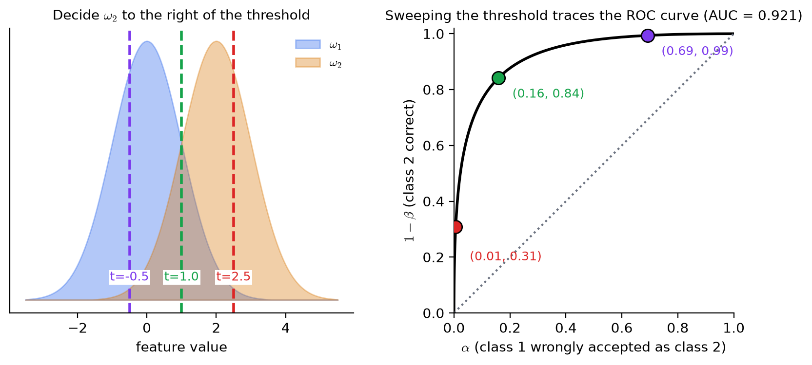
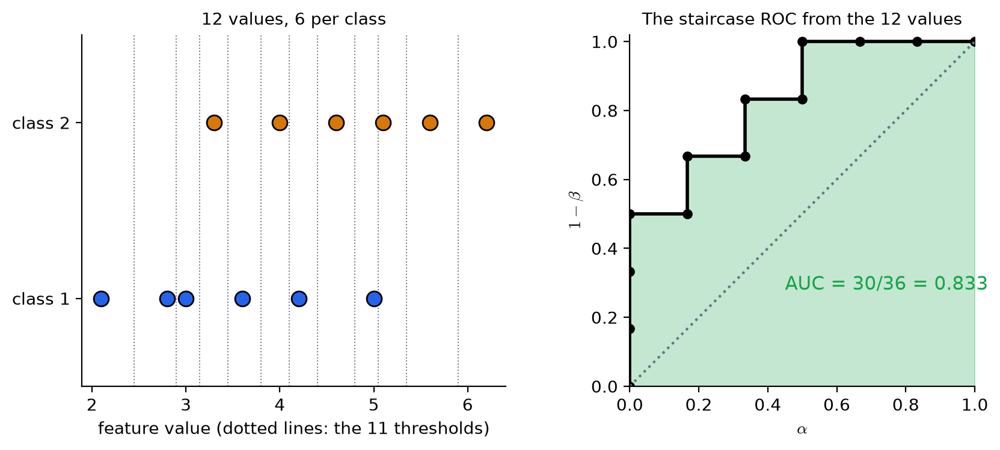
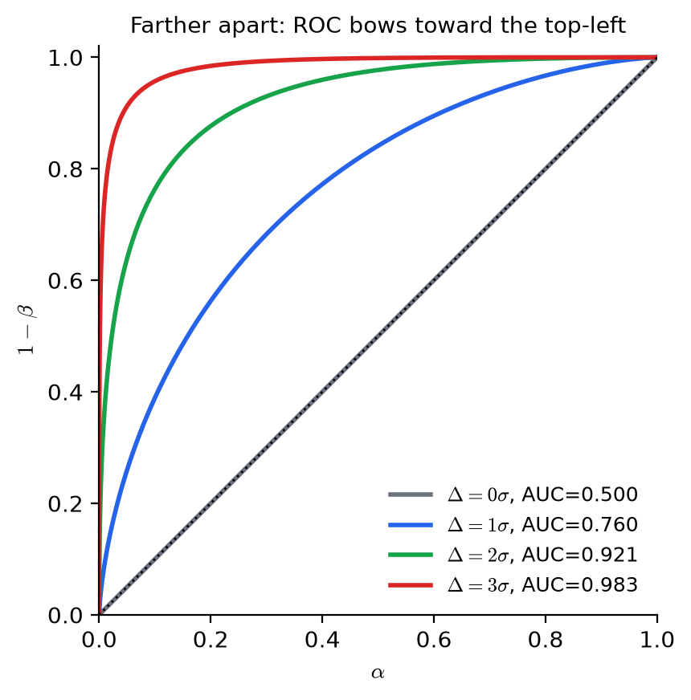
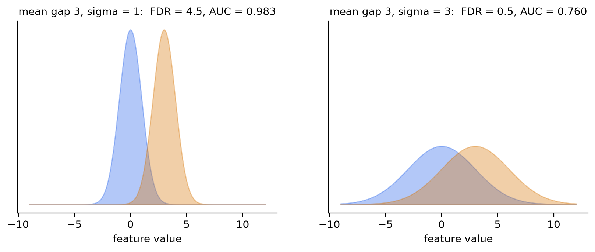
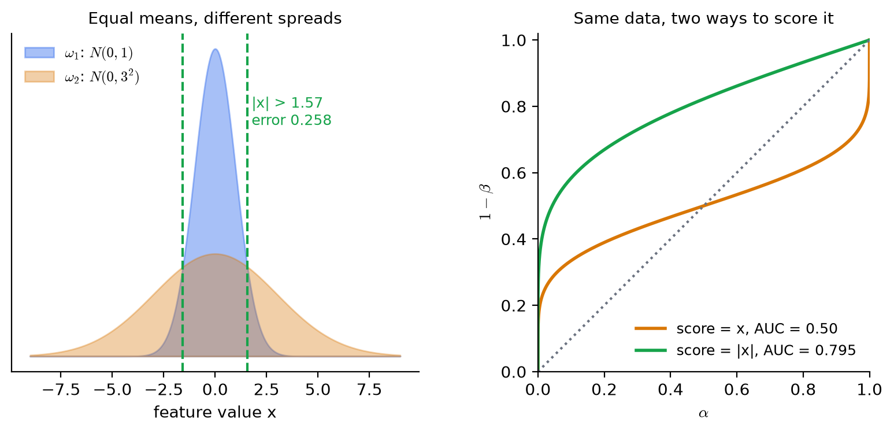

# KP04 ROC 曲線與 AUC：看兩類重疊多少，不只看均值差多少

> 程度：大學生（undergrad）
>
> 圖型識別｜特徵選擇單元

## 學習目標

- 由兩類樣本與一個門檻，算出兩種錯誤率 $\alpha$、$\beta$，並說出它們此消彼長。
- 掃過所有門檻，畫出 ROC 曲線，並說出對角線與左上角各代表什麼。
- 由一組小資料手算 AUC，並說出它的機率意義：隨機抽一對，$\omega_2$ 的值較大的機率。
- 說明為什麼 AUC 可以拿來排序特徵，並指出它看不見的情況。

## KP04 ROC 曲線與 AUC：看兩類重疊多少，不只看均值差多少

**一句話重點**：把門檻從左掃到右，每個門檻有一組（誤認的比例，抓對的比例），連起來就是 ROC 曲線。曲線越靠左上角、底下的面積（AUC）越大，兩類越分得開。

### 先備與符號

*你需要先會的兩件事*：

- *KP03*：均值差顯著，不等於兩類分得開（每類 500 筆、均值只差 $0.2\sigma$ 時，$p=0.011$，兩類卻幾乎重疊）。這個 KP 回答「重疊多少」。
- *機率與累積分布*：標準常態的累積分布函數 $\Phi(t)$ 是「落在 $t$ 左邊」的機率。

*符號表*：

| 符號 | 意義 | 說明 |
|---|---|---|
| $\omega_1,\ \omega_2$ | 兩個類別 | 本講義令 $\omega_2$ 的特徵值平均較大 |
| $t$ | 決策門檻 | 值大於 $t$ 判 $\omega_2$，否則判 $\omega_1$ |
| $\alpha$ | $\omega_1$ 被誤判成 $\omega_2$ 的機率 | 即 $P(x>t\mid\omega_1)$ |
| $\beta$ | $\omega_2$ 被誤判成 $\omega_1$ 的機率 | 即 $P(x\le t\mid\omega_2)$ |
| $1-\beta$ | $\omega_2$ 被判對的機率 | ROC 的縱軸 |
| AUC | ROC 曲線下的面積 | 介於 $0$ 與 $1$ |
| $\Delta$ | 兩類均值之差 | 單位同特徵 |

*用語*：**ROC 曲線**（receiver operating characteristic curve）是把所有門檻的 $(\alpha,\,1-\beta)$ 連起來的曲線。

### 1. 均值有差，兩類仍可能糊成一團

**白話說明**：KP03 的檢定只看「均值差多少」。想像兩堆蘋果，平均重量相差 $10$ 克，但每堆內部都從 $50$ 克散到 $250$ 克。你拿起一顆，根本猜不出它屬於哪一堆。均值差再顯著，散布一大，類別還是糊在一起。要量的是**兩類的重疊程度**。

**正式定義**：令特徵 $x$ 在兩類的機率密度是 $p(x\mid\omega_1)$ 與 $p(x\mid\omega_2)$。兩條密度曲線重疊的面積越大，任何用 $x$ 做的決策出錯的機率越高。重疊不是一個數字，而是一整組取捨，要掃過所有可能的門檻才看得完整，這就是 ROC 曲線的任務。

**常見迷思**：「均值差大，分類就容易。」不一定。分得開看的是均值差與散布的比，KP05 會把它寫成 FDR。

### 2. 一個門檻，兩種錯誤，此消彼長

**白話說明**：用門檻 $t$ 切開：$x>t$ 判 $\omega_2$，$x\le t$ 判 $\omega_1$。切下去會出兩種錯：把 $\omega_1$ 的樣本誤判成 $\omega_2$（誤認），把 $\omega_2$ 的樣本漏掉（漏抓）。門檻右移：誤認少了，漏抓多了；門檻左移則相反。沒有一個位置同時讓兩種錯都最小。

**正式定義**：

$$
\alpha=P(x>t\mid\omega_1),\qquad \beta=P(x\le t\mid\omega_2),\qquad 1-\beta=P(x>t\mid\omega_2).
$$

$\alpha$ 是 $\omega_1$ 被誤判的機率，$\beta$ 是 $\omega_2$ 被誤判的機率。$1-\beta$ 是 $\omega_2$ 被正確抓到的機率。一個門檻對應平面上的一個點 $(\alpha,\ 1-\beta)$。

**例子**：100 個樣本，其中 50 個屬於 $\omega_1$、50 個屬於 $\omega_2$。設一個門檻後：

| 結果 | 人數 |
|---|---|
| $\omega_1$ 判對（$1-\alpha$） | 40 |
| $\omega_1$ 誤判成 $\omega_2$（$\alpha$） | 10 |
| $\omega_2$ 判對（$1-\beta$） | 45 |
| $\omega_2$ 漏判成 $\omega_1$（$\beta$） | 5 |

$\alpha=10/50=0.20$，$1-\beta=45/50=0.90$。這個門檻在圖上是點 $(0.20,\ 0.90)$。

**常見迷思**：「兩種錯要分開看，只看一個沒用。」只看 $1-\beta$ 高，可能是門檻設太低，把所有樣本都判成 $\omega_2$，$1-\beta=1$ 但 $\alpha=1$。永遠要成對看。

### 3. 掃過所有門檻，得到 ROC 曲線

**白話說明**：把門檻從最左掃到最右，每個位置得到一個點，連起來就是 ROC 曲線。曲線上每個點是一種取捨：往右上走，抓得多但誤認也多；往左下走，誤認少但抓得少。

**正式定義**：ROC 曲線是點集 $\{(\alpha(t),\,1-\beta(t))\}$，$t$ 取遍所有可能的門檻。兩個極端：

- *兩類完全重疊*：任何門檻都有 $\alpha=1-\beta$（抓到的比例等於誤認的比例，等於亂猜），曲線是從 $(0,0)$ 到 $(1,1)$ 的**對角線**。
- *兩類完全分開*：總有一個門檻讓 $\alpha=0$ 且 $1-\beta=1$，曲線貼著**左上角**。

兩類分得越開，曲線離對角線越遠、越往左上角凸。

圖說 `lec07-kp04-roc-auc-f1-sweep`：先看左圖：藍色是 $\omega_1$，橘色是 $\omega_2$，三條虛線是三個門檻 $t=-0.5,\ 1.0,\ 2.5$；再看右圖：同色的三個點是這三個門檻對應的 $(\alpha,1-\beta)$：$(0.69,\,0.99)$、$(0.16,\,0.84)$、$(0.01,\,0.31)$；黑色曲線是掃過所有門檻的結果。這組分布的兩類均值相距 $2\sigma$，AUC 是 $0.921$。〔功能：1、2〕

**例子：12 個值的手算 ROC。** 兩類各 6 個值：

- $\omega_1$：$2.1,\ 2.8,\ 3.0,\ 3.6,\ 4.2,\ 5.0$
- $\omega_2$：$3.3,\ 4.0,\ 4.6,\ 5.1,\ 5.6,\ 6.2$

把 12 個值由小到大排好，在相鄰兩個值的中點各放一個門檻，再加上「全判 $\omega_2$」與「全判 $\omega_1$」兩個極端，共 13 個門檻。數每個門檻右邊有幾個 $\omega_1$、幾個 $\omega_2$，各除以 6：

| 門檻 $t$ | $\omega_1$ 在右邊 | $\omega_2$ 在右邊 | $\alpha$ | $1-\beta$ |
|---|---|---|---|---|
| $-\infty$ | 6 | 6 | 1.000 | 1.000 |
| 2.45 | 5 | 6 | 0.833 | 1.000 |
| 2.90 | 4 | 6 | 0.667 | 1.000 |
| 3.15 | 3 | 6 | 0.500 | 1.000 |
| 3.45 | 3 | 5 | 0.500 | 0.833 |
| 3.80 | 2 | 5 | 0.333 | 0.833 |
| 4.10 | 2 | 4 | 0.333 | 0.667 |
| 4.40 | 1 | 4 | 0.167 | 0.667 |
| 4.80 | 1 | 3 | 0.167 | 0.500 |
| 5.05 | 0 | 3 | 0.000 | 0.500 |
| 5.35 | 0 | 2 | 0.000 | 0.333 |
| 5.90 | 0 | 1 | 0.000 | 0.167 |
| $+\infty$ | 0 | 0 | 0.000 | 0.000 |

把這 13 個點依序連起來，就是一條階梯狀的 ROC 曲線：每遇到一個 $\omega_2$ 的值，曲線向上一格（$1/6$）；每遇到一個 $\omega_1$ 的值，向右一格。

圖說 `lec07-kp04-roc-auc-f2-hand-roc`：先看左圖：12 個值排在軸上，灰色點線是 11 個門檻；再看右圖：階梯狀的黑線是上表 13 個點連起來的 ROC，綠色是曲線下的面積。〔功能：1、2〕

**常見迷思**：「ROC 曲線一定是光滑的。」只有樣本很多、分布連續時才近似光滑；樣本少時是階梯，這是正常的。

### 4. AUC：把整條曲線濃縮成一個分數

**白話說明**：曲線上每個點是一種取捨，不好比。把曲線下的面積算出來，得到一個 $0$ 到 $1$ 的分數：**AUC**。對角線（亂猜）的 AUC 是 $0.5$；完全分開是 $1$。

**面積的兩種算法**：教科書用的是「曲線與對角線之間的面積」，完全重疊是 $0$，完全分離是 $\tfrac12$（上方三角形）。現在更常用整條曲線下的面積 AUC，兩者差一個對角線下的 $\tfrac12$：

$$
\text{AUC}=\tfrac12+(\text{曲線與對角線之間的面積}).
$$

12 個值的例子：階梯下方面積是 $0.833$，所以曲線與對角線之間的面積是 $0.333$。

**AUC 的機率意義**：AUC 等於「隨機各抽一個 $\omega_1$ 與一個 $\omega_2$ 的樣本，$\omega_2$ 的值較大的機率」。用 12 個值驗證：共有 $6\times6=36$ 對。對每個 $\omega_2$ 的值，數有幾個 $\omega_1$ 比它小：

| $\omega_2$ 的值 | 3.3 | 4.0 | 4.6 | 5.1 | 5.6 | 6.2 |
|---|---|---|---|---|---|---|
| 比它小的 $\omega_1$ 個數 | 3 | 4 | 5 | 6 | 6 | 6 |

總和 $3+4+5+6+6+6=30$，所以 $\text{AUC}=30/36=0.833$，與階梯面積相同。`[補充]` scikit-learn 的 `roc_auc_score` 也得到 $0.8333$。

**兩類都是常態、變異數相同時**：令均值差為 $\Delta$、標準差為 $\sigma$，則

$$
\text{AUC}=\Phi\!\Big(\frac{\Delta}{\sigma\sqrt2}\Big).
$$

| $\Delta/\sigma$ | 0 | 0.5 | 1 | 2 | 3 |
|---|---|---|---|---|---|
| AUC | $0.500$ | $0.638$ | $0.760$ | $0.921$ | $0.983$ |

圖說 `lec07-kp04-roc-auc-f3-separation`：先看灰色曲線：$\Delta=0$ 時貼著對角線，AUC 是 $0.5$；再往上看藍、綠、紅色：兩類每多分開一個 $\sigma$，曲線越往左上角凸，AUC 越大。〔功能：1、2〕

**接 KP03**：KP03 的例子（每類 500 筆、$\Delta=0.2\sigma$）AUC 只有 $0.544$，而公式給的理論值是 $\Phi(0.2/\sqrt2)=0.556$。有顯著的 $p$ 值，AUC 卻只比亂猜好一點點。這兩個數字各答一個問題：$p$ 值答「均值有沒有差」，AUC 答「兩類分得開多少」。

**用來排序特徵**：把每個候選特徵算一個 AUC，由大到小排，AUC 接近 $0.5$ 的丟掉。這與 KP03 用 $|q|$ 排序同一個精神，但 AUC 量的是重疊，不需要常態假設。

**常見迷思**：「AUC 小於 $0.5$ 就是特徵沒用。」不一定。AUC $=0.2$ 表示方向反了：把「大於門檻判 $\omega_2$」改成「小於門檻判 $\omega_2$」，AUC 變成 $0.8$。

### 5. ROC 與 AUC 看不見的情況

**(a) 同樣的均值差，散布不同。** 兩個特徵的均值差都是 $3$。特徵 A 的 $\sigma=1$，特徵 B 的 $\sigma=3$。

| 特徵 | 均值差 | $\sigma$ | AUC | FDR $=\Delta^2/(\sigma_1^2+\sigma_2^2)$ |
|---|---|---|---|---|
| A | 3 | 1 | $0.983$ | $4.5$ |
| B | 3 | 3 | $0.760$ | $0.5$ |

均值差相同，AUC 差很多：B 的散布大，重疊多。右欄的 FDR 是 KP05 的主角，這裡先預告：它也把「均值差」除以「散布」，結論與 AUC 一致。

圖說 `lec07-kp04-roc-auc-f4-same-gap`：先看左圖：$\sigma=1$ 時兩座山分得開；再看右圖：均值差一樣，$\sigma=3$ 時兩座山幾乎疊在一起；標題裡的 FDR 與 AUC 都跟著變小。〔功能：1、2〕

**(b) 均值相同、散布不同。** `[補充]` 令 $\omega_1\sim N(0,1)$，$\omega_2\sim N(0,3^2)$。兩類均值都是 $0$，但 $\omega_2$ 比較「散」：$\omega_1$ 擠在中間，$\omega_2$ 兩邊都有。用 $x$ 本身當分數，ROC 曲線穿過對角線，AUC 剛好是 $0.50$：單向門檻看不出任何分辨力。但這兩類其實分得開：只要看 $|x|$，$|x|>1.57$ 判 $\omega_2$，錯誤率約 $0.258$。把分數換成 $|x|$，AUC 升到 $\frac2\pi\arctan 3=0.795$。

這個例子的教訓：ROC 與 AUC 預設的決策形式是「單向門檻」。特徵的分辨力藏在別的形式時（例如「離中心多遠」），要先把特徵換成合適的表示，再來算。

圖說 `lec07-kp04-roc-auc-f5-same-mean`：先看左圖：窄的藍山疊在寬的橘山上，綠色虛線是 $|x|>1.57$ 的決策邊界；再看右圖：橘色曲線以 $x$ 為分數，AUC $=0.50$；綠色曲線以 $|x|$ 為分數，高高在對角線之上，AUC $=0.795$。〔功能：1、2〕

**(c) 兩個特徵 AUC 相同，曲線形狀可以不同。** AUC 是一個數字，把整條曲線壓扁了。一條曲線可能在低誤認區（$\alpha$ 很小）表現很好、高誤認區很差，另一條相反。如果你的應用只能容忍 $\alpha\le0.05$，要看的是曲線在那一段的高度，不是整條的面積。實務上先看曲線，再看 AUC。

**常見迷思**：「AUC 高，這個特徵放進分類器一定好。」AUC 只量單一特徵的單向分辨力。它看不到特徵之間的搭配，這是 KP06 的主題。

### 延伸：練習與解題示範

**小練習**：

1. 兩類各 20 個樣本。某門檻下：$\omega_2$ 有 18 個判對、2 個漏判；$\omega_1$ 有 14 個判對、6 個誤判。算 $\alpha$、$\beta$、$1-\beta$，並寫出這個門檻在 ROC 上的點。
2. $\omega_1$ 的值是 $1,\ 3,\ 5$，$\omega_2$ 的值是 $2,\ 4,\ 6$。用配對計數法算 AUC。
3. 一位同學說：「我的特徵 AUC $=0.5$，所以它完全沒用。」請舉一個反例。

**題 1 解題示範**：$\alpha=6/20=0.30$，$\beta=2/20=0.10$，$1-\beta=18/20=0.90$。ROC 上的點是 $(0.30,\ 0.90)$。

**題 2 解題示範**：共 $3\times3=9$ 對。$\omega_2$ 的 $2$ 大於 $\omega_1$ 的 $1$（1 個）；$4$ 大於 $1,3$（2 個）；$6$ 大於 $1,3,5$（3 個）。總和 $1+2+3=6$，$\text{AUC}=6/9=0.667$。

**題 3 解題示範**：第 5 節 (b)：$\omega_1\sim N(0,1)$、$\omega_2\sim N(0,3^2)$ 的 AUC 是 $0.50$，但看 $|x|$ 可以分開兩類，AUC 升到 $0.795$。AUC $=0.5$ 只說「單向門檻」沒有分辨力，不代表特徵沒有資訊。

## 術語與來源

| 中文 | English |
|---|---|
| ROC 曲線 | Receiver operating characteristic (ROC) curve |
| 曲線下面積 | Area under the curve (AUC) |
| 決策門檻 | Decision threshold |
| 誤判率 | Misclassification probability |
| 重疊 | Overlap |
| 費雪判別比（KP05） | Fisher discriminant ratio (FDR) |
| 累積分布函數 | Cumulative distribution function (CDF) |
| 配對計數 | Pairwise counting |

來源：教科書 Theodoridis & Koutroumbas, *Pattern Recognition* 第 5 章 §5.5（本機 Ch5.pdf）與 CCC-LNS 網頁第 5 章 §5.5；說明、圖與順序為重新撰寫。100 個樣本的混淆計數為網頁範例。教科書以「曲線與對角線之間的面積」（0 到 $\tfrac12$）量分辨力，本講義並列現行常用的 AUC（0.5 到 1）並說明換算。12 個值的手算 ROC 與 AUC 配對計數、高斯等變異數的 AUC 公式、同均值不同變異數的例子、scikit-learn 驗算為 `[補充]`；所有數字由 `scripts/lec07-kp04-roc-auc/compute_data.py` 算出（`reports/lec07-kp04-roc-auc/數值驗算.json`）。
