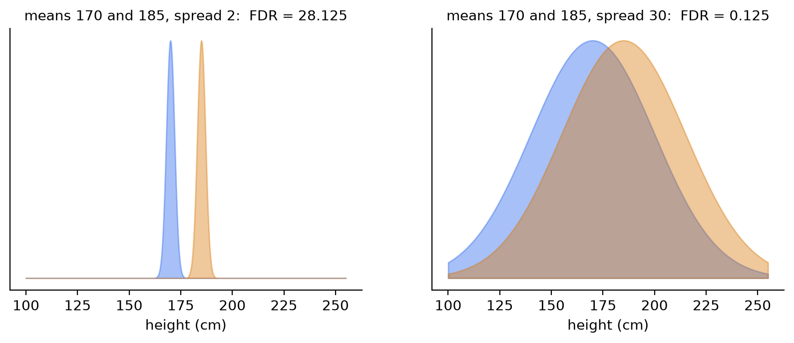
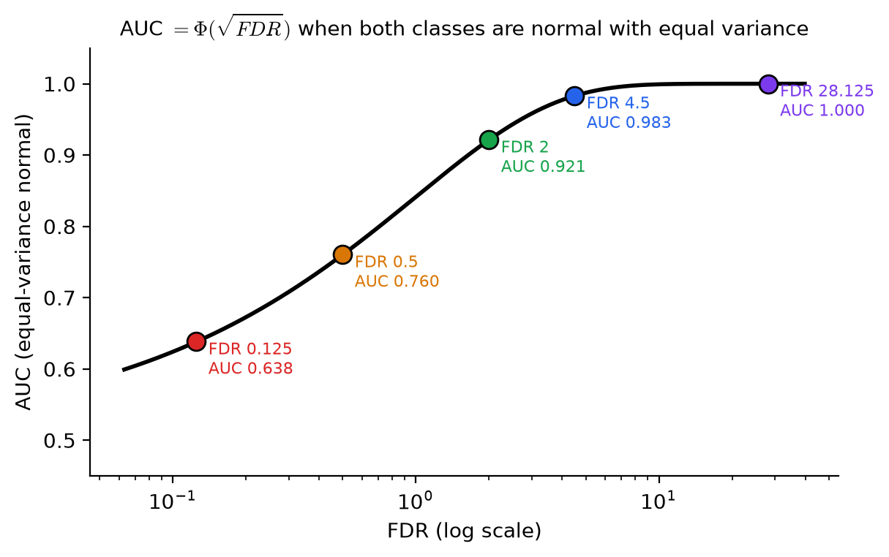
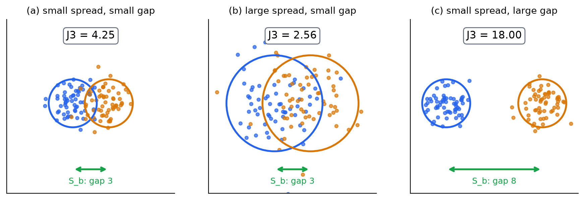
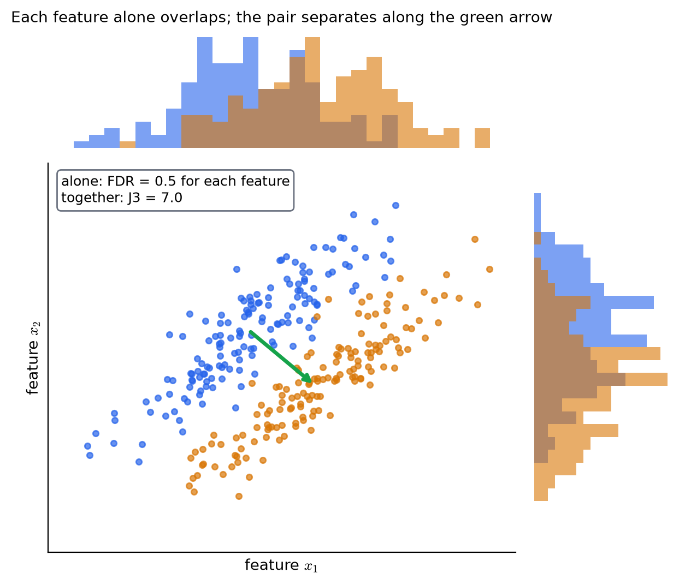

# KP05 可分離性分數：用均值與散布，一個式子打分數

> 程度：大學生（undergrad）
>
> 圖型識別｜特徵選擇單元

## 學習目標

- 算出一維兩類的 Fisher 判別比 FDR，並說出分子與分母各代表什麼。
- 說明 FDR 與 KP03 的 $t$ 統計量、KP04 的 AUC 的關係。
- 由兩類的均值與共變異數算出 $S_w$、$S_b$、$S_m$，並用它們算 $J_1$、$J_2$、$J_3$。
- 說明為什麼 $J_2$、$J_3$ 不受特徵單位影響，而 $J_1$ 會。
- 舉例說明：兩個特徵單獨看都分不開，合起來卻可能分得開。

## KP05 可分離性分數：用均值與散布，一個式子打分數

**一句話重點**：把「兩類的中心離多遠」除以「每類自己有多散」，就得到一個直接算得出來的分數。一維叫 FDR，多維用散布矩陣算 $J_1,J_2,J_3$。

### 先備與符號

*你需要先會的三件事*：

- *KP03 與 KP04*：$t$ 檢定問「均值有沒有差」，AUC 問「兩類重疊多少」。
- *共變異數矩陣*：$\Sigma=E[(\mathbf x-\boldsymbol\mu)(\mathbf x-\boldsymbol\mu)^{\mathsf T}]$。對角線是各特徵的變異數，非對角線是兩個特徵一起變動的程度。
- *矩陣的跡與行列式*：跡（trace）是對角線的和，也等於特徵值的和；行列式（determinant）等於特徵值的積。

*符號表*：

| 符號 | 意義 | 說明 |
|---|---|---|
| $\mu_i,\ \sigma_i^2$ | 第 $i$ 類在某特徵上的均值、變異數 | 一維 |
| $\boldsymbol\mu_i,\ \Sigma_i$ | 第 $i$ 類的均值向量、共變異數矩陣 | $l$ 維 |
| $P_i$ | 第 $i$ 類的先驗機率 | 可用 $n_i/N$ 估計 |
| $\boldsymbol\mu_0$ | 全體的均值向量 | $\boldsymbol\mu_0=\sum_iP_i\boldsymbol\mu_i$ |
| $S_w$ | 類內散布矩陣 | $\sum_iP_i\Sigma_i$ |
| $S_b$ | 類間散布矩陣 | $\sum_iP_i(\boldsymbol\mu_i-\boldsymbol\mu_0)(\boldsymbol\mu_i-\boldsymbol\mu_0)^{\mathsf T}$ |
| $S_m$ | 混合散布矩陣 | 資料對全體均值的共變異數 |
| $l,\ M$ | 特徵數、類別數 | 整數 |

### 1. 為什麼還要一個更簡單的分數

**白話說明**：KP03 要假設分布才能算 $p$ 值，KP04 要掃過所有門檻才能畫曲線。特徵有幾百個時，你想要一個「直接由均值與變異數算出來」的快速分數，先拿它把特徵排個序。教科書的說法是：先前的幾個準則，除非假設常態，否則都不容易計算；改看「樣本點在空間中怎麼散」，簡單得多。

**常見迷思**：「簡單的分數一定比複雜的差。」它是一個啟發式的準則：不保證對應最小錯誤率，但便宜、直覺，用來排序與淘汰很夠用。

### 2. 一維兩類：均值差除以散布，就是 FDR

**白話說明**：兩支籃球隊，你量每個人的身高。判斷「身高能不能分開兩隊」，直覺是：兩隊的平均身高差要大，每隊內部的身高散布要小。把這個直覺寫成一個比值，就是 **FDR**（Fisher's discriminant ratio，費雪判別比）。

**正式定義**：

$$
\text{FDR}=\frac{(\mu_1-\mu_2)^2}{\sigma_1^2+\sigma_2^2}.
$$

分子是兩類中心距離的平方，越大越好；分母是兩類內部散布的總和，越小越好。FDR 越大，這個特徵越能分開兩類。

**例子**：兩隊平均身高都是 $170$ 與 $185$ 公分。

| 情形 | $\sigma_1,\ \sigma_2$ | FDR 算式 | FDR |
|---|---|---|---|
| 隊內整齊 | $2,\ 2$ | $\dfrac{(170-185)^2}{2^2+2^2}=\dfrac{225}{8}$ | $28.125$ |
| 隊內很亂 | $30,\ 30$ | $\dfrac{225}{30^2+30^2}=\dfrac{225}{1800}$ | $0.125$ |

均值差一樣是 $15$ 公分，FDR 差了 $225$ 倍：隊內散布大，分母把辨識力吃掉了。

圖說 `lec07-kp05-separability-fdr-f2-heights`：先看左圖：標準差 $2$ 時，兩座山又窄又分得開，FDR $=28.125$；再看右圖：均值一樣，標準差 $30$ 時兩座山幾乎疊在一起，FDR 只有 $0.125$。〔功能：1、2〕

**與 KP03 的 $t$ 的關係**：兩類樣本數都是 $N$、$s_z^2$ 取兩類樣本變異數的平均時，KP03 的 $q=\dfrac{\bar x-\bar y}{s_z\sqrt{2/N}}$，平方後是

$$
q^2=\frac{(\bar x-\bar y)^2}{s_z^2\cdot 2/N}=N\cdot\frac{(\bar x-\bar y)^2}{\hat\sigma_1^2+\hat\sigma_2^2}=N\cdot\text{FDR}.
$$

也就是 $t$ 統計量的平方等於「樣本數乘上 FDR」。用 KP03 的 Example 5.3：均值 $3.73$ 與 $3.25$，樣本變異數 $0.0601$ 與 $0.0672$，FDR $=\dfrac{0.2304}{0.1273}=1.809$；$N=10$，$N\cdot\text{FDR}=18.09$，與 $q^2=4.254^2=18.09$ 相同。兩者差在：$t$ 乘上了樣本數，用來判斷「是不是運氣」；FDR 沒有乘，用來比較「分得多開」，不會因為多蒐集樣本就變大。教科書也特別指出，FDR 用得更「原始」，不依賴背後的分布。

**與 KP04 的 AUC 的關係**：`[補充]` 兩類都是常態、變異數相同時，$\text{FDR}=\Delta^2/(2\sigma^2)$，代回 KP04 的公式得 $\text{AUC}=\Phi(\Delta/(\sigma\sqrt2))=\Phi(\sqrt{\text{FDR}})$。

| FDR | 0.125 | 0.5 | 1 | 2 | 4.5 | 8 |
|---|---|---|---|---|---|---|
| AUC | $0.638$ | $0.760$ | $0.841$ | $0.921$ | $0.983$ | $0.998$ |

KP04 的兩個特徵（均值差同為 $3$，$\sigma=1$ 與 $3$）：FDR 是 $4.5$ 與 $0.5$，AUC 是 $0.983$ 與 $0.760$，剛好是表中的兩列。條件不是常態等變異時，這個對應就只是近似。

圖說 `lec07-kp05-separability-fdr-f3-fdr-auc`：先看黑色曲線：FDR 越大，AUC 越接近 $1$；再看彩色圓點：身高例的 $0.125$ 與 $28.125$、KP04 的 $0.5$ 與 $4.5$ 都在曲線上。〔功能：1、2〕

**常見迷思**：「FDR 越大，錯誤率一定越低。」FDR 是啟發式的指標，只在像上面這樣的簡單情形下與錯誤率單調相關。

### 3. 多類別：加總兩兩，或看最差的一對

**白話說明**：有 $M\ge3$ 類時，把每一對類別的 FDR 加起來：

$$
\text{FDR}_1=\sum_{i=1}^M\sum_{j\ne i}\frac{(\mu_i-\mu_j)^2}{\sigma_i^2+\sigma_j^2}.
$$

注意這個雙重求和是**有序對**，每一對類別會被算兩次。

**例子**：三類的均值是 $0,\ 2,\ 6$，標準差都是 $1$：

| 類別對 | FDR |
|---|---|
| $(1,2)$ | $(0-2)^2/2=2$ |
| $(1,3)$ | $(0-6)^2/2=18$ |
| $(2,3)$ | $(2-6)^2/2=8$ |

每對各算一次的和是 $28$；有序對各算兩次，$\text{FDR}_1=56$。

加總有一個缺點：離得很遠的一對（$18$）會把整體分數拉高，掩蓋離得最近的一對（$2$）。教科書因此提到另一種做法：每個特徵取所有類別對中的**最小值**當分數，選的是「最差情況」最好的特徵（maxmin）。這個例子裡，最小值是 $2$，真正的瓶頸在第一類與第二類。

**常見迷思**：「加總分數高，每一類都分得開。」不一定，要看最差的一對。

### 4. 多維：用散布矩陣記帳

**白話說明**：特徵有 $l$ 個時，每一類是 $l$ 維空間裡的一團點。要量兩件事：每一團自己有多散，各團的中心離全體中心多遠。用三個矩陣來記這些：

- **類內散布矩陣** $S_w$：每一類自己的共變異數，依先驗機率加權相加。
- **類間散布矩陣** $S_b$：各類中心離全體中心的位移，外積後加權相加。
- **混合散布矩陣** $S_m$：資料相對於全體均值的共變異數。

**正式定義**：

$$
S_w=\sum_{i=1}^MP_i\Sigma_i,\qquad
S_b=\sum_{i=1}^MP_i(\boldsymbol\mu_i-\boldsymbol\mu_0)(\boldsymbol\mu_i-\boldsymbol\mu_0)^{\mathsf T},\qquad
\boldsymbol\mu_0=\sum_{i=1}^MP_i\boldsymbol\mu_i .
$$

$S_m=E[(\mathbf x-\boldsymbol\mu_0)(\mathbf x-\boldsymbol\mu_0)^{\mathsf T}]$ 與前兩者的關係是

$$
S_m=S_w+S_b,
$$

白話說：**總散布＝類內散布＋類間散布**。$\text{trace}\{S_w\}$ 是各類內特徵變異數的（加權）平均，$\text{trace}\{S_b\}$ 是各類中心離全體中心的（加權）平均平方距離。

**例子**：兩類、兩個特徵，先驗相等（$P_1=P_2=0.5$）。兩類的共變異數都是 $\Sigma_i=\sigma^2I$，均值是 $(-d/2,\ 0)$ 與 $(d/2,\ 0)$。取 $\sigma^2=1$、$d=3$：

- $\boldsymbol\mu_0=(0,\ 0)$。
- $S_w=0.5\,I+0.5\,I=\begin{pmatrix}1&0\\0&1\end{pmatrix}$。
- $S_b=0.5\begin{pmatrix}2.25&0\\0&0\end{pmatrix}\cdot2=\begin{pmatrix}2.25&0\\0&0\end{pmatrix}$（兩類各離全體中心 $1.5$，平方是 $2.25$）。
- $S_m=S_w+S_b=\begin{pmatrix}3.25&0\\0&1\end{pmatrix}$。

注意 $S_b$ 只在兩類中心連線的方向（第一個特徵）有值；第二個特徵上兩類的中心沒有差。

**常見迷思**：「$S_b$ 的秩可以很高。」不行。$S_b$ 是 $M$ 個秩為 $1$ 的矩陣相加（而且彼此還有一個線性關係：各類中心的加權和等於全體中心），秩最多是 $M-1$。類別少、特徵多時，$S_b$ 是奇異矩陣，行列式是 $0$。

### 5. 三個準則：$J_1,\ J_2,\ J_3$

**白話說明**：類間散布要大、類內散布要小，所以拿它們做比值。矩陣不能直接比大小，要先變成一個數：取跡，或取行列式。

**正式定義**：

$$
J_1=\frac{\text{trace}\{S_m\}}{\text{trace}\{S_w\}},\qquad
J_2=\frac{|S_m|}{|S_w|}=|S_w^{-1}S_m|,\qquad
J_3=\text{trace}\{S_w^{-1}S_m\}.
$$

三個值都是越大越好：各類內部越緊、各類中心越分開，值越大。

**例子（三種情形）**：兩類、兩個特徵，先驗相等，共變異數 $\sigma^2I$，均值差 $d$（教學設定，與課本 Example 5.5 的三種示意圖同一種情形）：

| 情形 | 類內散布 $\sigma^2$ | 均值差 $d$ | $\text{tr}\{S_w\}$ | $\text{tr}\{S_m\}$ | $J_1$ | $J_2$ | $J_3$ |
|---|---|---|---|---|---|---|---|
| (a) 小散布、小間距 | $1$ | $3$ | $2$ | $4.25$ | $2.125$ | $3.25$ | $4.25$ |
| (b) 大散布、小間距 | $4$ | $3$ | $8$ | $10.25$ | $1.281$ | $1.563$ | $2.563$ |
| (c) 小散布、大間距 | $1$ | $8$ | $2$ | $18$ | $9$ | $17$ | $18$ |

以 (a) 為例：$S_w=I$，$S_m=\text{diag}(3.25,\ 1)$，$J_1=4.25/2=2.125$，$J_2=3.25\cdot1/1=3.25$，$J_3=\text{trace}\{S_m\}=4.25$。三個準則的排序一致：(c) 最好，(a) 其次，(b) 最差。課本 Example 5.5 也得到同樣的排序（$J_3$ 為 $620.9$、$164.7$、$12.5$，依 c、a、b）；那個例子沒有公布圖中點的座標，無法重算，這裡的數字是本講義另造的資料。

`[補充]` 實際資料要用樣本估計。每類 200 筆（種子 0）的估計值：(a) $J_3=4.32$、(b) $2.77$、(c) $16.11$，與母體值同一種排序，數字因抽樣而略有差別。

圖說 `lec07-kp05-separability-fdr-f1-three-cases`：先看三格的藍橘圓圈：它們的大小是每類的散布；再看綠色雙箭頭：兩類中心的距離，對應 $S_b$；格子上方的 $J_3$ 是母體值：(a) $4.25$、(b) $2.56$、(c) $18.00$。〔功能：1、3〕

**為什麼同時有三個。** $J_2$ 與 $J_3$ 都含 $S_w^{-1}$：先用類內散布把各軸「標準化」，再比較類間散布。這讓它們對特徵的線性變換**不變**（教科書：「後面會用它們推導最佳特徵」）。$J_1$ 沒有這個性質。`[補充]` 驗證：令兩類各 200 筆、第二個特徵的單位乘上 $10$（例如公尺換成公分）：

| | $J_1$ | $J_2$ | $J_3$ |
|---|---|---|---|
| 乘 $10$ 之前 | $2.197$ | $3.464$ | $4.464$ |
| 乘 $10$ 之後 | $1.023$ | $3.464$ | $4.464$ |

換個單位，$J_1$ 從 $2.20$ 掉到 $1.02$，$J_2$、$J_3$ 完全不變。這是 KP02 說正規化重要的另一個角度：$J_1$ 受單位影響，要先正規化才可靠。

*行列式的陷阱*：若直接用 $|S_b|$，類別少於特徵數（$M<l$）時 $|S_b|=0$，準則失效。所以行列式版的分子用 $S_m$，不用 $S_b$。

**常見迷思**：「$J_3$ 越大分類器一定越好。」它是類別散布的幾何比值，是啟發式的好壞指標。

### 6. 個別看，會漏掉特徵之間的搭配

**白話說明**：前幾節都是「一個特徵一個分數」。可是兩個特徵合起來，可能產生單獨看不到的分辨力。

**例子**：`[補充]` 兩類、兩個特徵，兩類共變異數相同，$\Sigma=\begin{pmatrix}1&0.9\\0.9&1\end{pmatrix}$（兩個特徵高度正相關）。兩類均值是 $(0,\ 0)$ 與 $(1,\ -1)$。

- 單獨看 $x_1$：均值差 $1$、變異數 $1$，$\text{FDR}=1/(1+1)=0.5$；$x_2$ 也是 $0.5$。每個都是 KP04 的「很重疊」那一型。
- 合起來看：資料沿著一條斜帶散開（$\rho=0.9$），而兩類中心的連線 $(1,-1)$ 正好垂直於這條斜帶，是變異最小的方向。兩類中心的馬氏距離平方是 $\Delta^{\mathsf T}\Sigma^{-1}\Delta=20$，$J_3=2+20/4=7.0$；而兩個特徵單獨的一維 $J_3$ 各只有 $1+\text{FDR}/2=1.25$。

單獨看 FDR 都是 $0.5$，合在一起 $J_3$ 高達 $7.0$。逐一評分把兩個特徵都判成「弱」，卻看不到它們搭配起來的力量。

圖說 `lec07-kp05-separability-fdr-f4-correlated`：先看上方與右側的直方圖：每個特徵單獨看，藍色與橘色大幅重疊；再看中間的散點圖：兩團沿斜帶排開，沿著綠色箭頭的方向分得很清楚。〔功能：1、3〕

**這個例子的教訓**：逐一評分便宜，但會漏掉搭配，也會留下重複的特徵（兩個高度相關而各自很強的特徵，其實是同一件事）。所以還需要評估一組特徵的方法，這就是下一個 KP 的子集選擇。

**常見迷思**：「把個別分數最高的 $k$ 個特徵留下來就是最佳 $k$ 個。」不一定：它們可能彼此重複，也可能漏掉互補的特徵。

### 延伸：練習與解題示範

**小練習**：

1. 兩類的均值是 $10$ 與 $14$，標準差都是 $2$。算 FDR；若標準差改成 $6$，FDR 是多少？
2. 兩類、兩個特徵，先驗相等，共變異數都是 $I$，均值是 $(0,0)$ 與 $(4,0)$。算 $S_w$、$S_b$、$S_m$ 與 $J_3$。
3. 一位同學把兩個 FDR 都很低的特徵直接丟掉。什麼情況下這可能是錯的？

**題 1 解題示範**：標準差 $2$：$\text{FDR}=(10-14)^2/(4+4)=16/8=2$。標準差 $6$：$16/(36+36)=0.222$。均值差相同，散布變 $3$ 倍，FDR 降為約 $1/9$。

**題 2 解題示範**：$\boldsymbol\mu_0=(2,0)$。$S_w=I$。兩類各離中心 $2$，$S_b=0.5\cdot4\cdot\begin{pmatrix}1&0\\0&0\end{pmatrix}\cdot2=\begin{pmatrix}4&0\\0&0\end{pmatrix}$。$S_m=S_w+S_b=\text{diag}(5,\ 1)$。$J_3=\text{trace}\{S_w^{-1}S_m\}=5+1=6$。

**題 3 解題示範**：第 6 節的例子：兩個特徵各自的 FDR 都是 $0.5$，合起來 $J_3=7.0$。若特徵之間有相關，一對個別很弱的特徵，合起來可能是強特徵，直接丟掉會失去它。

## 術語與來源

| 中文 | English |
|---|---|
| 費雪判別比 | Fisher's discriminant ratio (FDR) |
| 類內散布矩陣 | Within-class scatter matrix |
| 類間散布矩陣 | Between-class scatter matrix |
| 混合散布矩陣 | Mixture scatter matrix |
| 先驗機率 | Prior probability |
| 跡 | Trace |
| 行列式 | Determinant |
| 線性變換不變性 | Invariance under linear transformations |
| 馬氏距離 | Mahalanobis distance |
| 啟發式準則 | Heuristic criterion |
| 奇異矩陣 | Singular matrix |

來源：教科書 Theodoridis & Koutroumbas, *Pattern Recognition* 第 5 章 §5.6.3、§5.7.1（本機 Ch5.pdf）與 CCC-LNS 網頁第 5 章 §5.6；說明、圖與順序為重新撰寫。身高例（$28.125$ 與 $0.125$）為網頁範例，數字重算相符。課本 Example 5.5 只給三個結果（$J_3=164.7,\ 12.5,\ 620.9$）而未給資料點，無法重算，本講義另造三種同類情形。$q^2=N\cdot\text{FDR}$ 的推導與驗算、$\text{AUC}=\Phi(\sqrt{\text{FDR}})$、三類 FDR 例、單位乘 $10$ 的驗算、相關特徵例為 `[補充]`；所有數字由 `scripts/lec07-kp05-separability-fdr/compute_data.py` 算出（`reports/lec07-kp05-separability-fdr/數值驗算.json`）。
