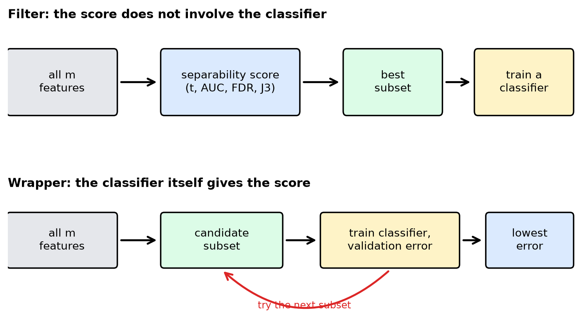
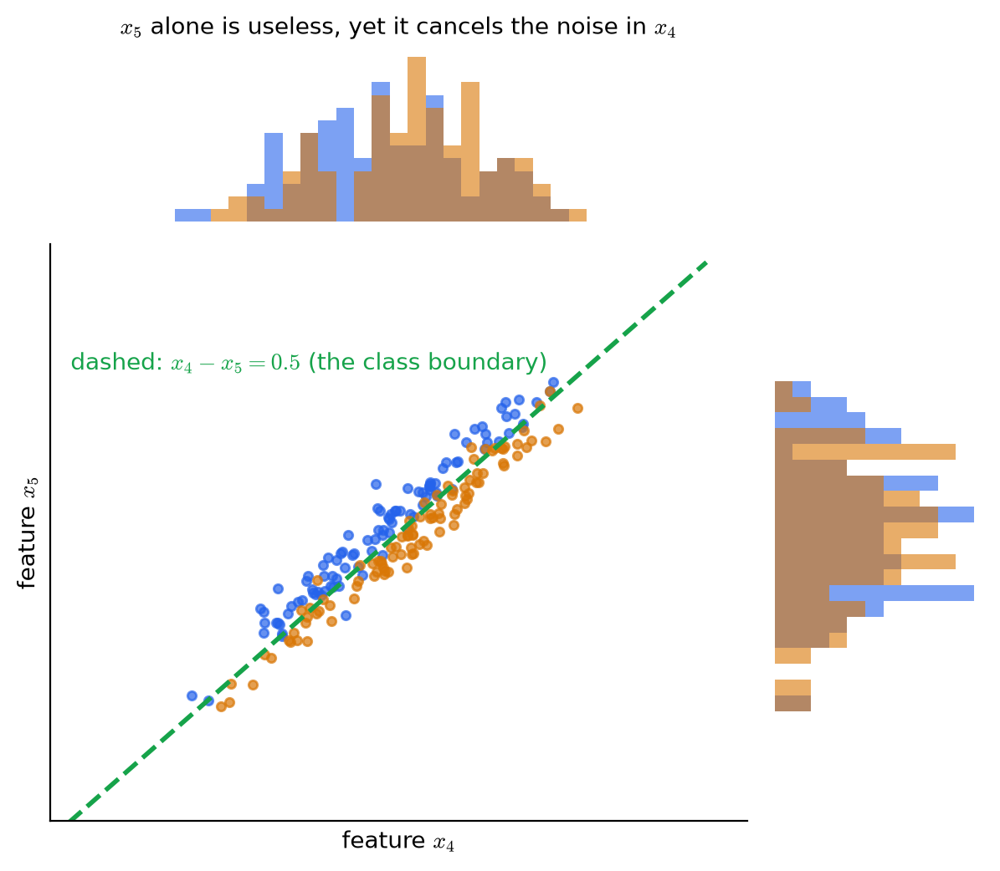
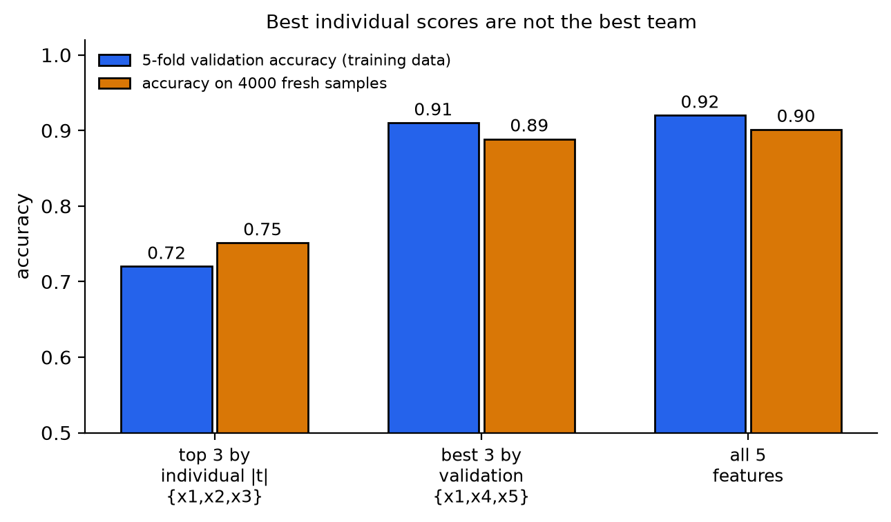
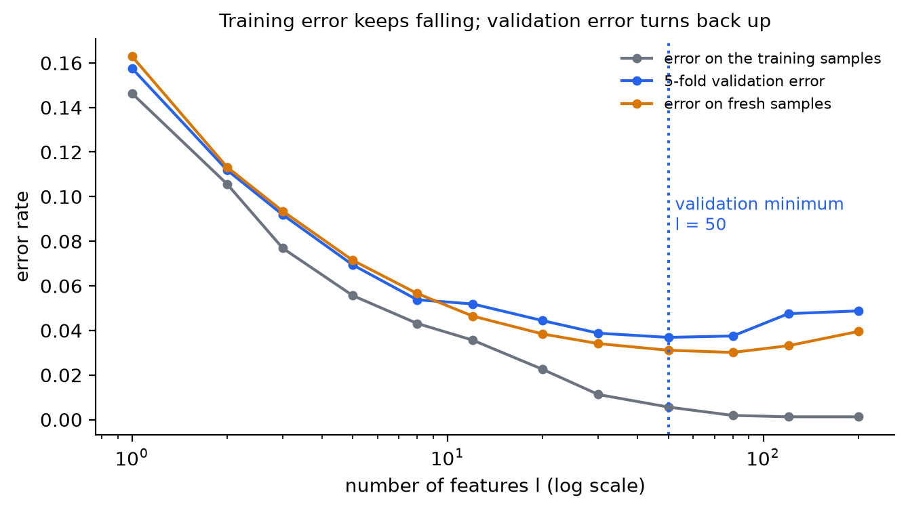
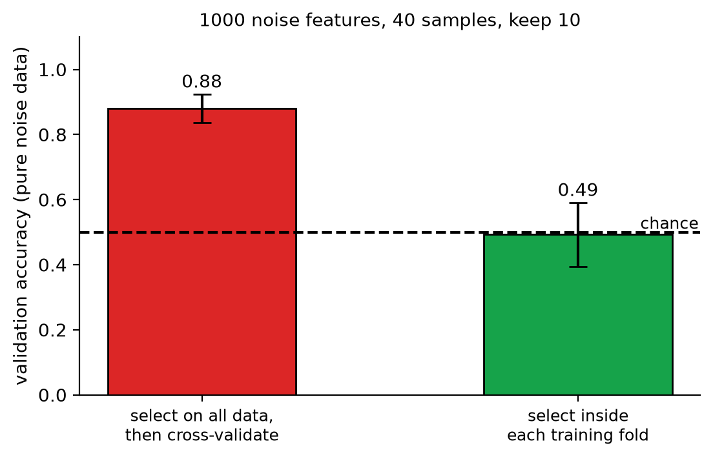

# KP06 特徵子集選擇：挑的是一組，不是一個一個的最高分

> 程度：大學生（undergrad）
>
> 圖型識別｜特徵選擇單元

## 學習目標

- 說明為什麼「個別分數最高的前 $l$ 個」不一定是最好的 $l$ 個特徵。
- 用「個別分數減去與已選特徵的相關」逐步挑特徵，並手算一次。
- 區分 filter 與 wrapper：各自用什麼評分、各自的代價。
- 算出特徵子集的組合數，說明為什麼不能全部試。
- 用驗證曲線決定要留幾個特徵，並指出「先用全部資料選特徵、再交叉驗證」為什麼會騙人。

## KP06 特徵子集選擇：挑的是一組，不是一個一個的最高分

**一句話重點**：特徵好不好，要看它在這一組裡的搭配，不是看它單獨的分數。評一組特徵，可以用可分性準則（filter），也可以直接問分類器（wrapper）；要留幾個，由驗證決定；選特徵本身要放進驗證裡。

### 先備與符號

*你需要先會的三件事*：

- *單特徵分數*：KP03 的 $|q|$、KP04 的 AUC、KP05 的 FDR 與 $J_3$，都是「越大越能分」。這個 KP 用 $C(k)$ 泛指其中任何一個。
- *相關係數*：兩個特徵的相關係數 $\rho_{ij}\in[-1,1]$，$|\rho_{ij}|$ 越大表示兩者越像。
- *訓練集、驗證集、測試集*：KP02 已用過；驗證集用來比較做法，測試集只用來最後報告。

*符號表*：

| 符號 | 意義 | 說明 |
|---|---|---|
| $m$ | 候選特徵的總數 | 整數 |
| $l$ | 要選出的特徵數 | $l\le m$ |
| $C(k)$ | 第 $k$ 個特徵的單特徵分數 | 越大越好 |
| $\rho_{ij}$ | 特徵 $i$ 與 $j$ 的相關係數 | 本講義用絕對值 $|\rho_{ij}|$ |
| $\alpha_1,\ \alpha_2$ | 兩個權重 | 個人分數與避免重複的取捨 |
| $\binom{m}{l}$ | 從 $m$ 個挑 $l$ 個的組合數 | $\frac{m!}{l!\,(m-l)!}$ |
| $\mathcal S$ | 一組被選出的特徵 | 子集 |

### 1. 個別最高分的前 $l$ 名，不一定是最好的 $l$ 個

**白話說明**：最直接的做法：每個特徵算一個 $C(k)$，由大到小排，取前 $l$ 個。這叫**純量特徵選擇**。它快，像人資先用履歷關鍵字掃一遍。盲點是它不看候選人彼此的關係。

**正式定義**：對每個特徵 $k=1,\dots,m$ 算 $C(k)$，依 $C(k)$ 由大到小排序，取前 $l$ 個組成特徵向量。$C$ 可以是 KP03–KP05 的任何準則。多類別時用平均（如 KP05 的 $\text{FDR}_1$），或取所有類別對中的最小值（只選「最差一對」仍分得開的特徵）。

這個做法有兩個盲點：

- *重複*：兩個高度相關而各自很強的特徵，其實是同一件事說兩遍，同時入選等於浪費名額。
- *互補*：某個特徵單獨很弱，但搭配另一個特徵能消去雜訊，單獨評分看不到。

**常見迷思**：「每個特徵都夠好，組起來就夠好。」重複的特徵不增加資訊；而被個別分數淘汰的特徵，可能是別人的關鍵搭檔。

### 2. 把「與已選特徵的相似度」扣掉

**白話說明**：教科書給了一個補救：選下一個特徵時，不只看它自己的分數，還要扣掉它跟已選特徵有多像。

**正式定義**：令 $i_1$ 是分數最高的特徵。選第二個特徵 $i_2$ 時，每個候選 $j$ 的綜合分數是

$$
\alpha_1C(j)-\alpha_2\,|\rho_{i_1j}|,
$$

取綜合分數最大的 $j$。第 $k$ 步（$k\ge3$）把與**所有已選特徵**的平均相關納入：

$$
i_k=\arg\max_{j\notin\{i_1,\dots,i_{k-1}\}}\Big\{\alpha_1C(j)-\frac{\alpha_2}{k-1}\sum_{r=1}^{k-1}|\rho_{i_rj}|\Big\}.
$$

$\alpha_1,\alpha_2$ 決定「個人能力」與「避免重複」誰比較重要。

**例子**（教學設定，取自網頁的玩具情境）：五個候選特徵的個別分數是 $C=0.90,\ 0.84,\ 0.80,\ 0.73,\ 0.70$。已知 $x_1$ 與 $x_2$ 的相關係數是 $0.95$（兩者幾乎重複）。取 $\alpha_1=1$、$\alpha_2=0.4$，已選 $x_1$。第二步：

| 候選 | $C(j)$ | $|\rho_{1j}|$ | $C(j)-0.4|\rho_{1j}|$ |
|---|---|---|---|
| $x_2$ | $0.84$ | $0.95$ | $0.84-0.38=0.46$ |
| $x_3$ | $0.80$ | $0.10$ | $0.80-0.04=0.76$ |
| $x_4$ | $0.73$ | $0.05$ | $0.73-0.02=0.71$ |
| $x_5$ | $0.70$ | $0.20$ | $0.70-0.08=0.62$ |

第二位不再是個別分數第二高的 $x_2$，而是 $x_3$（$0.76$）。第三步要用與 $x_1,x_3$ 兩個已選特徵的平均相關。`[補充]` 設 $|\rho_{23}|=0.20$、$|\rho_{34}|=0.30$、$|\rho_{35}|=0.25$（網頁只給了 $\rho_{1j}$）：

| 候選 | 平均相關 | 綜合分數 |
|---|---|---|
| $x_2$ | $(0.95+0.20)/2=0.575$ | $0.84-0.4\cdot0.575=0.61$ |
| $x_4$ | $(0.05+0.30)/2=0.175$ | $0.73-0.4\cdot0.175=0.66$ |
| $x_5$ | $(0.20+0.25)/2=0.225$ | $0.70-0.4\cdot0.225=0.61$ |

第三位是 $x_4$。最後選出 $\{x_1,x_3,x_4\}$，與只看個別分數的 $\{x_1,x_2,x_3\}$ 不同。

*這仍然不是最佳解。* 這個方法只是逐步挑，不比較整組；它也只懲罰「重複」，看不到「互補」（下一節）。

**常見迷思**：「扣掉相關就解決了所有問題。」權重 $\alpha_2$ 是人為設的；而且被個別分數淘汰的互補特徵，修正後也還是進不來。

### 3. 整組一起評：filter 與 wrapper

**白話說明**：要看到搭配，就得把一整組特徵當成一個單位來評分。評分的來源有兩種：

- **Filter**：用可分性準則（KP05 的 $J_2$、$J_3$，或 Bhattacharyya 距離）直接評這組特徵，**與之後用哪個分類器無關**。快、乾淨，分類器還沒選定也能先做。缺點：準則好，不等於最後分類器表現好。
- **Wrapper**：把這組特徵交給**要用的分類器**，估計它的分類錯誤率，挑錯誤率最低的那組。貼近實際任務，但每試一組就要訓練一次分類器，成本更高。

圖說 `lec07-kp06-subset-selection-f1-filter-wrapper`：先看上排：filter 的評分在分類器之外，選好子集後才訓練分類器；再看下排：wrapper 把分類器放進評分迴圈，紅色箭頭表示「一組試完再試下一組」。〔功能：1、2〕



**組合數**：從 $m$ 個挑 $l$ 個，共有

$$
\binom{m}{l}=\frac{m!}{l!\,(m-l)!}
$$

種。課本的數字：$m=20$、$l=5$ 就有 $15{,}504$ 種；$m=100$、$l=10$ 是 $17{,}310{,}309{,}456{,}440$，約 $1.73\times10^{13}$。何況 $l$ 本身往往事先不知道，還要對不同的 $l$ 各試一遍。

**例子（網頁的玩具情境）**：接著上面的五個特徵，用同一個分類器在 100 筆驗證資料上評三組候選：

| 候選子集 | 驗證錯誤數（100 筆） | 錯誤率 |
|---|---|---|
| $\{x_1,x_2,x_3\}$ | $18$ | $0.18$ |
| $\{x_1,x_3,x_4\}$ | $10$ | $0.10$ |
| $\{x_1,x_4,x_5\}$ | $13$ | $0.13$ |

只看個別分數的 filter 會選 $\{x_1,x_2,x_3\}$（錯誤率最高）；wrapper 看到驗證錯誤，選 $\{x_1,x_3,x_4\}$。這些錯誤數是網頁自己設計的教學數字，不是實驗結果。下面用可重現的模擬，把同樣的現象實際做一次。

**模擬：互補特徵。** `[補充]` 兩類各 100 筆，5 個特徵（教學設定，種子 0）：

- $x_1$：帶有類別訊號；$x_2\approx x_1$（相關 $0.99$，重複）；$x_3$：帶有類別訊號。
- $x_4$：類別訊號加上一個很大的雜訊 $2n$；$x_5$：**只含同一個雜訊** $2n$（與 $x_4$ 相關 $0.95$）。

個別的 $|t|$：$x_1=7.55,\ x_2=7.31,\ x_3=4.98,\ x_4=2.39,\ x_5=0.86$。個別分數前三名是 $\{x_1,x_2,x_3\}$，$x_5$ 看起來完全沒用。用線性判別分類器、5 折交叉驗證，並另用 4000 筆新資料評估：

| 子集 | 驗證準確率 | 新資料準確率 |
|---|---|---|
| 個別前三名 $\{x_1,x_2,x_3\}$ | $0.72$ | $0.75$ |
| 驗證最高的三個 $\{x_1,x_4,x_5\}$ | $0.91$ | $0.89$ |
| 全部 5 個 | $0.92$ | $0.90$ |
| 只用 $\{x_4,x_5\}$ | $0.89$ | $0.87$ |
| $x_4$ 單獨／$x_5$ 單獨 | — | $0.60$／$0.49$ |

$x_5$ 單獨的準確率是 $0.49$，等於亂猜，但 $x_4$ 加上 $x_5$ 就從 $0.60$ 升到 $0.87$：把 $x_4$ 裡的雜訊用 $x_5$ 減掉，剩下的就是類別訊號（$x_4-x_5\approx$ 類別）。個別評分把這個關鍵搭檔丟掉了，也把兩個重複的特徵（$x_1,x_2$）都留下了。

圖說 `lec07-kp06-subset-selection-f3-complementary`：先看上方與右側的直方圖：$x_4$、$x_5$ 各自看，兩類幾乎完全重疊；再看中間的散點圖：兩個特徵一起看，點沿著一條斜帶排開，藍橘兩類被綠色虛線 $x_4-x_5=0.5$ 分開。〔功能：1、3〕



圖說 `lec07-kp06-subset-selection-f2-filter-vs-wrapper`：先看左邊兩根長條：個別分數前三名的準確率只有 $0.72$ 與 $0.75$；再看中間：驗證選出的 $\{x_1,x_4,x_5\}$ 達到 $0.91$ 與 $0.89$，與右邊用全部 5 個特徵的 $0.92$、$0.90$ 幾乎一樣好。〔功能：1、2〕



**常見迷思**：「Filter 一定比 wrapper 差。」不是。Filter 的優點是快、不依賴分類器；特徵多時常先用 filter 把幾千個特徵砍到幾百個，再對剩下的做 wrapper。

### 4. 要留幾個特徵：看驗證曲線

**白話說明**：選到第 $l$ 個之後，還要決定 $l$ 取多少。不能看訓練誤差：特徵越多，訓練誤差只會越來越小（模型越能記住訓練資料）。要看**驗證誤差**。

**正式定義**：固定樣本數 $N$，隨著特徵數 $l$ 增加，驗證誤差通常先降後升：先降是因為更多特徵帶來更多資訊，後升是因為每多一個特徵就多估計一些參數，而樣本數固定，估計越來越不準。這叫**峰值現象**（peaking phenomenon），KP01 提過 $N/l$ 的比值。

**例子**：`[補充]` 兩類，第 $i$ 個特徵的類別均值是 $\pm1/\sqrt i$（越後面的特徵越弱，這是教科書 Trunk 例的設定），每類只有 $20$ 筆訓練樣本，分類器是最近均值法；重複 40 次取平均：

| 特徵數 $l$ | 1 | 5 | 20 | 50 | 80 | 200 |
|---|---|---|---|---|---|---|
| 訓練誤差 | $0.146$ | $0.056$ | $0.023$ | $0.006$ | $0.002$ | $0.001$ |
| 5 折驗證誤差 | $0.158$ | $0.069$ | $0.044$ | $0.037$ | $0.038$ | $0.049$ |
| 新資料誤差 | $0.163$ | $0.071$ | $0.038$ | $0.031$ | $0.030$ | $0.040$ |

訓練誤差一路降到 $0.001$；驗證誤差在 $l=50$ 最低（$0.037$），之後回升到 $0.049$；新資料誤差最低在 $l=80$（$0.030$），之後也回升。驗證誤差的最低點接近新資料的最低點；訓練誤差完全看不出該停在哪裡。

圖說 `lec07-kp06-subset-selection-f4-validation-curve`：先看灰色線：訓練誤差一路下降到接近 $0$；再看藍色線（驗證誤差）與橘色線（新資料誤差）：兩條都先降後升，谷底在 $l=50$ 到 $80$ 之間，藍色虛線標出驗證誤差的最低點。〔功能：1、2〕



*實務挑法*：選驗證誤差最低的 $l$；若有好幾個 $l$ 幾乎一樣好，選最小的那個，模型較簡單。

**常見迷思**：「特徵越多越安全。」固定樣本數時，多餘的特徵會讓估計變差。

### 5. 選特徵本身也是一種學習：要放進驗證裡

**白話說明**：用資料決定要留哪些特徵，就是在用資料「學習」。如果你先用**全部**資料挑出特徵，再用同一批資料做交叉驗證，驗證時早就「看過」答案了，分數會偏高。這與 KP02 的資料洩漏是同一類錯誤。

**例子**：`[補充]` 資料全是雜訊：1000 個特徵、40 個樣本（兩類各 20），類別標籤與特徵毫無關係，真正的準確率只能是 $0.5$。

- *錯誤做法*：先用全部 40 筆挑出 $|t|$ 最大的 10 個特徵，再對這 10 個特徵做 5 折交叉驗證。重複 20 次，平均準確率 $0.88$（標準差 $0.04$）。
- *正確做法*：交叉驗證的每一折，只用該折的訓練資料挑特徵，再用該折的驗證資料評估。重複 20 次，平均準確率 $0.49$（標準差 $0.10$），回到亂猜的水準。

圖說 `lec07-kp06-subset-selection-f5-selection-bias`：先看左邊紅色長條：先選特徵再驗證，在純雜訊上竟有 $0.88$ 的準確率；再看右邊綠色長條：把挑選放進每一折之後，$0.49$，與虛線的亂猜水準一致。〔功能：1、2〕



`[補充]` 在 scikit-learn 中，用 `Pipeline` 把選特徵與分類器串起來，交叉驗證時每一折會重新選一次：

```python
from sklearn.pipeline import make_pipeline
from sklearn.feature_selection import SelectKBest, f_classif
from sklearn.discriminant_analysis import LinearDiscriminantAnalysis
from sklearn.model_selection import cross_val_score

pipe = make_pipeline(SelectKBest(f_classif, k=10), LinearDiscriminantAnalysis())
cross_val_score(pipe, X, y, cv=5).mean()     # 選特徵發生在每一折的訓練資料之內
```

**常見迷思**：「資料不夠，所以先挑特徵再切驗證集，比較省。」就是這個順序造成偏差。無論用 filter 或 wrapper，挑選一定要在每一折之內做。

### 延伸：練習與解題示範

**小練習**：

1. 從 $m=30$ 個特徵挑 $l=4$ 個，全部組合有幾種？
2. 三個特徵的個別分數是 $C=0.95,\ 0.90,\ 0.60$。$x_1$ 已選，$|\rho_{12}|=0.97$，$|\rho_{13}|=0.10$。取 $\alpha_1=1$、$\alpha_2=0.5$，第二位選誰？
3. 某同學先用全部資料挑出最好的 5 個特徵，再把資料切成訓練與驗證，得到驗證準確率 $95\%$。這個數字可信嗎？

**題 1 解題示範**：$\binom{30}{4}=\dfrac{30\cdot29\cdot28\cdot27}{4\cdot3\cdot2\cdot1}=27{,}405$。

**題 2 解題示範**：$x_2$：$0.90-0.5\cdot0.97=0.415$。$x_3$：$0.60-0.5\cdot0.10=0.55$。選 $x_3$，雖然它的個別分數只有 $0.60$。

**題 3 解題示範**：不可信。挑特徵用到了後來當驗證資料的樣本，驗證時資訊已經洩漏。應該先切好資料，只用訓練那一部分挑特徵，再用驗證資料評估；或用 `Pipeline` 讓挑選發生在每一折之內。

## 術語與來源

| 中文 | English |
|---|---|
| 特徵子集選擇 | Feature subset selection |
| 純量特徵選擇 | Scalar feature selection |
| 交叉相關係數 | Cross-correlation coefficient |
| 過濾法 | Filter approach |
| 包裝法 | Wrapper approach |
| 組合數 | Number of combinations |
| 驗證曲線 | Validation curve |
| 峰值現象 | Peaking phenomenon |
| 選擇偏差 | Selection bias |
| 交叉驗證 | Cross-validation |
| 管線 | Pipeline |
| 線性判別分類器 | Linear discriminant classifier |
| 曲線下面積（KP04） | Area under the curve (AUC) |
| 費雪判別比（KP05） | Fisher's discriminant ratio (FDR) |

來源：教科書 Theodoridis & Koutroumbas, *Pattern Recognition* 第 5 章 §5.3、§5.7（本機 Ch5.pdf）與 CCC-LNS 網頁第 5 章 KP-12；說明、圖與順序為重新撰寫。組合數 $15{,}504$ 與相關修正逐步法來自課本；五位候選人的個別分數、$\rho_{12}=0.95$ 與驗證錯誤數 $18/10/13$ 為網頁的教學設定。第三步所需的 $\rho_{23},\rho_{34},\rho_{35}$、互補特徵模擬、Trunk 型驗證曲線模擬、純雜訊的選擇偏差模擬與 scikit-learn 程式為 `[補充]`；所有數字由 `scripts/lec07-kp06-subset-selection/compute_data.py` 算出（`reports/lec07-kp06-subset-selection/數值驗算.json`）。
