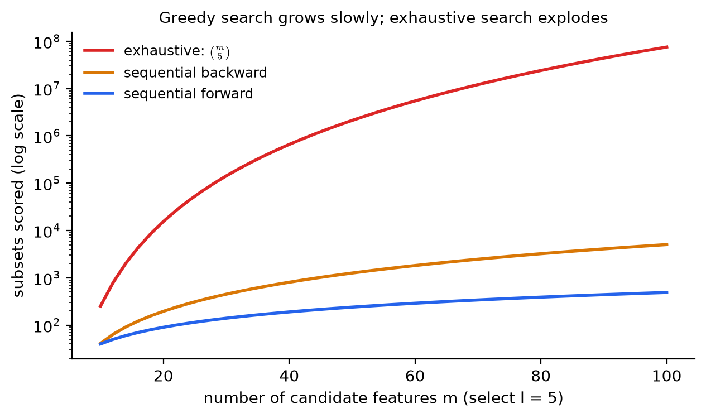
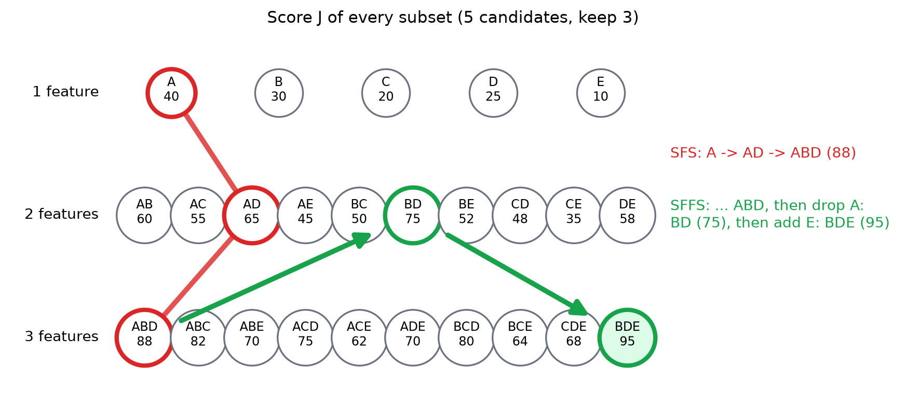
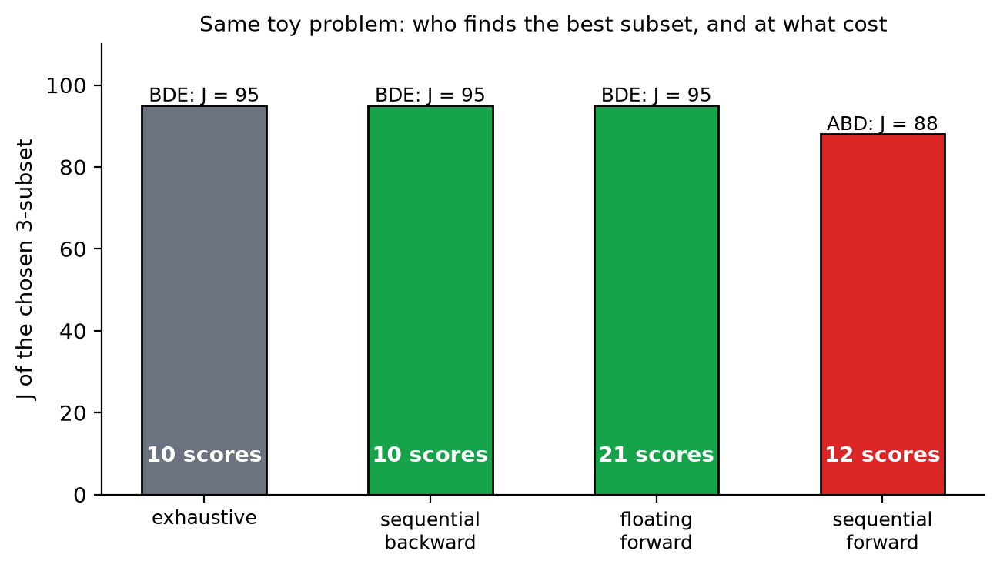

# KP07 特徵搜尋：不能窮舉，怎麼聰明地走

> 程度：大學生（undergrad）
>
> 圖型識別｜特徵選擇單元

## 學習目標

- 逐步執行前向選擇與後向選擇，並說出它們各要評幾組。
- 說明巢狀效應：為什麼這兩個方法一旦決定就不能反悔。
- 用浮動搜尋修正巢狀效應，並說出它仍不保證找到最佳。
- 說明最佳搜尋（分枝定界）需要什麼條件，以及為什麼 wrapper 的驗證誤差不滿足這個條件。
- 依特徵總數、要選的個數與評分成本，選擇適合的搜尋方法。

## KP07 特徵搜尋：不能窮舉，怎麼聰明地走

**一句話重點**：子集太多不能全試，所以每一步只比較一小批：前向是「加一個最好的」，後向是「丟一個最沒用的」，浮動搜尋允許回頭修正。這些都是貪婪的捷徑，不保證最佳。

### 先備與符號

*你需要先會的兩件事*：

- *子集評分*：KP06 的 $J(\mathcal S)$ 可以是 filter 的可分性準則，也可以是 wrapper 的驗證表現；本 KP 不管它怎麼算，只把它當成「給子集一個分數，越大越好」。
- *組合數*：$\binom{m}{l}$ 是從 $m$ 個挑 $l$ 個的方法數。

*符號表*：

| 符號 | 意義 | 說明 |
|---|---|---|
| $m$ | 候選特徵的總數 | 整數 |
| $l$ | 要選出的特徵數 | $l\le m$ |
| $\mathcal S$ | 一組特徵（子集） | 例：$\{A,B,D\}$ |
| $J(\mathcal S)$ | 子集 $\mathcal S$ 的分數 | 越大越好 |
| SFS／SBS／SFFS | 順序前向／後向／浮動前向選擇 | 見各節 |

### 1. 為什麼只能一步一步走

**白話說明**：KP06 算過：$m=20$ 挑 $l=5$ 有 $15{,}504$ 組；$m=100$ 挑 $l=10$ 是 $1.73\times10^{13}$ 組。每一組在 wrapper 下都要訓練一次分類器。窮舉不可能，要用聰明的走法：每一步只評一小批子集。

**例子**：用 $m$ 個候選特徵選 $l$ 個時，三種做法要評分的子集數。窮舉是 $\binom{m}{l}$；前向選擇（SFS）與後向選擇（SBS）的次數是課本給的公式：

$$
\text{SFS}:\ lm-\frac{l(l-1)}{2},\qquad
\text{SBS}:\ 1+\frac{(m+1)m-l(l+1)}{2}.
$$

| $m$ | $l$ | 窮舉 | SFS | SBS |
|---|---|---|---|---|
| 5 | 3 | $10$ | $12$ | $10$ |
| 20 | 5 | $15{,}504$ | $90$ | $196$ |
| 100 | 10 | $17{,}310{,}309{,}456{,}440$ | $955$ | $4{,}996$ |
| 1000 | 20 | 約 $3.4\times10^{41}$ | $19{,}810$ | $500{,}291$ |

特徵很少時（$m=5$），貪婪法並不比窮舉省；特徵一多，差距是天文數字。

圖說 `lec07-kp07-search-f2-cost`：先看紅線：窮舉的次數隨 $m$ 暴增，縱軸是對數刻度，仍然飛快上升；再看橘線與藍線：後向與前向選擇的次數緩慢增加。〔功能：1、2〕



### 2. 前向選擇（SFS）：每次加一個最好的

**白話說明**：從空集合開始。第一步在所有單特徵裡挑最好的。之後每一步，從剩下的特徵裡挑一個，使「已選的加上它」的分數最高，直到選滿 $l$ 個。

**正式定義**：令 $\mathcal S_0=\emptyset$。第 $k$ 步：

$$
x^{+}=\arg\max_{x\notin\mathcal S_{k-1}}J(\mathcal S_{k-1}\cup\{x\}),\qquad
\mathcal S_k=\mathcal S_{k-1}\cup\{x^{+}\}.
$$

**例子**：教學情境：五個候選特徵 $A,B,C,D,E$，要選 3 個。每個子集的分數如下（粗體為最大值；單特徵與部分雙特徵、三特徵的分數來自網頁，其餘為 `[補充]`，補齊時保證「加一個特徵分數不會下降」）：

| 子集大小 | 各子集的 $J$ |
|---|---|
| 1 | $A{:}40,\ B{:}30,\ C{:}20,\ D{:}25,\ E{:}10$ |
| 2 | $AB{:}60,\ AC{:}55,\ AD{:}65,\ AE{:}45,\ BC{:}50,\ BD{:}75,\ BE{:}52,\ CD{:}48,\ CE{:}35,\ DE{:}58$ |
| 3 | $ABC{:}82,\ ABD{:}88,\ ABE{:}70,\ ACD{:}75,\ ACE{:}62,\ ADE{:}70,\ BCD{:}80,\ BCE{:}64,\ CDE{:}68,\ \mathbf{BDE{:}95}$ |
| 4 | $ABCD{:}92,\ ABCE{:}85,\ ABDE{:}97,\ ACDE{:}80,\ BCDE{:}96$ |
| 5 | $ABCDE{:}98$ |

SFS 的每一步：

| 步驟 | 比較的候選 | 最好的 | 選入 |
|---|---|---|---|
| 1 | 單特徵 $A{:}40,B{:}30,C{:}20,D{:}25,E{:}10$ | $A$ | $\{A\}$ |
| 2 | $AB{:}60,\ AC{:}55,\ AD{:}65,\ AE{:}45$ | $AD$ | $\{A,D\}$ |
| 3 | $ABD{:}88,\ ACD{:}75,\ ADE{:}70$ | $ABD$ | $\{A,B,D\}$，$J=88$ |

評分次數：$5+4+3=12$，與公式 $3\cdot5-3=12$ 相符。窮舉會發現最佳是 $\{B,D,E\}$（$J=95$）。SFS 錯過了它。

**巢狀效應**：SFS 的決定是單向的：$A$ 在第一步被選入，之後永遠不會被剔除。但 $A$ 單獨很強，卻和別人搭配得不好；真正最強的 $\{B,D,E\}$ 裡根本沒有 $A$。這種「早期決定鎖死後面」的現象叫**巢狀效應**（nesting effect）。

**常見迷思**：「SFS 每一步都選最好的，所以最後一定最好。」每一步最好，不代表整體最好。

### 3. 後向選擇（SBS）：每次丟一個最沒用的

**白話說明**：反過來，從所有特徵開始。每一步試著丟掉每一個特徵，看丟掉誰之後剩下的分數仍最高，就丟掉誰，直到剩下 $l$ 個。

**例子**（同一張分數表）：

| 步驟 | 丟掉一個後的候選 | 分數最高的 | 丟掉 |
|---|---|---|---|
| 起點 | $ABCDE{:}98$ | — | — |
| 1 | $BCDE{:}96,\ ACDE{:}80,\ ABDE{:}97,\ ABCE{:}85,\ ABCD{:}92$ | $ABDE{:}97$ | $C$ |
| 2 | $BDE{:}95,\ ADE{:}70,\ ABE{:}70,\ ABD{:}88$ | $BDE{:}95$ | $A$ |

SBS 找到了 $\{B,D,E\}$（$J=95$）。評分次數：$1+5+4=10$，與公式 $1+\frac{(5+1)\cdot5-3\cdot4}{2}=10$ 相符。

這個例子裡後向成功、前向失敗，是這組數字的結果，不是通則。後向同樣不能反悔：丟掉的特徵不會再回來。例如若丟掉 $E$ 太早，而 $E$ 要搭配 $B,D$ 才有價值，後向一樣會錯過。

*前向還是後向*：課本指出，要選的個數 $l$ 接近 $m$ 時後向的評分次數較少，$l$ 很小時前向較少。wrapper 還要考慮每次評分的成本：後向一開始就要評大的子集，訓練分類器更貴。

**常見迷思**：「後向一定比前向好。」不一定，只有在 $l$ 接近 $m$ 時比較省，而且同樣有巢狀效應。

### 4. 浮動搜尋（SFFS）：加了之後，回頭看看

**白話說明**：浮動搜尋像 SFS，但每加一個特徵之後，會**回頭檢查**：把已選的某一個拿掉，分數會不會比「同樣大小的歷史最佳」更好？如果會，就拿掉它（這是「後向」的一步），再繼續往前加。它可以反悔，所以能修正巢狀效應。

**正式定義**（浮動前向搜尋，Pudil 提出；課本的步驟 I 到 III）。令 $X_k$ 是目前找到的最佳 $k$ 個特徵，並記住所有較小大小的最佳子集：

1. **加入**：從剩下的特徵選一個 $x$，使 $J(X_k\cup\{x\})$ 最大，得到 $X_{k+1}$。
2. **測試**：找出 $X_{k+1}$ 中拿掉後分數最高的特徵 $x_r$。若 $x_r$ 就是剛加入的那個，回到步驟 1。若拿掉 $x_r$ 後的分數**沒有**超過已記住的最佳 $k$ 個特徵 $X_k$，也回到步驟 1。
3. **剔除**：否則拿掉 $x_r$，更新最佳 $k$ 個特徵，並重複測試，直到不能再改善為止。

用 SFS 做到 2 個特徵起始。演算法在選滿 $l$ 個時結束。

**例子**（同一張分數表，$l=3$）：

| 動作 | 結果子集 | 分數 | 說明 |
|---|---|---|---|
| 前向 | $\{A\}$ | $40$ | 與 SFS 相同 |
| 前向 | $\{A,D\}$ | $65$ | 與 SFS 相同 |
| 前向 | $\{A,B,D\}$ | $88$ | 與 SFS 相同 |
| 測試／剔除 | $\{B,D\}$（拿掉 $A$） | $75$ | 拿掉 $A$ 後的 $75$ 超過歷史最佳 2 個特徵 $\{A,D\}$ 的 $65$，所以剔除 $A$ |
| 前向 | $\{B,D,E\}$ | $95$ | 在 $\{B,D\}$ 之上再加最好的 $E$ |

SFFS 找到全域最佳 $\{B,D,E\}$。程式計數共評分 21 次（含重複評分，比 SFS 的 12 次多）。

圖說 `lec07-kp07-search-f1-subset-lattice`：先看三排圓圈：每個圓圈是一個子集，數字是它的分數 $J$；再看紅線：SFS 的路徑 $A\to AD\to ABD$，停在 88；最後看兩條綠色箭頭：SFFS 先到 $ABD$，剔除 $A$ 回到 $BD$（75），再加 $E$ 到 $BDE$（95，綠底圓圈）。〔功能：1、3〕



*這個例子是刻意設計的。* 課本明確指出：浮動搜尋「不保證找到所有最佳子集」，它只是比單純的前向或後向好，代價是評分更多。

**常見迷思**：「浮動搜尋就是最佳搜尋。」不是。它仍是貪婪法，只是多給了反悔的機會。

### 5. 要保證最佳：單調性與分枝定界

**白話說明**：想要保證找到全域最佳，又不想全部試，需要一個條件：**單調性**。意思是：子集加進新特徵，分數不會下降：

$$
J(x_1,\dots,x_i)\le J(x_1,\dots,x_i,x_{i+1}).
$$

有了單調性，一個子集的分數是它所有子集的上界。搜尋時如果發現某個分支「即使把所有剩下特徵都加進去，上界也低於目前已找到的最好方案」，這整個分支就可以剪掉，不用逐一試。這個方法叫**分枝定界**（branch and bound），課本也提到動態規劃是另一種做法。它能不窮舉就找到最佳，但課本也說：它的複雜度仍高於前面的次佳方法。

*上面的分數表滿足單調性*（所有加特徵的分數都不降），所以適用；我們補數字時特地檢查過這一點。

**但 wrapper 通常不滿足單調性。** 用 KP06 的驗證曲線：特徵越多，驗證誤差先降後升，所以「多加特徵、分數（準確率）不下降」並不成立。filter 的可分性準則（例如 KP05 的 $J_3$）常有單調性，所以分枝定界多半用在 filter。

**常見迷思**：「有了分枝定界就不需要別的方法。」它要求單調性；而且特徵很多時，它仍然太慢。

### 6. 比較與實務

同一個 5 選 3 的問題：

| 方法 | 選出的子集 | $J$ | 評分次數 |
|---|---|---|---|
| 窮舉 | $\{B,D,E\}$ | $95$ | $10$ |
| 後向（SBS） | $\{B,D,E\}$ | $95$ | $10$ |
| 浮動前向（SFFS） | $\{B,D,E\}$ | $95$ | $21$ |
| 前向（SFS） | $\{A,B,D\}$ | $88$ | $12$ |

圖說 `lec07-kp07-search-f3-compare`：先看四根長條的高度：窮舉、後向、浮動前向都到 95；再看最右邊紅色的前向選擇：只有 88；長條裡的白字是各自的評分次數。〔功能：1、2〕



*怎麼選*（經驗法則）：特徵上千個，先用 filter 或前向選擇砍到幾十個；要選的個數很小，用前向；要保留的個數接近總數，用後向；評分成本不高、想要更好的結果，用浮動搜尋；有單調性的準則且特徵不多，才考慮分枝定界。

`[補充]` scikit-learn 提供 `SequentialFeatureSelector`，支援前向與後向（沒有浮動），以交叉驗證當評分。用 KP06 的模擬資料（5 個特徵、選 3 個、線性判別分類器、5 折）：

```python
from sklearn.feature_selection import SequentialFeatureSelector
from sklearn.discriminant_analysis import LinearDiscriminantAnalysis

sfs = SequentialFeatureSelector(LinearDiscriminantAnalysis(), n_features_to_select=3,
                                direction='forward', cv=5)
sfs.fit(X, y)
sfs.get_support()          # 被選中的特徵
```

前向與後向兩個方向都選出 $\{x_2,x_4,x_5\}$，在 4000 筆新資料上的準確率是 $0.89$，與 KP06 驗證選出的 $\{x_1,x_4,x_5\}$ 同一等級（$x_1$ 與 $x_2$ 幾乎重複，互換不影響）。個別分數的 filter 前三名只有 $0.75$。wrapper 式的前向搜尋，因為每一步評的是「加上它之後的整組」，找得到單獨看沒用的 $x_5$。

**常見迷思**：「搜尋方法比評分方法更重要。」兩者缺一不可：評分標準錯了，搜尋再好也只是更有效率地找到錯的答案；第 5 節與 KP06 也說了，連選特徵這件事都要放進驗證裡。

### 延伸：練習與解題示範

**小練習**：

1. $m=50$ 個特徵、選 $l=3$ 個。窮舉、SFS、SBS 各要評分幾次？
2. 三個特徵 $A,B,C$，選 2 個。單特徵：$A{:}30,\ B{:}25,\ C{:}20$。雙特徵：$AB{:}40,\ AC{:}38,\ BC{:}55$。SFS 選出什麼？最佳是什麼？
3. 說明為什麼 wrapper 的驗證準確率通常不滿足單調性。

**題 1 解題示範**：窮舉 $\binom{50}{3}=19{,}600$。SFS：$lm-l(l-1)/2=3\cdot50-3=147$。SBS：$1+\frac{(50+1)\cdot50-3\cdot4}{2}=1+\frac{2538}{2}=1270$。$l$ 很小，前向最省。

**題 2 解題示範**：SFS 第一步選 $A$（30，最高）；第二步比較 $AB{:}40$ 與 $AC{:}38$，選 $AB$，$J=40$。最佳是 $BC{:}55$。這是巢狀效應：$A$ 單獨最強，卻錯過了 $B$ 與 $C$ 的搭配。

**題 3 解題示範**：驗證準確率受兩件事影響：特徵多帶來更多資訊，也帶來更多要估計的參數。KP06 的驗證曲線顯示，特徵多到某個程度後，驗證誤差會回升；也就是「加一個特徵，分數反而下降」是會發生的，單調性不成立。

## 術語與來源

| 中文 | English |
|---|---|
| 順序前向選擇 | Sequential forward selection (SFS) |
| 順序後向選擇 | Sequential backward selection (SBS) |
| 浮動搜尋 | Floating search (SFFS) |
| 巢狀效應 | Nesting effect |
| 貪婪搜尋 | Greedy search |
| 單調性 | Monotonicity |
| 分枝定界 | Branch and bound |
| 組合數 | Number of combinations |
| 次佳搜尋 | Suboptimal search |
| 最佳搜尋 | Optimal search |

來源：教科書 Theodoridis & Koutroumbas, *Pattern Recognition* 第 5 章 §5.7.2（本機 Ch5.pdf）與 CCC-LNS 網頁第 5 章 KP-13；說明、圖與順序為重新撰寫。評分次數公式與浮動搜尋的步驟來自課本，並用程式實作驗證（5 選 3：SFS 12 次、SBS 10 次，與公式相符）。五個候選特徵的單特徵、部分雙特徵與三特徵分數取自網頁的教學情境，其餘 31 個子集中的缺值為 `[補充]`（已檢查單調性無違反）。scikit-learn 示範與驗算為 `[補充]`；所有數字由 `scripts/lec07-kp07-search/compute_data.py` 算出（`reports/lec07-kp07-search/數值驗算.json`）。
