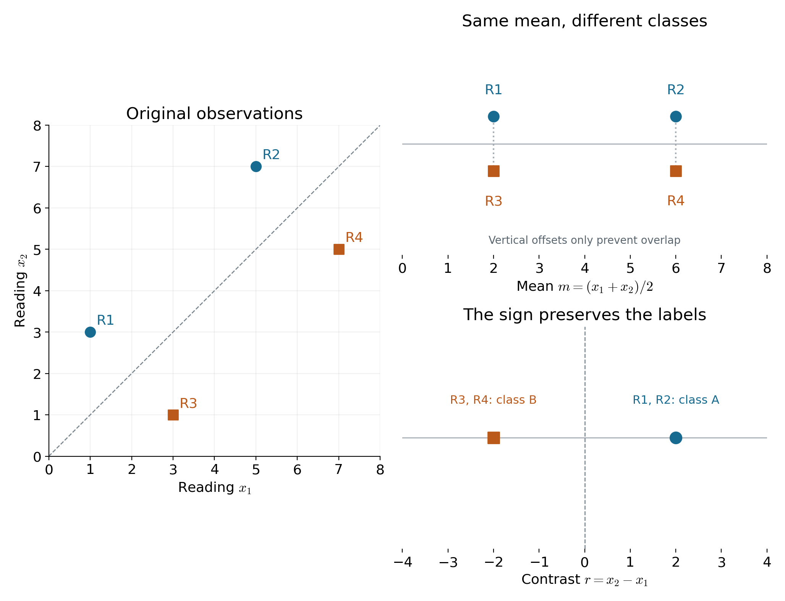
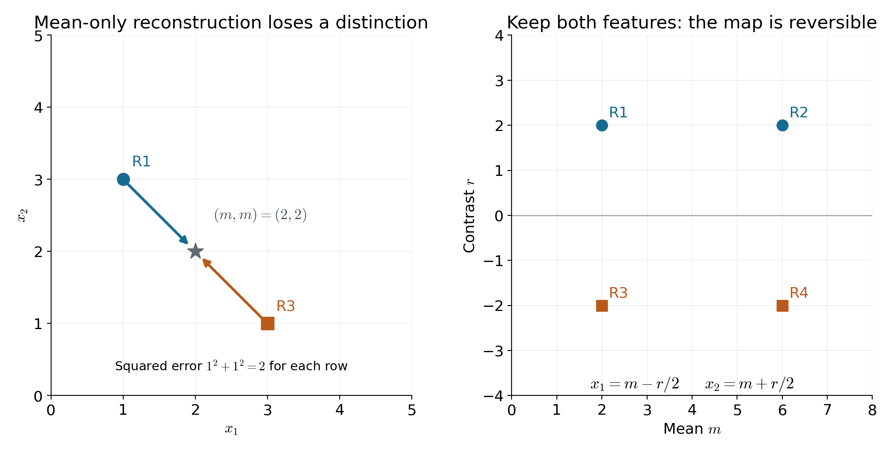
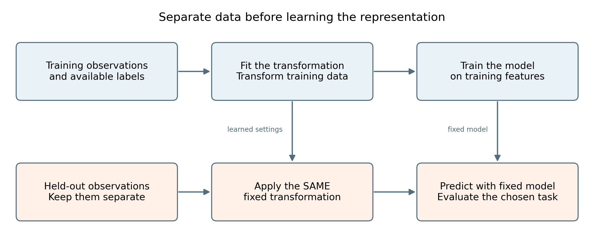

# Lecture 10 · KP01：換特徵前，先決定要保留什麼（Decide what to preserve before generating features）

> 程度：研究生（grad）／Level: Graduate (grad)
>
> 週次：第 10 週（2026-11-09）｜主題：Feature Generation I
>
> Week 10 (2026-11-09) | Topic: Feature Generation I
>
> 對應實作：本講的四筆資料驗算程式
>
> Related implementation: the four-observation verification program below

## 學習目標（Learning objectives）

- 區分原始量測、特徵選取與特徵生成（Distinguish raw measurements, feature selection, and feature generation）。
- 用平均值與差值，說明不同表示保留的資訊（Explain what mean and contrast features preserve）。
- 以重建與分類兩種目標，判斷同一表示的限制（Assess a representation using reconstruction and classification objectives）。
- 說明降維不保證提高辨識能力，並提出合理的驗證方式（Explain why dimension reduction need not improve recognition, and propose appropriate evaluation）。

## KP01：特徵要保留任務需要的資訊（Features should preserve task-relevant information）

**一句話重點**：先說清楚要完成的任務，再決定新特徵要保留哪些差異。較少的數字、較小的重建誤差，都不能單獨保證分類更好。

**One-sentence summary**: Define the task before choosing which differences new features should preserve. Fewer numbers and smaller reconstruction errors alone do not guarantee better classification.

### 1. 資料已有數字，為什麼還要換表示（Why change data that are already numerical?）

你已學過用分類器判斷類別。
但分類器收到什麼數字，同樣影響結果。
照片的像素、感測器的讀值，都只是最初的量測。
我們還要決定如何把它們交給後續方法。

You have learned to predict labels with classifiers.
The numbers a classifier receives also influence its behavior.
Image pixels and sensor readings are initial measurements.
We must still decide how to represent them for later processing.

**原始量測**：直接從資料或儀器取得的數值。
**特徵**是交給後續方法、用來描述資料的量。
兩者有時相同，也可以經過計算才得到特徵。

**Raw measurements**: values obtained directly from data or instruments.
A **feature** describes an observation for a later method.
A feature can equal a raw measurement or result from a calculation.

**特徵向量**：依固定順序排列的多個特徵。
**維度**是這個向量包含的座標數。
順序與每個座標的意義，都要保持一致。

**Feature vector**: multiple features arranged in a fixed order.
Its **dimension** is the number of coordinates.
Both the order and the meaning of each coordinate must remain consistent.

先用幾個小題找回必要先備。
它們不要求你先懂矩陣分解。

Use these short checks to review the prerequisites.
They do not require matrix decompositions.

- 有序資料：$(1,3)^T$ 與 $(3,1)^T$ 是否相同？不是，兩個讀值的位置不同（Ordered observations: they differ because the entries change positions）。
- 平均值：$1$ 與 $3$ 的平均是多少？答案是 $2$（Arithmetic mean: the answer is $2$）。
- 有號差值：第二個讀值減第一個讀值是多少？答案是 $2$；反過來則是 $-2$（Signed difference: reversing the subtraction changes its sign）。
- 類別標記：A、B 是本例要判斷的答案，不能直接當成已知輸入（Class labels: A and B are prediction targets, not known input features）。

以下符號只用來描述輸入與輸出。
上標 $T$ 表示把橫排數字轉成欄向量。

The following symbols describe inputs and outputs.
The superscript $T$ turns a row of numbers into a column vector.

| 符號 | 中文意義與維度 | English meaning and dimension |
|---|---|---|
| $\mathbf{x}$、$x_j$ | 原始量測向量及第 $j$ 個讀值 | Raw observation vector and its entry $j$ |
| $D$ | 原始量測的座標數 | Number of raw coordinates |
| $f$ | 將原始量測轉成新特徵的規則 | Rule mapping measurements to new features |
| $\mathbf{z}$、$q$ | 新特徵向量及其座標數 | Generated feature vector and its dimension |
| $m$ | 兩個可比較讀值的平均 | Mean of two comparable readings |
| $r$ | 第二個讀值減第一個讀值 | Contrast: second reading minus first |
| $\hat x_1,\hat x_2$ | 從保留特徵估回的兩個讀值 | Reconstructed readings from retained features |
| $E$ | 單筆資料兩個重建差異的平方和 | Sum of squared reconstruction differences for one observation |

**白話說明**：表示方式像一份為任務整理的摘要。
摘要可以保留重點，也可能刪掉關鍵線索。
這個比喻只說明資訊取捨，不表示數值運算理解文字語意。

**Plain explanation**: a representation resembles a summary prepared for a task.
A summary can retain useful evidence or omit an essential clue.
This analogy concerns information selection, not numerical operations understanding language.

### 2. 挑原欄位與算新欄位，做的是不同操作（Selecting columns and generating features）

既然表示可以改變，最簡單的做法是挑幾個原讀值。
這叫做**特徵選取**。
若將讀值組合成新的量，則是**特徵生成**。
先分清這兩個操作，才能說明後續方法做了什麼。

One simple change retains selected original readings.
This is **feature selection**.
Combining readings into new quantities is **feature generation**.
Distinguishing these operations clarifies what a later method actually changes.

**正式定義**：特徵生成以規則 $f$，把原始向量換成新特徵向量。
這個規則可以事先指定，也可以從資料學得。

**Formal definition**: feature generation applies a rule $f$ to produce a new feature vector from the original observation.
The rule can be specified beforehand or learned from data.

記號 $\mathbb{R}^{D}$ 表示由 $D$ 個實數組成的向量空間。
下式左側描述輸入，右側描述生成的表示。

The notation $\mathbb{R}^{D}$ denotes vectors with $D$ real entries.
The expression below describes the input on the left and its generated representation on the right.

$$
\mathbf{x}\in\mathbb{R}^{D},\qquad
\mathbf{z}=f(\mathbf{x})\in\mathbb{R}^{q}.
$$

當 $q<D$，輸出使用較少座標，稱為**降維**。
特徵生成本身沒有要求輸出一定比較少。

When $q<D$, fewer coordinates are used; this is **dimensionality reduction**.
Feature generation itself does not require fewer output coordinates.

先拿 $\mathbf{x}=(1,3)^T$ 看幾種操作。
下表所有數字都是 `[補充]` 的教學設定。
它們不來自真實感測實驗。

Consider several operations on $\mathbf{x}=(1,3)^T$.
All values below form an `[Added]` teaching example.
They do not come from a real sensor experiment.

| 操作 | 本例輸出 | 中文解釋 | English explanation |
|---|---|---|---|
| 保留 $x_1$ | $1$ | 選取原來的一個座標 | Select one original coordinate |
| 算平均 $(x_1+x_2)/2$ | $2$ | 組合兩個讀值，產生一個新特徵 | Generate one feature from both readings |
| 同時算平均與差值 | $(2,2)^T$ | 新表示仍有兩個座標 | Generate two coordinates; dimension remains two |
| 保留兩欄再加乘積 | $(1,3,3)^T$ | 多一個生成座標，輸出維度變大 | Add a product feature; output dimension increases |

最後一列只是用來釐清定義。
本章接下來主要研究低維表示。
但不能把「特徵生成」與「降維」當成完全相同的詞。

The last row clarifies the definition.
The coming chapter primarily studies lower-dimensional representations.
Nevertheless, feature generation and dimensionality reduction are not identical terms.

### 3. 同一組資料可以保留平均，也可以保留差異（Mean and contrast preserve different information）

操作已經分清楚，現在看它們留下什麼。
以下四筆資料各有兩個可比較的讀值。
我們刻意設計 A、B 的差異，方便你驗算。
類別由第二個讀值比第一個高或低來區分。

With the operations distinguished, examine what they retain.
Each of the following four observations has two comparable readings.
The difference between A and B is deliberately constructed for verification.
Their labels depend on whether the second reading exceeds the first.

**例子**：R1–R4 是資料識別碼。
兩欄使用相同尺度，這裡可以直接相加與相減。
真實資料若單位不同，必須先處理尺度問題。

**Example**: R1–R4 identify observations.
The two readings share a scale, so addition and subtraction are meaningful here.
Real measurements with different units require attention to scaling first.

$$
m=\frac{x_1+x_2}{2},\qquad r=x_2-x_1.
$$

| Record | $x_1$ | $x_2$ | Class | Mean $m$ | Contrast $r$ |
|---|---:|---:|---|---:|---:|
| R1 | 1 | 3 | A | 2 | 2 |
| R2 | 5 | 7 | A | 6 | 2 |
| R3 | 3 | 1 | B | 2 | -2 |
| R4 | 7 | 5 | B | 6 | -2 |

以 R1 為例，兩個運算都只需要代入已知讀值。
平均描述共同水準，差值描述兩欄的相對高低。

For R1, substitute its known readings into both formulas.
The mean describes the shared level, while the contrast describes their relative ordering.

$$
m=\frac{1+3}{2}=2,\qquad r=3-1=2.
$$

R1 與 R3 的平均同樣是 $2$。
若只傳出平均值，就不能知道原來是哪一筆。
它們的類別卻不同，因此平均值也刪掉了分類所需的線索。

R1 and R3 both have mean $2$.
Sending only the mean does not identify which observation was present.
Their labels differ, so the mean also removes evidence required for this classification task.

差值則讓 A 都出現在 $2$，B 都出現在 $-2$。
看差值的正負，就能區分這四筆的標記。
但同類別中的 R1 與 R2 仍被合併了。
所以它保留類別差異，沒有保留全部原始資訊。

The contrast places A at $2$ and B at $-2$.
Its sign distinguishes the labels of these four observations.
However, it still merges R1 and R2 within the same class.
It preserves their class difference without preserving every original detail.



圖說 `lec10-kp01-task-relevant-features`：先看左圖四筆原讀值，再看右上圖相同平均值如何合併不同類別，最後看右下圖差值的正負。位置由表中的實際數值決定；藍色圓點為 A，橙色方點為 B。右上圖上下錯開只為避免遮住標記，不是另一個輸入特徵；右下圖用識別碼列出合併的資料。〔功能：1、2〕

Caption `lec10-kp01-task-relevant-features`: First inspect the raw observations on the left, equal means at upper right, and signed contrasts at lower right. Positions use the table values. Blue circles are A; orange squares are B. Upper-right vertical offsets only prevent overlap; they are not another feature. Lower-right identifiers show merged observations. [Function: 1, 2]

這是一個刻意構造的小例子。
它說明表示如何丟掉差異，沒有估計真實分類器的泛化能力。
原始數字較多，也不表示實際模型一定會表現較差。

This is a deliberately constructed small example.
It demonstrates lost distinctions, not the generalization performance of a real classifier.
More original coordinates also do not imply that a practical model necessarily performs worse.

### 4. 能重建得接近，不代表任務線索都還在（Reconstruction quality and task evidence）

平均與差值保留的內容不同。
如果兩個都保留，能不能還原原資料？
先把兩式聯立，就能回答。

Mean and contrast retain different information.
Can both together recover the original observation?
Solve their two defining equations to find out.

$$
2m=x_1+x_2,\qquad r=x_2-x_1.
$$

第一式加第二式，得到 $2m+r=2x_2$。
第一式減第二式，得到 $2m-r=2x_1$。
兩側各除以 $2$，便得到反向計算方式。

Adding the equations gives $2m+r=2x_2$.
Subtracting the second from the first gives $2m-r=2x_1$.
Dividing by $2$ yields the inverse calculation.

$$
x_1=m-\frac r2,\qquad x_2=m+\frac r2.
$$

R1 保留的兩個數字是 $m=2$、$r=2$。
反算後得到 $x_1=2-1=1$、$x_2=2+1=3$。
維度仍是 $2$，但描述方式已經改變。

R1 retains $m=2$ and $r=2$.
The inverse gives $x_1=2-1=1$ and $x_2=2+1=3$.
The dimension remains $2$, although the description changes.

現在只保留平均值，並暫用兩欄相等來重建。
這是我們明訂的近似規則，不是唯一可能的重建方式。
R1 與 R3 都會被估回 $(2,2)^T$。

Now retain only the mean and reconstruct using equal readings.
This is an explicitly chosen approximation rule, not the only possible reconstruction rule.
Both R1 and R3 are estimated as $(2,2)^T$.

**重建誤差**：比較原資料與估回資料的差異。
本例使用兩個差異的平方和。
它衡量讀值是否接近，沒有直接衡量類別是否保留。

**Reconstruction error**: a measure of differences between an observation and its reconstruction.
Here we add the squared differences of the two readings.
This measures numerical closeness, not label preservation directly.

$$
\hat x_1=\hat x_2=m,\qquad
E=(x_1-\hat x_1)^2+(x_2-\hat x_2)^2.
$$

R1 的誤差如下。
R3 的兩個差異正負相反，平方和仍相同。

The error for R1 is calculated below.
R3 reverses the signs of the differences but has the same squared error.

$$
E_{mathrm{R1}}=(1-2)^2+(3-2)^2=1+1=2.
$$

四筆的誤差都為 $2$，總和為 $8$。
即使重建只偏離這些小差異，類別線索已經完全合併。
我們不替 $2$ 任意貼上「夠小」的標準。
能否接受，要回到任務與量測尺度判斷。

Each observation has squared error $2$, giving a total of $8$.
Despite these limited numerical changes, the differing labels collapse onto identical means.
We do not declare $2$ to be an acceptable error by itself.
Acceptability depends on the task and measurement scale.



圖說 `lec10-kp01-reconstruction`：先看左圖 R1、R3 如何被同一個重建點取代，再看右圖同時保留平均與差值後的位置。左右座標定義不同，不能把紙面距離直接當成相同誤差。右圖保留了反算兩欄所需的數字；左圖的重建規則已明訂為 $(m,m)$。〔功能：1、2、3〕

Caption `lec10-kp01-reconstruction`: First see R1 and R3 replaced by the same reconstruction, then inspect their mean-plus-contrast coordinates. The axes differ, so paper distances are not directly comparable errors. The right retains enough numbers for inversion. The left explicitly uses the reconstruction rule $(m,m)$. [Function: 1, 2, 3]

**常見迷思**：只要丟掉的變化小，就不影響分類？
本例的答案是否定的。
兩欄間的相對高低，剛好就是要判斷的線索。
這也是學降維前，必須先說明目標的原因。

**Common misconception**: can small discarded variation be assumed irrelevant to classification?
This example shows otherwise.
The relative ordering of the readings is precisely the required evidence.
That is why objectives must be stated before reducing dimensions.

### 5. 依任務定義要保留的關係（Defining preservation according to the task）

反例已經指出，單一誤差不能代表全部目標。
現在把常見任務分開看。
每個任務都要說清楚，哪種關係不能隨意改變。

The counterexample shows that one error measure cannot represent every objective.
Separate the common tasks below.
Each must specify which relationships should remain intact.

**測試資料**：為最後評估保留、未參與學習與選擇的資料。
它能用來檢查方法是否也適用於未用過的觀察。

**Test data**: observations reserved for final evaluation, without influencing learning or selection.
They help assess whether a method works on unused observations.

| 任務 | 主要想保留什麼 | 可以怎麼檢查 | English explanation |
|---|---|---|---|
| 壓縮與重建 | 能估回原始資料的數值結構 | 檢查重建誤差與所需儲存量 | Assess reconstruction loss and storage |
| 分類與辨識 | 有助於區分類別的差異 | 在保留的測試資料上比較辨識結果 | Evaluate discrimination on held-out observations |
| 資料視覺化 | 預先選定的距離、鄰近或整體形狀關係 | 檢查指定關係是否被扭曲 | Inspect the chosen geometric relationships |
| 相似資料檢索 | 與應用相關的相似性 | 檢查找回的資料是否符合需求 | Assess whether retrieved observations meet the intended notion of similarity |

高維資料常有共同變化與重複量測。
適合的表示可以減少冗餘，也可能減輕後續計算負擔。
但轉換本身也有成本，效果必須量測。
降低維度並不保證分類、視覺化與檢索同時改善。

High-dimensional observations often contain shared variation and repeated measurements.
A suitable representation can reduce redundancy and may reduce later computational work.
The transformation itself also has a cost, so its benefits must be measured.
Reducing dimension does not guarantee simultaneous improvements in classification, visualization, and retrieval.

**想深入**：資訊是否遺失，也取決於資料落在哪裡。
若兩欄永遠相等，只留平均便可精確還原。
但本例兩欄並非相等，所以同一平均值對應多筆資料。
不能把特定資料的可逆性，當成對所有資料的保證。

**Going deeper**: information loss also depends on where observations occur.
If both readings always agree, the mean alone reconstructs them exactly.
Our readings differ, so one mean corresponds to multiple observations.
Reversibility for restricted data does not guarantee reversibility for every possible observation.

### 6. 本章的方法各自強調不同的表示條件（Different methods emphasize different constraints）

任務目標已經分清楚，接著才適合比較方法。
本章從換座標開始，再研究如何選擇方向與處理彎曲資料。
下表是本次講義的閱讀路線，不要求你現在就會推導。

With task objectives established, methods can be meaningfully compared.
The chapter starts with coordinate changes, then examines direction selection and curved data.
This table maps the selected lectures; their derivations are introduced later.

| 單元 | 方法或問題 | 本章要建立的理解 | English learning focus |
|---|---|---|---|
| KP01 | 特徵生成動機 | 先決定要保留什麼 | Decide what to preserve |
| KP02 | 基底與投影 | 用一組方向的係數描述並重建資料 | Describe and reconstruct data using directional coefficients |
| KP03 | 主成分分析 PCA／KLT | 從整批資料選擇主要變化方向 | Learn directions of large data variation |
| KP04 | 奇異值分解 SVD | 用矩陣分解理解低秩近似及 PCA 計算 | Relate matrix decomposition, low-rank approximation, and PCA |
| KP05 | 非負矩陣分解 NMF | 在非負限制下組合成分 | Build representations under nonnegative constraints |
| KP06 | 流形假設 | 資料可能沿著彎曲的低維形狀變化 | Recognize curved lower-dimensional structure |
| KP07 | 核主成分分析 Kernel PCA | 透過相似度計算建立非線性表示 | Construct nonlinear representations using kernel similarities |
| KP08 | Laplacian Eigenmaps | 用資料點與鄰接關係構成的圖保留局部鄰近 | Preserve local neighborhoods with a data graph |
| KP09 | LLE 與 ISOMAP | 分別重視鄰居重建關係與沿資料形狀的距離 | Compare neighbor reconstruction and distances along the data geometry |

這些名稱不是同一層次的互斥分類。
例如，非線性方法也可能從資料學出表示。
學得的基底不必一律正交，非負限制也不保證唯一的部件解釋。
詳細條件會在對應講義中逐一檢查。

These names do not form a mutually exclusive taxonomy at one level.
For example, a nonlinear representation can also be learned from data.
Learned bases need not be orthogonal, and nonnegativity does not guarantee unique interpretable parts.
The corresponding lectures examine the precise conditions.

### 7. 要驗證新表示，先保留未參與選擇的資料（Evaluating a representation without reusing test evidence）

方法的目標不同，驗證也要配合。
若要評估辨識能力，不能只看剛才的四筆示範。
要保留未參與學習與方法選擇的資料，再檢查表現。

Evaluation must match the method's objective.
Recognition performance cannot be established using only the four illustrative observations.
Reserve observations that did not influence learning or method selection, then evaluate the result.

**訓練資料**：用來估計表示規則或模型設定的資料。
前面定義的測試資料，則保留到最後評估。
**資料洩漏**是把評估時應保留的資訊提前用於選擇或學習。

**Training data**: observations used to estimate a representation or model settings.
The test data defined earlier remain reserved for final evaluation.
**Data leakage** occurs when information reserved for evaluation influences selection or learning beforehand.

本例的平均與差值公式是事先指定的，沒有估計參數。
PCA 等方法則需要從資料學習方向。
這些方向必須用訓練資料估計，再固定套到測試資料。
若需要選參數，可在訓練資料內另外安排驗證。

Our mean and contrast formulas are fixed beforehand and estimate no parameters.
Methods such as PCA learn directions from observations.
Estimate these directions using training data, then apply the fixed transformation to test observations.
Parameter selection can use a separate validation procedure within the training data.



圖說 `lec10-kp01-training-protocol`：先沿上排看訓練資料如何決定表示與模型，再沿下排看保留資料如何使用固定設定。向下箭頭傳遞已學得的設定，不傳回測試資料來修改上排。這是 `[補充]` 的驗證流程示意，不是四筆範例的實驗結果。〔功能：1〕

Caption `lec10-kp01-training-protocol`: First follow the training path above, then the held-out path using fixed settings below. Downward arrows pass learned settings; test observations do not feed back into training. This `[Added]` diagram describes an evaluation protocol, not results from the four-observation example. [Function: 1]

這個流程只能讓比較更可信，不能保證任一方法一定較好。
還要核對資料來源、任務、尺度與評估指標。
圖形看起來漂亮，也不能取代這些檢查。

This protocol makes comparisons more credible without guaranteeing that a particular method is better.
Data provenance, task, scale, and evaluation criteria still require scrutiny.
An attractive plot does not replace those checks.

### 8. 用程式核對同一組資料（Verifying the same observations in code）

先用手算理解資訊取捨，再用程式檢查所有資料。
NumPy 是 Python 的陣列運算工具。
本程式每行放一筆資料，每欄放一個原始讀值。
類別標記只用來理解任務，不放進特徵運算。

Understand the information trade-off by hand, then verify every observation in code.
NumPy provides array operations in Python.
Here, rows are observations and columns are original readings.
Labels clarify the task but are not inputs to the feature calculations.

```python
import numpy as np

X = np.array([[1., 3.], [5., 7.], [3., 1.], [7., 5.]])
mean = X.mean(axis=1)
contrast = X[:, 1] - X[:, 0]
features = np.column_stack((mean, contrast))
recovered = np.column_stack((mean - contrast/2, mean + contrast/2))
approximation = np.column_stack((mean, mean))
error_per_row = ((X - approximation)**2).sum(axis=1)
print(features)
print(np.allclose(recovered, X))
print(error_per_row, error_per_row.sum())
```

第一個輸出列出每筆的平均與差值。
第二個輸出為 `True`，表示兩個特徵可以還原本例資料。
最後一行列出各筆與整批的重建平方誤差。

The first output lists each observation's mean and contrast.
The second is `True`, confirming exact recovery for this example.
The last line reports per-observation and total squared reconstruction errors.

```text
[[ 2.  2.]
 [ 6.  2.]
 [ 2. -2.]
 [ 6. -2.]]
True
[2. 2. 2. 2.] 8.0
```

程式中的 `axis=1` 表示沿每行的兩個讀值計算。
`np.allclose` 以容許誤差比較浮點數。
這段程式只驗證特徵與重建，沒有訓練分類器。

The `axis=1` argument performs the calculation over the two readings in each row.
The function `np.allclose` compares floating-point values with a tolerance.
This program verifies features and reconstruction; it does not train a classifier.

### 9. 小練習：說出保留與失去的內容（Practice: identify what is retained and lost）

**小練習**：先回答，再閱讀後面的解題示範。
答案除了數字，也要說明所用的判準。

**Practice**: attempt the questions before reading the worked solutions.
Explain the criterion behind each answer as well as any numerical result.

1. 輸入有兩個讀值。只保留 $x_1$、同時保留 $(m,r)$、加入乘積後保留 $(x_1,x_2,x_1x_2)$，各是幾維？哪些是降維（Find each output dimension and identify dimensionality reduction）。
2. 對 R3 計算平均、差值，並用兩者還原讀值。若只留平均並用 $(m,m)$ 重建，平方誤差是多少（Compute and invert both features for R3, then find the mean-only squared reconstruction error）。
3. 只看到平均值 $2$，能否決定類別是 A 還是 B？請指出表中證據（Can mean $2$ determine class A or B? Cite evidence from the table）。
4. 先用全部資料選出降維方向，再將資料分成訓練與測試兩份，這樣是否能保證公平評估？如何修正（Does learning directions before splitting guarantee fair evaluation? Explain the correction）。

### 10. 解題示範：讓每個結論都有依據（Worked solutions with explicit evidence）

**題 1 解題示範**：三種輸出維度依序為 $1$、$2$、$3$。
原始維度是 $2$，因此只有第一種降低維度。
第二種換了表示，第三種增加了一個生成特徵。

**Question 1 worked solution**: the output dimensions are $1$, $2$, and $3$.
The original dimension is $2$, so only the first reduces it.
The second changes the representation, while the third adds a generated feature.

**題 2 解題示範**：R3 的兩個讀值是 $3$ 與 $1$。
差值為負，反算時必須保留這個負號。

**Question 2 worked solution**: R3 has readings $3$ and $1$.
Its contrast is negative, and the inverse calculation must preserve that sign.

$$
m=\frac{3+1}{2}=2,\qquad r=1-3=-2,
$$

$$
x_1=2-\frac{-2}{2}=3,\qquad
x_2=2+\frac{-2}{2}=1.
$$

只留平均時，兩欄都重建為 $2$。
平方誤差如下，與 R1 相同。

With only the mean, both readings are reconstructed as $2$.
Its squared error equals that of R1, as calculated below.

$$
E_{mathrm{R3}}=(3-2)^2+(1-2)^2=1+1=2.
$$

**題 3 解題示範**：不能決定。
R1 的平均為 $2$、類別為 A。
R3 的平均也為 $2$、類別卻為 B。
同一個已保留特徵對應不同答案，關鍵差異已經丟失。

**Question 3 worked solution**: the mean does not determine the label.
R1 has mean $2$ and label A.
R3 also has mean $2$, but its label is B.
One retained feature value corresponds to conflicting targets, demonstrating lost evidence.

**題 4 解題示範**：不能保證。
測試資料已提前影響降維方向，這是資料洩漏。
應先分開資料，再只用訓練部分學習方向。
最後用固定方向處理測試資料，評估相同任務。

**Question 4 worked solution**: the procedure does not guarantee fair evaluation.
Test observations have already influenced the directions, creating data leakage.
Split first, then learn directions using only the training portion.
Apply the fixed directions to test observations and evaluate the intended task.

## 小結與下一步（Summary and next step）

- 特徵選取挑原座標；特徵生成計算新表示（Feature selection retains original coordinates; generation computes a new representation）。
- 是否降維，要比較輸入與輸出的座標數（Determine dimensionality reduction by comparing input and output dimensions）。
- 重建、分類、視覺化與檢索，可能需要保留不同資訊（Reconstruction, classification, visualization, and retrieval can require different information）。
- 保留未參與選擇的資料，才能較可信地檢查效果（Held-out observations support more credible evaluation）。

本例的平均與差值，是兩種新的量測方式。
接下來要把「沿不同方向量資料」寫成統一的形式。
這組方向稱為基底。

Our mean and contrast are two new ways to measure an observation.
Next, express directional measurements in one common framework.
A set of such directions forms a basis.

它如何產生座標，又如何重建資料？
接續閱讀 [KP02 基底、投影與重建](lec10-kp02-basis-projection.md)。

How does a basis produce coordinates and reconstruct data?
Continue with [KP02: basis, projection, and reconstruction](lec10-kp02-basis-projection.md).

## 術語表（Glossary）

| 中文術語 | English term | 中文意義 | English meaning |
|---|---|---|---|
| 原始量測 | Raw measurement | 最初取得的讀值 | Initially observed value |
| 特徵 | Feature | 描述資料、交給後續方法的量 | Quantity describing an observation for later processing |
| 特徵向量 | Feature vector | 依固定順序排列的特徵 | Features in a fixed order |
| 維度 | Dimension | 表示使用的座標數 | Number of coordinates |
| 特徵選取 | Feature selection | 保留部分原座標 | Retaining selected original coordinates |
| 特徵生成 | Feature generation | 以規則產生新表示 | Mapping observations to a new representation |
| 降維 | Dimensionality reduction | 用較少座標表示資料 | Using fewer coordinates |
| 重建誤差 | Reconstruction error | 原資料與重建資料的差異指標 | Difference between original and reconstructed data |
| 訓練資料 | Training data | 用於估計表示或模型設定的資料 | Observations used to estimate a representation or model |
| 測試資料 | Test data | 用於最後評估的保留資料 | Observations reserved for final evaluation |
| 資料洩漏 | Data leakage | 評估資訊提前影響學習或選擇 | Reserved evaluation information influencing learning or selection |
| 基底 | Basis | 用來描述資料的量測方向組 | Directions used to represent observations |
| 主成分分析 | Principal component analysis, PCA / KLT | 由資料變異選取方向，於 KP03 展開 | Directions selected by variation, developed in KP03 |
| 奇異值分解 | Singular value decomposition, SVD | 矩陣分解與低秩近似，於 KP04 展開 | Matrix decomposition and low-rank approximation, developed in KP04 |
| 非負矩陣分解 | Nonnegative matrix factorization, NMF | 在非負限制下建立表示，於 KP05 展開 | Representation under nonnegative constraints, developed in KP05 |
| 局部線性嵌入 | Locally linear embedding, LLE | 保留鄰居重建關係，於 KP09 展開 | Preserving neighbor reconstruction, developed in KP09 |
| 等距映射 | ISOMAP | 以沿資料形狀的距離建立表示，於 KP09 展開 | Embedding using distances along data geometry, developed in KP09 |
| NumPy | NumPy | 本講使用的 Python 陣列運算工具 | Python array library used in this lecture |

## 延伸閱讀與來源（Further reading and sources）

- 課程來源：[Feature Generation I，§6.1 特徵生成與降維動機](https://ndhuccc.github.io/CCC-LNS/PR_115/Ch06-feature-generation-i/index.html#kp1)，讀取日期 2026-11-06（Course source: §6.1, accessed 2026-11-06）。
- 教科書：Theodoridis 與 Koutroumbas，*Pattern Recognition*，第 4 版，Feature Generation I 相關章節；書目見[參考資料](../references/README.md)（Textbook reference: the corresponding Feature Generation I chapter; see the bibliography）。

本講依來源概念重新撰寫。
四筆資料、反向計算、圖解、程式、練習與驗證流程，都是 `[補充]` 教學設計。

This lecture independently explains the source concepts.
The observations, inverse calculation, diagrams, code, exercises, and evaluation protocol are `[Added]` teaching material.

來源中的方法介紹依本次核准單元整理；其他方法的細節不在本講展開。
所有算例另用程式核對，不把構造資料的結果當成實證效能。

The method map follows the approved units, with other methods left outside this lecture's scope.
All calculations are checked in code; constructed examples are not empirical performance evidence.
